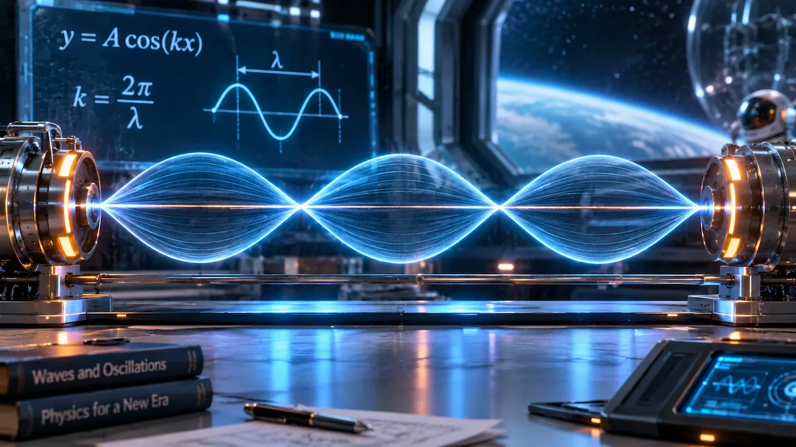
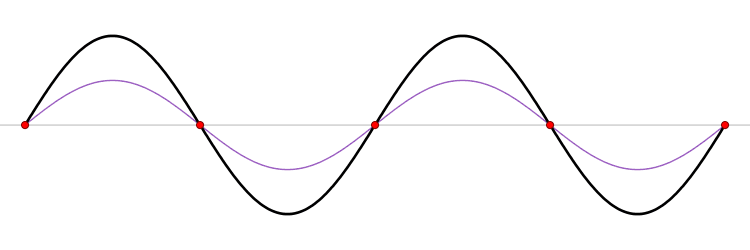

# Onde stationnaire et onde progressive a une dimension

<figure style="max-width: 900px; margin: auto; text-align: center;">

<figcaption>L'onde stationnaire ne bouge pas... mais elle n'en est pas moins spectaculaire</figcaption>
</figure>

## Onde stationnaire

C'est une onde de la forme :

$$y = A \sin(kx)$$

ou

$$y = A \cos(kx)$$

Cette onde ne se déplace pas. Par exemple ses maximums et ses minimums restent à la même place. Pensez à une corde de guitare que vous pincez. Les 2 extrémités sont fixes. Ci-dessous une illustration que l'on trouve sur [Wikipedia](https://fr.wikipedia.org/wiki/Onde_stationnaire)

Ici $$A$$ est simplement l'amplitude maximum. Dans la suite on va dire qu'elle vaut 1.

La question qui se pose maintenant, c'est : **mais c'est quoi ce $$k$$?**

On appelle **longueur d'onde** $$\lambda$$ la distance entre 2 points identiques successifs sur l'onde. Par exemple, prenez 2 points rouges successifs sur l'onde ci-dessus. On sait que $$\cos()$$ et $$\sin()$$ ont une période de $$2\pi$$ donc on pourrait se dire que la distance entre 2 points c'est $$2\pi$$.

Nan... ça ne marche pas. Imaginez qu'on pince une corde de guitare. Il y a aucune raison pour que les nœuds et les ventres de l'onde soient espacés de 3.14 (et puis d'abord, on ne sait même pas si ce sont des mètres ou des centimètres).

Ce que l'on va faire c'est qu'on va faire une règle de trois et on va dire : Si je mesure $$\lambda$$ cm entre 2 nœuds successifs sur la corde alors tout se passe comme si je parcourais $$2\pi$$ radians. Pour faire la règle de 3 on se retrouve à compléter le tableau suivant :

| $$\lambda$$ (cm) | $$2\pi$$ (radians) |
|:---:|:---:|
| x | ?? |

Je cherche "??". Sur la première ligne, pour passer de $$\lambda$$ à $$2\pi$$, je divise par $$\lambda$$ et je multiplie par $$2\pi$$. Autrement dit :

$$?? = \frac{x}{\lambda} * 2 \pi$$

Donc

$$k = \frac{2*\pi}{\lambda} $$

Finalement une onde stationnaire est donc une fonction de la forme :

$$y = \cos(\frac{2*\pi*x}{\lambda})$$

On "voit" que si $$x$$ vaut $$\lambda$$ alors l'intérieur de la parenthèse vaut $$2\pi$$ et on retombe sur un nœud. De même si x vaut $$n \lambda$$ (un nombre entier de fois $$\lambda$$) il en est de même.

Maintenant si on nous donne une fonction de la forme :

$$y = \cos(\frac{\pi*x}{3*\lambda})$$

Histoire d'y retrouver mes petits je peux toujours écrire

$$y = \cos(\frac{2 \pi x}{6 \lambda})$$

$$y = \cos(\frac{2 \pi \frac{x}{6}}{ \lambda})$$

Je "vois" alors que j'ai affaire à une fonction dans laquelle $$\frac{x}{6}$$ doit parcourir $$2\pi$$ pour retrouver un point identique. Donc $$x$$ doit parcourir $$12 \pi$$ avant de retrouver un point similaire.

La longueur d'onde de la nouvelle fonction est donc $$12 \pi$$ c'est à dire 6 fois plus grande que la précédente.

## Onde progressive

L'équation de l'onde est de la forme

$$y = A \cos(kx - \omega t)$$

On peut se demander ce qui caractérise les maximums. En fait se sont les points tels que

$$kx - \omega t = 0$$

$$\frac{x}{t} = \frac{\omega}{k}$$

Si on se rappelle que $$x$$ est une distance (en m par exemple) et que $$t$$ est un temps alors $$\frac{x}{t}$$ est une vitesse. C'est même la vitesse de propagation de l'onde. On a donc :

$$\frac{\omega}{k} = v$$

Précédemment on a vu que

$$k = \frac{2*\pi}{\lambda} $$

La question est donc: **mais c'est quoi ce $$\omega$$ ?**

Pour cela on va définir la **fréquence** $$f$$ de l'onde comme étant le nombre de maximums qui passent devant nos yeux par unité de temps.

Imaginez que l'onde se déplace vers la droite à la vitesse **v** et que chaque fois que vous voyez un max, vous ajoutez 1. Au bout d'une seconde vous avez compté $$f$$ maximums.

Pour le coup, on peut "s'amuser" à définir la vitesse de l'onde par :

$$v = f \lambda$$

En effet, si je compte 3 pics en une seconde et que je sais que les pics sont séparés par 100m alors je sais que j'ai vu passé devant moi 3x100 m en une seconde. Et ça, c'est bien une vitesse et elle vaut 300 ms-1.

On peut aussi en profiter pour se mettre dans le crâne, une bonne fois pour toute, qu'**une fréquence c'est l'inverse d'un temps**.

En effet, on a dit :

$$v = f \lambda$$

Donc $$f \lambda = \frac{[distance]}{[temps]}$$

Soit encore $$f = \frac{1}{[temps]}$$

Bref, maintenant on peut écrire

$$ v = \frac{\omega}{k} = f{\lambda}$$

$$ \omega = f {\lambda} k = f {\lambda} \frac{2*\pi}{\lambda}$$

$$ \omega = 2 \pi f \text{(en rad s}^{-1})$$

On peut se demander dans quel sens circule l'onde (vers la gauche ou vers la droite?).

Pour cela je fixe $$x$$ et je le prends par exemple égal à 0. Alors à $$t=0$$ et en $$x=0$$ l'amplitude vaut 1.

Ensuite je pose $$t=1$$ et je regarde l'amplitude toujours en $$x=0$$.

Je me retrouve alors à évaluer $$A \cos(-w)$$. En d'autres mots, à $$t=1$$ et $$x=0$$ le point à pour amplitude celle qu'avait le point d’abscisse $$x = -w/k$$ à l'instant $$t=0$$.

En effet si à $$t=0$$, je remplace $$x$$ par $$-w/k$$ alors je me retrouve bien avec un $$\cos(-w)$$. Bref, en $$x=0$$ et à $$t=1$$ je me retrouve avec l'ordonnée d'un point qui était à gauche $$(-w/k)$$ du point $$x=0$$ à l’instant $$t=0$$.

Conclusion **l'onde se déplace vers la droite**. Si on avait $$y = A \cos(kx + \omega t)$$ l'onde irait à gauche.

## Résumé

* Onde stationnaire $$y = A \cos(kx)$$ où $$k = \frac {2 pi}{\lambda}$$
* La **longueur d'onde** $$\lambda$$ c'est la distance entre 2 points identiques successifs sur l'onde
* Onde progressive vers la droite $$y = A \cos(kx - \omega t)$$
* Où $$k = \frac{2*\pi}{\lambda} $$ et où l'onde se déplace à la vitesse $$ v = \frac{\omega}{k} = f \lambda$$ vers la droite
* La **fréquence** $$f$$ de l'onde c'est le nombre de maximums qui passent devant nos yeux par seconde
* La fréquence, c'est l'inverse d'un temps
* On a $$ \omega = 2 pi f \text{(en rad s}^{-1})$$

## Note spécifique à la mécanique quantique

Il est possible que je commence une série de billets à propos de la mécanique quantique (MQ). Autant anticiper l'action 😁.

Dans le cadre de la MQ, on souhaite écrire $$k$$ en fonction de $$p$$ la quantité de mouvement.

Pour rappel on a vu que $$k = \frac{2\pi}{\lambda}$$

On part de l'équation d'Albert qui donne l'énergie en fonction de la masse $$E = mc^2$$

On se rappelle ensuite que la quantité de mouvement $$p$$ s'écrit : $$ p = mv$$

Là, faut être un peu "gonflé" et il faut se dire que même si on sait que le photon n'a pas de masse, la masse équivalente à son énergie vaut : $$m =\frac{E}{c^2}$$

Et que donc, pour un photon à la vitesse $$c$$ on pourrait écrire $$p =\frac{E}{c^2}c = \frac{E}{c}$$

On utilise ensuite le fait que pour un photon, son énergie E vaut  $$E = h\nu$$

$$p$$ peut alors s'écrire $$ p = \frac{E}{c} = \frac{h\nu}{c} $$

Si on se rappelle (voir dans le résumé juste ci-dessus) que pour le photon qui a une vitesse $$c$$ et une fréquence $$\nu$$

$$c = \nu\lambda$$

Alors on peut écrire $$ p = \frac{h\nu}{c} = \frac{h\nu}{\nu\lambda} = \frac{h}{\lambda}$$

À partir de là on utilise $$k = \frac{2\pi}{\lambda}$$

Et on peut exprimer $$k$$ sous la forme  $$k = \frac{2\pi}{\frac{h}{p}} = \frac{p}{\frac{h}{2\pi}}$$

Soit $$k = \frac{p}{\hbar}$$ (attention y a bien un ~~h~~ au dénominateur et $$\hbar =\frac{h}{2\pi}$$)

