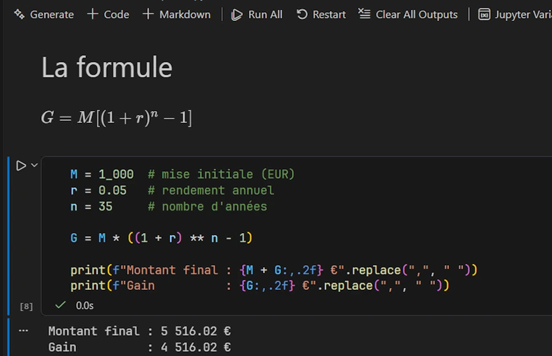
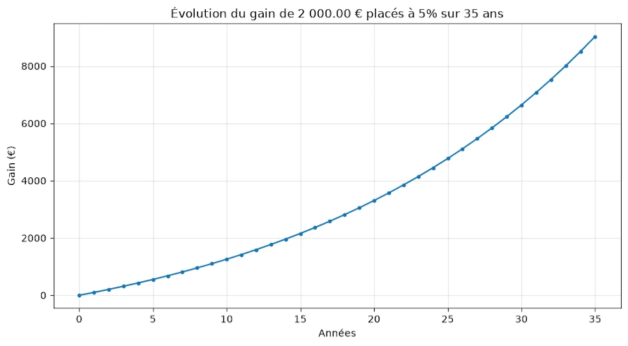
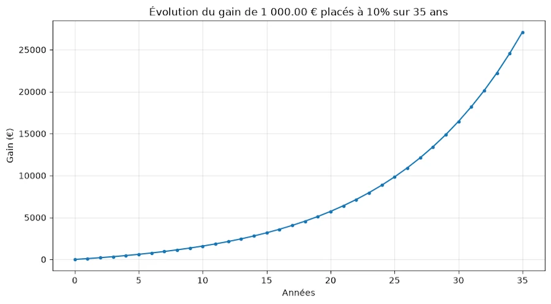
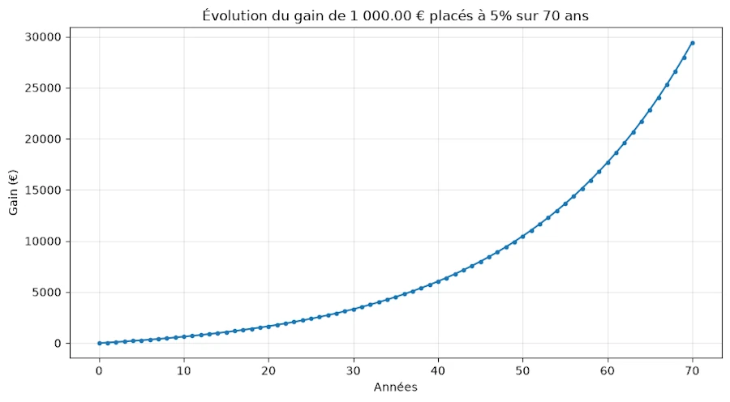
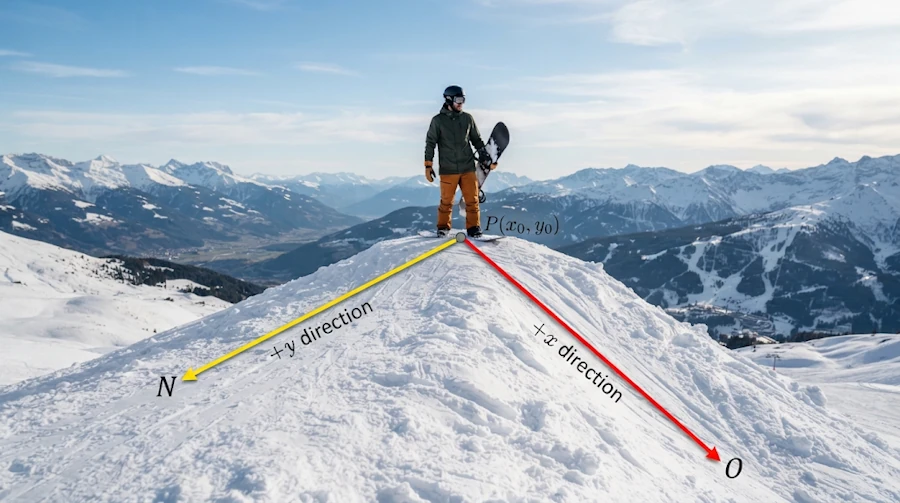
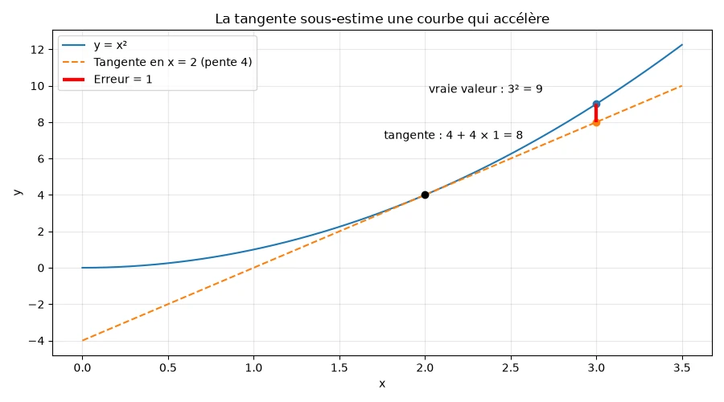
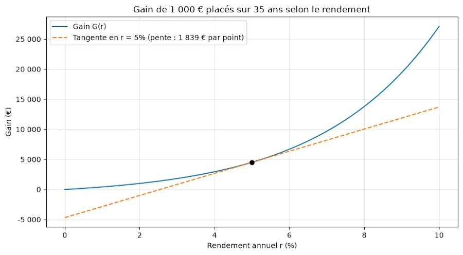
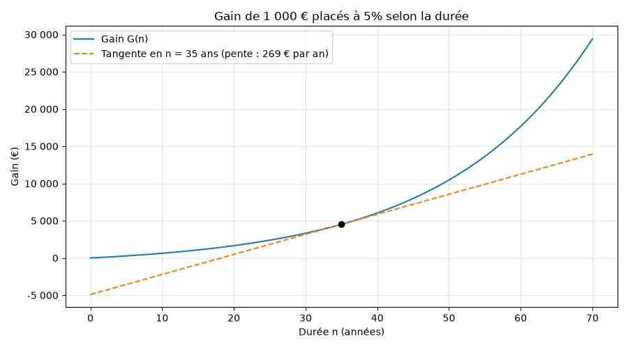
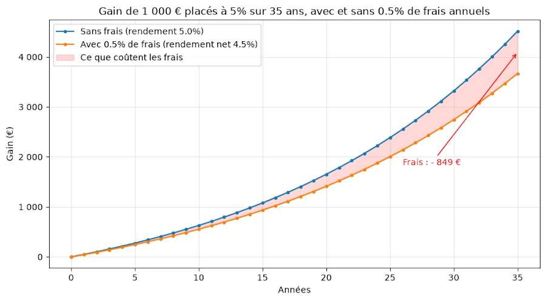

# {{ page.title }}
{: .no_toc }

{{ page.description }}
{: .lead }


<h2 align="center"><span style="color:orange"><b> 🚧 This post is under construction 🚧</b></span></h2>


<!-- ###################################################################### -->
<!-- ###################################################################### -->
<!-- ###################################################################### -->
## TL;DR
{: .no_toc }


<!-- ###################################################################### -->
<!-- ###################################################################### -->
<!-- ###################################################################### -->
## TODO
{: .no_toc }

* Dérivées partielles. Identifier les leviers les plus efficaces
* Ne pas oublier les frais composés
* Ne pas oublier l'inflation
* Liens sur les vidéos de dérivées


<figure style="max-width: 900px; margin: auto; text-align: center;">

<figcaption>.</figcaption>
</figure>


<!-- ###################################################################### -->
<!-- ###################################################################### -->
<!-- ###################################################################### -->
## Table of Contents
{: .no_toc .text-delta}
- TOC
{:toc}


<!-- ###################################################################### -->
<!-- ###################################################################### -->
<!-- ###################################################################### -->
## Introduction

Y a deux ans, j'étais allé chez Mamie et à l'occasion de mon 16 eme anniversaire on avait fêté ce dernier à sa manière. Je vais pas me plaindre, j'étais sorti de là avec 5 500 € de plus sur mon compte. Si tu ne me crois pas, ou si tu te pose des questions à propos des pourcentages, vas lire cet [excellent article]().

Cette année c'est bizarre. On a fêté mes 18 ans à la maison avec les parents et dans la soirée Mamie m'a envoyé un message WhatApps un peu énigmatique me demandant de venir la voir ce matin à 10H00 avec mon PC portable...

Je suis très proche de ma grand-mère alors ni une ni deux, à 10H00 pétante, je sonne à sa porte.

Salut Marty chéri. Je sais que tu as un truc de prévu ce midi avec tes potes alors on va faire court et efficace. Tiens, prends un café et assieds toi là. Alleluia, il va pleuvoir des grenouilles demain mais pour une fois ton père m'a écouté... La semaine dernière il t'a ouvert un [PEA Jeune](https://www.yomoni.fr/apprendre/pea-jeune). En deux mots c'est une enveloppe fiscale. Arrête de me regarder avec ces yeux là tu vas voir c'est simple. En gros, tu vas pouvoir l'utiliser pour acheter, entre autres, des actions. Tu ne pourras pas y déposer plus de 20 k€ mais même si un jour tes intérêts font que la somme montant+dividende va au delà de ce montant, ce ne sera pas un problème. En effet, seuls les versements sont limités à 20 k€, pas la somme totale. Mais bon, à ce stade on s'en fout car à mon avis tu ne seras pas concerné. Quand tu quittera fiscalement le foyer fiscal de tes parents (t'es pas un Tanguy, rassure moi, tu vas partir avant tes 25 ans) il sera automatiquement transformé en PEA. Là ce sera cool car il ne perdra pas son antériorité, tu pourras le garder toute ta vie, y déposer jusqu'à 150 k€ et comme il aura plus de 5 ans, les taxes à payer quand tu sortira de l'argent seront, un peu, allégées.

Ok Mamie, super, mais j'ai rien compris... T'es bien le fils de ton père! Gentil mais il percute pas vite. Bon, alors là tout de suite ce qu'il faut que tu retiennes c'est que tu as un compte, que tu peux acheter des actions, laisser l'argent travailler pour toi etc.

Moi, ce que je veux voir avec toi ce matin, c'est comprendre comment ça marche afin que tu puisse en tirer le meilleur. Et tu vas voir que c'est encore une question d'intérêts composés.

Alors mon p'tit gars... Est-ce que tu te rappelle le marché que je t'avais proposé y a 2 ans et le raisonnement que tu avais dû poser afin de me répondre? Tu avais le choix entre 1 000 € tout de suite ou la somme correspondant à 1 000 € placé à 5% pendant 35 ans.

Tu m'étonnes. Bien sûr que je m'en rappelle. Je crois que c'est LA formule que je n'oublierai jamais...


<!-- ###################################################################### -->
<!-- ###################################################################### -->
<!-- ###################################################################### -->
## La formule

C'était un truc du style :

$$V_n = V_0 * (1 + 5\%)^n$$

Dans lequel $$V_n$$ c'était la valeur au bout de $$n$$ années, $$V_0$$ le montant initial et $$n$$ le nombre d'années. Tu vois, je m'en rappelle comme si c'était hier. Mais bon pourquoi tu me pose la question?

Patience petit Padawan... Bon, t'es plus un gamin, est que tu peux m'écrire la formule qui donne le gain au bout de $$n$$ années?

Ben oui... Je vais partir de l'égalité précédente. Ensuite j'ai envie d'écrire un truc du style:

$$
\begin{align*}
\textrm{Montant final} &= \textrm{Montant initial} * (1 + 5\%)^n \\
\textrm{Gain} &= \textrm{Montant final} - \textrm{Montant initial} \\
\textrm{Gain} &= \textrm{Montant initial} * (1 + 5\%)^n - \textrm{Montant initial} \\
G &= M * (1 + 5\%)^n - M \\
G &= M [(1 + 5\%)^n - 1] \\
G &= M [(1 + r\%)^n - 1] \\
G &= M [(1 + r)^n - 1]
\end{align*}
$$

où $$M$$ est le montant initial, $$r$$ le rendement annuel et $$n$$ le nombre d'années.

OK Marty. Imagine que pour tes 18 ans je te donne 1000 € à placer sur ton PEA Jeune. Non, non ne me remercie pas car tu ne les a pas encore gagné. J'imagine que dans ton école vous apprenez à écrire des scripts en Python. Si c'est pas le cas, sors de cette maison je te déshérite, hahaha! Plus sérieusement, ouvre ton PC et écris moi un script de 3 lignes qui calcule le gains au bout de 35 ans de tes 1 000 € placés à 5%.

OK... Du coup j'ouvre mon PC puis VSCode et dans un notebook que je nomme `interets_composes.ipynb` j'écris:

```python
M = 1_000  # mise initiale (EUR)
r = 0.05   # rendement annuel
n = 35     # nombre d'années

G = M * ((1 + r) ** n - 1)

print(f"Montant final : {M + G:,.2f} €".replace(",", " "))
print(f"Gain          : {G:,.2f} €".replace(",", " "))
```

À l'exécution je vois :

<figure style="max-width: 900px; margin: auto; text-align: center;">

<figcaption>Calcul du gain de 1 000 € placés à 5% sur 35 ans</figcaption>
</figure>

Mamie, c'est pas pour me vanter mais l'honneur est sauf. On retrouve bien les 5 500 € de mes 16 ans mais ici comme on imagine que la mise de fond est de 1 000 €, à la fin le gain est de 4 500 € environ.

Bien, bien, bien... Je vois que tu as au moins appris 1 ou 2 trucs dans ton école. Est-ce que tu peux afficher tout ça dans un graphe?

Tes désirs sont des ordres...

```python
import matplotlib.pyplot as plt

M = 1_000  # mise initiale (€)
r = 0.05   # rendement annuel
N = 35     # duree max (annees)

annees = list(range(N + 1))
gains = [M * ((1 + r) ** n - 1) for n in annees]

fig, ax = plt.subplots(figsize=(9, 5))
ax.plot(annees, gains, marker='o', markersize=3)
ax.set_xlabel("Années")
ax.set_ylabel("Gain (€)")
ax.set_title(f"Évolution du gain de {M:,.2f} € placés à {r:.0%} sur {N} ans".replace(",", " "))
ax.grid(True, alpha=0.3)
fig.tight_layout()
plt.show()

```

<figure style="max-width: 900px; margin: auto; text-align: center;">

<figcaption>Évolution du gain de 1 000 € placés à 5% sur 35 ans</figcaption>
</figure>


Super. Maintenant on peut commencer à discuter. Tiens, affiche moi les 3 graphes quand on double
1. le montant initial (2 000 € au lieu de 1 000 €)
1. le rendement (10% au lieu de 5)
1. la durée (70 ans au lieu de 35)

Voilà ce que je vois. Respectivement 9 000 €, 27 000 € et 29 000 €

<figure style="max-width: 900px; margin: auto; text-align: center;">

<figcaption>Évolution du gain de 2 000 € placés à 5% sur 35 ans</figcaption>
</figure>

<figure style="max-width: 900px; margin: auto; text-align: center;">

<figcaption>Évolution du gain de 1 000 € placés à 10% sur 35 ans</figcaption>
</figure>

<figure style="max-width: 900px; margin: auto; text-align: center;">

<figcaption>Évolution du gain de 1 000 € placés à 5% sur 70 ans</figcaption>
</figure>


Et du coup Marty, qu'est-ce qui te vient en tête?

J'ai pas l'impression que doubler la mise au départ soit si intéressant. En fait si, c'est rentable car on gagne 2 fois plus (9k au lieu de 4.5k) mais bon c'est linéaire. Dans les autres cas, c'est une toute autre histoire. Au bout de 70 ans, troisième cas, j'aurai une hanche en titane, plus de dents mais je pourrai m'acheter une Rolex avec les 29 k€ de gains mais... Le mieux, c'est peut être le compromis du second cas et trouver un placement qui double les intérêts. Dans ce cas à 53 ans ($$18+35=53$$) je pourrai m'acheter et profiter pendant quelques années encore d'une très belle moto à 27 000 balles.

Tu es mon digne petit fils. Oui, il y a 3 paramètres indépendants dans ton équation et en jouant sur les valeurs, on voit que certains ont plus d'influence que d'autres. Alors... Commence pas à faire ta mijaurée ou ton wokiste de base. Imagine... Imagine que tu te balades sur une plage et qu'en marchant, tu rattrapes une fille que tu vois de dos. Qu'est ce qui va faire que tu vas vouloir engager la conversation avec elle? La longueur des cheveux, ses fesses, son bronzage... Bon ben voilà, t'as tout compris. Là aussi y a plusieurs paramètres mais certains sont plus importants que d'autres.

Du coup, la question à 1M$ c'est: est-ce que tu es capable d'aller plus loin que les tests de doublement de valeur qu'on a fait tout à l'heure et de retrouver, par calcul, l'influence de chacun des 3 paramètres?

Mouai... Normalement c'est possible. On a vu ça en physique et mon prof qui lui n'est pas un obsédé avait un exemple tout aussi pertinent. Il disait: imaginez que vous êtes au sommet d'une petite colline avec votre snowboard. Le terrain c'est une surface dont l'altitude est une fonction de $$x$$ et de $$y$$, un truc du style $$z = f(x, y)$$. Du coup si tu pars vers le nord, $$x$$ ne change pas, seul $$y$$ varie et la pente est peut être douce. Si tu pars vers l'ouest, $$y$$ ne change pas, seul $$x$$ varie et la pente est peut être plus prononcée, et donc plus de fun. Donc les gars, pas de panique, calculer une dérivée partielle ça revient à étudier la formule initiale en bloquant tous les paramètres sauf un et à regarder alors ce qui se passe.

<figure style="max-width: 900px; margin: auto; text-align: center;">

<figcaption>Dérivées partielles en snowboard</figcaption>
</figure>

Allez, c'est parti.


<!-- ###################################################################### -->
### Ce qu'il faut retenir

1. Le gain d'un placement à intérêts composés s'écrit $$G = M \left[ (1+r)^n - 1 \right]$$ avec $$M$$ le montant initial, $$r$$ le rendement annuel (0.05 pour 5%) et $$n$$ le nombre d'années.

1. Les 3 paramètres n'ont pas la même influence sur le gain. Le montant a une influence linéaire. Le rendement et la durée semblent avoir un effet beaucoup plus important mais similaire entre eux.

1. Pour quantifier l'influence de chaque paramètre on va devoir calculer les dérivées partielles.


<!-- ###################################################################### -->
<!-- ###################################################################### -->
<!-- ###################################################################### -->
## Dérivation partielle

Je reprends la formule de départ.

$$
G = M \left[ (1+r)^n - 1 \right]
$$


<!-- ###################################################################### -->
### Qu'est-ce qui se passe si le montant varie?

Je ré-écris l'équation sous la forme

$$
y = x \left[ (1+r)^n - 1 \right]
$$

Il faut bien voir que $$x$$ est la variable et que $$r$$ et $$n$$ doivent être considérés comme des constantes. À l'extreme, on pourrait écrire l'équation précédente sous la forme :

$$
\begin{align*}
y = x \left[ (1+r)^n - 1 \right] \\
y = x K \\
y = K x
\end{align*}
$$

Si je dérive j'obtiens

$$
\begin{align*}
y^\prime &= K \\
y^\prime &= \left[ (1+r)^n - 1 \right] \\
y^\prime &= (1+r)^n - 1 \\
G^\prime &= (1+r)^n - 1
\end{align*}
$$


Mais comme on veut se rappeler que ce qu'on a sous les yeux, c'est la variation du gain $$G$$ quand le montant $$M$$ varie, on écrit pas $$G^\prime$$ mais plutôt $$\frac{\partial G}{\partial M}$$. Un c'est trop la classe et deux ça veut juste dire, dérivée partielle de $$G$$ par rapport à $$M$$. Du coup j'écris :


$$
\frac{\partial G}{\partial M} = (1+r)^n - 1
$$

Et tu comprends ça comment mon petit Marty?

Ben... Je me dis que si $$r$$ et $$n$$ sont des constantes, 5% et 35 ans par exemple, alors le membre de droite de l'égalité est constant lui aussi. Ici, avec les valeurs précédentes il vaut 4.5160. Y a pas de surprise. On avait $$ y = K x$$. La pente c'est $$K$$ (4.5160). Le gain varie linéairement avec le montant. Si on injecte 1000 € au début on va récupérer 4 516 € à la fin. Plus important, cela explique pourquoi quand on double le montant au départ (2000 € vs 1000 € par exemple) à la fin, on a "juste" doublé le gain.


<!-- ###################################################################### -->
### Qu'est-ce qui se passe si le rendement varie?

Je pars de l'équation

$$
G = M \left[ (1+r)^n - 1 \right]
$$

Je la ré-écris sous la forme

$$
y = M \left[ (1+x)^n - 1 \right]
$$

Ça ressemble à $$y = M [f(x) - 1]$$ dont la dérivée est de la forme $$y^\prime = M f^\prime(x)$$

Ensuite la dérivée de $$(1+x)^n$$ c'est la dérivée de $$u^n$$ soit $$nu^{n-1}u^\prime$$ soit ici $$n (1+x)^{n-1} \, 1$$ car la dérivée de $$x$$ c'est $$1$$

Du coup j'écris

$$
\frac{\partial y}{\partial x} = M \, n \, (1+x)^{n-1}
$$

Soit avec les noms des variables du début

$$
\frac{\partial G}{\partial r} = M \, n \, (1+r)^{n-1}
$$

Et qu'est-ce que ça veut dire en Français dans le texte?

La dérivée partielle du gain par rapport au rendement est une fonction qui ressemble bigrement à $$y^\prime=K \,X^N$$. J'ai remplacé $$1+r$$ par $$X$$ et $$n-1$$ par $$N$$ pour bien faire ressortir le fait qu'on a une "simple" fonction puissance de $$X$$, qui grimpe vite, très vite.


Mouais... C'est bien joli tout ça mon petit Marty, mais tes $$X^N$$, ils me disent pas combien je gagne, moi. Tu peux me faire une application numérique? Tu gardes les 1 000 € et les 35 ans, et tu fais varier le rendement de 1% à 10% par exemple.

Pas de souci Mamie. Je retourne dans mon notebook, je créé une section "Qu'est-ce qui se passe si le rendement varie?" et après quelques tâtonnements j'obtiens ce code :

```python
M = 1_000  # mise initiale (€)
n = 35     # nombre d'années

def gain(r):
    return M * ((1 + r) ** n - 1)

def derivee(r):
    return M * n * (1 + r) ** (n - 1)

def fmt(x):
    return f"{x:,.0f} €".replace(",", " ")

print(f"{'r':>5} | {'Gain G':>10} | {'dG/dr':>12} | {'Pente / point':>13} | {'G(r+1%) - G(r)':>14}")
print("-" * 68)
for pct in range(1, 11):
    r = pct / 100
    print(f"{r:>5.0%} | {fmt(gain(r)):>10} | {fmt(derivee(r)):>12} | "
          f"{fmt(derivee(r) / 100):>13} | {fmt(gain(r + 0.01) - gain(r)):>14}")
```

La fonction `gain()` c'est la formule du début et la fonction `derivee()` c'est la dérivée partielle qu'on vient de calculer. Ensuite, pour chaque rendement de 1% à 10%, j'affiche une ligne du tableau. À l'exécution je vois :

```text
    r |     Gain G |        dG/dr | Pente / point | G(r+1%) - G(r)
--------------------------------------------------------------------
   1% |      417 € |     49 090 € |         491 € |          583 €
   2% |    1 000 € |     68 624 € |         686 € |          814 €
   3% |    1 814 € |     95 617 € |         956 € |        1 132 €
   4% |    2 946 € |    132 801 € |       1 328 € |        1 570 €
   5% |    4 516 € |    183 867 € |       1 839 € |        2 170 €
   6% |    6 686 € |    253 786 € |       2 538 € |        2 990 €
   7% |    9 677 € |    349 234 € |       3 492 € |        4 109 €
   8% |   13 785 € |    479 155 € |       4 792 € |        5 629 €
   9% |   19 414 € |    655 494 € |       6 555 € |        7 688 €
  10% |   27 102 € |    894 168 € |       8 942 € |       10 472 €
```

Attends, attends... Doit y avoir une erreur dans le code? Ligne 5%, ta dérivée elle vaut 183 867 €. Avec 1 000 € de mise? Tu vas me faire croire que je vais gagner 183 k€?

Non, non Mamie... Regarde l'en-tête de la colonne. C'est pas un montant c'est une dérivée, un taux d'accroissement. Elle dit de combien bouge $$G$$ quand $$r$$ bouge de 1. Sauf que $$r = 1$$ ça veut dire 100%. Autrement dit 183 867 €, c'est ce qu'on gagnerait en plus si le rendement passait de 5% à 105%, et encore, seulement si la pente restait la même tout du long. Personne ne fait ça. Nous, ce qui nous intéresse, c'est de passer de 5% à 6%, donc un point de rendement, donc $$\Delta r = 0.01$$. Il faut donc diviser par 100 :

$$
\Delta G \approx \frac{\partial G}{\partial r} \times \Delta r = 183\,867 \times 0.01 \approx 1\,839 \text{ €}
$$

C'est comme le compteur de la voiture. Si tu roules à 90 km/h pendant une minute, tu ne fais pas 90 km. Tu fais $$90/60 = 1.5$$ km. Le compteur donne une vitesse "par heure", la dérivée donne une pente "par 100% de rendement". Dans les deux cas, il faut ramener ça à la durée, ou à la variation, qui nous intéresse. C'est ce que montre la colonne "Pente / point" : à 5%, un point de rendement en plus rapporte environ 1 839 € de plus au bout de 35 ans.

Mouais. Et comment je sais que ton truc est juste?

Facile, c'est la dernière colonne. Là je ne fais aucune dérivée, je calcule bêtement le gain à 6% puis le gain à 5% et je fais la différence : $$6\,686 - 4\,516 = 2\,170$$ €. On est dans les mêmes eaux que les 1 839 € mais la dérivée sous-estime un peu. Et c'est normal. La dérivée c'est la pente **au point** 5%. Or entre 5% et 6% la pente ne reste pas constante, elle continue de grimper (à 6%, elle vaut déjà 2 538 € par point). Si on utilise la pente du départ pour tout le trajet, on "oublie" l'accélération. C'est comme une voiture qui accélère : si tu estimes la distance de la prochaine minute avec ta vitesse actuelle, tu te trompes forcément par défaut. D'ailleurs, regarde, la vraie valeur (2 170 €) est bien coincée entre la pente à 5% (1 839 €) et la pente à 6% (2 538 €).


Tiens, pour bien visualiser ces histoires d'erreur, dans le notebook je créé une section "La tangente sous-estime une courbe qui accélère" dans laquelle je te propose le code et l'illustration suivante avec la fonction $$x^2$$. Le code est "compliqué" car il y a beaucoup de choses à faire pour avoir un graphe "sympa". Sinon on trace juste la fonction $$y=x^2$$, la tangente à la courbe en $$x=2$$ et on calcule, en $$x=3$$, la différence entre la valeur de la fonction et la hauteur à laquelle se trouve la dérivée.

```python
import matplotlib.pyplot as plt

x0 = 2   # point où l'on trace la tangente
x1 = 3   # point où l'on utilise la tangente pour estimer f

def f(x):
    return x ** 2

pente = 2 * x0  # f'(x) = 2x

xs = [i / 100 for i in range(0, 351)]  # 0 à 3.5
courbe = [f(x) for x in xs]
tangente = [f(x0) + pente * (x - x0) for x in xs]

vrai = f(x1)                               # vraie valeur
estim = f(x0) + pente * (x1 - x0)          # estimation par la tangente
erreur = vrai - estim

fig, ax = plt.subplots(figsize=(9, 5))
ax.plot(xs, courbe, label="y = x²")
ax.plot(xs, tangente, linestyle="--", label=f"Tangente en x = {x0} (pente {pente})")
ax.plot([x0], [f(x0)], marker="o", color="black")
ax.plot([x1], [vrai], marker="o", color="tab:blue")
ax.plot([x1], [estim], marker="o", color="tab:orange")

# Erreur : écart vertical entre la courbe et la tangente en x1
ax.vlines(x1, estim, vrai, color="red", linewidth=3, label=f"Erreur = {erreur:g}")
ax.annotate(f"vraie valeur : {x1}² = {vrai:g}", (x1, vrai), xytext=(-150, 10), textcoords="offset points")
ax.annotate(f"tangente : {f(x0):g} + {pente} × {x1 - x0} = {estim:g}", (x1, estim),
            xytext=(-190, -15), textcoords="offset points")

ax.set_xlabel("x")
ax.set_ylabel("y")
ax.set_title("La tangente sous-estime une courbe qui accélère")
ax.grid(True, alpha=0.3)
ax.legend(loc="upper left")
fig.tight_layout()
plt.show()

print(f"f({x1}) = {vrai:g}, tangente en x = {x1} : {estim:g}, erreur = {erreur:g}")

```

<figure style="max-width: 900px; margin: auto; text-align: center;">

<figcaption>La tangente sous-estime une courbe qui accélère</figcaption>
</figure>


Ok c'est clair maintenant. Et sinon, si tu lis le tableau de haut en bas, tu vois quoi?

Déjà, voilà le tableau

```text
    r |     Gain G |        dG/dr | Pente / point | G(r+1%) - G(r)
--------------------------------------------------------------------
   1% |      417 € |     49 090 € |         491 € |          583 €
   2% |    1 000 € |     68 624 € |         686 € |          814 €
   3% |    1 814 € |     95 617 € |         956 € |        1 132 €
   4% |    2 946 € |    132 801 € |       1 328 € |        1 570 €
   5% |    4 516 € |    183 867 € |       1 839 € |        2 170 €
   6% |    6 686 € |    253 786 € |       2 538 € |        2 990 €
   7% |    9 677 € |    349 234 € |       3 492 € |        4 109 €
   8% |   13 785 € |    479 155 € |       4 792 € |        5 629 €
   9% |   19 414 € |    655 494 € |       6 555 € |        7 688 €
  10% |   27 102 € |    894 168 € |       8 942 € |       10 472 €
```


Je vois que la colonne "Pente / point" s'envole. Un point de rendement en plus, ça vaut 491 € quand on est à 1% et presque 9 000 € quand on est à 10%. C'est 18 fois plus pour le même point! C'est ça la "fonction puissance qui grimpe vite" de tout à l'heure. Et c'est très différent du cas de la dérivée partielle par rapport au montant qui était constante : chaque millier d'euros en plus au départ rapportait 4 516 € de plus, que l'on parte de 1 000 € ou de 10 000 €.

Parfait. Peux tu illustrer tout ça avec un graphe?

Dans le notebook, je crée une section que je nomme "Illustration du tableau précédent", je me gratte un peu la tête et finalement j'obtiens le code ci-dessous et le graphe :

```python
import matplotlib.pyplot as plt

M = 1_000  # mise initiale (€)
n = 35     # nombre d'années
r0 = 0.05  # point où l'on trace la tangente

rs = [i / 1000 for i in range(0, 101)]  # 0 % à 10 %
gains = [M * ((1 + r) ** n - 1) for r in rs]

G0 = M * ((1 + r0) ** n - 1)
pente = M * n * (1 + r0) ** (n - 1)
tangente = [G0 + pente * (r - r0) for r in rs]

fig, ax = plt.subplots(figsize=(9, 5))
ax.plot([r * 100 for r in rs], gains, label="Gain G(r)")
ax.plot([r * 100 for r in rs], tangente, linestyle="--",
        label=f"Tangente en r = {r0:.0%} (pente : {pente / 100:,.0f} € par point)".replace(",", " "))
ax.plot([r0 * 100], [G0], marker="o", color="black")
ax.set_xlabel("Rendement annuel r (%)")
ax.set_ylabel("Gain (€)")
ax.set_title(f"Gain de {M:,.0f} € placés sur {n} ans selon le rendement".replace(",", " "))
ax.yaxis.set_major_formatter(lambda y, _: f"{y:,.0f}".replace(",", " "))
ax.grid(True, alpha=0.3)
ax.legend()
fig.tight_layout()
plt.show()
```

<figure style="max-width: 900px; margin: auto; text-align: center;">

<figcaption>Gain de 1 000 € placés sur 35 ans selon le rendement, avec la tangente en r = 5%</figcaption>
</figure>

C'est graphique mais bon Marty, comment on lit ça?

Cette fois-ci, en abscisse on n'a plus les années mais le rendement, de 0% à 10%. La durée est bloquée à 35 ans et la mise à 1 000 €. C'est exactement l'idée de la dérivée partielle : on bloque tout sauf le paramètre qui nous intéresse (ici le rendement $$r$$).

1. **La courbe pleine** c'est le gain $$G(r)$$, la colonne "Gain G" du tableau mais avec beaucoup plus de points. Elle est presque à l'horizontale à gauche et elle se redresse de plus en plus vers la droite. Plus on avance, plus elle est raide. Ça, c'est la colonne "Pente / point" qui s'envole.
1. **Le point noir** c'est notre cas de référence : 5%, 4 516 €.
1. **Les pointillés** c'est la tangente à la courbe en ce point. C'est la droite qui "frôle" la courbe en $$r=5\%$$ et qui a exactement la même pente qu'elle à cet endroit. Tu te rappelles l'équation de la tangente que tu m'avais fait réviser en long et en large quand j'étais en Première? $$y = f(a) + f^\prime(a)(x - a)$$. Ben, c'est exactement la ligne `tangente = [G0 + pente * (r - r0) for r in rs]` du code, avec $$a = 5\%$$ et $$f^\prime(a) = 183\,867$$.

Et maintenant Mamie, le plus intéressant. Pose ton doigt sur $$r=6\%$$ en abscisse. La tangente donne $$4\,516 + 1\,839 = 6\,355$$ €. La courbe, elle, donne 6 686 €. L'écart entre les deux (331 €), c'est exactement l'écart entre les colonnes "Pente / point" et "G(r+1%) - G(r)" du tableau ($$2\,170 - 1\,839$$). Le tableau et le dessin racontent la même histoire.

On voit aussi que la tangente reste partout **sous** la courbe (la courbe est convexe). C'est pour ça que l'approximation par la dérivée est toujours un peu trop pessimiste ici. Enfin, si on s'éloigne trop de 5%, la tangente raconte n'importe quoi. Vers la gauche elle finit même par passer sous zéro, ce qui n'a aucun sens pour un gain. La dérivée c'est un outil local, un zoom autour d'un point. Pour des petites variations elle est top, pour des grandes variations il vaut mieux refaire le calcul complet.


<!-- ###################################################################### -->
### Qu'est-ce qui se passe si la durée varie?

Je pars de l'équation

$$
G = M \left[ (1+r)^n - 1 \right]
$$

Je la ré-écris sous la forme

$$
y = M \left[ (1+r)^x - 1 \right]
$$

$$
y = M \,(1+r)^x - M
$$

Du coup la dérivée de $$y$$ c'est la dérivée de $$M \,(1+r)^x$$ car la dérivée de $$M$$ par rapport à  $$x$$ c'est 0. Mais bon je suis coincé car je cherche la dérivée par rapport à $$x$$ d'un truc de la forme $$K^x$$ et ça, je sais pas faire. Mamie? Une idée?

Non, débrouille toi tout seul t'es un grand garçon. Je veux bien admettre que vous êtes de plus en plus nul au point d'être quasiment dernier au classement [PISA](https://www.planetegrandesecoles.com/classement-pisa-france-resultats) mais bon faut pas pousser.

OK, ok, ok... Te fâche pas. Le truc dont je me souviens c'est que si il y a une puissance, faut utiliser les log. Oui mais moi j'ai $$K^x$$. Le log de ce truc là ne m'arrange pas, je vais me retrouver avec $$\ln(K^x)$$... Moi ce que je veux c'est avoir un truc qui vaut $$K^x$$.

Marty, si je te donne $$\ln(5)$$, comment tu retrouve $$5$$?

Ben c'est évident, je prends l'exponentielle... Ayé, j'ai compris! J'ai $$K^x$$, pour jouer avec les puissances je veux utiliser $$\ln(K^x)$$ du coup j'écris $$e^{\ln(K^x)}$$.

À partir de là, la vie est belle car dériver $$K^x$$ ça revient à dériver $$e^{\ln(K^x)}$$ ce qui revient à dériver $$e^X$$ et ça c'est facile c'est de la forme $$e^X \, X^\prime$$. Du coup je peux écrire :

$$
\begin{align*}
\frac{\partial y}{\partial x} &= \frac{\partial (M \,(1+r)^x)}{\partial x} \\
\frac{\partial y}{\partial x} &= M \, \frac{\partial ((1+r)^x)}{\partial x} \\
\frac{\partial y}{\partial x} &= M \, \frac{\partial (e^{\ln(1+r)^x})}{\partial x} \\
\frac{\partial y}{\partial x} &= M \, \frac{\partial (e^{x\ln(1+r)})}{\partial x} \\
\frac{\partial y}{\partial x} &= M \, e^{x\ln(1+r)} \, \frac{\partial (x\ln(1+r))}{\partial x} \\
\frac{\partial y}{\partial x} &= M \, e^{\ln(1+r)^x} \, \frac{\partial (x\ln(1+r))}{\partial x} \\
\frac{\partial y}{\partial x} &= M \, (1+r)^x \, \frac{\partial (x\ln(1+r))}{\partial x} \\
\frac{\partial y}{\partial x} &= M \, (1+r)^x \, \ln(1+r) \\

\end{align*}
$$


Enfin, si je reprends les notations de la formule de départ j'arrive à :


$$
\frac{\partial G}{\partial n} = M \, (1+r)^n \ln(1+r)
$$

Et voilà Mamie, c'est plié!

Pas si vite jeune homme. Une formule c'est bien joli mais tu sais ce que je pense des formules qu'on ne sait pas lire. Qu'est-ce qu'elle raconte la tienne?

Alors... Déjà, si je regarde bien, $$M \,(1+r)^n$$ c'est le montant total sur le compte au bout de $$n$$ années. La mise plus le gain, $$M + G$$ quoi. Je peux donc écrire :

$$
\frac{\partial G}{\partial n} = (M + G) \ln(1+r)
$$

Ensuite, avec $$r=5\%$$, $$\ln(1.05) \approx 0.0488$$. C'est presque 5%. Autrement dit, une année de plus rapporte à peu près 5% de ce qu'il y a déjà sur le compte. Dit comme ça, ça paraît bête, c'est la définition même des intérêts... Mais la conséquence est énorme : **la vitesse à laquelle le gain grossit est proportionnelle à ce qu'on a déjà accumulé**. Plus la boule de neige qui descend de la montagne est grosse, plus elle ramasse de neige à chaque tour. C'est la signature d'une exponentielle. Pour le rendement, $$r$$ était "en bas", dans une fonction puissance. Ici, $$n$$ est "en haut", dans l'exposant.

Bien. Moi je suis une vieille dame, faut que je voie pour croire. Tu me fais la même chose que pour le rendement? Un tableau puis un graphe. Tu gardes les 1 000 € et les 5% et cette fois, tu fais varier la durée de 0 à 70 ans.

Pas de souci. Dans le notebook, dans la section "Qu'est-ce qui se passe si la durée varie?", je recopie presque le code du rendement. Seule la fonction `derivee()` change (il faut un `import math` pour avoir le logarithme `math.log()`) et la boucle porte maintenant sur les années, de 5 en 5 :

```python
import math

M = 1_000  # mise initiale (€)
r = 0.05   # rendement annuel

def gain(n):
    return M * ((1 + r) ** n - 1)

def derivee(n):
    return M * (1 + r) ** n * math.log(1 + r)

def fmt(x):
    return f"{x:,.0f} €".replace(",", " ")

print(f"{'n':>4} | {'Gain G':>10} | {'dG/dn':>10} | {'G(n+1) - G(n)':>13}")
print("-" * 47)
for n in range(0, 71, 5):
    print(f"{n:>4} | {fmt(gain(n)):>10} | {fmt(derivee(n)):>10} | {fmt(gain(n + 1) - gain(n)):>13}")
```

À l'exécution je vois :

```text
   n |     Gain G |      dG/dn | G(n+1) - G(n)
-----------------------------------------------
   0 |        0 € |       49 € |          50 €
   5 |      276 € |       62 € |          64 €
  10 |      629 € |       79 € |          81 €
  15 |    1 079 € |      101 € |         104 €
  20 |    1 653 € |      129 € |         133 €
  25 |    2 386 € |      165 € |         169 €
  30 |    3 322 € |      211 € |         216 €
  35 |    4 516 € |      269 € |         276 €
  40 |    6 040 € |      343 € |         352 €
  45 |    7 985 € |      438 € |         449 €
  50 |   10 467 € |      559 € |         573 €
  55 |   13 636 € |      714 € |         732 €
  60 |   17 679 € |      911 € |         934 €
  65 |   22 840 € |    1 163 € |       1 192 €
  70 |   29 426 € |    1 485 € |       1 521 €
```

Attends, attends... Cette fois tu n'as pas divisé par 100? Elle est où ta colonne "Pente / point"?

Bien vu Mamie, mais non, pas besoin. Pour le rendement, la dérivée était exprimée "par 100% de rendement" et il fallait la ramener à un point. Ici $$n$$ se compte en années, donc la dérivée est directement en "euros par an". Une année de plus c'est $$\Delta n = 1$$ et on lit la colonne telle quelle. À 35 ans, une année de plus rapporte environ 269 € selon la dérivée et 276 € en vrai (dernière colonne).

Et là encore la dérivée sous-estime?

Oui, pour la même raison que tout à l'heure : la courbe accélère et la tangente reste en dessous. Mais regarde, l'écart est minuscule et surtout il est toujours le même en proportion : 49 contre 50, 269 contre 276, 1 485 contre 1 521... La vraie valeur est toujours environ 2.5% au-dessus. C'est logique. Sur une année, la vraie augmentation c'est $$G(n+1) - G(n) = M(1+r)^n \times r$$, soit 5% du montant. La dérivée c'est $$M(1+r)^n \times \ln(1+r)$$, soit 4.88% du montant. Le rapport des deux vaut $$0.05 / 0.0488 \approx 1.025$$ et ce, quel que soit $$n$$.

OK. Et si tu lis le tableau de haut en bas?

La colonne "dG/dn" double à peu près tous les 14 ou 15 ans : 49 € au départ, 101 € à 15 ans, 211 € à 30 ans, 438 € à 45 ans, 911 € à 60 ans. Et je peux même le calculer. Doubler $$(1+r)^n$$ revient à avoir $$n \ln(1+r) = \ln 2$$ soit $$n = \ln 2 / \ln(1.05) \approx 14.2$$ ans.

Ah! Ça, de mon temps, à la banque on appelait ça la règle de 70. Tu divises 70 par le rendement en pourcent et tu as le temps de doublement : $$70/5 = 14$$ ans. Pas besoin de logarithme, juste un crayon et le dos d'une enveloppe.

Trop fort... Du coup ça veut dire que la première année m'a rapporté 50 € alors que la 70ème m'en rapportera plus de 1 500. Les 35 premières années rapportent 4 516 € et les 35 suivantes $$29\,426 - 4\,516 = 24\,910$$ €. Cinq fois plus pour la même durée!

Voilà pourquoi je voulais que ton père t'ouvre ce PEA maintenant et pas quand tu auras 40 ans. **Le temps, c'est le seul ingrédient que tu ne pourras jamais racheter**. Bon, et ce graphe?

Dans le notebook, je crée une section "Le gain en fonction de la durée" et je reprends le code du graphe du rendement. Sauf qu'en abscisse, on a maintenant la durée :

```python
import math
import matplotlib.pyplot as plt

M = 1_000  # mise initiale (€)
r = 0.05   # rendement annuel
N = 70     # durée max (années)
n0 = 35    # point où l'on trace la tangente

ns = [i / 10 for i in range(0, 10 * N + 1)]  # 0 à 70 ans
gains = [M * ((1 + r) ** n - 1) for n in ns]

G0 = M * ((1 + r) ** n0 - 1)
pente = M * (1 + r) ** n0 * math.log(1 + r)
tangente = [G0 + pente * (n - n0) for n in ns]

fig, ax = plt.subplots(figsize=(9, 5))
ax.plot(ns, gains, label="Gain G(n)")
ax.plot(ns, tangente, linestyle="--",
        label=f"Tangente en n = {n0} ans (pente : {pente:,.0f} € par an)".replace(",", " "))
ax.plot([n0], [G0], marker="o", color="black")
ax.set_xlabel("Durée n (années)")
ax.set_ylabel("Gain (€)")
ax.set_title(f"Gain de {M:,.0f} € placés à {r:.0%} selon la durée".replace(",", " "))
ax.yaxis.set_major_formatter(lambda y, _: f"{y:,.0f}".replace(",", " "))
ax.grid(True, alpha=0.3)
ax.legend()
fig.tight_layout()
plt.show()
```

<figure style="max-width: 900px; margin: auto; text-align: center;">

<figcaption>Gain de 1 000 € placés à 5% selon la durée, avec la tangente en n = 35 ans</figcaption>
</figure>

C'est le même principe que pour le rendement. On bloque la mise (1 000 €) et le rendement (5%) et on ne laisse bouger que la durée $$n$$.

1. **La courbe pleine** c'est le gain $$G(n)$$. D'ailleurs, c'est la même courbe que celle du tout début quand on avait doublé la durée à 70 ans. Elle est presque plate pendant une vingtaine d'années puis elle décolle. C'est la colonne "dG/dn" qui double tous les 14 ans.
1. **Le point noir** c'est encore notre cas de référence : 35 ans, 4 516 €.
1. **Les pointillés** c'est la tangente en $$n = 35$$ ans, de pente 269 € par an. Toujours la même formule $$y = f(a) + f^\prime(a)(x - a)$$, avec cette fois $$a = 35$$.

Tiens Mamie, pose ton doigt sur $$n = 36$$ ans. La tangente donne $$4\,516 + 269 = 4\,785$$ € et la courbe 4 792 €. À l'oeil, on ne voit même pas la différence. Maintenant, pose ton doigt sur 70 ans. La tangente annonce environ 13 900 € alors que la courbe est à 29 426 €. La dérivée se trompe de plus de moitié! Un an, c'est un petit pas l'homme et la tangente s'en sort très bien. 35 ans, c'est un pas de géant pour l'humanité et l'outil local qu'est la dérivée ne suffit plus. Et comme pour le rendement, si on part trop vers la gauche, la tangente passe sous zéro (vers 18 ans) ce qui n'a aucun sens pour un gain.


Pas mal, pas mal Marty. Du coup dans la formule

$$
G = M \left[ (1+r)^n - 1 \right]
$$

On a 3 paramètres ($$M$$, $$r$$ et $$n$$). On a fait un premier test en les doublant pour voir ce qui se passait dans les chiffres. Ensuite, tu as utilisé les dérivées partielles pour examiner l'impact de chacun d'entre eux. Ceci dit y a un truc qui me chagrine...

Ça m'aurait étonné...

Sérieux, Marty, tes formules, tes graphes tout ça c'est super et je suis vraiment très fier de toi. Le truc, et tu aurai dû soulever le problème tout seul, c'est qu'on compare pas des pommes avec des pommes. En fait plutôt que de doubler le nombre d'années puis doubler le rendement pour finalement comparer l'impact sur le gain, je pense qu'il serait plus "honnête" de faire varier chacun des paramètres (($$M$$, $$r$$ et $$n$$)) de 1% puis de constater lequel de ces leviers a le plus d'impact sur le gain. Comprends tu mon problème ?


<!-- ###################################################################### -->
### Ce qu'il faut retenir

1. La dérivée partielle du gain par rapport au montant initial est une constante et donc le gain varie linéairement avec ce dernier.

1. La dérivée partielle du gain par rapport au rendement n'est pas constante. Elle augmente très vite avec $$r$$. Un point de rendement en plus vaut d'autant plus que le rendement est déjà élevé (491 € à 1%, 8 942 € à 10%, avec 1 000 € sur 35 ans).

1. La dérivée partielle du gain par rapport à la durée est proportionnelle à ce qu'il y a déjà sur le compte. Une année de plus rapporte environ $$r$$ % du montant accumulé. Elle croît de façon exponentielle et double à peu près tous les $$70/r$$ ans (14 ans à 5%). Ce sont donc les dernières années qui rapportent le plus : il faut commencer tôt et ne pas toucher au placement.


<!-- ###################################################################### -->
<!-- ###################################################################### -->
<!-- ###################################################################### -->
## Effet relatif, élasticité

Ok Mamie, je vais le redire avec mes mots afin de m'assurer qu'on est bien synchros. Ce que tu dis, c'est que ces dérivées ont des unités différentes (€, %, années), donc on ne peut pas les comparer telles quelles (mon prof de Physique serait aux anges de t'entendre dire ça). Pour savoir quel levier est le plus puissant, il faut raisonner en effet relatif : "+1 % sur le paramètre donne combien de % de gain ?". Et ça, sauf erreur de ma part ça s'appelle l'**élasticité** mais bon on s'en fout un peu.

Pour faire court, je cherche un truc qui répond à la question : si $$r$$ augmente de 1 % de sa valeur, de combien de % augmente $$G$$ ?

* La partie de la phrase "si $$r$$ augmente de 1 % de sa valeur" peut se traduire avec $$\frac{\Delta r}{r}$$
* L'autre partie "de combien de % augmente $$G$$" peut se traduire avec $$\frac{\Delta G}{G}$$

Du coup on peut s'amuser à faire le ratio des deux. Cela nous permettra de quantifier de combien varie $$G$$ quand $$r$$ varie de $$x\%$$ par exemple. Finalement j'écris :


$$
\begin{align*}
E &= \frac{\text{Variation relative de } G \text{ en } \%}{\text{Variation relative de } r \text{ en } \%} \\
E &= \frac{\frac{\Delta G}{G}}{\frac{\Delta r}{r}} \\
E &= \frac{\Delta G}{G}\frac{r}{\Delta r} \\
E &= \frac{\Delta G}{\Delta r}\frac{r}{G} \\
\end{align*}
$$

Comme on va s’intéresser à des toutes petites variations je préfère écrire

$$
E_r = \frac{\partial G}{\partial r} \cdot \frac{r}{G}
$$

Comme on va s'intéresser à chacun des paramètres et pas uniquement au taux, j'écris

$$
E_x = \frac{\partial G}{\partial x} \cdot \frac{x}{G}
$$


### Élasticité du montant

On avait

$$ G = M \left[ (1+r)^n - 1 \right]$$

$$\frac{\partial G}{\partial M} = (1+r)^n - 1$$


Du coup on va écrire

$$
\begin{align*}
E_M &= \frac{\partial G}{\partial M} \cdot \frac{M}{G} \\
E_M &= \left[(1+r)^n - 1\right] \cdot \frac{M}{M \left[ (1+r)^n - 1 \right]} \\
E_M &=  \frac{M \left[ (1+r)^n - 1 \right]}{M \left[ (1+r)^n - 1 \right]} \\
E_M &= 1
\end{align*}
$$


Ça, ça veut dire que le gain varie dans les mêmes proportions que le montant initial. On retrouve ce que l'on avait testé : quand je double le montant initial, le gain final est doublé.

C'est utile à savoir mais c'est pas très excitant, allez on passe au suivant.


### Élasticité du taux

On avait

$$ G = M \left[ (1+r)^n - 1 \right]$$

$$ \frac{\partial G}{\partial r} = M \, n \, (1+r)^{n-1}$$

Du coup on va écrire

$$
\begin{align*}
E_r &= \frac{\partial G}{\partial r} \cdot \frac{r}{G} \\
E_r & = M \, n \, (1+r)^{n-1} \cdot \frac{r}{G} \\
E_r & = M \, n \, (1+r)^{n-1} \cdot \frac{r}{M \left[ (1+r)^n - 1 \right]} \\
E_r & = \frac{M \,n \, r \, (1+r)^{n-1}}{M \left[ (1+r)^n - 1 \right]} \\
E_r & = \frac{n \, r \, (1+r)^{n-1}}{(1+r)^n - 1 } \\
\end{align*}
$$


**Application numérique**

On se place en $$M = 1\,000\ \text{€}$$, $$r = 5\%$$ et $$n = 35$$ ans

$$
\begin{align*}
E_r & = \frac{n \, r \, (1+r)^{n-1}}{(1+r)^n - 1 } \\
E_r & = \frac{35 \cdot 0.05 \cdot 1.05^{34}}{1.05^{35} - 1 } \\
E_r & \approx \frac{9.1933}{4.5160} \\
E_r & \approx 2.0357 \\
\end{align*}
$$

On peut aussi faire une vérification "à la main" et augmenter le rendement de $$5\%$$ à $$5.05\%$$. En utilisant notre super formule du départ :

$$
G = M [(1 + r)^n - 1]
$$

Je trouve $$G_{05} = 1000 (1.05^{35} - 1) = 4516$$ et $$G_{0505} = 1000 (1.0505^{35} - 1) = 4608$$ ce qui veut dire que le gain à augmenté de $$2.03\%$$


### Elasticité de la durée

On avait

$$ G = M \left[ (1+r)^n - 1 \right]$$

$$\frac{\partial G}{\partial n} = M \, (1+r)^n \ln(1+r)$$


Du coup on va écrire

$$
\begin{align*}
E_n &= \frac{\partial G}{\partial n} \cdot \frac{n}{G} \\
E_n &= M \, (1+r)^n \ln(1+r) \cdot \frac{n}{G} \\
E_n &= M \, (1+r)^n \ln(1+r) \cdot \frac{n}{M \left[ (1+r)^n - 1 \right]} \\
E_n &=  \frac{M \, (1+r)^n \ln(1+r) \cdot n}{M \left[ (1+r)^n - 1 \right]} \\
E_n &= \frac{n \, (1+r)^n \ln(1+r)}{(1+r)^n - 1}
\end{align*}
$$


**Application numérique**

On se place en $$M = 1\,000\ \text{€}$$, $$r = 5\%$$ et $$n = 35$$ ans


$$
\begin{align*}
E_n &= \frac{n \, (1+r)^n \ln(1+r)}{(1+r)^n - 1}\\
E_n &= \frac{35 \cdot (1.05)^{35} \ln(1.05)}{(1.05)^{35} - 1}\\
E_n & \approx \frac{9.4194}{4.5160}\\
E_n & \approx 2.0857 \\
\end{align*}
$$

Ici aussi je peux faire une vérification "à la mano". Je fais passer la durée de 35 à 35.35 ans ($$+1\%$$) dans notre formule du départ :

$$
G = M [(1 + r)^n - 1]
$$

Je trouve $$G_{35} = 1000 (1.05^{35} - 1) = 4516$$ et $$G_{3535} = 1000 (1.05^{35.35} - 1) = 4611$$ ce qui veut dire que dans ce cas là, le gain a augmenter de $$2.10\%$$


Bien, bien, bien Marty... Donc selon tes calculs, faire varier la durée de placement ou la valeur du rendement ça revient au même. Tu peux me le prouver ou au moins me l'expliquer?

Là je sais pas trop quoi te dire Mamie. C'est vrai qu'avec nos valeurs on a trouvé $$E_r=2.03$$ et $$E_n=2.08$$ mais bon... Les comparer... Ah si, je me rappelle ce que nous a dit notre prof de Physique l'autre jour. Il nous a parlé de la **loi de Weber-Fechner** et du fait qu'on est plus sensible aux rapports qu'aux différences. Par exemple entre 1 et 2 on voit la différence alors qu'entre 20 et 21 on ne la voit plus.

Bref, pour comparer des valeurs on fait leur rapport. Bon, hé ben évaluons le rapport $$\frac{E_n}{E_r}$$.

Je commence en collant les expressions qu'on a précédemment déterminé:

$$
\begin{align*}
\frac{E_n}{E_r} &= \frac{\frac{n \, (1+r)^n \ln(1+r)}{(1+r)^n - 1}}{\frac{n \, r \, (1+r)^{n-1}}{(1+r)^n - 1 }}\\

\frac{E_n}{E_r} &= \frac{n \, (1+r)^n \ln(1+r)}{n \, r \, (1+r)^{n-1}}\\
\frac{E_n}{E_r} &= \frac{(1+r) \ln(1+r)}{r}\\
\frac{E_n}{E_r} &= \frac{(1+r)}{r} \cdot \ln(1+r)\\
\end{align*}
$$

Si je me place à $$r=5\%$$ et que je fais le calcul je trouve $$\frac{E_n}{E_r} \approx 1.0245$$ alors qu'en prenant les valeurs respectives précédentes je trouve $$\frac{2.08}{2.03} = 1.0246$$. Au moins c'est cohérent.

Mais bon, faut pas se voiler la face, là, le rapport il vend pas du rêve. Le truc à remarquer quand même c'est qu'il ne dépend que du rendement $$r$$, pas du montant $$M$$ ni de la durée $$n$$.

Sinon, cette année on utilise pas mal les développements limités et je sais que pour $$x$$ petit on peut écrire $$\ln(1+x) = x - \frac{x^2}{2} + \frac{x^3}{3} - \dots$$

Du coup, en première approximation, on peut dire

$$
\begin{align*}
\frac{E_n}{E_r} &= \frac{(1+r)}{r} \cdot r \\
\frac{E_n}{E_r} &= 1+r \\
\end{align*}
$$

Là pour le coup c'est assez violent mais, "de tête", je peux évaluer $$\frac{E_n}{E_r} \approx 1.05$$. Oui, on est "loin" des $$1.025$$ mais bon, là aussi c'est homogène et en tout cas cela explique que les élasticités du rendement $$r$$ et de la durée $$n$$ sont du même ordre de grandeur.

Jouer sur le taux $$r$$ est donc aussi efficace que de jouer sur la durée $$n$$.

Très bonne analyse Marty. Moi de mon côté je note qu'en relatif, c'est match nul. Mais **le temps, tu peux le choisir alors que le rendement tu le subis**.

Heu... Mamie, je vois l'heure qui tourne et j'ai toujours rien compris à ton histoire d'actions et de PEA...

J'y viens j'y viens mon lapin. Mais avant ça j'ai besoin que tu écrive un petit script Python dans lequel je veux pouvoir simuler des frais **annuels** (attention le mot est important) qui viendraient en soustraction du rendement. Idéalement, mais ça je sais que tu sais faire, je voudrais que tu affiche la courbe de gain sans frais et la courbe de gain avec frais. Fais simple prend 0.5% de frais par an par exemple.


<!-- ###################################################################### -->
### Ce qu'il faut retenir

1. Les dérivées partielles ont des unités différentes, on ne peut pas les comparer telles quelles. On compare plutôt les élasticités $$E_x = \frac{\partial G}{\partial x} \cdot \frac{x}{G}$$ qui répondent à la question : si $$x$$ augmente de 1%, de combien de % augmente le gain ?

1. L'élasticité du montant vaut 1 : +1% de mise donne +1% de gain. Avec 1 000 € placés à 5% sur 35 ans, les élasticités du rendement et de la durée valent environ 2 ($$E_r \approx 2.04$$ et $$E_n \approx 2.09$$) : +1% sur l'un ou l'autre donne environ +2% de gain.

1. Le rapport $$\frac{E_n}{E_r} = \frac{(1+r)\ln(1+r)}{r} \approx 1 + r$$ ne dépend que du rendement. En relatif, rendement et durée font match nul. Mais la durée on la choisit alors que le rendement on le subit : il faut commencer tôt.


<!-- ###################################################################### -->
<!-- ###################################################################### -->
<!-- ###################################################################### -->
## Les frais composés

En fait Mamie, il n'y a rien de bien compliqué. Au lieu d'avoir 5% par an on aura 4.5% par an. Le plus "touchy" dans l'histoire c'est de faire en sorte que le graphe soit assez sympa.

Après pas mal de ratatouillages j'arrive à ce script :

```python
import matplotlib.pyplot as plt

M = 1_000      # mise initiale (€)
r = 0.05       # rendement annuel brut
frais = 0.005  # frais annuels (0.5 %)
N = 35         # durée (années)

def gain(taux, n):
    return M * ((1 + taux) ** n - 1)

def fmt(x):
    return f"{x:,.0f} €".replace(",", " ")

annees = list(range(N + 1))
sans_frais = [gain(r, n) for n in annees]
avec_frais = [gain(r - frais, n) for n in annees]  # les frais se soustraient au rendement

G_sans = sans_frais[-1]
G_avec = avec_frais[-1]
perte = G_sans - G_avec

print(f"Gain sans frais ({r:.1%})          : {fmt(G_sans)}")
print(f"Gain avec frais ({r - frais:.1%} net)      : {fmt(G_avec)}")
print(f"Coût des frais au bout de {N} ans : {fmt(perte)} ({perte / G_sans:.0%} du gain)")

fig, ax = plt.subplots(figsize=(9, 5))
ax.plot(annees, sans_frais, marker="o", markersize=3, label=f"Sans frais (rendement {r:.1%})")
ax.plot(annees, avec_frais, marker="o", markersize=3, label=f"Avec {frais:.1%} de frais (rendement net {r - frais:.1%})")
ax.fill_between(annees, avec_frais, sans_frais, color="red", alpha=0.15, label="Ce que coûtent les frais")
ax.annotate(f"Frais : - {fmt(perte)}", (N, (G_sans + G_avec) / 2), xytext=(N - 9, G_avec * 0.5),
            color="red", arrowprops=dict(arrowstyle="->", color="red"))
ax.set_xlabel("Années")
ax.set_ylabel("Gain (€)")
ax.set_title(f"Gain de {fmt(M)} placés à {r:.0%} sur {N} ans, avec et sans {frais:.1%} de frais annuels")
ax.yaxis.set_major_formatter(lambda y, _: f"{y:,.0f}".replace(",", " "))
ax.grid(True, alpha=0.3)
ax.legend(loc="upper left")
fig.tight_layout()
plt.show()
```
Et finalement à ce graphique

<figure style="max-width: 900px; margin: auto; text-align: center;">

<figcaption>Gain de 1 000 € placés à 5% sur 35 ans, avec et sans 0.5% de frais annuels</figcaption>
</figure>


Marty, tu n'es pas encore le Mozart de la finance mais ton savoir faire en Python m’impressionne. C'est "bô" et surtout c'est instructif. Bon, cela dit je vais te calmer tout de suite. Comment tu peux résumer ton graphe en une phrase?

Je note que :
* Sans les frais le gain est toujours de 4 516 €. Je commence à connaître ce chiffre par coeur.
* 0.5% de frais c'est pas grand chose et je comprends tout à fait que le banquier qui tient les comptes, verse les intérêts cumulés etc. soit rémunéré.
* Je note quand même que 0.5% par rapport à 5% de rendement ça fait 10% mais bon, OK, il faut que le banquier soit rémunéré.
* Avec les frais annualisés le gains passe à 3 667 €. Là, ça fait moins rêver que 4.5 k€ sans frais mais bon je dépose 1 000 €, je les "oublie" 35 ans et zou je récupère 3.6 fois la somme à la sortie. Moi ça me va.
* Heu, attends 2 minutes... À la fin, les 849 € de frais, c'est 19% du gain. Là pour le coup je suis plus trop d'accord. Si les frais étaient de l'ordre de 0.5% à 2% du gain, je veux bien mais là, 19%. C'est énorme. En plus j'apporte 100% du capital, j'ai plus accès à mon argent pendant 35 ans et au final je découvre que le banquier a ponctionné 19% du gain. Non, non, je suis pas d'accord du tout. Gilet jaune, rond point et tous à la manif!

Ok Marty mais j'avais dit une phrase. Là, tu me raconte ta vie...

En une phrase Mamie? T'es sûr? Bon allez je me lance : "**Si tu prêtes ton argent, tu prêtes attention aux frais.**"

Pas mal. Y a un financier (John Bogle, le fondateur de Vanguard) qui a dit un truc du style : "En matière d'investissement, vous payez pour ce que vous n'obtenez pas, donc si vous ne payez rien vous obtenez tout." Dans ce contexte, l'idée bien sûr c'est que si tu paie des frais tu n'obtiens pas le gain mais par contre si tu ne paie pas de frais tu obtiens tout le gain.

Mais bon on va garder ta phrase.


<!-- ###################################################################### -->
### Ce qu'il faut retenir

Lorem


<!-- ###################################################################### -->
<!-- ###################################################################### -->
<!-- ###################################################################### -->
## Conclusion

Lorem ipsum, dolor sit amet consectetur adipisicing elit. Impedit laboriosam illum, quisquam assumenda dolores at dolore optio corrupti hic libero!


<!-- ###################################################################### -->
<!-- ###################################################################### -->
<!-- ###################################################################### -->
## Webliography


* [Pourcentages, croissance, gestion des ressources…]()


<!-- * [Link to a web page](https://cleonis.nl/physics/phys256/energy_position_equation.php).
* [Link to a page of the site]()
-->

