# {{ page.title }}
{: .no_toc }

{{ page.description }}
{: .lead }


<!-- <h2 align="center"><span style="color:orange"><b> 🚧 This post is under construction 🚧</b></span></h2> -->


<!-- ###################################################################### -->
<!-- ###################################################################### -->
<!-- ###################################################################### -->
## TL;DR
{: .no_toc }

* Le gain d'un placement s'écrit $$G = M [(1+r)^n - 1]$$. Le montant $$M$$ agit de façon linéaire, le rendement $$r$$ et la durée $$n$$ de façon explosive.
* En relatif (élasticités), rendement et durée font jeu égal. Mais la durée on la choisit : il faut commencer tôt.
* Les frais sont des intérêts composés à l'envers. 2 % de frais annuels peuvent manger plus de 60 % du gain sur 50 ans.
* Le rendement brut, on le subit, le rendement net on le pilote en partie : banque en ligne, ETF capitalisants à frais réduits, PEA.
* L'inflation est l'autre ennemi silencieux. On raisonne en euros constants et en rendement réel $$\approx r - i$$.
* Une simulation sur toute une vie (mise de départ, DCA de 1 % du salaire, retraits de 4 % par an, fiscalité) montre ce que donnent ces leviers quand on les active tous en même temps… à condition de tenir pendant les krachs.


<figure style="max-width: 900px; margin: auto; text-align: center;">

<figcaption>Le gain, une surface à plusieurs paramètres</figcaption>
</figure>


<!-- ###################################################################### -->
<!-- ###################################################################### -->
<!-- ###################################################################### -->
## Table of Contents
{: .no_toc .text-delta}
- TOC
{:toc}


<!-- ###################################################################### -->
<!-- ###################################################################### -->
<!-- ###################################################################### -->
## Prérequis
* Normalement un niveau de maths de terminale scientifique devrait suffire
* Si par moment, vous pensez que vous êtes dépassé, sautez la série d'égalités, rejoignez le prochain paragraphe. J'essaie à chaque fois d'expliquer en français ce que nous racontent les équations. Vous en retiendrez toujours quelque chose.
* Je vous conseille très sérieusement d'avoir lu cette [page]() **AVANT** de commencer à lire celle-ci.


<!-- ###################################################################### -->
<!-- ###################################################################### -->
<!-- ###################################################################### -->
## À propos du notebook Python

Sur les liens suivants, faites un clic droit et choisissez l'option "Enregistrez le lien sous".

* Le notebook qui accompagne ce billet c'est [interets_composes.ipynb](assets/interets_composes.ipynb)
* Prenez le temps de lire le fichier [README.md](assets/README.md) qui contient les instructions pour installer tout ce dont vous avez besoin pour pouvoir exécuter le notebook Python dans la joie et la bonne humeur. Je ne peux pas le faire à votre place. Je ne fais aucune supposition sur les outils dont vous disposez déjà. Du coup, j'explique comment installer `VSCode`, `uv`, etc.


<!-- ###################################################################### -->
<!-- ###################################################################### -->
<!-- ###################################################################### -->
## Introduction

Y a deux ans, j'étais allé chez Mamie et à l'occasion de mon 16e anniversaire on avait fêté ce dernier à sa manière. Je vais pas me plaindre, j'étais sorti de là avec 5 500 € de plus sur mon compte. Si tu ne me crois pas, ou si tu te poses des questions à propos des pourcentages, vas lire cet [excellent article]().

Cette année c'est bizarre. Comme mon école est loin et que je ne rentre plus à la maison qu'un week-end sur deux, on a fêté mes 18 ans en petit comité avec un peu de retard. Ensuite, assez tard dans la soirée Mamie m'a envoyé un message WhatsApp un peu énigmatique me demandant de venir la voir ce matin à 10:00 avec mon PC portable…

Je suis très proche de ma grand-mère alors ni une ni deux, à 10:00 pétante, je sonne à sa porte.

Salut Marty chéri. Je sais que tu as un truc de prévu ce midi avec tes potes alors, on va faire court et efficace. Tiens, prends un café et assieds-toi là. Alléluia, il va pleuvoir des grenouilles demain mais pour une fois ton père m'a écouté… La semaine dernière il t'a ouvert un [PEA Jeune](https://www.yomoni.fr/apprendre/pea-jeune). En deux mots c'est une enveloppe fiscale. Arrête de me regarder avec ces yeux-là, tu vas voir c'est simple. En gros, tu vas pouvoir l'utiliser pour acheter, entre autres, des actions. Tu ne pourras pas y déposer plus de 20 k€ mais même si un jour tes intérêts font que la somme montant+dividende va au-delà de ce montant, ce ne sera pas un problème. En effet, seuls les versements sont limités à 20 k€, pas la somme totale. Mais bon, à ce stade on s'en fout car à mon avis tu ne seras pas concerné. Quand tu quitteras fiscalement le foyer fiscal de tes parents (t'es pas un Tanguy, rassure-moi, tu vas partir avant tes 25 ans) il sera automatiquement transformé en PEA. Là ce sera cool car il ne perdra pas son antériorité, tu pourras le garder toute ta vie, y déposer jusqu'à 150 k€ et comme il aura plus de 5 ans, les taxes à payer quand tu sortiras de l'argent seront, un peu, allégées.

Ok Mamie, super, mais j'ai rien compris…

T'es bien le fils de ton père ! Gentil mais il percute pas vite. Bon, alors là tout de suite ce qu'il faut que tu retiennes c'est que tu as un compte, que tu peux acheter des actions, laisser l'argent travailler pour toi, etc.

Moi, ce que je veux voir avec toi ce matin, c'est comprendre comment ça marche afin que tu puisses en tirer le meilleur. Et tu vas voir que c'est encore une question d'intérêts composés.

Alors mon p'tit gars… Est-ce que tu te rappelles le marché que je t'avais proposé y a 2 ans et le raisonnement que tu avais dû poser afin de me répondre ? Tu avais le choix entre 1 000 € tout de suite ou la somme correspondant à 1 000 € placé à 5 % pendant 35 ans.

Tu m'étonnes. Bien sûr que je m'en rappelle. Je crois que c'est LA formule que je n'oublierai jamais…


<!-- ###################################################################### -->
<!-- ###################################################################### -->
<!-- ###################################################################### -->
## La formule

C'était un truc du style :

$$V_n = V_0 * (1 + 5\%)^n$$

Dans lequel $$V_n$$ c'était la valeur au bout de $$n$$ années, $$V_0$$ le montant initial et $$n$$ le nombre d'années. Tu vois, je m'en rappelle comme si c'était hier. Mais bon pourquoi tu me poses la question ?

Patience petit Padawan… Bon, est-ce que tu peux m'écrire la formule qui donne le gain au bout de $$n$$ années ?

Ben oui… Je vais partir de l'égalité précédente. Ensuite, j'ai envie d'écrire un truc du style :

$$
\begin{align*}
\textrm{Montant final} &= \textrm{Montant initial} * (1 + 5\%)^n \\
\textrm{Gain} &= \textrm{Montant final} - \textrm{Montant initial} \\
\textrm{Gain} &= \textrm{Montant initial} * (1 + 5\%)^n - \textrm{Montant initial} \\
G &= M * (1 + 5\%)^n - M \\
G &= M [(1 + 5\%)^n - 1] \\
G &= M [(1 + r\%)^n - 1] \\
G &= M [(1 + r)^n - 1]
\end{align*}
$$

Où $$M$$ est le montant initial, $$r$$ le rendement annuel et $$n$$ le nombre d'années.

OK Marty. Imagine que pour tes 18 ans je te donne 1000 € à placer sur ton PEA Jeune. Non, non ne me remercie pas car tu ne les as pas encore gagnés. J'imagine que dans ton école vous apprenez à écrire des scripts en Python. Si c'est pas le cas, sors de cette maison, je te déshérite, ha ! ha ! ha ! Plus sérieusement, ouvre ton PC et écris-moi un script de 3 lignes qui calcule le gain au bout de 35 ans de tes 1 000 € placés à 5 %.

<figure style="max-width: 900px; margin: auto; text-align: center;">

<figcaption>Marty écrit un script Python pour sa Mamie</figcaption>
</figure>


OK… Du coup, j'ouvre mon PC puis VSCode et dans un notebook que je nomme `interets_composes.ipynb` j'écris :

```python
M = 1_000  # mise initiale (EUR)
r = 0.05   # rendement annuel
n = 35     # nombre d'années

G = M * ((1 + r) ** n - 1)

print(f"Montant final : {M + G:,.2f} €".replace(",", " "))
print(f"Gain          : {G:,.2f} €".replace(",", " "))
```

À l'exécution, je vois :

<figure style="max-width: 900px; margin: auto; text-align: center;">
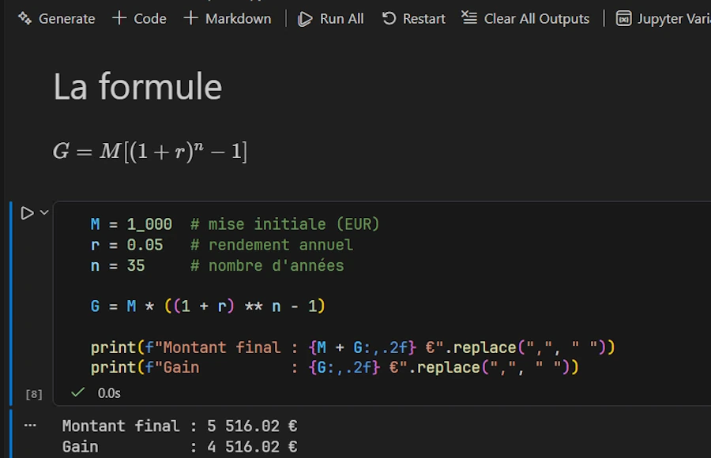
<figcaption>Calcul du gain de 1 000 € placés à 5 % sur 35 ans</figcaption>
</figure>

Mamie, c'est pas pour me vanter mais l'honneur est sauf. On retrouve bien les 5 500 € de mes 16 ans mais ici comme on imagine que la mise de fond est de 1 000 €, à la fin le gain est de 4 500 € environ.

Bien, bien, bien… Je vois que tu as au moins appris 1 ou 2 trucs dans ton école. Est-ce que tu peux afficher tout ça dans un graphe s'il te plaît ?

Tes désirs sont des ordres…

```python
import matplotlib.pyplot as plt

M = 1_000  # mise initiale (€)
r = 0.05   # rendement annuel
N = 35     # duree max (annees)

annees = list(range(N + 1))
gains = [M * ((1 + r) ** n - 1) for n in annees]

fig, ax = plt.subplots(figsize=(9, 5))
ax.plot(annees, gains, marker='o', markersize=3)
ax.set_xlabel("Années")
ax.set_ylabel("Gain (€)")
ax.set_title(f"Évolution du gain de {M:,.2f} € placés à {r:.0%} sur {N} ans".replace(",", " "))
ax.grid(True, alpha=0.3)
fig.tight_layout()
plt.show()

```

<figure style="max-width: 900px; margin: auto; text-align: center;">

<figcaption>Évolution du gain de 1 000 € placés à 5 % sur 35 ans</figcaption>
</figure>


Super. Maintenant, on peut commencer à discuter. Tiens, affiche-moi les 3 graphes quand on double
1. le montant initial (2 000 € au lieu de 1 000 €)
1. le rendement (10 % au lieu de 5)
1. la durée (70 ans au lieu de 35)

Voilà ce que je vois. Respectivement 9 000 €, 27 000 € et 29 000 €

<figure style="max-width: 900px; margin: auto; text-align: center;">
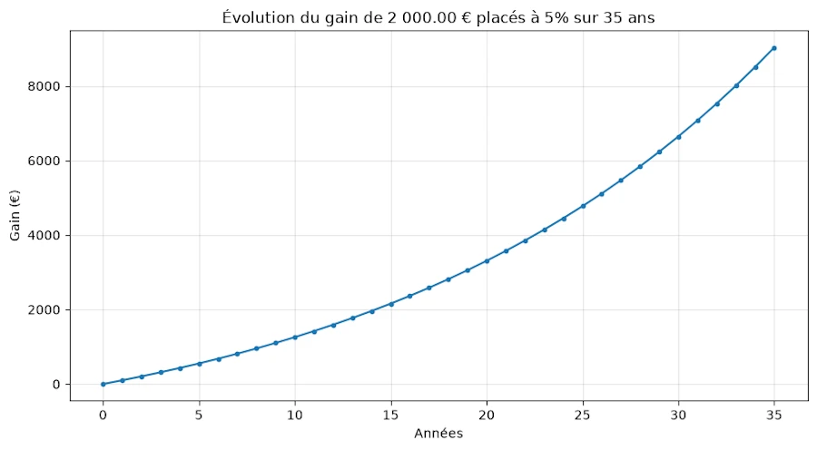
<figcaption>Évolution du gain de 2 000 € placés à 5 % sur 35 ans</figcaption>
</figure>

<figure style="max-width: 900px; margin: auto; text-align: center;">
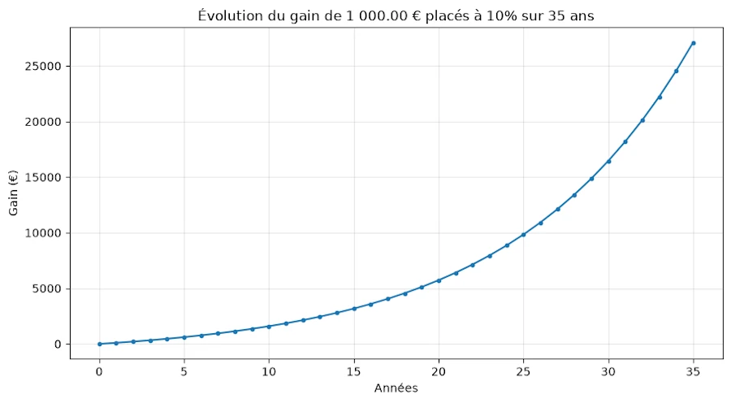
<figcaption>Évolution du gain de 1 000 € placés à 10 % sur 35 ans</figcaption>
</figure>

<figure style="max-width: 900px; margin: auto; text-align: center;">
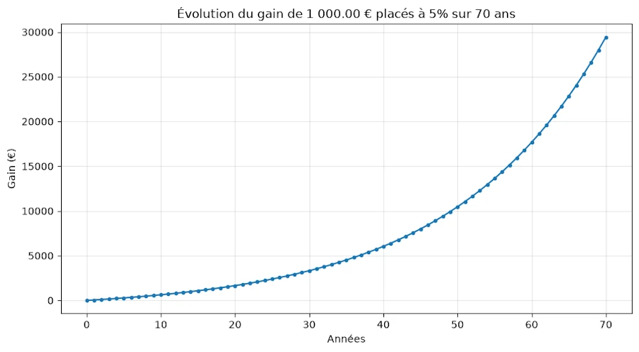
<figcaption>Évolution du gain de 1 000 € placés à 5 % sur 70 ans</figcaption>
</figure>


Et du coup Marty, qu'est-ce qui te vient en tête ?

J'ai pas l'impression que doubler la mise au départ soit si intéressant. En fait si, c'est rentable, car on gagne 2 fois plus (9 k au lieu de 4.5 k) mais bon c'est linéaire.

Dans les autres cas, c'est une tout autre histoire. Au bout de 70 ans, troisième cas, j'aurai une hanche en titane, plus de dents mais je pourrai m'acheter une Rolex avec les 29 k€ de gains mais…

Le mieux, c'est peut-être le compromis du second cas et trouver un placement qui double les intérêts. Dans ce cas à 53 ans ($$18+35=53$$) je pourrai m'acheter et profiter pendant quelques années encore d'une très belle moto à 27 000 balles.

Tu es mon digne petit-fils. Oui, il y a 3 paramètres indépendants dans ton équation et en jouant sur les valeurs, on voit que certains ont plus d'influence que d'autres. Alors… Commence pas à faire ta mijaurée ou ton wokiste de base. Imagine… Imagine que tu te balades sur une plage et qu'en marchant, tu rattrapes une fille que tu vois de dos. Qu'est-ce qui va faire que tu vas vouloir engager la conversation avec elle ? La longueur des cheveux, ses fesses, son bronzage… Bon ben voilà, t'as tout compris. Là aussi y a plusieurs paramètres indépendants mais certains sont plus importants que d'autres.

Du coup, la question à 1 M$ c'est : est-ce que tu es capable d'aller plus loin que les tests de doublement de valeur qu'on vient de faire et de retrouver, par calcul, l'influence de chacun des 3 paramètres ?

Mouai… Normalement c'est possible. On a vu ça en physique et mon prof qui lui n'est pas un obsédé avait un exemple tout aussi pertinent. Il disait : imaginez que vous êtes au sommet d'une petite colline avec votre snowboard. Le terrain c'est une surface dont l'altitude est une fonction de $$x$$ et de $$y$$, un truc du style $$z = f(x, y)$$. Du coup si tu pars vers le nord, $$x$$ ne change pas, seul $$y$$ varie et la pente est peut-être douce. Si tu pars vers l'ouest, $$y$$ ne change pas, seul $$x$$ varie et la pente est peut-être plus prononcée, et c'est donc plus de fun assuré (In tartiflette we trust !). Du coup les gars, pas de panique, calculer une dérivée partielle ça revient à étudier la formule initiale en bloquant tous les paramètres sauf un et à regarder alors ce qui se passe.

<figure style="max-width: 900px; margin: auto; text-align: center;">
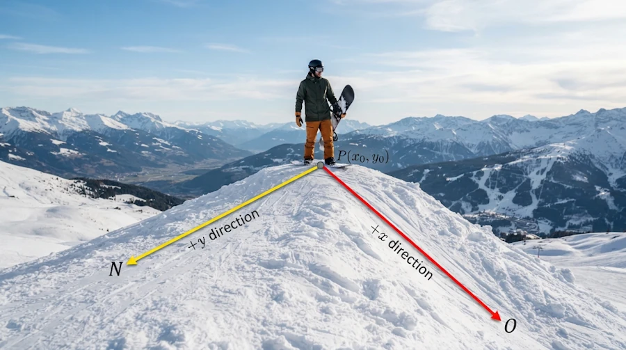
<figcaption>Dérivées partielles en snowboard</figcaption>
</figure>

Allez, c'est parti.


<!-- ###################################################################### -->
### Ce qu'il faut retenir

1. Le gain d'un placement à intérêts composés s'écrit $$G = M \left[ (1+r)^n - 1 \right]$$ avec $$M$$ le montant initial, $$r$$ le rendement annuel (0.05 pour 5 %) et $$n$$ le nombre d'années.

1. Les 3 paramètres n'ont pas la même influence sur le gain. Le montant a une influence linéaire. Le rendement et la durée semblent avoir un effet beaucoup plus important mais similaire entre eux.

1. Pour quantifier l'influence de chaque paramètre on va devoir calculer les dérivées partielles.


<!-- ###################################################################### -->
<!-- ###################################################################### -->
<!-- ###################################################################### -->
## Dérivation partielle

Je reprends la formule de départ.

$$
G = M \left[ (1+r)^n - 1 \right]
$$


<!-- ###################################################################### -->
### Qu'est-ce qui se passe si le montant varie ?

Je réécris l'équation sous la forme

$$
y = x \left[ (1+r)^n - 1 \right]
$$

Il faut bien voir que $$x$$ est la variable indépendante et que $$r$$ et $$n$$ doivent être considérés comme des constantes. À l’extrême, on pourrait écrire l'équation précédente sous la forme :

$$
\begin{align*}
y &= x \left[ (1+r)^n - 1 \right] \\
y &= x K \\
y &= K x
\end{align*}
$$

Si je dérive, j'obtiens

$$
\begin{align*}
y^\prime &= K \\
y^\prime &= \left[ (1+r)^n - 1 \right] \\
y^\prime &= (1+r)^n - 1 \\
G^\prime &= (1+r)^n - 1
\end{align*}
$$


Mais comme on veut se rappeler que ce qu'on a sous les yeux, c'est la variation du gain $$G$$ quand le montant $$M$$ varie, on n'écrit pas $$G^\prime$$ mais plutôt $$\frac{\partial G}{\partial M}$$. Un, c'est trop la classe et deux, ça veut juste dire, dérivée partielle de $$G$$ par rapport à $$M$$. Du coup, j'écris :


$$
\frac{\partial G}{\partial M} = (1+r)^n - 1
$$

Et tu comprends ça comment mon petit Marty ?

Ben… Je me dis que si $$r$$ et $$n$$ sont des constantes, 5 % et 35 ans par exemple, alors le membre de droite de l'égalité est constant lui aussi. Ici, avec les valeurs précédentes il vaut 4.5160. Y a pas de surprise. On avait $$ y = K x$$. La pente c'est $$K$$ (4.5160). Le gain varie linéairement avec le montant. Si on injecte 1000 € au début, on va récupérer 4 516 € à la fin. Plus important, cela explique pourquoi quand on double le montant au départ (2000 € vs 1000 € par exemple) à la fin, on a "juste" doublé le gain.


<!-- ###################################################################### -->
### Qu'est-ce qui se passe si le rendement varie ?

Je pars de l'équation

$$
G = M \left[ (1+r)^n - 1 \right]
$$

Je la réécris sous la forme

$$
y = M \left[ (1+x)^n - 1 \right]
$$

Ça ressemble à $$y = M [f(x) - 1]$$ dont la dérivée est de la forme $$y^\prime = M f^\prime(x)$$.

Ensuite la dérivée de $$(1+x)^n$$ c'est la dérivée de $$u^n$$ soit $$nu^{n-1}u^\prime$$ soit ici $$n (1+x)^{n-1} \, 1$$ car la dérivée de $$x$$ c'est $$1$$.

Du coup, j'écris

$$
\frac{\partial y}{\partial x} = M \, n \, (1+x)^{n-1}
$$

Soit avec les noms des variables du début

$$
\frac{\partial G}{\partial r} = M \, n \, (1+r)^{n-1}
$$

Et qu'est-ce que ça veut dire en français dans le texte ?

La dérivée partielle du gain par rapport au rendement est une fonction qui ressemble bigrement à $$y^\prime=K \,X^N$$. J'ai remplacé $$1+r$$ par $$X$$ et $$n-1$$ par $$N$$ pour bien faire ressortir le fait qu'on a une "simple" fonction puissance de $$X$$, qui grimpe vite, très vite.


Mouai… C'est bien joli tout ça mon petit Marty, mais tes $$X^N$$, ils me disent pas combien je gagne, moi. Tu peux me faire une application numérique ? Tu gardes les 1 000 € et les 35 ans, et tu fais varier le rendement de 1 % à 10 % par exemple.

Pas de souci Mamie. Je retourne dans mon notebook, je crée une section "Qu'est-ce qui se passe si le rendement varie ?" et après quelques tâtonnements, j'obtiens ce code :

```python
M = 1_000  # mise initiale (€)
n = 35     # nombre d'années

def gain(r):
    return M * ((1 + r) ** n - 1)

def derivee(r):
    return M * n * (1 + r) ** (n - 1)

def fmt(x):
    return f"{x:,.0f} €".replace(",", " ")

print(f"{'r':>5} | {'Gain G':>10} | {'dG/dr':>12} | {'Pente / point':>13} | {'G(r+1%) - G(r)':>14}")
print("-" * 68)
for pct in range(1, 11):
    r = pct / 100
    print(f"{r:>5.0%} | {fmt(gain(r)):>10} | {fmt(derivee(r)):>12} | "
          f"{fmt(derivee(r) / 100):>13} | {fmt(gain(r + 0.01) - gain(r)):>14}")
```

La fonction `gain()` c'est la formule du début et la fonction `derivee()` c'est la dérivée partielle qu'on vient de calculer. Ensuite, pour chaque rendement de 1 % à 10 %, j'affiche une ligne du tableau. À l'exécution, je vois :

```text
    r |     Gain G |        dG/dr | Pente / point | G(r+1%) - G(r)
--------------------------------------------------------------------
   1% |      417 € |     49 090 € |         491 € |          583 €
   2% |    1 000 € |     68 624 € |         686 € |          814 €
   3% |    1 814 € |     95 617 € |         956 € |        1 132 €
   4% |    2 946 € |    132 801 € |       1 328 € |        1 570 €
   5% |    4 516 € |    183 867 € |       1 839 € |        2 170 €
   6% |    6 686 € |    253 786 € |       2 538 € |        2 990 €
   7% |    9 677 € |    349 234 € |       3 492 € |        4 109 €
   8% |   13 785 € |    479 155 € |       4 792 € |        5 629 €
   9% |   19 414 € |    655 494 € |       6 555 € |        7 688 €
  10% |   27 102 € |    894 168 € |       8 942 € |       10 472 €
```

Attends, attends… Doit y avoir une erreur dans le code ? Ligne 5 %, ta dérivée, elle vaut 183 867 €. Avec 1 000 € de mise ? Tu vas me faire croire que je vais gagner 183 k€ ?

Non, non Mamie… Regarde l'en-tête de la colonne. C'est pas un montant c'est une dérivée, un taux d'accroissement. Elle dit de combien bouge $$G$$ quand $$r$$ bouge de 1. Sauf que $$r = 1$$ ça veut dire 100 %. Autrement dit 183 867 €, c'est ce qu'on gagnerait en plus si le rendement passait de 5 % à 105 %, et encore, seulement si la pente restait la même tout du long. Personne ne fait ça. Nous, ce qui nous intéresse, c'est de passer de 5 % à 6 %, donc un point de rendement, donc $$\Delta r = 0.01$$. Il faut diviser par 100 :

$$
\Delta G \approx \frac{\partial G}{\partial r} \times \Delta r = 183\,867 \times 0.01 \approx 1\,839 \text{ €}
$$

C'est comme le compteur de la voiture. Si tu roules à 90 km/h pendant une minute, tu ne fais pas 90 km. Tu fais $$90/60 = 1.5$$ km. Le compteur donne une vitesse "par heure", la dérivée donne une pente "par 100 % de rendement". Dans les deux cas, il faut ramener ça à la durée, ou à la variation, qui nous intéresse. C'est ce que montre la colonne "Pente / point" : à 5 %, un point de rendement en plus rapporte environ 1 839 € de plus au bout de 35 ans.

Mouai. Et comment je sais que ton truc est juste ?

Facile, c'est la dernière colonne. Là, je ne fais aucune dérivée, je calcule bêtement le gain à 6 % puis le gain à 5 % et je fais la différence : $$6\,686 - 4\,516 = 2\,170$$ €. On est dans les mêmes eaux que les 1 839 € mais la dérivée sous-estime un peu. Et c'est normal. La dérivée c'est la pente **au point** 5 %. Or entre 5 % et 6 % la pente ne reste pas constante, elle continue de grimper (à 6 %, elle vaut déjà 2 538 € par point). Si on utilise la pente du départ (à 5 %) pour tout le trajet qui va de 5 % à 6 %, on "oublie" l'accélération. C'est comme une voiture qui accélère : si tu estimes la distance de la prochaine minute avec ta vitesse actuelle, tu te trompes forcément par défaut. D'ailleurs, regarde, la vraie valeur (2 170 €) est bien coincée entre la pente à 5 % (1 839 €) et la pente à 6 % (2 538 €).


Tiens, pour bien visualiser ces histoires d'erreur, dans le notebook, je crée une section "La tangente sous-estime une courbe qui accélère" dans laquelle je te propose le code et l'illustration suivante avec la fonction $$x^2$$. Le code est "compliqué" car il y a beaucoup de choses à faire pour avoir un graphe "sympa". Sinon, on trace juste la fonction $$y=x^2$$, la tangente à la courbe en $$x=2$$ et on calcule, en $$x=3$$, la différence entre la valeur de la fonction et la hauteur à laquelle se trouve la dérivée.

```python
import matplotlib.pyplot as plt

x0 = 2   # point où l'on trace la tangente
x1 = 3   # point où l'on utilise la tangente pour estimer f

def f(x):
    return x ** 2

pente = 2 * x0  # f'(x) = 2x

xs = [i / 100 for i in range(0, 351)]  # 0 à 3.5
courbe = [f(x) for x in xs]
tangente = [f(x0) + pente * (x - x0) for x in xs]

vrai = f(x1)                               # vraie valeur
estim = f(x0) + pente * (x1 - x0)          # estimation par la tangente
erreur = vrai - estim

fig, ax = plt.subplots(figsize=(9, 5))
ax.plot(xs, courbe, label="y = x²")
ax.plot(xs, tangente, linestyle="--", label=f"Tangente en x = {x0} (pente {pente})")
ax.plot([x0], [f(x0)], marker="o", color="black")
ax.plot([x1], [vrai], marker="o", color="tab:blue")
ax.plot([x1], [estim], marker="o", color="tab:orange")

# Erreur : écart vertical entre la courbe et la tangente en x1
ax.vlines(x1, estim, vrai, color="red", linewidth=3, label=f"Erreur = {erreur:g}")
ax.annotate(f"vraie valeur : {x1}² = {vrai:g}", (x1, vrai), xytext=(-150, 10), textcoords="offset points")
ax.annotate(f"tangente : {f(x0):g} + {pente} × {x1 - x0} = {estim:g}", (x1, estim),
            xytext=(-190, -15), textcoords="offset points")

ax.set_xlabel("x")
ax.set_ylabel("y")
ax.set_title("La tangente sous-estime une courbe qui accélère")
ax.grid(True, alpha=0.3)
ax.legend(loc="upper left")
fig.tight_layout()
plt.show()

print(f"f({x1}) = {vrai:g}, tangente en x = {x1} : {estim:g}, erreur = {erreur:g}")

```

<figure style="max-width: 900px; margin: auto; text-align: center;">
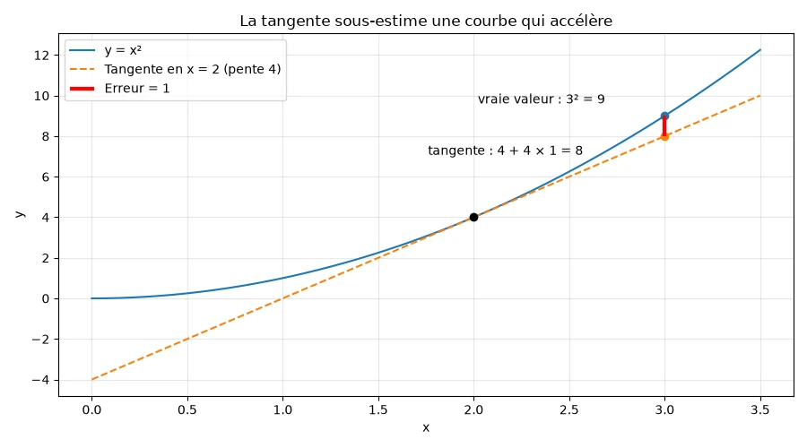
<figcaption>La tangente sous-estime une courbe qui accélère</figcaption>
</figure>


Ok c'est clair maintenant. Et sinon, si tu lis le tableau de haut en bas, tu vois quoi ?

Déjà, revoilà le tableau

```text
    r |     Gain G |        dG/dr | Pente / point | G(r+1%) - G(r)
--------------------------------------------------------------------
   1% |      417 € |     49 090 € |         491 € |          583 €
   2% |    1 000 € |     68 624 € |         686 € |          814 €
   3% |    1 814 € |     95 617 € |         956 € |        1 132 €
   4% |    2 946 € |    132 801 € |       1 328 € |        1 570 €
   5% |    4 516 € |    183 867 € |       1 839 € |        2 170 €
   6% |    6 686 € |    253 786 € |       2 538 € |        2 990 €
   7% |    9 677 € |    349 234 € |       3 492 € |        4 109 €
   8% |   13 785 € |    479 155 € |       4 792 € |        5 629 €
   9% |   19 414 € |    655 494 € |       6 555 € |        7 688 €
  10% |   27 102 € |    894 168 € |       8 942 € |       10 472 €
```


Je vois que la colonne "Pente / point" s'envole. Un point de rendement en plus, ça vaut 491 € quand on est à 1 % et presque 9 000 € quand on est à 10 %. C'est 18 fois plus pour le même point de pourcentage ! C'est ça la "fonction puissance qui grimpe vite" de tout à l'heure. Et c'est très différent du cas de la dérivée partielle par rapport au montant qui était constante : chaque millier d'euros en plus au départ rapportait 4 516 € de plus, que l'on parte de 1 000 € ou de 10 000 €.

Parfait. Peux-tu illustrer tout ça avec un graphe ?

Dans le notebook, je crée une section que je nomme "Illustration du tableau précédent", je me gratte un peu la tête et finalement, j'obtiens le code ci-dessous et le graphe :

```python
import matplotlib.pyplot as plt

M = 1_000  # mise initiale (€)
n = 35     # nombre d'années
r0 = 0.05  # point où l'on trace la tangente

rs = [i / 1000 for i in range(0, 101)]  # 0 % à 10 %
gains = [M * ((1 + r) ** n - 1) for r in rs]

G0 = M * ((1 + r0) ** n - 1)
pente = M * n * (1 + r0) ** (n - 1)
tangente = [G0 + pente * (r - r0) for r in rs]

fig, ax = plt.subplots(figsize=(9, 5))
ax.plot([r * 100 for r in rs], gains, label="Gain G(r)")
ax.plot([r * 100 for r in rs], tangente, linestyle="--",
        label=f"Tangente en r = {r0:.0%} (pente : {pente / 100:,.0f} € par point)".replace(",", " "))
ax.plot([r0 * 100], [G0], marker="o", color="black")
ax.set_xlabel("Rendement annuel r (%)")
ax.set_ylabel("Gain (€)")
ax.set_title(f"Gain de {M:,.0f} € placés sur {n} ans selon le rendement".replace(",", " "))
ax.yaxis.set_major_formatter(lambda y, _: f"{y:,.0f}".replace(",", " "))
ax.grid(True, alpha=0.3)
ax.legend()
fig.tight_layout()
plt.show()
```

<figure style="max-width: 900px; margin: auto; text-align: center;">
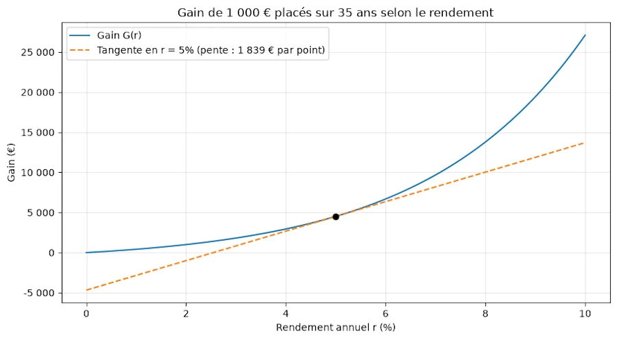
<figcaption>Gain de 1 000 € placés sur 35 ans selon le rendement, avec la tangente en r = 5 %</figcaption>
</figure>

C'est graphique mais bon Marty, comment on lit ça ?

Cette fois-ci, en abscisse on n'a plus les années mais le rendement, de 0 % à 10 %. La durée est bloquée à 35 ans et la mise à 1 000 €. C'est exactement l'idée de la dérivée partielle : on bloque tout sauf le paramètre qui nous intéresse (ici le rendement $$r$$).

1. **La courbe pleine** c'est le gain $$G(r)$$, la colonne "Gain G" du tableau mais avec beaucoup plus de points. Elle est presque à l'horizontale à gauche et elle se redresse de plus en plus vers la droite. Plus on avance, plus elle est raide. Ça, c'est la colonne "Pente / point" qui s'envole.
1. **Le point noir** c'est notre cas de référence : 5 %, 4 516 €.
1. **Les pointillés** c'est la tangente à la courbe en ce point. C'est la droite qui "frôle" la courbe en $$r=5\%$$ et qui a précisément la même pente qu'elle a à cet endroit. Tu te rappelles l'équation de la tangente que tu m'avais fait réviser en long et en large quand j'étais en Première ? $$y = f(a) + f^\prime(a)(x - a)$$. Ben, c'est exactement la ligne `tangente = [G0 + pente * (r - r0) for r in rs]` du code, avec $$a = 5\%$$ et $$f^\prime(a) = 183\,867$$.


<!-- ---------------------------------------------------------------------  -->
#### Note
{: .no_toc }

Si c'est la panique à propos de l'équation de la droite qui porte la dérivée, tu peux lire cet excellent [article](https://www.40tude.fr/docs/03_maths/005_derivee_differentielle/005_derivee_differentielle.html)


Et maintenant Mamie, le plus intéressant. Pose ton doigt sur $$r=6\%$$ en abscisse. La tangente donne $$4\,516 + 1\,839 = 6\,355$$ €. La courbe, elle, donne 6 686 €. L'écart entre les deux (331 €), c'est l'écart entre les colonnes "Pente / point" et "G(r+1 %) - G(r)" du tableau ($$2\,170 - 1\,839$$). Le tableau et le dessin racontent la même histoire.

On voit aussi que la tangente reste partout **sous** la courbe (la courbe est convexe). C'est pour ça que l'approximation par la dérivée est toujours un peu trop pessimiste ici. Enfin, si on s'éloigne trop de 5 %, la tangente raconte n'importe quoi. Vers la gauche elle finit même par passer sous zéro, ce qui n'a aucun sens pour un gain. La dérivée c'est un outil local, un zoom autour d'un point. Pour des petites variations elle est top, pour des grandes variations il vaut mieux refaire le calcul complet.


<!-- ###################################################################### -->
### Qu'est-ce qui se passe si la durée varie ?

Je pars de l'équation

$$
G = M \left[ (1+r)^n - 1 \right]
$$

Je la réécris sous la forme

$$
y = M \left[ (1+r)^x - 1 \right]
$$

$$
y = M \,(1+r)^x - M
$$

Du coup la dérivée de $$y$$ c'est la dérivée de $$M \,(1+r)^x$$ car la dérivée de $$M$$ par rapport à $$x$$ c'est 0. Mais bon, je suis coincé car je cherche la dérivée par rapport à $$x$$ d'un truc de la forme $$K^x$$ et ça, je sais pas faire. Mamie ? Une idée ?

Non, débrouille-toi tout seul t'es un grand garçon. Je veux bien admettre que vous êtes de plus en plus nuls au point d'être quasiment dernier au classement [PISA](https://www.planetegrandesecoles.com/classement-pisa-france-resultats) mais bon, faut pas pousser.

OK, ok, ok… Te fâche pas. Le truc dont je me souviens c'est que s'il y a une puissance, faut utiliser les logs. Oui mais moi, j'ai $$K^x$$. Le log de ce truc-là ne m'arrange pas, je vais me retrouver avec $$\ln(K^x)$$… Moi ce que je veux c'est avoir un truc qui vaut $$K^x$$.

Marty, si je te donne $$\ln(5)$$, comment tu retrouves $$5$$ ?

Ben c'est évident, je prends l'exponentielle… Ayé, j'ai compris ! J'ai $$K^x$$, pour jouer avec les puissances je veux utiliser $$\ln(K^x)$$ du coup, j'écris $$e^{\ln(K^x)}$$.

À partir de là, la vie est belle car dériver $$K^x$$ ça revient à dériver $$e^{\ln(K^x)}$$ ce qui revient à dériver $$e^X$$ et ça c'est facile c'est de la forme $$e^X \, X^\prime$$. Du coup, je peux écrire :

$$
\begin{align*}
\frac{\partial y}{\partial x} &= \frac{\partial (M \,(1+r)^x)}{\partial x} \\
\frac{\partial y}{\partial x} &= M \, \frac{\partial ((1+r)^x)}{\partial x} \\
\frac{\partial y}{\partial x} &= M \, \frac{\partial (e^{\ln(1+r)^x})}{\partial x} \\
\frac{\partial y}{\partial x} &= M \, \frac{\partial (e^{x\ln(1+r)})}{\partial x} \\
\frac{\partial y}{\partial x} &= M \, e^{x\ln(1+r)} \, \frac{\partial (x\ln(1+r))}{\partial x} \\
\frac{\partial y}{\partial x} &= M \, e^{\ln(1+r)^x} \, \frac{\partial (x\ln(1+r))}{\partial x} \\
\frac{\partial y}{\partial x} &= M \, (1+r)^x \, \frac{\partial (x\ln(1+r))}{\partial x} \\
\frac{\partial y}{\partial x} &= M \, (1+r)^x \, \ln(1+r) \\

\end{align*}
$$


Enfin, si je reprends les notations de la formule de départ, j'arrive à :


$$
\frac{\partial G}{\partial n} = M \, (1+r)^n \ln(1+r)
$$

Et voilà Mamie, c'est plié !

Pas si vite jeune homme. Une formule c'est bien joli mais tu sais ce que je pense des formules qu'on ne sait pas lire. Qu'est-ce qu'elle raconte la tienne ?

Alors… Déjà, si je regarde bien, $$M \,(1+r)^n$$ c'est le montant total sur le compte au bout de $$n$$ années. La mise plus le gain, $$M + G$$ quoi. Je peux donc écrire :

$$
\frac{\partial G}{\partial n} = (M + G) \ln(1+r)
$$

Ensuite, avec $$r=5\%$$, $$\ln(1.05) \approx 0.0488$$. C'est presque 5 %. Autrement dit, une année de plus rapporte à peu près 5 % de ce qu'il y a déjà sur le compte. Dit comme ça, ça paraît bête, c'est la définition même des intérêts… Mais la conséquence est énorme : **la vitesse à laquelle le gain grossit est proportionnelle à ce qu'on a déjà accumulé**. Plus la boule de neige qui descend de la montagne est grosse, plus elle ramasse de neige à chaque tour. C'est la signature d'une exponentielle. Pour le rendement, $$r$$ était "en bas", dans une fonction puissance. Ici, $$n$$ est "en haut", dans l'exposant.

Bien, moi, je suis une vieille dame, faut que je voie pour croire. Tu me fais la même chose que pour le rendement ? Un tableau puis un graphe. Tu gardes les 1 000 € et les 5 % et cette fois, tu fais varier la durée de 0 à 70 ans.

Pas de souci. Dans le notebook, dans la section "Qu'est-ce qui se passe si la durée varie ?", je recopie presque le code du rendement. Seule la fonction `derivee()` change (il faut un `import math` pour avoir le logarithme `math.log()`) et la boucle porte maintenant sur les années, de 5 en 5 :

```python
import math

M = 1_000  # mise initiale (€)
r = 0.05   # rendement annuel

def gain(n):
    return M * ((1 + r) ** n - 1)

def derivee(n):
    return M * (1 + r) ** n * math.log(1 + r)

def fmt(x):
    return f"{x:,.0f} €".replace(",", " ")

print(f"{'n':>4} | {'Gain G':>10} | {'dG/dn':>10} | {'G(n+1) - G(n)':>13}")
print("-" * 47)
for n in range(0, 71, 5):
    print(f"{n:>4} | {fmt(gain(n)):>10} | {fmt(derivee(n)):>10} | {fmt(gain(n + 1) - gain(n)):>13}")
```

À l'exécution, je vois :

```text
   n |     Gain G |      dG/dn | G(n+1) - G(n)
-----------------------------------------------
   0 |        0 € |       49 € |          50 €
   5 |      276 € |       62 € |          64 €
  10 |      629 € |       79 € |          81 €
  15 |    1 079 € |      101 € |         104 €
  20 |    1 653 € |      129 € |         133 €
  25 |    2 386 € |      165 € |         169 €
  30 |    3 322 € |      211 € |         216 €
  35 |    4 516 € |      269 € |         276 €
  40 |    6 040 € |      343 € |         352 €
  45 |    7 985 € |      438 € |         449 €
  50 |   10 467 € |      559 € |         573 €
  55 |   13 636 € |      714 € |         732 €
  60 |   17 679 € |      911 € |         934 €
  65 |   22 840 € |    1 163 € |       1 192 €
  70 |   29 426 € |    1 485 € |       1 521 €
```

Attends, attends… Cette fois, tu n'as pas divisé par 100 ? Elle est où ta colonne "Pente / point" ?

Bien vu Mamie, mais non, pas besoin. Pour le rendement, la dérivée était exprimée "par 100 % de rendement" et il fallait la ramener à un point. Ici $$n$$ se compte en années, donc la dérivée est directement en "euros par an". Une année de plus c'est $$\Delta n = 1$$ et on lit la colonne telle quelle. À 35 ans, une année de plus rapporte environ 269 € selon la dérivée et 276 € en vrai (dernière colonne).

Et là encore la dérivée sous-estime ?

Oui, pour la même raison que tout à l'heure : la courbe accélère et la tangente reste en dessous. Mais regarde, l'écart est minuscule et surtout, il est toujours le même en proportion : 49 contre 50, 269 contre 276, 1 485 contre 1 521… La valeur exacte est toujours environ 2.5 % au-dessus. C'est logique. Sur une année, l'augmentation c'est $$G(n+1) - G(n) = M(1+r)^n \times r$$, soit 5 % du montant. La dérivée c'est $$M(1+r)^n \times \ln(1+r)$$, soit 4.88 % du montant. Le rapport des deux vaut $$0.05 / 0.0488 \approx 1.025$$ et ce, quel que soit $$n$$.

OK. Et si tu lis le tableau de haut en bas ?

La colonne "dG/dn" double à peu près tous les 14 ou 15 ans : 49 € au départ, 101 € à 15 ans, 211 € à 30 ans, 438 € à 45 ans, 911 € à 60 ans. Et je peux même le calculer. Doubler $$(1+r)^n$$ revient à avoir $$n \ln(1+r) = \ln 2$$ soit $$n = \ln 2 / \ln(1.05) \approx 14.2$$ ans.

Ah ! Ça, de mon temps, à la banque on appelait ça [la règle du 70](#la-règle-du-70). Tu divises 70 par le rendement en pourcent et tu as le temps de doublement : $$70/5 = 14$$ ans. Pas besoin de logarithme, juste un crayon et le dos d'une enveloppe.

Trop fort… Du coup ça veut dire que la première année m'a rapporté 50 € alors que la 70ᵉ m'en rapportera plus de 1 500. Les 35 premières années rapportent 4 516 € et les 35 suivantes $$29\,426 - 4\,516 = 24\,910$$ €. Cinq fois plus pour la même durée !

Voilà pourquoi je voulais que ton père t'ouvre ce PEA maintenant et pas quand tu auras 40 ans. **Le temps, c'est le seul ingrédient que tu ne pourras jamais racheter**. Bon, et ce graphe ?

Dans le notebook, je crée une section "Le gain en fonction de la durée" et je reprends le code du graphe du rendement. Sauf qu'en abscisse, on a maintenant la durée :

```python
import math
import matplotlib.pyplot as plt

M = 1_000  # mise initiale (€)
r = 0.05   # rendement annuel
N = 70     # durée max (années)
n0 = 35    # point où l'on trace la tangente

ns = [i / 10 for i in range(0, 10 * N + 1)]  # 0 à 70 ans
gains = [M * ((1 + r) ** n - 1) for n in ns]

G0 = M * ((1 + r) ** n0 - 1)
pente = M * (1 + r) ** n0 * math.log(1 + r)
tangente = [G0 + pente * (n - n0) for n in ns]

fig, ax = plt.subplots(figsize=(9, 5))
ax.plot(ns, gains, label="Gain G(n)")
ax.plot(ns, tangente, linestyle="--",
        label=f"Tangente en n = {n0} ans (pente : {pente:,.0f} € par an)".replace(",", " "))
ax.plot([n0], [G0], marker="o", color="black")
ax.set_xlabel("Durée n (années)")
ax.set_ylabel("Gain (€)")
ax.set_title(f"Gain de {M:,.0f} € placés à {r:.0%} selon la durée".replace(",", " "))
ax.yaxis.set_major_formatter(lambda y, _: f"{y:,.0f}".replace(",", " "))
ax.grid(True, alpha=0.3)
ax.legend()
fig.tight_layout()
plt.show()
```

<figure style="max-width: 900px; margin: auto; text-align: center;">
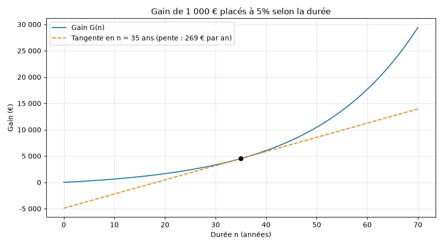
<figcaption>Gain de 1 000 € placés à 5 % selon la durée, avec la tangente en n = 35 ans</figcaption>
</figure>

C'est le même principe que pour le rendement. On bloque la mise (1 000 €) et le rendement (5 %) et on ne laisse bouger que la durée $$n$$.

1. **La courbe pleine** c'est le gain $$G(n)$$. D'ailleurs, c'est la même courbe que celle du tout début quand on avait doublé la durée à 70 ans. Elle est presque plate pendant une vingtaine d'années puis elle décolle. C'est la colonne "dG/dn" qui double tous les 14 ans.
1. **Le point noir** c'est encore notre cas de référence : 35 ans, 4 516 €.
1. **Les pointillés** c'est la tangente en $$n = 35$$ ans, de pente 269 € par an. Toujours la même formule $$y = f(a) + f^\prime(a)(x - a)$$, avec cette fois $$a = 35$$.

Tiens Mamie, pose ton doigt sur $$n = 36$$ ans. La tangente donne $$4\,516 + 269 = 4\,785$$ € et la courbe 4 792 €. À l'œil, on ne voit même pas la différence. Maintenant, pose ton doigt sur 70 ans. La tangente annonce environ 13 900 € alors que la courbe est à 29 426 €. La dérivée se trompe de plus de moitié ! Un an, c'est un petit pas pour l'homme et la tangente s'en sort très bien. 35 ans, c'est un pas de géant pour l'humanité et l'outil local qu'est la dérivée ne suffit plus. Et comme pour le rendement, si on part trop vers la gauche, la tangente passe sous zéro (vers 18 ans) ce qui n'a aucun sens pour un gain.


Pas mal, pas mal Marty. Du coup dans la formule

$$
G = M \left[ (1+r)^n - 1 \right]
$$

On a 3 paramètres ($$M$$, $$r$$ et $$n$$). On a fait un premier test en les doublant pour voir ce qui se passait dans les chiffres. Ensuite, tu as utilisé les dérivées partielles pour examiner l'impact de chacun d'entre eux. Ceci dit y a un truc qui me chagrine…

Ça m'aurait étonné…

Sérieux, Marty, tes formules, tes graphes tout ça c'est super et je suis vraiment très fier de toi. Le truc, et tu aurais dû soulever le problème tout seul, c'est qu'on ne compare pas des pommes avec des pommes. En fait, on a doublé le nombre d'années puis doublé le rendement pour finalement comparer l'impact sur le gain. Je pense qu'il serait plus "honnête" de faire varier chacun des paramètres (($$M$$, $$r$$ et $$n$$)) de 1 % puis de constater lequel de ces leviers a le plus d'impact sur le gain. Comprends tu mon problème ?


<!-- ###################################################################### -->
### Ce qu'il faut retenir

1. La dérivée partielle du gain par rapport au montant initial est une constante et donc le gain varie linéairement avec ce dernier.

1. La dérivée partielle du gain par rapport au rendement n'est pas constante. Elle augmente très vite avec $$r$$. Un point de rendement en plus vaut d'autant plus que le rendement est déjà élevé (491 € à 1 %, 8 942 € à 10 %, avec 1 000 € sur 35 ans).

1. La dérivée partielle du gain par rapport à la durée est proportionnelle à ce qu'il y a déjà sur le compte. Une année de plus rapporte environ $$r$$ % du montant accumulé. Elle croît de façon exponentielle et double à peu près tous les $$70/r$$ ans (14 ans à 5 %). Ce sont donc les dernières années qui rapportent le plus : il faut commencer tôt et ne pas toucher au placement.


<!-- ###################################################################### -->
<!-- ###################################################################### -->
<!-- ###################################################################### -->
## Effet relatif, élasticité

Ok Mamie, je vais le redire avec mes mots afin de m'assurer qu'on est bien synchros. Ce que tu dis, c'est que ces dérivées ont des unités différentes (€, %, années), donc on ne peut pas les comparer telles quelles (mon prof de Physique serait aux anges de t'entendre dire ça). Pour savoir quel levier est le plus puissant, il faut raisonner en effet relatif : "+1 % sur le paramètre donne combien de % de gain ?". Et ça, sauf erreur de ma part, ça s'appelle l'**élasticité** mais bon on s'en fout un peu.

Pour faire court, je cherche un truc qui répond à la question : si $$r$$ augmente de 1 % de sa valeur, de combien de % augmente $$G$$ ?

* La partie de la phrase "si $$r$$ augmente de 1 % de sa valeur" peut se traduire avec $$\frac{\Delta r}{r}$$.
* L'autre partie "de combien de % augmente $$G$$" peut se traduire avec $$\frac{\Delta G}{G}$$.

Du coup on peut s'amuser à faire le ratio des deux. Cela nous permettra de quantifier de combien varie $$G$$ quand $$r$$ varie de $$x\%$$ par exemple. Finalement, j'écris :


$$
\begin{align*}
E &= \frac{\text{Variation relative de } G \text{ en } \%}{\text{Variation relative de } r \text{ en } \%} \\
E &= \frac{\frac{\Delta G}{G}}{\frac{\Delta r}{r}} \\
E &= \frac{\Delta G}{G}\frac{r}{\Delta r} \\
E &= \frac{\Delta G}{\Delta r}\frac{r}{G} \\
\end{align*}
$$

Comme on va s’intéresser à de toutes petites variations, je préfère écrire

$$
E_r = \frac{\partial G}{\partial r} \cdot \frac{r}{G}
$$

Comme on va s'intéresser à chacun des paramètres et pas uniquement au taux, j'écris

$$
E_x = \frac{\partial G}{\partial x} \cdot \frac{x}{G}
$$


<!-- ###################################################################### -->
### Élasticité du montant

On avait

$$ G = M \left[ (1+r)^n - 1 \right]$$

$$\frac{\partial G}{\partial M} = (1+r)^n - 1$$


Du coup, on va écrire

$$
\begin{align*}
E_M &= \frac{\partial G}{\partial M} \cdot \frac{M}{G} \\
E_M &= \left[(1+r)^n - 1\right] \cdot \frac{M}{M \left[ (1+r)^n - 1 \right]} \\
E_M &=  \frac{M \left[ (1+r)^n - 1 \right]}{M \left[ (1+r)^n - 1 \right]} \\
E_M &= 1
\end{align*}
$$


Ça, ça veut dire que le gain varie dans les mêmes proportions que le montant initial. On retrouve ce que l'on avait testé : quand je double le montant initial, le gain final est doublé.

C'est utile à savoir mais c'est pas très excitant, allez, on passe au suivant.


<!-- ###################################################################### -->
### Élasticité du taux

On avait

$$ G = M \left[ (1+r)^n - 1 \right]$$

$$ \frac{\partial G}{\partial r} = M \, n \, (1+r)^{n-1}$$

Du coup, on va écrire

$$
\begin{align*}
E_r &= \frac{\partial G}{\partial r} \cdot \frac{r}{G} \\
E_r & = M \, n \, (1+r)^{n-1} \cdot \frac{r}{G} \\
E_r & = M \, n \, (1+r)^{n-1} \cdot \frac{r}{M \left[ (1+r)^n - 1 \right]} \\
E_r & = \frac{M \,n \, r \, (1+r)^{n-1}}{M \left[ (1+r)^n - 1 \right]} \\
E_r & = \frac{n \, r \, (1+r)^{n-1}}{(1+r)^n - 1 } \\
\end{align*}
$$


**Application numérique**

On se place en $$M = 1\,000\ \text{€}$$, $$r = 5\%$$ et $$n = 35$$ ans

$$
\begin{align*}
E_r & = \frac{n \, r \, (1+r)^{n-1}}{(1+r)^n - 1 } \\
E_r & = \frac{35 \cdot 0.05 \cdot 1.05^{34}}{1.05^{35} - 1 } \\
E_r & \approx \frac{9.1933}{4.5160} \\
E_r & \approx 2.0357 \\
\end{align*}
$$

On peut aussi faire une vérification "à la main" et augmenter le rendement de $$5\%$$ à $$5.05\%$$. En utilisant notre super formule du départ :

$$
G = M [(1 + r)^n - 1]
$$

Je trouve $$G_{05} = 1000 (1.05^{35} - 1) = 4516$$ et $$G_{0505} = 1000 (1.0505^{35} - 1) = 4608$$ ce qui veut dire que le gain a augmenté de $$2.05\%$$.


<!-- ###################################################################### -->
### Élasticité de la durée

On avait

$$ G = M \left[ (1+r)^n - 1 \right]$$

$$\frac{\partial G}{\partial n} = M \, (1+r)^n \ln(1+r)$$


Du coup, on va écrire

$$
\begin{align*}
E_n &= \frac{\partial G}{\partial n} \cdot \frac{n}{G} \\
E_n &= M \, (1+r)^n \ln(1+r) \cdot \frac{n}{G} \\
E_n &= M \, (1+r)^n \ln(1+r) \cdot \frac{n}{M \left[ (1+r)^n - 1 \right]} \\
E_n &=  \frac{M \, (1+r)^n \ln(1+r) \cdot n}{M \left[ (1+r)^n - 1 \right]} \\
E_n &= \frac{n \, (1+r)^n \ln(1+r)}{(1+r)^n - 1}
\end{align*}
$$


**Application numérique**

On se place en $$M = 1\,000\ \text{€}$$, $$r = 5\%$$ et $$n = 35$$ ans


$$
\begin{align*}
E_n &= \frac{n \, (1+r)^n \ln(1+r)}{(1+r)^n - 1}\\
E_n &= \frac{35 \cdot (1.05)^{35} \ln(1.05)}{(1.05)^{35} - 1}\\
E_n & \approx \frac{9.4194}{4.5160}\\
E_n & \approx 2.0857 \\
\end{align*}
$$

Ici aussi, je peux faire une vérification "à la mano". Je fais passer la durée de 35 à 35.35 ans ($$+1\%$$) dans notre formule du départ :

$$
G = M [(1 + r)^n - 1]
$$

Je trouve $$G_{35} = 1000 (1.05^{35} - 1) = 4516$$ et $$G_{3535} = 1000 (1.05^{35.35} - 1) = 4611$$ ce qui veut dire que dans ce cas-là, le gain a augmenté de $$2.10\%$$.


Ok Marty, tes vérifications "à la mano" tiennent la route. Mais tout ça, c'est pour 35 ans. Qu'est-ce qui se passe si je place mes sous 10 ans ? Ou 50 ans ?

Là pour le coup, plutôt que de refaire les calculs pour chaque durée, je retourne dans mon notebook. Dans une section "Effet relatif, élasticité" j'écris un script qui calcule $$E_r$$ et $$E_n$$ pour des durées allant de 0 à 50 ans et qui trace les deux courbes. Pour l'instant je garde $$r = 5\%$$.

J'arrive à ça :

```python
import math
import matplotlib.pyplot as plt

r = 0.05   # rendement annuel
N = 50     # durée max (années)
n0 = 35    # durée de référence

def E_r(n):
    return n * r * (1 + r) ** (n - 1) / ((1 + r) ** n - 1)

def E_n(n):
    return n * (1 + r) ** n * math.log(1 + r) / ((1 + r) ** n - 1)

print(f"{'n':>4} | {'E_r':>6} | {'E_n':>6} | {'E_n / E_r':>9}")
print("-" * 35)
for n in [1] + list(range(5, N + 1, 5)):
    print(f"{n:>4} | {E_r(n):>6.3f} | {E_n(n):>6.3f} | {E_n(n) / E_r(n):>9.4f}")

ns = [i / 10 for i in range(1, 10 * N + 1)]  # 0.1 à 50 ans (n = 0 interdit : division par 0)
er = [E_r(n) for n in ns]
en = [E_n(n) for n in ns]

fig, ax = plt.subplots(figsize=(9, 5))
ax.plot(ns, er, label="Élasticité du rendement $E_r$")
ax.plot(ns, en, linestyle="--", label="Élasticité de la durée $E_n$")
ax.axhline(1, color="gray", linestyle=":", label="Élasticité du montant $E_M = 1$")

# Point de référence : 35 ans
ax.plot([n0, n0], [E_r(n0), E_n(n0)], marker="o", linestyle="none", color="black")
ax.annotate(f"À {n0} ans : $E_r$ = {E_r(n0):.2f}, $E_n$ = {E_n(n0):.2f}\n"
            f"+1 % sur r ou sur n donne environ +{E_r(n0):.0f} % de gain",
            (n0, E_r(n0)), xytext=(n0 - 12, 0.35),
            arrowprops=dict(arrowstyle="->"))

ax.set_xlim(0, N)
ax.set_ylim(0, None)
ax.set_xlabel("Durée du placement n (années)")
ax.set_ylabel("Élasticité (% de gain pour +1 %)")
ax.set_title(f"Élasticités du gain selon la durée (rendement {r:.0%})")
ax.grid(True, alpha=0.3)
ax.legend(loc="upper left")
fig.tight_layout()
plt.show()
```

Les fonctions `E_r()` et `E_n()` sont juste les deux formules qu'on vient d'établir. Le seul piège c'est $$n = 0$$ : le dénominateur $$(1+r)^n - 1$$ vaut 0, donc je démarre à 0.1 an. À l'exécution, je vois :

```text
   n |    E_r |    E_n | E_n / E_r
-----------------------------------
   1 |  1.000 |  1.025 |    1.0246
   5 |  1.100 |  1.127 |    1.0246
  10 |  1.233 |  1.264 |    1.0246
  15 |  1.376 |  1.410 |    1.0246
  20 |  1.528 |  1.566 |    1.0246
  25 |  1.689 |  1.731 |    1.0246
  30 |  1.859 |  1.904 |    1.0246
  35 |  2.036 |  2.086 |    1.0246
  40 |  2.220 |  2.275 |    1.0246
  45 |  2.411 |  2.471 |    1.0246
  50 |  2.608 |  2.673 |    1.0246
```

Et le graphe ressemble à ça :

<figure style="max-width: 900px; margin: auto; text-align: center;">
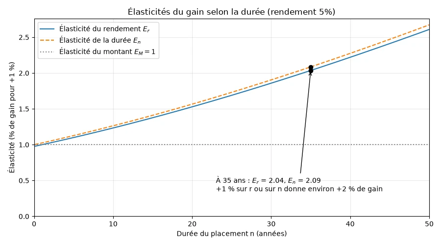
<figcaption>Élasticités du rendement et de la durée en fonction de la durée du placement, à 5 %</figcaption>
</figure>

Ok Marty et tu commente ça comment ?

Je remarque que :
1. Les deux courbes sont quasiment l'une sur l'autre, et ce, quelle que soit la durée. Le faible écart qu'on a trouvé à 35 ans n'était donc pas particulier.
1. Dans le tableau, la dernière colonne affiche toujours 1.0246. On dirait que le rapport $$\frac{E_n}{E_r}$$ ne dépend pas de la durée. Bizarre… Je garde ça dans un coin de la tête.
1. Les deux élasticités augmentent avec la durée, presque en ligne droite. Elles valent à peu près 1 au début, 2 à 35 ans et plus de 2.6 à 50 ans. Autrement dit, plus le placement est long, plus le gain devient sensible au rendement et à la durée. Et passé la première année, elles sont toutes les deux au-dessus de l'élasticité du montant, qui reste bloquée à 1.


Donc selon tes calculs, Marty, faire varier la durée de placement ou la valeur du rendement ça revient quasiment au même. Tu peux me le prouver ou au moins me l'expliquer ?

<!-- ******************************************* -->
<!-- ******************************************* -->
<!-- ******************************************* -->
<!-- ******************************************* -->
<!-- ******************************************* -->
<!-- ******************************************* -->
<!-- ******************************************* -->


Là, je sais pas trop quoi te dire Mamie. C'est vrai qu'avec nos valeurs, on a trouvé $$E_r=2.04$$ et $$E_n=2.09$$ mais bon… Les comparer… Ah si je me rappelle ce que nous a dit notre prof de Physique l'autre jour. Il nous a parlé de la [loi de Weber-Fechner](https://fr.wikipedia.org/wiki/Loi_de_Weber-Fechner) et du fait qu'on est plus sensible aux rapports qu'aux différences. Par exemple entre 1 et 2 on voit la différence alors qu'entre 20 et 21 on ne la voit plus.

Bref, pour comparer des valeurs on fait leur rapport. Bon, hé ben évaluons le rapport $$\frac{E_n}{E_r}$$.

Je commence en collant les expressions qu'on a précédemment déterminées :

$$
\begin{align*}
\frac{E_n}{E_r} &= \frac{\frac{n \, (1+r)^n \ln(1+r)}{(1+r)^n - 1}}{\frac{n \, r \, (1+r)^{n-1}}{(1+r)^n - 1 }}\\

\frac{E_n}{E_r} &= \frac{n \, (1+r)^n \ln(1+r)}{n \, r \, (1+r)^{n-1}}\\
\frac{E_n}{E_r} &= \frac{(1+r) \ln(1+r)}{r}\\
\frac{E_n}{E_r} &= \frac{(1+r)}{r} \cdot \ln(1+r)\\
\end{align*}
$$

Si je me place à $$r=5\%$$ et que je fais le calcul, je trouve $$\frac{E_n}{E_r} \approx 1.0246$$ alors qu'en prenant les valeurs respectives précédentes, je trouve $$\frac{2.0857}{2.0357} \approx 1.0246$$. Au moins c'est cohérent.

Mais bon, faut pas se voiler la face, là, le rapport il vend pas du rêve. Le truc à remarquer quand même c'est qu'il ne dépend que du rendement $$r$$, pas du montant $$M$$ ni de la durée $$n$$. Voilà pourquoi la dernière colonne de mon tableau était constante !

Sinon, cette année on utilise pas mal les développements limités et je sais que pour $$x$$ petit on peut écrire $$\ln(1+x) = x - \frac{x^2}{2} + \frac{x^3}{3} - \dots$$.

Du coup, en première approximation, quand je garde que le terme de degré 1 dans le développement limité car $$\frac{x^2}{2}$$ c'est tout petit ($$=0.00125$$), on peut dire que :

$$
\begin{align*}
\frac{E_n}{E_r} &= \frac{(1+r)}{r} \cdot r \\
\frac{E_n}{E_r} &= 1+r \\
\end{align*}
$$

Là, pour le coup, c'est assez violent, mais bon, "de tête", je peux évaluer $$\frac{E_n}{E_r} \approx 1.05$$. Oui, on est "loin" des $$1.025$$ mais bon, là aussi c'est homogène et en tout cas cela explique que les élasticités du rendement $$r$$ et de la durée $$n$$ sont du même ordre de grandeur.

"Loin"… Mon petit Marty, tu as jeté le terme en $$\frac{x^2}{2}$$ à la poubelle un peu vite. Tu as dit toi-même qu'il était tout petit. Mais tout petit par rapport à quoi ? Ramasse le et refais le calcul pour voir.

Ok, ok… Je garde les deux premiers termes du développement limité : $$\ln(1+r) \approx r - \frac{r^2}{2}$$. Du coup :

$$
\begin{align*}
\frac{E_n}{E_r} &\approx \frac{(1+r)}{r} \cdot \left(r - \frac{r^2}{2}\right) \\
\frac{E_n}{E_r} &\approx (1+r)\left(1 - \frac{r}{2}\right) \\
\frac{E_n}{E_r} &\approx 1 + r - \frac{r}{2} - \frac{r^2}{2} \\
\frac{E_n}{E_r} &\approx 1 + \frac{r}{2} \\
\end{align*}
$$

J'ai encore jeté le $$\frac{r^2}{2}$$ de l'avant-dernière ligne mais bon, maintenant, je sais ce que je fais. Avec $$r = 5\%$$ je trouve $$1 + 0.025 = 1.025$$. Pile-poil ! En fait, le terme "tout petit" n'était pas petit par rapport à l'écart que je cherchais à expliquer. Il **était** l'écart.

Voilà. Retiens ça : avant de négliger un terme, demande-toi toujours "petit par rapport à quoi ?".

Jouer sur le taux $$r$$ est donc aussi efficace que de jouer sur la durée $$n$$.

Très bonne analyse Marty. Moi, de mon côté je note qu'en relatif, c'est match nul. Mais **le temps, tu peux le choisir alors que le rendement tu le subis**. IOW (c'est une expression de jeunes ça, non ?) il faut commencer à épargner tôt, très tôt.

Enfin… Le rendement tu le subis, c'est pas tout à fait vrai. Tu en subis une partie seulement. Il y a un morceau du rendement sur lequel tu as la main et on va en parler tout de suite.

Heu… Mamie, je vois l'heure qui tourne et j'ai toujours rien compris à ton histoire d'actions et de PEA…

J'y viens j'y viens mon lapin. Mais avant ça j'ai besoin que tu écrives un petit script Python dans lequel je veux pouvoir simuler des frais **annuels** (attention, le mot est important) qui viendraient en soustraction du rendement. Idéalement, mais ça je sais que tu sais faire, je voudrais que tu affiches la courbe de gain sans frais et la courbe de gain avec frais. Fais simple prend 0.5 % de frais par an par exemple.


<!-- ###################################################################### -->
### Ce qu'il faut retenir

1. Les dérivées partielles ont des unités différentes. Les comparer c'est comparer des $$kg$$ avec des $$ms^{-1}$$. On compare leurs élasticités $$E_x = \frac{\partial G}{\partial x} \cdot \frac{x}{G}$$ qui répondent à la question : si $$x$$ augmente de 1 %, de combien de % augmente le gain ?

1. L'élasticité du montant vaut 1 : +1 % de mise donne +1 % de gain. Avec 1 000 € placés à 5 % sur 35 ans, les élasticités du rendement et de la durée valent environ 2 ($$E_r \approx 2.04$$ et $$E_n \approx 2.09$$) : +1 % sur l'un ou l'autre donne environ +2 % de gain.

1. Le rapport $$\frac{E_n}{E_r} = \frac{(1+r)\ln(1+r)}{r} \approx 1 + \frac{r}{2}$$ ne dépend que du rendement. En relatif, rendement et durée font match nul. Mais la durée on la choisit alors que le rendement, on le subit : il faut commencer à épargner tôt, très tôt.


<!-- ###################################################################### -->
<!-- ###################################################################### -->
<!-- ###################################################################### -->
## Les frais composés

En fait Mamie, il n'y a rien de bien compliqué. Au lieu d'avoir 5 % par an on aura 4.5 % par an. Le plus "touchy" dans l'histoire c'est de faire en sorte que le graphe soit facile à comprendre.

Après pas mal de *ratatouillages*, j'arrive à ce script :

```python
import matplotlib.pyplot as plt

M = 1_000      # mise initiale (€)
r = 0.05       # rendement annuel brut
frais = 0.005  # frais annuels (0.5 %)
N = 35         # durée (années)

def gain(taux, n):
    return M * ((1 + taux) ** n - 1)

def fmt(x):
    return f"{x:,.0f} €".replace(",", " ")

annees = list(range(N + 1))
sans_frais = [gain(r, n) for n in annees]
avec_frais = [gain(r - frais, n) for n in annees]  # les frais se soustraient au rendement

G_sans = sans_frais[-1]
G_avec = avec_frais[-1]
perte = G_sans - G_avec

print(f"Gain sans frais ({r:.1%})          : {fmt(G_sans)}")
print(f"Gain avec frais ({r - frais:.1%} net)      : {fmt(G_avec)}")
print(f"Coût des frais au bout de {N} ans : {fmt(perte)} ({perte / G_sans:.0%} du gain)")

fig, ax = plt.subplots(figsize=(9, 5))
ax.plot(annees, sans_frais, marker="o", markersize=3, label=f"Sans frais (rendement {r:.1%})")
ax.plot(annees, avec_frais, marker="o", markersize=3, label=f"Avec {frais:.1%} de frais (rendement net {r - frais:.1%})")
ax.fill_between(annees, avec_frais, sans_frais, color="red", alpha=0.15, label="Ce que coûtent les frais")
ax.annotate(f"Frais : - {fmt(perte)}", (N, (G_sans + G_avec) / 2), xytext=(N - 9, G_avec * 0.5),
            color="red", arrowprops=dict(arrowstyle="->", color="red"))
ax.set_xlabel("Années")
ax.set_ylabel("Gain (€)")
ax.set_title(f"Gain de {fmt(M)} placés à {r:.0%} sur {N} ans, avec et sans {frais:.1%} de frais annuels")
ax.yaxis.set_major_formatter(lambda y, _: f"{y:,.0f}".replace(",", " "))
ax.grid(True, alpha=0.3)
ax.legend(loc="upper left")
fig.tight_layout()
plt.show()
```
Qui affiche ce graphique

<figure style="max-width: 900px; margin: auto; text-align: center;">
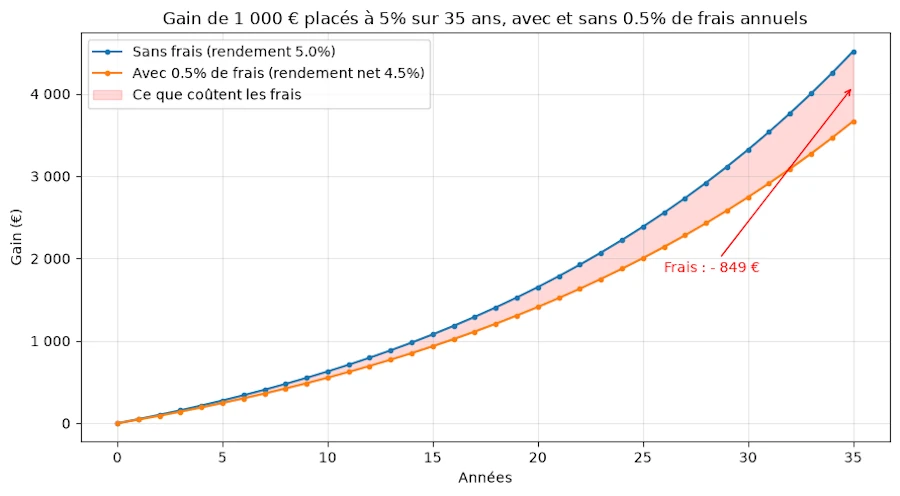
<figcaption>Gain de 1 000 € placés à 5 % sur 35 ans, avec et sans 0.5 % de frais annuels</figcaption>
</figure>


Marty, tu n'es pas encore le Mozart de la finance mais ton savoir-faire en Python m’impressionne. C'est "bô" et surtout c'est instructif. Bon, cela dit, je vais te calmer tout de suite. Comment tu peux résumer ton graphe en une phrase ?

Je note que :
* Sans les frais le gain est toujours de 4 516 €. Je commence à connaître ce chiffre par cœur.
* 0.5 % de frais c'est pas grand-chose (50 centimes pour 100 balles placés) et je comprends tout à fait que le banquier qui tient les comptes, verse les intérêts cumulés, etc. soit rémunéré.
* Je note quand même que 0.5 % par rapport à 5 % de rendement ça fait 10 % mais bon, OK, il faut que le banquier soit rémunéré.
* Avec les frais annualisés le gain passe à 3 667 €. Là, ça fait moins rêver que 4.5 k€ sans frais mais bon je dépose 1 000 €, je les "oublie" 35 ans et zou, je récupère 3.6 fois la somme à la sortie. Moi, ça me va.
* Heu, attends 2 minutes… À la fin, les 849 € de frais, c'est 19 % du gain. Là, pour le coup, je suis plus trop d'accord. Si les frais étaient de l'ordre de 0.5 % à 2 % du gain, je veux bien mais là, 19 %. C'est énorme. En plus j'apporte 100 % du capital, j'ai plus accès à mon argent pendant 35 ans et finalement, je découvre que le banquier a ponctionné 19 % du gain. Non, non, je suis pas d'accord du tout. Gilet jaune, rond-point et tous à la manif !

Ok Marty mais j'avais dit une phrase. Là, tu me racontes ta vie…

En une phrase Mamie ? T'es sûr ? Bon allez, je me lance : "**Si tu prêtes ton argent, tu prêtes attention aux frais.**"

Pas mal. Y a un financier (John Bogle, le fondateur de Vanguard) qui a dit un truc du style : "We investors as a group get precisely what we *don't* pay for. If we pay nothing, we get everything" (ISBN 978-1-119-40450-7, p42). J'aime bien car c'est le contre-pied de l'adage qui dit "On en a pour son argent". Dans le contexte de l'investissement, l'idée c'est que si tu paies des frais, tu n'obtiens pas le gain mais par contre si tu ne paies pas de frais, tu obtiens tout le gain.

Mais bon, on va garder ta phrase.

<!-- ---------------------------------------------------------------------  -->
#### Note
{: .no_toc }

Le livre de John C. BOGLE sur [Amazon](https://amzn.eu/d/0iV9ZL8S). Il existe en version audio, en français…

<figure style="max-width: 225px; margin: auto; text-align: center;">
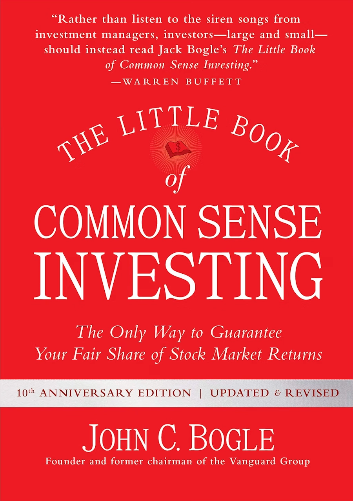
<figcaption>Common Sense Investing</figcaption>
</figure>


J'ai parlé du livre de BOGLE. À l'occasion lis-le. Mais sinon dans le chapitre 4, il prend l'exemple de 10 000$, placés 50 ans à 7 % par an avec 2 % de frais annuels. Tu peux changer les paramètres de ton script et confirmer qu'on retrouve ses chiffres

Je suis assez confiant. Tiens voilà ce que j'obtiens. Le titre du graphe parle d'€ mais c'est pas le plus important :

<figure style="max-width: 900px; margin: auto; text-align: center;">
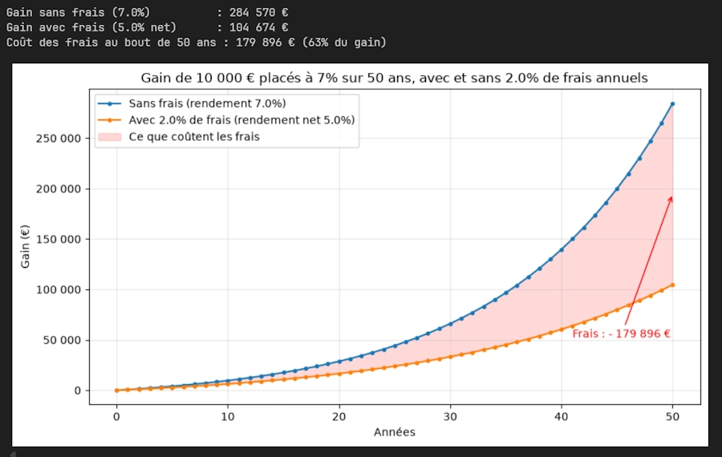
<figcaption>Gains pour 10 000$ placés 50 ans à 7 % par an avec 2 % de frais annuels</figcaption>
</figure>

C'est parfait. Dans le livre il parle de 294 k$ et 114 k$ mais c'est parce qu'il parle de la somme totale et pas uniquement du gain. Du coup, nous sommes complètement raccord avec lui. Bravo.

Un dernier point. Tu as noté que dans ce cas, les coûts ont consommé **63 % du gain**. On en revient à ce que tu disais tout à l'heure. L'investisseur (celui qui investi, toi, moi)
1. il apporte 100 % de capital (10 000$ ici),
1. il assume tous les risques. Imagine que l'argent est placé sur des actions qui montent et qui descendent. La banque n'assume aucun risque. Si les actions baissent c'est toi qui perds et qui paie les frais,
1. il n'accède pas à son argent pendant 50 ans, il ne fait aucun retrait pour bénéficier au maximum des intérêts composés.

Et à la fin, au lieu de 100 % du gain, l'investisseur ne récupère que 37 % de ce dernier. Le reste est dans la poche de la banque. Oui, je sais, c'est confiscatoire, honteux tout ce que tu veux mais cela doit vraiment t'inciter **à prêter attention aux frais**.

Et tu te rappelles ce que je te disais tout à l'heure ? Le rendement, tu en subis une partie seulement. Ben voilà, on y est. Le rendement brut (les 7 % de BOGLE), c'est le marché qui le décide et toi, tu n'y peux rien. Mais le rendement net (7 % - 2 % = 5 %), c'est celui qui travaille pour toi, et les 2 % de frais, eux, c'est toi qui choisis de les payer ou pas. **Le rendement brut, tu le subis, le rendement net tu le pilotes.**

Oui mais Mamie là, tu exagères… 2 % de frais annuels personne ne va signer ça. Non ?

Détrompe-toi Marty. Tu dis ça parce que je t'ai mis le nez dedans ce matin et que tu en as pris conscience (bravo). Mais, entre nous, qui prend le temps d'ouvrir Excel pour faire une espèce de simulation. Qui cherche un site Web pour faire les calculs d'intérêts et de frais composés que nous avons fait. Tout le monde se dit que 2 % c'est 2 € de frais si je place 100 € mais personne ne réalise vraiment que ça c'est vrai uniquement pour la première année et qu'ensuite ça se cumule.

Tiens, j'ai cru comprendre que tu étais assez proche de la petite Jennifer PARKER. Sa mère est venue me voir le mois dernier car son banquier voulait lui faire signer un contrat et elle voulait mon avis. Regarde, j'ai fait une photocopie d'une partie du document :


<figure style="max-width: 900px; margin: auto; text-align: center;">
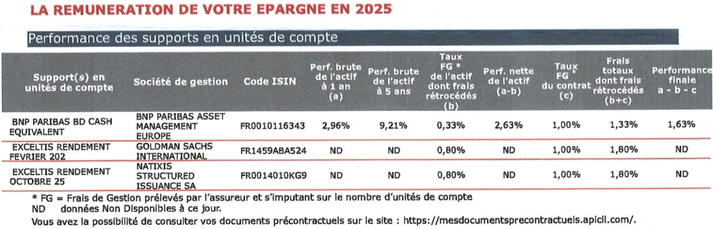
<figcaption>Exemple de contrat</figcaption>
</figure>

Maintenant que je sais ce que tu sais, je peux te poser la question : qu'est-ce que tu regardes en premier, qu'est-ce que tu notes ?

Ben j'en sais rien Mamie… Déjà, je lis les en-têtes de colonne et je vois :
* Colonne 1 - Performance brute sur 1 an : ça c'est le rendement
* Colonne 3 - dont frais rétrocédés : ça, ça doit dire que la société qui émet le contrat paie des commissions à celui qui fait signer le contrat. En plus c'est annuel. Le vendeur a donc tout intérêt à ce que le client garde le contrat le plus longtemps possible. Mais du coup ça veut dire que le banquier de la mère de Jennifer est intéressé à la chose et qu'il agit plus en commercial qu'en conseiller patrimonial.
* Colonne 5 - FG avec une étoile : ça, ce sont les frais de gestion. 1 %
* Colonne 7 - Performance finale : 1.63 %

Ah oui… En fait on nous vend un contrat qui rapporte 2.96 % mais finalement, il ne rapporte que 1.63 % car il y a 1.33 % de frais annuel. Les frais accaparent $$\frac{1.33}{2.96}=45\%$$ du gain auquel on pourrait s'attendre.

Du coup, je trouve très bien que toutes les informations soient écrites noir sur blanc dans le contrat. Mais "nom de Zeus" qui va prendre le temps de lire ça, qui va avoir le temps de vraiment comprendre à quelle sauce ses gains partent en fumée, ou plus exactement dans la poche de la banque ?

Eh, Marty, on est en 2026. Du coup voilà ce que j'ai montré à Mme PARKER :

* Une photocopie pour avoir une version PDF
* Copier coller dans ChatGPT ou Claude pour lui demander son avis

Tiens regarde ce que cela donne. Sa réponse est beaucoup plus longue mais bon c'est clair, les frais sont élevés, trop élevés.

<figure style="max-width: 600px; margin: auto; text-align: center;">
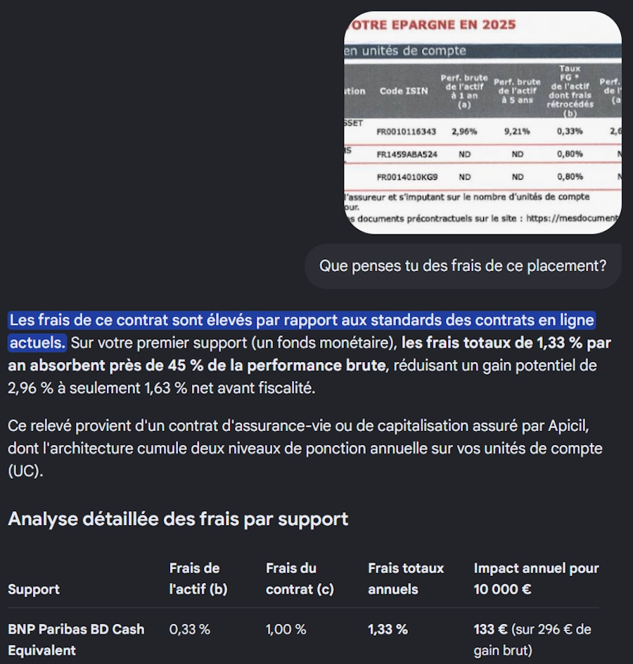
<figcaption>L'avis d'un assistant IA sur les frais du contrat</figcaption>
</figure>

Du coup, j'ai conseillé à la "manman" de la belle Jennifer de trouver un contrat d'assurance vie (ou autre chose), en ligne, un truc facile à comprendre avec des frais annuels les plus bas possible. Normalement, elle repasse ici demain après-midi pour qu'on fasse le point sur ce qu'elle a déniché.

Bon allez, maintenant que tu sais de quoi on parle, on va parler de ton PEA, tu vas voir ça va être court.


<!-- ###################################################################### -->
### Ce qu'il faut retenir

* **Si tu prêtes ton argent, tu prêtes attention aux frais.**
* Les frais se composent comme les intérêts, mais à l'envers. Chez BOGLE, 2 % de frais annuels sur 50 ans consomment 63 % du gain.
* Le rendement brut, tu le subis, le rendement net (brut moins les frais) tu le pilotes.


<!-- ###################################################################### -->
<!-- ###################################################################### -->
<!-- ###################################################################### -->
## Mise en application, le PEA Jeune de Marty

<!-- ---------------------------------------------------------------------  -->
#### Note
{: .no_toc }

*Le contenu suivant est fourni uniquement à titre informatif et éducatif. Il ne constitue en aucun cas un conseil en investissement, une recommandation financière ou une incitation à acheter ou vendre des produits financiers. Investir en bourse, notamment dans des ETF, comporte un risque de perte en capital. Les performances passées ne préjugent pas des performances futures. Faites toujours vos propres recherches ou consultez un conseiller financier agréé avant toute décision.*


Je te l'ai dit, j'ai demandé à ton père de t'ouvrir un **PEA Jeune** dans une banque en ligne.

Pourquoi "Jeune" ? Parce que pour ouvrir un PEA classique il faut être majeur **et** avoir son propre foyer fiscal. Toi, tu es majeur depuis hier (encore bon anniversaire mon chéri) mais tu es toujours rattaché au foyer fiscal de tes parents. Le PEA Jeune est fait pour ça : il est réservé aux 18-25 ans encore rattachés au foyer de leurs parents.

Pourquoi en ligne ? Pour limiter les frais bien sûr ! En plus je suis persuadée qu'à moyen terme (10-20 ans) les banques classiques vont disparaître. Aux yeux de leurs DAF qui gèrent avec une feuille Excel, leurs réseaux d'agences coûtent trop cher, localement les conseillers ne peuvent plus prendre de décision sans consulter "le siège", elles sont lentes, pas compétitives… En plus, elles investissent toutes dans des banques en ligne. C'est un signe qui ne trompe pas.

Pourquoi PEA ? Parce que comparé à un livret A qui en 2026 rapporte péniblement [1.6 %](https://www.magnolia.fr/placement/produits-epargne/reglementes/livret-a/historique) sans risque, dans un PEA, tu peux acheter des actions. C'est plus risqué mais sur les 20 dernières années, en moyenne annuelle, on parle de plus de 10 % par an pour le S&P 500 (hors dividendes réinvestis) et de 6 % pour le CAC 40 Français (là aussi hors dividendes réinvestis).

Bref, un PEA Jeune dans une banque en ligne. Je crois qu'il a ouvert ça chez Boursobank mais on s'en fiche ce serait pareil chez les autres.

En plus, depuis les années 90 (c'est pas tout jeune non plus, je sais) les investisseurs comme toi et moi peuvent investir sur des paniers d'actions. En fait, tu achètes une "action" qui "recopie" les variations du CAC40 ou du S&P 500 par exemple. Ça c'est super car si une des 500 actions du S&P 500 se casse la figure, l'indice ne s'écroule pas complètement. En plus, ni toi ni moi n'y connaissons quoi que ce soit, il y a donc très peu de chance pour qu'on déniche, achète et garde une action de l'Apple ou du NVIDIA "de d'en" 20 ans.

Sinon, bonne nouvelle, les frais annuels des ETF sont en général faibles (0.5 %, 0.05 %). Tiens regardes ce que je peux afficher sur le site [JustETF](https://www.justetf.com/fr/search.html?search=ETFS&sortOrder=asc&sortField=ter&productGroup=epg-longOnly&ls=XPAR&pea=true&distributionPolicy=distributionPolicy-accumulating&fsg=more100&resetPage=true) après un filtrage rapide :

<figure style="max-width: 900px; margin: auto; text-align: center;">
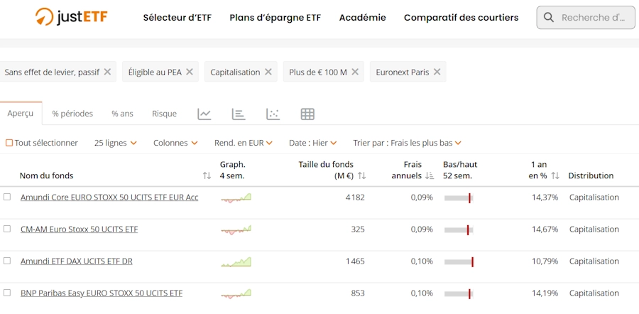
<figcaption>Exemples d'ETF éligibles au PEA, classés par frais.</figcaption>
</figure>

Prends le temps de lire la quatrième colonne… Ça laisse rêveur. Non ?

Enfin avec une banque en ligne, généralement les frais des passages d'ordres sont gratuits et les droits de garde sont à 0 % aussi. T'inquiète ils se rattrapent ailleurs.

Si tu compares, par exemple, avec ce que propose la Caisse d'Épargne (ce serait similaire avec une autre banque classique) tu vas découvrir que les passages d'ordres coûtent entre 0.5 % (via internet) ou carrément 1.2 % quand l'ordre est passé depuis l'agence.

En plus il y a des droits de garde qui sont facturés au semestre et dont le taux dépend, bien sûr, du montant. Vas-y, explique-moi en quoi une ligne dans une base de données où il y a écrit 100 k€ coûte plus cher à garder qu'une autre ligne sur laquelle il y a écrit 10 k€. Ils se fichent de nous. Ne me crois pas. Vas vérifier par toi même sur cette
[page](https://www.boursedescredits.com/guide-pea-caisse-epargne-avis-frais-courtage-conditions-pea-6681.php) par exemple.

<figure style="max-width: 900px; margin: auto; text-align: center;">
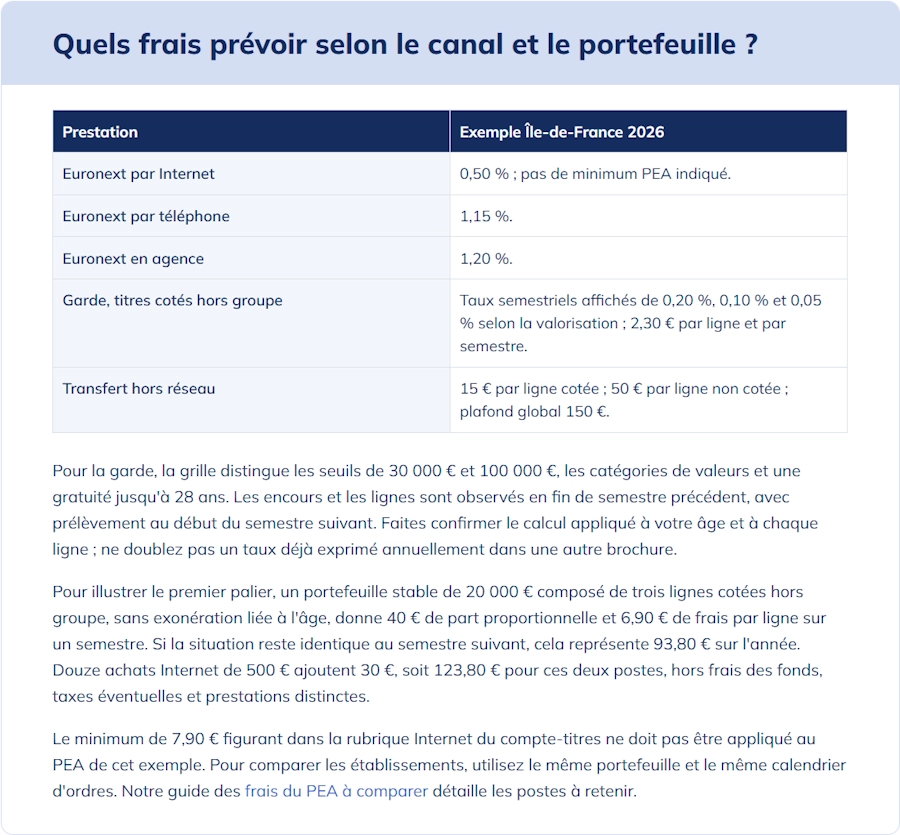
<figcaption>Les frais du PEA chez Caisse d'Epargne selon BourseDesCrédit au 17/10/26</figcaption>
</figure>

Bref un PEA Jeune, dans une banque en ligne dans lequel tu achètes des ETF. On va choisir ces derniers "capitalisants". Cela veut dire que les dividendes sont tout de suite réinvestis. Cela permet de bénéficier des intérêts composés. Comme les rendements $$r$$ sont élevés, qu'il y a peu de frais et que tu vas laisser du temps au temps ça devrait bien se passer.

Tu n'y connais rien donc à titre d'exemple, je te propose de faire très simple et de choisir ce que font pas mal de gens :

* Un ETF qui réplique l'indice des capitalisations des plus grandes sociétés des pays développés (code [ISIN FR001400U5Q4](https://www.amundietf.fr/fr/professionnels/produits/equity/amundi-pea-monde-msci-world-ucits-etf/fr001400u5q4) par exemple).
* Un ETF qui réplique l'indice des capitalisations des plus grandes sociétés des pays émergents (code [ISIN FR0013412020](https://www.amundietf.fr/fr/professionnels/produits/equity/amundi-pea-emergent-msci-emerging-esg-transition-ucits-etf-acc/fr0013412020)).
* Je te propose de les répartir en 80/20.

Juste pour s'amuser… Avant que tu n'arrives, je suis allé sur le site [TradingView](https://fr.tradingview.com/) et j'ai regardé l'historique de l'ETF qui s'appelle "Amundi MSCI World Swap UCITS ETF (CW8)" et dont le code ISIN est LU1681043599. Il est capitalisant et il a été créé le 16 juin 2009. Sa valeur au départ, à l'ouverture était de 81.24 et sa valeur à la fermeture le 02 novembre 2026 était de 708.80.

Peux-tu me calculer le taux de croissance annualisé (CAGR) s'il te plaît ?

<figure style="max-width: 900px; margin: auto; text-align: center;">
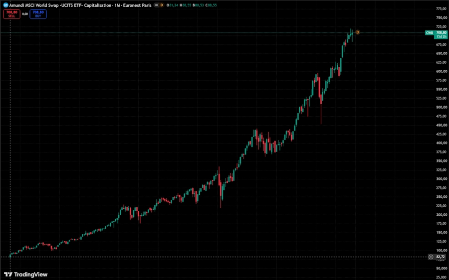
<figcaption>L'historique de Amundi MSCI World Swap UCITS ETF (CW8) - ISIN:LU1681043599</figcaption>
</figure>

Du coup, je sais même pas ce que c'est que le CAGR. Je vais sur [Wikipédia](https://en.wikipedia.org/wiki/Compound_annual_growth_rate) et je vois :

$$
CAGR = (\frac{\textrm{Valeur finale}}{\textrm{Valeur initiale}})^{\frac{1}{n}} - 1
$$

En fait le CAGR c'est rien d'autre que le rendement composé équivalent. À la fin on pourra dire qu'entre 2009 et 2026 tout s'est passé comme si on avait bénéficié d'un rendement composé de x % et ce même si entre temps l'indice a connu des hauts et des bas.

Maintenant, il faut que je sois prudent car j'ai des dates de jour précis. Donc j'utilise le web et je trouve qu'entre le 16/06/2009 et le 02/11/2026 inclus il y a 6 349 jours. Pour convertir ça en années je dois diviser par 365.25 à cause des années bissextiles. Du coup, j'arrive à :

$$
(\frac{\textrm{708.8}}{\textrm{81.24}})^{\frac{1}{\frac{6349}{365.25}}} - 1 = (8.7247)^{0.0575} -1 = 1.1326 - 1 = 0.1326 = 13.26\%
$$

Waouh ! 13 % par an pendant 17 ans ! Mamie, faut tout mettre là-dessus, tout de suite !

Doucement cow-boy. Regarde la date de départ : juin 2009. Ça ne te dit rien ? Non, bien sûr, tu avais quoi, 1 an… En 2008 il y a eu la crise des subprimes et les bourses mondiales ont perdu autour de 40 % (les banques ont perdu 400 milliards de dollars toutes seules, comme des grandes). À l'occasion lis le livre ou regarde le film [The Big Short](https://fr.wikipedia.org/wiki/The_Big_Short_:_Le_Casse_du_si%C3%A8cle) (il est disponible sur Netflix. Édifiant).

Quoi qu'il en soit, le point le plus bas a été touché en mars 2009. Autrement dit, ton ETF débute quasiment au fond du trou. Forcément, quand on part du sous-sol, la vue depuis le toit est spectaculaire. Si on avait lancé le calcul début 2008, juste avant la chute, le CAGR aurait été bien plus modeste. En plus, l'indice est calculé en dollars et sur la période le dollar s'est apprécié face à l'euro, ce qui a gonflé un peu la performance vue depuis la France.

Bref, retiens ça : **un CAGR dépend énormément de la date de départ et de la date d'arrivée**. Quand quelqu'un t'annonce un rendement annualisé, la première question à poser c'est "entre quand et quand ?".

Ok, mais du coup, 2008, si j'avais été là… j'aurais perdu 40 % ?

Sur le papier, oui. Et c'est le point le plus important de toute cette matinée, alors ouvre grand tes oreilles. Les 10 % par an dont on va parler, c'est une **moyenne** sur des décennies. Dans la vraie vie, il y aura des années à +25 % et des années à -30 %. Ça monte par l'escalier et ça descend par l'ascenseur. Ceux qui ont paniqué et tout vendu en mars 2009 ont transformé une perte sur le papier en perte réelle. Ceux qui n'ont rien fait, ou mieux, qui ont continué à acheter chaque mois, ont tout récupéré en quelques années et ils sont aujourd'hui à +13 % par an. Les intérêts composés, ça ne marche que si tu laisses le temps faire son boulot. Le jour où les marchés s'effondrent, et ce jour viendra, plusieurs fois, la meilleure chose à faire c'est… rien. Éteins la télé, va manger un kebab et ne touche à rien.

Facile à dire Mamie…

Je sais. C'est même la chose la plus difficile de toute cette histoire. Les maths, tu les as. Le sang froid, ça s'apprend.

Bien. Maintenant, peux-tu m'afficher le graphe précédent mais en utilisant les 5500 € de tes 16 ans, 10.00 % de rendement (tu notes qu'en prenant 10 % au lieu de 13 % je prends une bonne marge de sécurité, justement à cause de cette date de départ très favorable) et 0.2 % de frais. Enfin, on va imaginer que tu commences à faire travailler ton argent à partir de demain et que tu prendras ta retraite à 70 ans (70-18 = 52 ans d'investissement).

Allez, montre-moi ce que cela donnerait avec le graphe précédent mais dans le Notebook crée une nouvelle cellule car on va devoir prendre en compte d'autres éléments.

<figure style="max-width: 900px; margin: auto; text-align: center;">
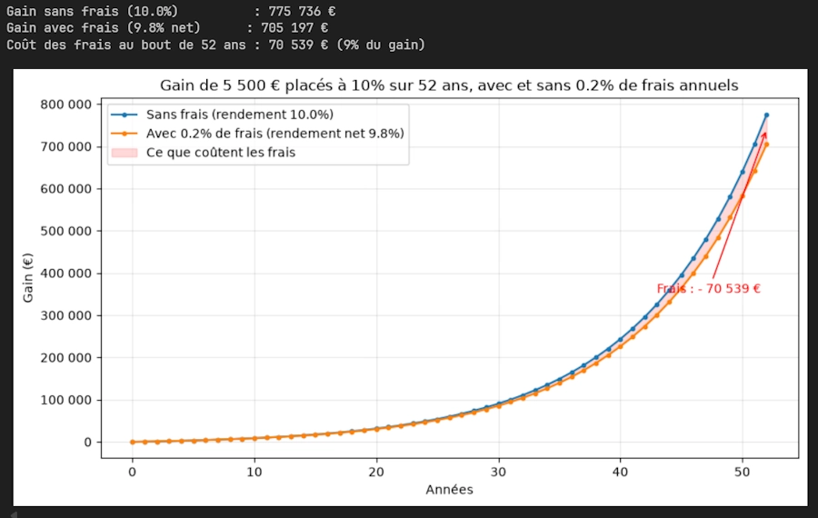
<figcaption>Gain de 5 500 € placés à 10 % sur 52 ans, avec et sans 0.2 % de frais annuels</figcaption>
</figure>


J'y crois pas Mamie. On arrive à 700 k€ de gain, et encore, c'est après les frais. Si je meurs à 100 ans ça veut dire que je vais avoir un complément de retraite d'environ $$\frac{700000}{30*12}\approx 2000$$ €. Ça va être la fête à l'EHPAD !

Oui, mais non… On en parle tout de suite.


<!-- ###################################################################### -->
### Ce qu'il faut retenir

* Un PEA (Jeune) dans une banque en ligne : accès aux actions, pas de frais de courtage ni de droits de garde.
* Des ETF plutôt que des actions en direct : un panier de centaines de sociétés, donc du risque dilué et des frais annuels très faibles (0.05 % à 0.5 %).
* Des ETF capitalisants : les dividendes sont réinvestis automatiquement, les intérêts composés travaillent à plein.
* Le CAGR, c'est le rendement composé équivalent : $$CAGR = (\frac{\textrm{Valeur finale}}{\textrm{Valeur initiale}})^{\frac{1}{n}} - 1$$. Avec des dates précises, $$n$$ = nombre de jours / 365.25.
* Un CAGR dépend énormément des dates de départ et d'arrivée. Toujours se demander "entre quand et quand ?".
* Pour une simulation, prendre un rendement inférieur au rendement historique (10 % au lieu de 13 %) : c'est une **marge de sécurité**.
* Un rendement moyen de 10 % cache des années à -30 %. Les intérêts composés ne fonctionnent que si on ne vend pas en pleine panique. Pendant un krach, la meilleure chose à faire c'est souvent rien.
* 5 500 € à 10 % pendant 52 ans avec 0.2 % de frais génèrent environ 700 k€ de gain. Les frais mangent quand même 70 k€ (9 % du gain).


<!-- ###################################################################### -->
<!-- ###################################################################### -->
<!-- ###################################################################### -->
## Le complément de retraite de Marty

Non ! Désolé, ça va pas être la fête à l'EHPAD. T'as tout faux mon petit lapin car tu as oublié de prendre en compte trois paramètres très importants. Allez, je te donne les deux premiers
1. Un point positif. À tes 70 ans tu ne vas pas retirer toute ton épargne d'un coup. Normalement, tu ne seras pas complètement sénile, il te restera un peu de jugeote. Du coup, chaque mois, si besoin, tu retireras ton complément de retraite et tu laisseras le reste travailler.
2. Un autre point positif. Un jour tu vas commencer à travailler. Disons que tu bosses de $$18+5=23$$ ans à 70 ans. On peut raisonnablement penser que tu puisses, dès réception de ton salaire, en prendre 1 % et le verser sur ton PEA. Du coup, en plus des 5500 € de départ, tu auras ajouté 1 % de tes salaires entre 23 et 70 ans. Cela n'a l'air de rien mais rappelle-toi les frais des banques. Les premiers 1 % vont te rapporter énormément. Le truc ici c'est la discipline et l'automatisation. À réception de ta première feuille de salaire, tu automatises le versement de 1 % de ton salaire sur ton PEA (fais une recherche sur le terme DCA, *dollar cost average*, mais garde en tête que moi, je te dis de verser 1 % de ton salaire et pas une somme fixe).
3. Du coup, pour le troisième point, vas-y je t'écoute… ⚠️C'est un point négatif malheureusement…

Là, je suis sec Mamie. J'y connais rien à tous ces trucs. Comment veux-tu que j'imagine ce qui va m'impacter négativement sur une si longue période…

Je sais pas pourquoi mais je me doutais que tu allais caler là-dessus. Mais bon c'est normal, tu vas voir c'est pernicieux. Tu vas manger au kebab ?

Oui, bien sûr, comme tout le monde.

Non, moi j'y vais pas et c'est pour ça que je me sens jeune et belle. Plus sérieusement, j'ai vérifié ce matin et sauf erreur de ma part le prix moyen d'un menu en France a grimpé d'environ 40 % en cinq ans, passant d'environ 6 € ou 7 € avant 2021 à une fourchette comprise entre 10 € et 12 € en 2026. Tiens fais-toi plaisir va lire cette [page](https://restopilot.ai/blog/40-sur-le-menu-kebab-en-cinq-ans/) et note que 40 % sur 5 ans c'est 7 % par an annualisé. Alors, le Mozart du Python, une idée, une pensée…


<figure style="max-width: 900px; margin: auto; text-align: center;">

<figcaption>+40 % sur le menu kebab en cinq ans</figcaption>
</figure>

C'est vrai que ça commence à coûter une blinde le kebab. Ayé, j'ai trouvé. La hausse du coût de la vie, l'inflation tous ces trucs-là.

Hé oui, mon pauv' monsieur, la vie est chère. En 2020, avec un billet de 20 €, il était possible d'acheter 3 menus kebabs à 6,50 €. En 2026, avec le même billet de 20 €, on peut même plus en acheter 2 complets à 11 €. L'argent n'a pas disparu mais sa valeur d'échange a baissé.

Il en va de même pour la retraite des vieux comme moi ou des profs. Si le montant des retraites ou les salaires de l'administration ne sont pas revalorisés lorsque les prix montent (et ils montent toujours) les gens n'ont plus les moyens de remplir leur caddie comme avant, ils partent moins longtemps en vacances, ils n'épargnent plus, ils commencent à faire des crédits et tombent entre les griffes de Cetelem et consorts…

As-tu une idée de l'inflation en 2026 en France ? Tiens va lire cette [page](https://www.insee.fr/fr/statistiques/9107965). Tu peux ne pas être d'accord mais l'INSEE annonce 3.4 % sur un an (d'octobre 25 à octobre 26). Je te rappelle que le Livret A rapporte en moyenne 1.6 % sur 2026.

Sinon j'imagine aisément que tu as aucune idée de l'inflation ces dernières années ? Pour le coup, va lire cette autre [page](https://www.insee.fr/fr/statistiques/4268033), tu y verras ce superbe graphique :

<figure style="max-width: 900px; margin: auto; text-align: center;">
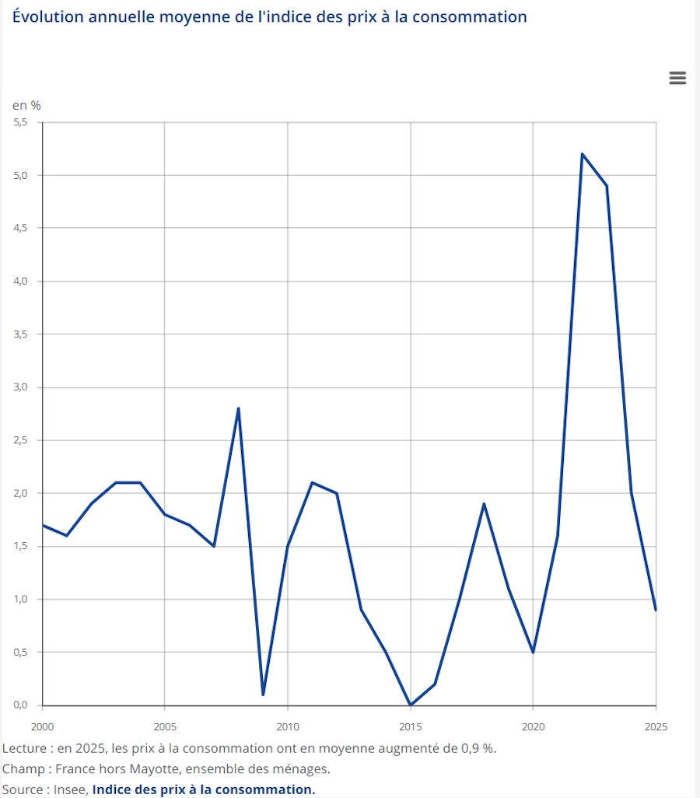
<figcaption>Évolution annuelle moyenne de l'indice des prix à la consommation 2000-2025</figcaption>
</figure>

Ce qui est très important à comprendre c'est que
1. Si tu laisses ton argent sur un compte non rémunéré, tu perds, en pouvoir d'achat, l'équivalent de l'inflation chaque année. Environ 2 % par an en moyenne sur le long terme, 3.4 % en ce moment.
1. Si tu le mets sur un Livret A (rendement 1.6 % alors que l'inflation est à 3.4 %) tu perds un peu moins d'argent, mais tu en perds quand même.
1. Il faut que tes investissements "remontent la rivière" et aillent bien au-delà de l'inflation, et ce, sur toute la durée de ton placement.

Ok Mamie, mais concrètement, je calcule ça comment ?

Avec ce que tu sais déjà, mon grand. Tiens, 1 000 € d'il y a 35 ans, avec 2 % d'inflation par an, ça vaut combien aujourd'hui ?

Ben ce sont les intérêts composés, mais pour les prix : $$1\,000 \times 1.02^{35} \approx 2\,000$$ €. Il faut 2 000 € aujourd'hui pour acheter ce qu'on achetait avec 1 000 € il y a 35 ans. Et c'est logique, la [règle du 70](#la-règle-du-70) dit que les prix doublent en $$70/2 = 35$$ ans !

Bien. Et dans l'autre sens ? Si dans 35 ans, tu as 2 000 € sur ton compte ?

Je divise : $$\frac{2\,000}{1.02^{35}} \approx 1\,000$$. Ces 2 000 € futurs achèteront autant que 1 000 € d'aujourd'hui. De façon générale, si $$i$$ est l'inflation :

$$
V_{\textrm{constant}} = \frac{V_{\textrm{courant}}}{(1+i)^n}
$$

Les euros **courants** ce sont ceux qui seront écrits sur ton relevé de compte. Les euros **constants** ce sont ces mêmes euros ramenés au pouvoir d'achat d'une année de référence (ici 2026). Pour comparer des montants séparés de plusieurs décennies, c'est la seule façon honnête de faire.

C'est bon c'est calé. Allez, une dernière pour la route. Ton argent placé à $$r$$ grossit de $$(1+r)$$ chaque année, les prix grossissent de $$(1+i)$$. Ton pouvoir d'achat, lui, il grossit de combien ?

Je fais le rapport des deux :

$$
1 + r_{\textrm{réel}} = \frac{1+r}{1+i} \quad \Rightarrow \quad r_{\textrm{réel}} = \frac{1+r}{1+i} - 1 \approx r - i
$$

Avec 10 % de rendement et 2 % d'inflation ça donne $$\frac{1.10}{1.02} - 1 \approx 7.8\%$$, en gros 8 %. Et pour le Livret A en ce moment : $$\frac{1.016}{1.034} - 1 \approx -1.7\%$$. Là, c'est clair, il descend la rivière.

Marty après ça je te laisse filer mais peux-tu copier/coller/modifier le script précédent de telle sorte :

1. Qu'il tienne compte d'une inflation à 2 % par an (je prends 2 % car c'est l'objectif de la BCE mais on pourra le modifier si besoin),
1. Qu'il simule un DCA de 1 % de ton salaire à partir de tes 23 ans. Pour déterminer ton salaire je vais dire 36 k€ aujourd'hui pour un jeune développeur. Dans 5 ans avec 2 % d'inflation… On va dire 40 k€ brut environ, soit 2500 € net après impôt, donc un DCA de 25 € au début. En ce qui concerne ton taux augmentation sur ta carrière, faut en faire un paramètre et le mettre à 2.5 % pour commencer (un peu plus que l'inflation),
1. Enfin faut étendre la simulation sur 82 années si on suppose que tu décèdes à 100 ans. Il y aura donc 3 grandes périodes
  * De 18 à 23 ans. Les 5500 travaillent à 10 %. Les frais sont à 0.2 %.
  * De 23 à 70 ans. DCA mensuel de 1 % de ton salaire. Fais simple. Augmente ton salaire chaque année. Les frais restent à 0.2 %
  * À partir de 70 ans et jusqu'à 100 ans tu retires 4 % de ton épargne par an (faudra faire des 4 % un paramètre). Attention il ne faudra pas oublier la fiscalité. Comme ton PEA aura plus de 5 ans, tu ne paieras pas d'impôt sur le revenu, mais les prélèvements sociaux vont te prendre 18.6 % de la part de gain contenue dans chaque retrait. La part qui correspond à tes versements, elle, n'est pas taxée.


Mamie, ça y est j'ai enfin terminé. Je ne te montre pas le script mais voilà ce que je vois à l'écran. Normalement c'est bon :

<figure style="max-width: 900px; margin: auto; text-align: center;">
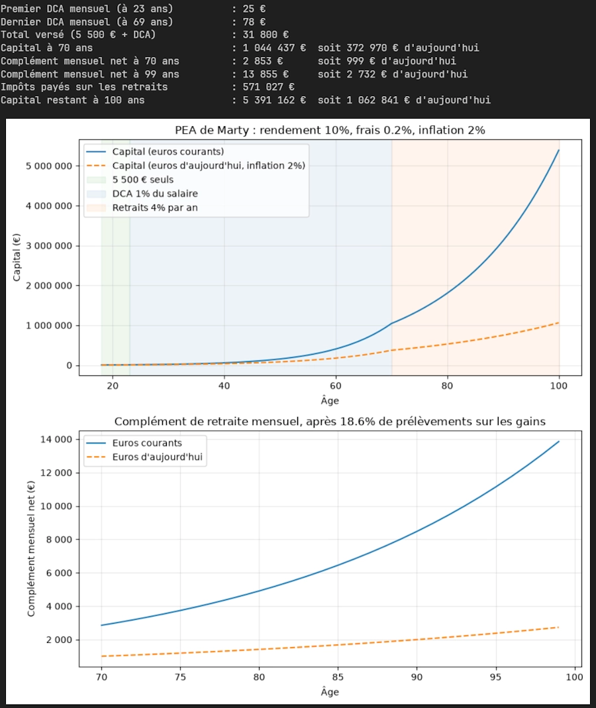
<figcaption>Le PEA de Marty de 18 à 100 ans : capital et complément de retraite</figcaption>
</figure>

* Au tout début, jusqu'à la fin de mes études il n'y a que les 5500 € qui travaillent sur le PEA
* À 23 ans, avec 2500 € net, mes premiers DCA valent 25 € (un abonnement téléphonique ou 2 kébabs complets)
* Ensuite mon salaire augmente un peu plus que l'inflation (2.5 % vs 2.0 %)
* L'automatisation du DCA fait que je ne me rends compte de rien (1 % reste 1 %)
* À 70 ans le montant du PEA s'élève à plus de 1 M€ constant bien que je n'ai versé qu'un peu moins de 32 k€
* Ensuite, je retire 4 % par an. Mon premier complément mensuel sera, en euros constants, de 1000 € et le dernier de 2 700 €. C'est normal car le capital restant travaille plus que ce que je ne retire. Du coup mon PEA continue de progresser.

C'est trop cool. Je vais rouler en fauteuil roulant plaquée or !

Mouai… Calme-toi mon petit Antonelli parce qu'il y a encore quelques réglages à faire. Par exemple, là tout se passe comme si tu gardais tes actions jusqu'au bout mais en fait passé un certain âge, on souhaite sécuriser son capital. On diminue la part en actions et on investit dans des obligations, des fonds euros, des trucs et des machins qui rapportent moins mais qui sanctuarisent une partie de ton épargne. Imagine un krach de -40 % l'année de tes 71 ans, au moment où tu commences à vivre de ton capital. Ça ferait beaucoup moins rire à l'EHPAD.

Et puis tu ne t'es pas demandé pourquoi tu mourais avec plus de 5 millions sur ton PEA ? Les 4 % que je t'ai fait retirer, ce n'est pas un chiffre au hasard. Ça vient d'une étude américaine de la fin des années 90 (l'étude dite "Trinity") qui a cherché le taux de retrait qui permettait à un capital de tenir au moins 30 ans, **y compris** en traversant les pires périodes de l'histoire boursière. C'est un taux prévu pour les mauvaises années. Dans ta simulation, il n'y a que des bonnes années, à 9.8 % net, tous les ans, sans exception. Forcément, avec 4 % de retrait, ton capital continue de gonfler. Dans la vraie vie, avec des hauts et des bas, le résultat serait beaucoup moins rose… mais ton capital aurait de bonnes chances de tenir jusqu'au bout. C'est ça le véritable objectif.

Là, le truc, c'est qu'il faut que tu réalises vraiment que :

* On a choisi un rendement élevé. On l'a tempéré 10 % vs 13 % mais quand même, c'est pas le 1.6 % du Livret A
* On a réduit les frais. Voir les 0.2 % vs les 2 % d'une banque (j'exagère mais à peine)
* On fait travailler l'argent très longtemps (52 ans c'est énorme comparé à la majorité des Français)
* On part avec un montant significatif (5500 € c'est pas 0 € ou 100 €)
* Du coup on coche toutes les cases de ton étude précédente (rendement $$r$$, temps $$n$$ et montant $$M$$)


<!-- ###################################################################### -->
### Ce qu'il faut retenir

* L'inflation est un ennemi silencieux : à 2 % par an, les prix doublent en 35 ans. Un placement doit rapporter nettement plus que l'inflation, sinon on s'appauvrit.
* Euros courants vs euros constants : pour comparer des montants séparés de plusieurs décennies, il faut raisonner en euros constants (corrigés de l'inflation) : $$V_{\textrm{constant}} = \frac{V_{\textrm{courant}}}{(1+i)^n}$$.
* Le rendement qui compte c'est le rendement réel : $$r_{\textrm{réel}} = \frac{1+r}{1+i} - 1 \approx r - i$$. Le Livret A à 1.6 % avec 3.4 % d'inflation, c'est -1.7 % de pouvoir d'achat par an.
* Le DCA en pourcentage du salaire : un petit versement mensuel (1 %), automatisé, qui grandit avec le salaire. La discipline et l'automatisation comptent plus que le montant.
* À la retraite, on ne retire pas tout : on retire un pourcentage (4 % par an) et le reste continue de travailler. Les 4 % sont prévus pour résister aux mauvaises années, d'où un capital qui gonfle dans une simulation sans krach.
* La fiscalité du PEA ne porte que sur la part de gain de chaque retrait (18.6 %), pas sur les versements.
* Le résultat spectaculaire vient du fait qu'on coche toutes les cases : un rendement $$r$$ élevé, des frais faibles, une durée $$n$$ très longue et un montant de départ $$M$$ significatif.
* Ce n'est qu'une simulation : rendement constant, pas de krach, pas de sécurisation du capital en fin de vie. Dans la réalité, il faudra ajuster et s'ajuster.


<!-- ###################################################################### -->
<!-- ###################################################################### -->
<!-- ###################################################################### -->
## Conclusion

Bon, Marty, il est presque midi et tes copains t'attendent. Avant que tu files, on fait le bilan. Tu te rappelles comment on avait fini il y a deux ans, avec les pourcentages ?

Oui… Tu m'avais dit que notre cerveau gère très mal les exponentielles. Qu'on pense en lignes droites alors que la réalité nous colle des courbes qui s'emballent. Et que c'était dangereux.

Exactement. Et ce matin, tu as vu l'autre face de la pièce. L'exponentielle, ce n'est ni une amie ni une ennemie. C'est un moteur. **La même exponentielle travaille pour toi avec les intérêts composés et contre toi avec les frais composés et l'inflation.** Tout l'art c'est de mettre la première de ton côté le plus tôt possible et de rogner les deux autres autant que tu peux.

Et pour ça, tu as maintenant une petite boîte à outils. Reprends ta formule $$G = M [(1+r)^n - 1]$$ et regarde ce que tu as fait de chaque lettre :

| Levier | Ce qu'on a appris | Ce que tu en fais |
|---|---|---|
| $$n$$, la durée | L'élasticité de la durée vaut celle du rendement, et c'est la seule qu'on choisisse vraiment | Tu commences à 18 ans, pas à 40 |
| $$r$$, le rendement net | Le brut se subit, les frais se choisissent | Banque en ligne, ETF capitalisants à frais réduits, PEA |
| $$M$$, le montant | Effet linéaire, mais il s'additionne tous les mois | Les 5 500 € de départ plus un DCA automatique de 1 % du salaire |
| $$i$$, l'inflation | Elle ne se pilote pas, il faut la battre | Raisonner en euros constants et en rendement réel |

Et n'oublie pas la ligne qui n'est pas dans le tableau, parce qu'aucune formule ne la contient : **le sang froid**. Le jour où tout s'effondre, ne touche à rien.

Je retiens Mamie. Mais franchement, entre ma simulation à 5 millions et tes krachs à -40 %, je ne sais plus trop quoi en penser. C'est riche ou c'est risqué ?

Les deux, mon crapaud. Et c'est bien pour ça qu'on n'a pas fini. Ce matin, on a regardé **un** placement, ton PEA, avec un seul type de support, des actions. C'est le moteur de ton épargne mais une voiture ce n'est pas qu'un moteur, il faut aussi des freins, des airbags et une roue de secours. Il reste plein de questions :

* L'épargne de précaution : avant de mettre un seul euro en bourse, il faut avoir de côté 3 à 6 mois de dépenses sur un livret. Ils doivent être disponibles tout de suite, pour le jour où ta machine à laver te lâche ou celui où ton employeur te lâche. Sinon c'est toi qui seras obligé de vendre tes actions au pire moment.
* L'assurance vie : la deuxième enveloppe fiscale des Français, avec ses fonds euros, ses unités de compte et… ses frais. Tu sais maintenant ce qu'il faut regarder en premier.
* La sécurisation progressive : comment et quand faire glisser ton capital des actions vers des placements plus calmes à l'approche de la retraite.
* Ton budget : parce que le meilleur rendement du monde ne sert à rien si à la fin du mois il ne reste rien à placer.

Ça fait beaucoup…

Ça tombe bien, j'ai du temps. Tiens, la maman de Jennifer repassera demain après-midi pour me montrer le contrat d'assurance vie qu'elle a trouvé en ligne. Tu n'as qu'à venir. On regardera ses frais ensemble, tu feras tourner tes scripts et on parlera épargne au sens large. Et qui sait, peut-être que Jennifer l'accompagnera…

Mamie !

Quoi ? Je suis vieille, je ne suis pas aveugle. Allez, file, tes copains t'attendent. Et Marty… Le premier versement automatique sur ton PEA, tu le programmes **avant** de passer à la caisse du kebab.

Et si un jour quelqu'un te vend un placement "sans risque" à 8 % par an, avec "des frais tout à fait raisonnables", tu sais ce que tu as à faire. Tu sors ton notebook, tu fais tourner tes scripts et tu te demandes si ton interlocuteur, lui, l'a fait avant de te parler.


<!-- ###################################################################### -->
<!-- ###################################################################### -->
<!-- ###################################################################### -->
## Webliographie

* Une formidable vidéo (la meilleure du web, c'est sûr) qui parle de la dérivation de $$a^x$$.
  * Il y a d'autres vidéos sur la [chaîne](https://www.youtube.com/@frbaucop) à propos de la dérivation et de ses applications.
  * Il y a même une seconde vidéo qui montre comment dériver $$a^x$$ différemment (oups, je l'avais oublié).


<figure style="max-width: 560px; margin: auto;">
<div style="position: relative; padding-bottom: 56.25%; height: 0;">
    <iframe
    src="https://www.youtube.com/embed/zYY7hyGGsaE?start=0"
    title="Une façon de dériver a^x"
    style="position: absolute; inset: 0; width: 100%; height: 100%;"
    allowfullscreen>
    </iframe>
</div>
<figcaption style="text-align: center;">
    Une façon de dériver a^x
</figcaption>
</figure>


* [Pourcentages, croissance, gestion des ressources…]()
* [Dérivée et différentielle]()


