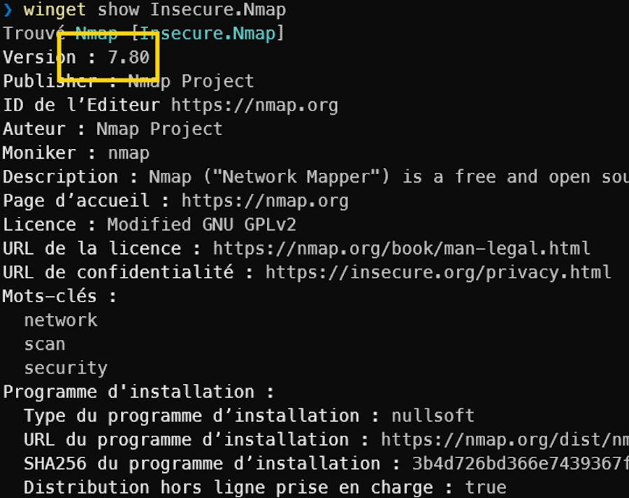
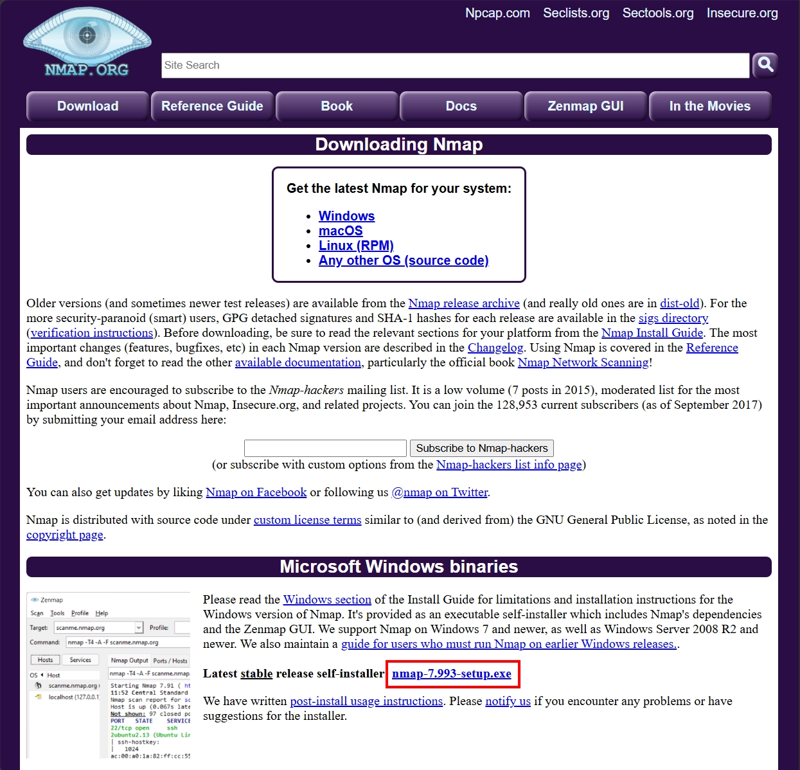
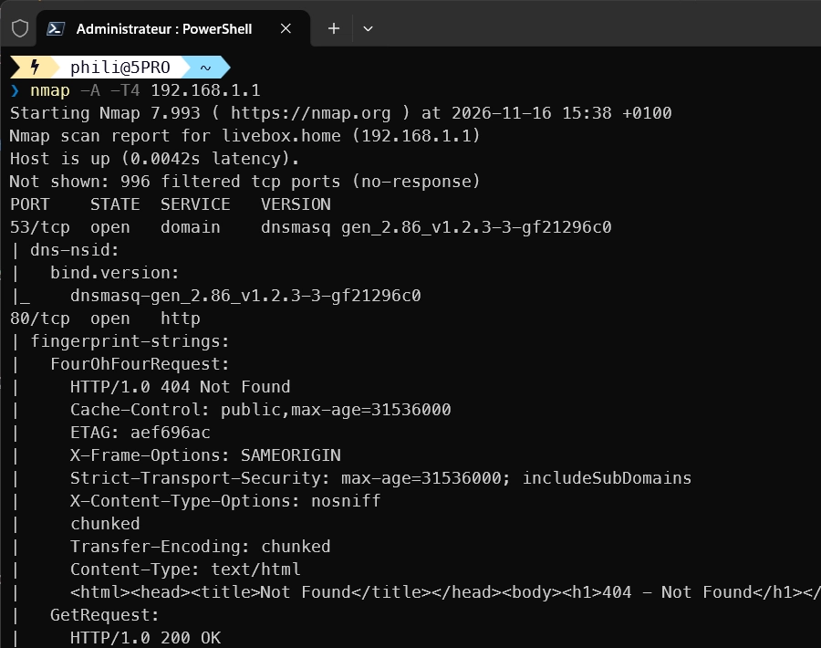
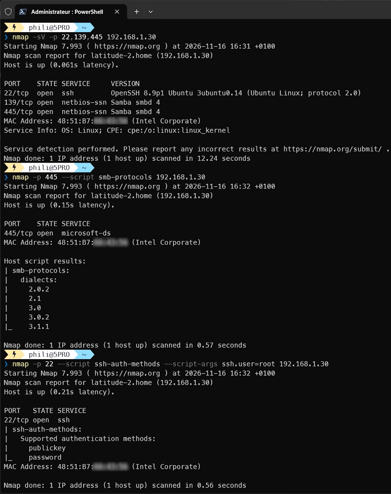

<!--

**Pense à flouter sur les captures** ton IP publique, tes adresses IPv6 et les adresses MAC.

| Fichier | Contenu |
|---|---|
| `img00.webp` | Image d'en-tête : la box en forteresse, avec un radar qui balaie le réseau |
| `img01.webp` | Installeur avec Npcap et Zenmap cochés (ou la sortie de `winget`) |
| `img02.webp` | `nmap --version` dans un terminal administrateur |
| `img03.webp` | `ipconfig`, avec IPv4, masque et passerelle surlignés |
| `img04.webp` | `nmap -sn` : la liste des appareils (MAC à flouter) |
| `img05.webp` | `nmap -A` sur la box |
| `img06.webp` | Sortie de `ndiff` montrant un nouvel appareil ou un nouveau port |
| `img07.webp` | **Schéma** Internet / box / réseau local : ce qui est bloqué, les exceptions (redirection, DMZ, UPnP, IPv6) et la connexion sortante d'un objet connecté. C'est l'image la plus utile de l'article. |
| `img08.webp` | Le PC branché sur le partage de connexion du téléphone |
| `img09.webp` | Scan externe : « All 1000 scanned ports are filtered » |
| `img10.webp` | L'interface de la box : page UPnP ou pare-feu IPv6 |

-->


# {{ page.title }}
{: .no_toc }

{{ page.description }}
{: .lead }


<h2 align="center"><span style="color:orange"><b> 🚧 This post is under construction 🚧</b></span></h2>


<!-- ###################################################################### -->
<!-- ###################################################################### -->
<!-- ###################################################################### -->
## TL;DR
{: .no_toc }

* Sous Windows 11, installe Nmap en natif avec l'installeur officiel de nmap.org (pas `winget`, resté en 7.80), pas sous WSL2. Lance PowerShell en administrateur.
* Vu de l'intérieur : `nmap -sn` pour l'inventaire, `nmap -A` pour les services, `--script vuln` pour les failles connues, `ndiff` pour suivre l'évolution dans le temps.
* La box protège bien par défaut. Les vraies portes d'entrée ce sont les exceptions qu'on oublie : redirections de ports, DMZ, UPnP, IPv6 et services de la box elle-même.
* Pour savoir ce que voit Internet, il faut scanner l'IP publique **depuis l'extérieur**, par exemple via le partage 4G/5G d'un téléphone. Ne pas oublier IPv6.
* L'intérieur compte quand même : la plupart des attaques domestiques partent d'une machine déjà derrière la box (PC infecté, objet connecté douteux, Wi-Fi faible).
* Ne scanner que ce qui nous appartient.


<figure style="max-width: 900px; margin: auto; text-align: center;">

<figcaption>Ma box est-elle vraiment une forteresse ?</figcaption>
</figure>


<!-- ###################################################################### -->
<!-- ###################################################################### -->
<!-- ###################################################################### -->
## Table of Contents
{: .no_toc .text-delta}
- TOC
{:toc}


<!-- ###################################################################### -->
<!-- ###################################################################### -->
<!-- ###################################################################### -->
## Introduction

L'autre soir je suis tombé sur une vidéo YouTube à propos de Nmap. Le gars scannait son réseau, listait les appareils, trouvait des ports ouverts, des services un peu vieux... Bref, ça faisait peur. Sauf qu'à un moment je me suis dit : "attends, tout ça il le fait **derrière** sa box."

Et là, la question qui me venait c'était plutôt : qui, depuis l'extérieur, est capable de passer à travers la box pour venir se promener dans mon réseau ? Parce que ce que j'avais compris jusque-là, c'est que derrière ma box j'étais relativement tranquille.

En creusant un peu, la réponse est "oui mais". Oui la box protège bien. Mais c'est pas la seule question à se poser, et surtout il y a des façons simples de vérifier tout ça soi-même.

Dans ce billet on va donc faire les deux :

1. installer Nmap proprement sous Windows 11
1. auditer le réseau **de l'intérieur** : quels appareils, quels services, quelles failles connues
1. comprendre ce que la box protège vraiment, et ce qu'elle ne protège pas
1. scanner le réseau **depuis l'extérieur**, comme le verrait quelqu'un sur Internet

Pas besoin d'être un expert en sécurité. Il faut juste savoir ouvrir un terminal PowerShell et être curieux.


<!-- ###################################################################### -->
<!-- ###################################################################### -->
<!-- ###################################################################### -->
## Avant de commencer : un mot sur la loi

Je préfère le dire tout de suite et clairement : **ne scanne que ton propre réseau et ta propre adresse IP publique**.

Scanner le réseau du voisin, celui de ton employeur sans autorisation écrite, ou une adresse IP "pour voir", peut être considéré comme une tentative d'intrusion. C'est illégal en France (et ailleurs).

Si tu veux t'entraîner sur une cible extérieure autorisée, les auteurs de Nmap mettent à disposition `scanme.nmap.org`. C'est fait pour ça. Restes-en à des scans légers.


<!-- ###################################################################### -->
<!-- ###################################################################### -->
<!-- ###################################################################### -->
## Installation


<!-- ###################################################################### -->
### Windows natif plutôt que WSL2

Je te conseille d'installer Nmap directement sous Windows, avec l'installeur officiel : le fichier `nmap-<version>-setup.exe` sur [nmap.org/download](https://nmap.org/download.html).

Mon premier réflexe était d'utiliser `winget`. Mauvaise idée. Avant d'installer quoi que ce soit, regarde la version proposée :

```powershell
winget show Insecure.Nmap
```

<figure style="max-width: 900px; margin: auto; text-align: center;">

<figcaption>winget propose encore Nmap 7.80</figcaption>
</figure>

Le paquet `winget` est bloqué en 7.80, une version de 2019, alors que nmap.org propose une version bien plus récente. L'explication la plus probable : depuis la 7.90, l'installeur gratuit de Npcap ne s'installe plus en mode silencieux (cette option est réservée à la version payante, Npcap OEM). Or `winget` a besoin d'une installation silencieuse. Résultat, le paquet n'a plus été mis à jour. Pour un outil de sécurité, utiliser une version vieille de plusieurs années avec un pilote Npcap obsolète et des scripts NSE dépassés, c'est dommage.

Si tu l'as déjà installé via `winget`, désinstalle-le d'abord :

```powershell
winget uninstall Insecure.Nmap
```

Ensuite tu vas sur [nmap.org](https://nmap.org/) et tu clique sur Download. Là tu récupère la dernière version disponible pour Windows.

<figure style="max-width: 900px; margin: auto; text-align: center;">

<figcaption>Récupération de la dernière version de Nmap depuis le site web</figcaption>
</figure>

Enfin tu lance l'installeur en acceptant les options par défaut. Il ajoute aussi :

* **Npcap** : le pilote de capture réseau dont Nmap a besoin pour ses scans bas niveau
* **Zenmap** : une interface graphique, pratique pour visualiser les résultats
* **ndiff** : un petit outil qui compare deux scans, on s'en servira plus loin

<figure style="max-width: 623px; margin: auto; text-align: center;">

<figcaption>Installation de Nmap, Npcap et Zenmap sous Windows 11</figcaption>
</figure>


<!-- ---------------------------------------------------------------------- -->
#### Pourquoi pas sous WSL2 ?
Par défaut, WSL2 tourne derrière un réseau virtuel en NAT. Il ne voit donc pas vraiment ton réseau local et les scans bas niveau y fonctionnent mal. Si tu tiens absolument à Linux, il faut activer le mode réseau `mirrored` de WSL. Ça marche, mais le Nmap natif reste plus simple.


<!-- ###################################################################### -->
### PowerShell en administrateur

Sans droits administrateur, Nmap ne peut pas forger ses propres paquets. Il se rabat alors sur des méthodes plus lentes et moins précises, et il ne voit pas les adresses MAC des appareils. Donc : clic droit sur Windows Terminal, "Exécuter en tant qu'administrateur".

Alternative : WIN + X + A.

On vérifie que tout est en place :

```powershell
nmap --version
```

<figure style="max-width: 900px; margin: auto; text-align: center;">

<figcaption>Nmap est installé et répond</figcaption>
</figure>


<!-- ###################################################################### -->
<!-- ###################################################################### -->
<!-- ###################################################################### -->
## Partie 1 : le réseau vu de l'intérieur


<!-- ###################################################################### -->
### Repérer ton réseau

La commande `ipconfig` te donne ton adresse et celle de ta passerelle (la box).

```powershell
ipconfig
```

Si ton adresse ressemble à `192.168.1.x` avec un masque `255.255.255.0`, alors ton réseau c'est `192.168.1.0/24`. C'est-à-dire les 254 adresses de `192.168.1.1` à `192.168.1.254`. Dans la suite j'utilise ce réseau là. Adapte à ton cas (`192.168.0.0/24` est aussi très courant).

<figure style="max-width: 900px; margin: auto; text-align: center;">

<figcaption>Adresse IPv4, masque et passerelle</figcaption>
</figure>


<!-- ###################################################################### -->
### Inventorier les appareils

On commence par une simple découverte des machines, sans scanner les ports :

```powershell
# Host discovery only (no port scan)
nmap -sn 192.168.1.0/24
```

Tu obtiens la liste des appareils connectés, avec leur adresse MAC et souvent le fabricant. C'est déjà très instructif. On y trouve souvent une prise connectée, une vieille tablette ou une télé qu'on avait complètement oubliées.

Prends le temps de mettre un nom sur chaque ligne. Un appareil que tu n'arrives pas à identifier, c'est déjà un sujet.

<figure style="max-width: 900px; margin: auto; text-align: center;">

<figcaption>Inventaire des appareils du réseau local</figcaption>
</figure>


<!-- ###################################################################### -->
### Scanner les ports et identifier les services

Ensuite, on regarde quels ports sont ouverts, puis on demande à Nmap d'identifier les services, leurs versions et le système d'exploitation.

```powershell
# Fast scan of the 1000 most common TCP ports
nmap -T4 192.168.1.0/24

# Services, versions, OS detection and default scripts on one host
nmap -A -T4 192.168.1.1

# Top 100 UDP ports (slow)
nmap -sU --top-ports 100 192.168.1.1
```

Quelques explications :

* `-T4` : un profil de timing un peu plus rapide que celui par défaut. Sur un réseau local c'est sans problème.
* `-A` : fait tout d'un coup. Détection des versions (`-sV`), du système d'exploitation (`-O`), scripts par défaut (`-sC`) et traceroute.
* `-sU` : le scan UDP. Il est **beaucoup** plus lent, mais il révèle des choses comme UPnP (port 1900) ou SNMP (port 161) qu'un scan TCP ne verra jamais.

Commencer par la box (`192.168.1.1` ici) est une bonne idée. C'est l'appareil le plus exposé de la maison. Voilà ce que je vois :

<figure style="max-width: 900px; margin: auto; text-align: center;">

<figcaption>Services et versions exposés par la box</figcaption>
</figure>

Une fois nettoyé voilà ce que l'on peut étudier :

```powershell
❯ nmap -A -T4 192.168.1.1
Starting Nmap 7.993 ( https://nmap.org ) at 2026-11-16 15:38 +0100
Nmap scan report for livebox.home (192.168.1.1)
Host is up (0.0042s latency).
Not shown: 996 filtered tcp ports (no-response)
PORT    STATE  SERVICE   VERSION
53/tcp  open   domain    dnsmasq gen_2.86_v1.2.3-3-gf21296c0
| dns-nsid:
|   bind.version:
|_    dnsmasq-gen_2.86_v1.2.3-3-gf21296c0
80/tcp  open   http
| fingerprint-strings:
|   GetRequest:
|     HTTP/1.0 200 OK
|     X-Frame-Options: SAMEORIGIN
|     Strict-Transport-Security: max-age=31536000; includeSubDomains
|     ...
113/tcp closed ident
443/tcp open   ssl/https
|   ...
2 services unrecognized despite returning data.
[...]
MAC Address: 68:3F:7D:XX:XX:XX (Ingram Micro Services)
Device type: general purpose|media device|storage-misc|broadband router
Running (JUST GUESSING): Linux 2.6.X|3.X (92%), ...
Aggressive OS guesses: Linux 2.6.32 (92%), ...
No exact OS matches for host (test conditions non-ideal).
Network Distance: 1 hop

TRACEROUTE
HOP RTT     ADDRESS
1   4.23 ms livebox.home (192.168.1.1)

Nmap done: 1 IP address (1 host up) scanned in 94.37 seconds
```


<!-- ---------------------------------------------------------------------- -->
#### Remarques

- **53 (DNS), 80 et 443 (interface d'administration)** : rien d'anormal pour une box vue du réseau local.
- **Le port 80 répond aussi en HTTP simple** : c'est un des points de la liste « ce qui doit alerter ». Ici le risque est faible, puisque ce n'est visible que depuis le réseau local. Mieux vaut quand même se connecter à l'interface en `https://`.
- **996 ports en `filtered`, même depuis l'intérieur** : la box se protège aussi du réseau local, c'est bon signe.
- **Système d'exploitation « JUST GUESSING »** : la détection de l'OS reste une estimation, ce n'est pas une vérité.
- **« Ingram Micro Services »** : c'est le fabricant associé au préfixe de l'adresse MAC, pas forcément la marque de la box. Faut donc se calmer si on retrouve pas la marque de la box.


<!-- ###################################################################### -->
### Chercher les vulnérabilités connues

Nmap embarque un moteur de scripts, NSE (Nmap Scripting Engine). La catégorie `vuln` regroupe des scripts qui testent des vulnérabilités connues.

```powershell
# Known vulnerability checks on one host
nmap --script vuln 192.168.1.10
```

C'est plus intrusif que les scans précédents. Certains scripts envoient de vraies requêtes d'exploitation (sans charge malveillante, mais quand même). Du coup, cible une machine précise plutôt que tout le réseau, et évite de le faire sur un NAS en pleine sauvegarde.


<!-- ###################################################################### -->
### Ce qui doit nous alerter

Quand tu relis les résultats, voilà ce qui doit faire lever un sourcil :

* **Telnet** (port 23) ou **FTP** (port 21) : protocoles qui transmettent tout en clair, mots de passe compris
* **SMB** (port 445) ouvert sur des appareils qui n'ont aucune raison de partager des fichiers
* l'**interface d'administration de la box en HTTP** simple (port 80) plutôt qu'en HTTPS
* **UPnP** activé (port UDP 1900)
* des **objets connectés** qui exposent des services inattendus (un serveur web sur une ampoule, vraiment ?)
* des **versions de firmware anciennes** repérées par `-sV`


<!-- ###################################################################### -->
### Test sur un portable sous Linux

```powershell
# On va taper un vieux Dell Latitude sous Linux
> nmap --script vuln 192.168.1.30
Starting Nmap 7.993 ( https://nmap.org ) at 2026-11-16 16:18 +0100
Nmap scan report for latitude-2.home (192.168.1.30)
Host is up (0.040s latency).
Not shown: 997 filtered tcp ports (no-response)
PORT    STATE SERVICE
22/tcp  open  ssh
139/tcp open  netbios-ssn
445/tcp open  microsoft-ds
MAC Address: 48:51:B7:XX:XX:XX (Intel Corporate)

Host script results:
|_smb-vuln-ms10-054: false
|_smb-vuln-ms10-061: Could not negotiate a connection:SMB: ERROR: Server returned less data than it was supposed to (one or more fields are missing); aborting [9]
|_samba-vuln-cve-2012-1182: Could not negotiate a connection:SMB: ERROR: Server returned less data than it was supposed to (one or more fields are missing); aborting [9]

Nmap done: 1 IP address (1 host up) scanned in 46.69 seconds
```


<!-- ---------------------------------------------------------------------- -->
#### Remarques
Rien d'alarmant sur ce scan. En revanche, il pose une question utile : as-tu besoin de Samba sur ce portable ?

**Ce que montre le scan**
- **997 ports en `filtered`** : un pare-feu est en effet actif sur la machine. Je sais plus si c'est `ufw` ou `firewalld`. Seuls 3 ports passent.
- **22/tcp (SSH)** : pratique pour administrer le portable à distance.
- **139 et 445 (SMB)** : c'est Samba, le partage de fichiers à la Windows. C'est pile le cas « SMB ouvert sur des appareils qui n'en ont pas besoin ».

**Les résultats des scripts**
- **`smb-vuln-ms10-054: false`** : cette faille-là n'est pas présente.
- **Les deux « Could not negotiate a connection »** : ces scripts datent de 2010 à 2012 et parlent SMBv1. Les Samba récents désactivent SMBv1 par défaut, donc la conversation échoue. Ce n'est pas une preuve d'absence de faille, mais c'est plutôt bon signe : SMBv1 est coupé.


<!-- ---------------------------------------------------------------------- -->
#### Pour aller plus loin, depuis Windows

Je peux saisir

```powershell
# Versions of SSH and Samba
nmap -sV -p 22,139,445 192.168.1.30

# SMB protocol versions accepted (SMBv1 should be absent)
nmap -p 445 --script smb-protocols 192.168.1.30

# SSH authentication methods (password should ideally be absent)
nmap -p 22 --script ssh-auth-methods --script-args ssh.user=root 192.168.1.30
```
Alors je vois

<figure style="max-width: 900px; margin: auto; text-align: center;">

<figcaption>.</figcaption>
</figure>


<!-- ---------------------------------------------------------------------- -->
#### Pour aller plus loin, sous Linux

Je peux saisir

```bash
# Who listens on which port
sudo ss -tlnp

# If file sharing is not needed
sudo systemctl disable --now smbd nmbd
```

Dans `/etc/ssh/sshd_config` je vois que 2 lignes sensibles sont toujours commentées
* `#PasswordAuthentication yes`
* `#PermitRootLogin prohibit-password`


En fait tout ça est conforme à l'installation de ma config Linux qui est expliquée sur cette [page]()


<!-- ###################################################################### -->
### Test sur l'imprimante de la maison

Je vois :

```powershell
> # On va tapper l'imprimante
> nmap --script vuln 192.168.1.17
Starting Nmap 7.993 ( https://nmap.org ) at 2026-11-16 15:53 +0100
Nmap scan report for device-9.home (192.168.1.17)
Host is up (0.0086s latency).
Not shown: 997 closed tcp ports (reset)
PORT     STATE SERVICE
80/tcp   open  http
|_http-dombased-xss: Couldn't find any DOM based XSS.
|_http-csrf: Couldn't find any CSRF vulnerabilities.
|_http-stored-xss: Couldn't find any stored XSS vulnerabilities.
515/tcp  open  printer
9100/tcp open  jetdirect
MAC Address: 60:12:8B:XX:XX:XX (Canon)

Nmap done: 1 IP address (1 host up) scanned in 74.17 seconds

```

Pendant le scan l'imprimante à imprimé 2 pages avec des signes cabalistiques. C'est pas un piratage, c'est un effet de bord connu de Nmap sur les imprimantes.

<figure style="max-width: 900px; margin: auto; text-align: center;">

<figcaption>Les 2 feuilles imprimées pendant le nmap --script vuln 192.168.1.17</figcaption>
</figure>


<!-- ---------------------------------------------------------------------- -->
#### Pourquoi l'imprimante a imprimé?
- **Port 9100 (`jetdirect`), l'impression « brute » :** l'imprimante imprime tout ce qu'elle reçoit sur ce port, sans vérification ni authentification.
- **Les scripts NSE de la catégorie `vuln` envoient des requêtes de test sur les ports ouverts.** L'imprimante a reçu ces octets sur le 9100 et les a imprimés tels quels, d'où les signes cabalistiques.
- **La détection de version (`-sV`, `-A`) évite ce problème :** elle exclut par défaut les ports 9100 à 9107 pour cette raison (directive `Exclude` du fichier `nmap-service-probes`). Les scripts lancés par `--script vuln` ne suivent pas cette exclusion. Du moins, c'est l'explication la plus probable ; je n'ai pas identifié lequel a déclenché l'impression.


<!-- ---------------------------------------------------------------------- -->
#### Comment l'éviter?

```powershell
# Skip raw printing ports
nmap --script vuln --exclude-ports 9100-9107 192.168.1.17
```


<!-- ---------------------------------------------------------------------- -->
#### Que dit le résultat?
- **80/tcp (interface web) :** aucune faille XSS ni CSRF détectée. Ce n'est pas une garantie, ces scripts ne testent que quelques cas.
- **515/tcp (LPD) et 9100/tcp :** n'importe quel appareil du réseau local peut imprimer sans authentification. C'est normal pour une imprimante domestique, mais ces ports ne doivent jamais apparaître dans le scan externe.


<!-- ###################################################################### -->
### Suivre le réseau dans le temps

Il vaut mieux se déplacer dans un répertoire temporaire pour faire ses premiers tests

```powershell
cd $env:TEMP
```

Un scan, c'est une photo. Ce qui est intéressant c'est le film. Enregistre tes résultats dans tous les formats avec `-oA` :

```powershell
# Save results in all formats for later comparison
# nmap -A -oA audit_2026-11-16 192.168.1.0/24
nmap -sV -T4 -oA audit_2026-11-16 192.168.1.0/24
```


<!-- ---------------------------------------------------------------------- -->
#### Remarques
Ci-dessus la ligne `-A` est en commentaire car lorsque j'utilise `ndiff` ensuite, ça part en vrille (bug dans un script Python je crois). Du coup je me rabat sur l'option `-sV`


```powershell
ls audit*
```


<figure style="max-width: 826px; margin: auto; text-align: center;">

<figcaption>Les 3 fichiers générés avec nmap -oA</figcaption>
</figure>

Tu obtiens trois fichiers : `.nmap` (lisible), `.gnmap` (facile à filtrer) et `.xml`. C'est le XML qui nous intéresse. Un mois plus tard, tu refais le même scan et tu compares avec `ndiff` :

```powershell
ndiff audit_2026-11-16.xml audit_2026-11-16_2.xml
```

`ndiff` te montre les nouveaux appareils, les appareils disparus et les ports qui se sont ouverts ou fermés. Un port qui s'ouvre tout seul sur un objet connecté, c'est typiquement le genre de chose qu'on veut savoir.

<!-- <figure style="max-width: 900px; margin: auto; text-align: center;">

<figcaption>ndiff : ce qui a changé entre deux scans</figcaption>
</figure> -->

Par exemple, ci-dessous j'ai lancé deux scans à 6 minutes d'intervalle. Entre les deux, j'ai éteint le PC Linux.

```powershell
❯ ndiff audit_2026-11-16.xml audit_2026-11-16_2.xml
-Nmap 7.993 scan initiated Mon Nov 16 17:36:45 2026 as: "C:\\Program Files (x86)\\Nmap\\nmap.exe" -sV -T4 -oA audit_2026-11-16 192.168.1.0/24
+Nmap 7.993 scan initiated Mon Nov 16 17:42:42 2026 as: "C:\\Program Files (x86)\\Nmap\\nmap.exe" -sV -T4 -oA audit_2026-11-16_2 192.168.1.0/24

 livebox.home (192.168.1.1, 68:3F:7D:xx:xx:xx):
 PORT    STATE  SERVICE   VERSION
-80/tcp  closed http
+80/tcp  open   http
-443/tcp closed https
+443/tcp open   ssl/https

+s25-40tude.home (192.168.1.12, 06:1F:C7:xx:xx:xx):
+Host is up.
+Not shown: 1000 closed ports

 5pro.home (192.168.1.16):
 PORT     STATE SERVICE VERSION
-5357/tcp open  http    Microsoft HTTPAPI httpd 2.0 (SSDP/UPnP)
+5357/tcp open  wsdapi

-latitude-2.home (192.168.1.30, 48:51:B7:xx:xx:xx):
-Host is up.
-Not shown: 997 filtered ports
-PORT    STATE SERVICE     VERSION
-22/tcp  open  ssh         OpenSSH 8.9p1 Ubuntu 3ubuntu0.18 (Ubuntu Linux; protocol 2.0)
-139/tcp open  netbios-ssn Samba smbd 4
-445/tcp open  netbios-ssn Samba smbd 4
```

Les lignes qui commencent par `-` viennent du premier scan, celles qui commencent par `+` du second. Une ligne sans signe est identique dans les deux. Prenons les blocs un par un :

* **Les deux lignes `Nmap`** : ce sont simplement les commandes des deux scans. `ndiff` les affiche toujours.
* **`livebox.home`** : les ports 80 et 443 passent de `closed` à `open`. Ça ressemble à une alerte... sauf que ces ports étaient déjà ouverts lors du `nmap -A` sur la box un peu plus tôt. Le plus probable, c'est que pendant le premier scan l'interface web de la box a refusé les connexions sous la charge de `-T4`. Avant de paniquer, on rescanne juste ces ports : `nmap -sV -p 80,443 192.168.1.1`.
* **`s25-40tude.home`** : un nouvel appareil. C'est mon téléphone, revenu sur le Wi-Fi entre les deux scans. Remarque son adresse MAC `06:1F:C7:...` : le deuxième caractère, `6`, indique une adresse "administrée localement". C'est l'adresse Wi-Fi privée (aléatoire) d'Android ou d'iOS, c'est pour ça que Nmap n'affiche aucun fabricant. Et ses 1000 ports fermés, c'est ce qu'on attend d'un téléphone.
* **`5pro.home`** : pas d'adresse MAC, c'est normal, c'est le PC qui lance le scan. Nmap n'affiche pas sa propre adresse MAC. Le port 5357 (WSDAPI, la découverte réseau de Windows) est ouvert dans les deux scans. Seul le libellé change : la détection de version (`-sV`) n'a pas donné la même réponse les deux fois. Encore du bruit.
* **`latitude-2.home`** : l'appareil a disparu, puisque je l'ai éteint. Au passage, on récupère les versions repérées par `-sV` : OpenSSH 8.9p1, donc une Ubuntu 22.04, et Samba 4. Attention, Ubuntu corrige les failles sans changer le numéro de version principal. Un "8.9p1" qui a l'air ancien n'est donc pas forcément vulnérable : c'est le suffixe `3ubuntu0.18` qui compte.

Ce qu'il faut retenir : `ndiff` remonte **beaucoup de bruit**. Des appareils qui vont et viennent (téléphones, portables), des libellés de version qui changent, des ports qui "clignotent" sur un scan rapide. Le vrai signal, c'est un **nouveau port ouvert sur un appareil stable** (box, NAS, caméra, imprimante) ou un **appareil inconnu qui reste** d'un scan à l'autre. Dans le doute, on rescanne l'appareil concerné, sur les ports concernés.


<!-- ###################################################################### -->
<!-- ###################################################################### -->
<!-- ###################################################################### -->
## Mais au fait, ma box ne me protège pas ?

C'est LA question que je me posais en regardant la vidéo. La réponse courte : vu de l'extérieur, la box protège déjà bien mais ce n'est pas la seule question à se poser.

<!-- TODO image: schéma Internet / box (NAT + pare-feu) / réseau local. Flèches : connexions entrantes bloquées, exceptions (redirection de port, DMZ, UPnP, IPv6), connexion sortante d'un objet connecté vers un serveur pirate -->
<figure style="max-width: 900px; margin: auto; text-align: center;">

<figcaption>Ce que la box bloque, et ce qu'elle laisse passer</figcaption>
</figure>


<!-- ###################################################################### -->
### Pourquoi la box protège

Par défaut, la box bloque toutes les connexions qui viennent d'Internet sans avoir été demandées depuis chez toi. Quand ton PC va sur un site web, la box se souvient de la demande et laisse passer la réponse. En revanche, si quelqu'un frappe à la porte sans avoir été invité, la box ne sait pas à qui transmettre et elle rejette la demande.

Résultat : quelqu'un à l'extérieur ne voit que la box elle-même, pas tes appareils.


<!-- ###################################################################### -->
### Les vraies failles côté extérieur

Ce sont les exceptions à cette règle. Celles que tu as ouvertes toi-même, parfois sans le savoir :

* **Les redirections de ports** que tu as configurées un jour pour un serveur de jeu, un NAS ou une caméra, et oubliées depuis.
* **La DMZ**, si elle est activée : elle expose une machine **entière** à Internet. Tous ses ports.
* **L'UPnP** : il permet à une console, une caméra ou un logiciel d'ouvrir des ports **tout seul**, sans te demander ton avis.
* **L'IPv6** : là, il n'y a plus de NAT. Chaque appareil a une adresse publique, joignable directement depuis Internet. Tout dépend alors du pare-feu IPv6 de la box, qu'il faut vérifier dans son interface.
* **Les services de la box elle-même** : administration à distance, serveur de fichiers, VPN, etc.


<!-- ###################################################################### -->
### Pourquoi l'intérieur compte quand même

**C'est LE truc que j'avais pas vraiment compris**

La plupart des attaques à la maison ne passent pas par une entrée directe à travers la box. Elles viennent de l'intérieur :

* un PC infecté par une pièce jointe ou un téléchargement douteux
* un objet connecté mal sécurisé qui contacte **lui-même** un serveur pirate. La box laisse passer puisque la connexion part de chez toi. Et une fois la connexion établie, elle fonctionne dans les deux sens.
* un Wi-Fi au mot de passe faible, ou partagé avec des invités

Une fois qu'une machine est compromise, l'attaquant est **derrière** la box. Et c'est exactement là que le scan interne de la partie 1 devient utile : il te montre ce que cet attaquant pourrait atteindre depuis la machine infectée.

Donc la vidéo n'avait pas tort. Il manquait juste l'autre moitié du sujet.


<!-- ###################################################################### -->
<!-- ###################################################################### -->
<!-- ###################################################################### -->
## Partie 2 : le réseau vu de l'extérieur

Scanner depuis chez toi ne montre pas ce que voit Internet. Pour ça il faut scanner ton adresse IP publique depuis une **autre** connexion. Deux solutions simples :

* partager la connexion 4G ou 5G de ton téléphone avec ton PC
* louer un petit serveur virtuel (VPS) pour quelques euros par mois

Je pars sur la première, c'est gratuit et on a tous un téléphone dans la poche.


<!-- ###################################################################### -->
### Récupérer tes adresses publiques

Depuis chez toi, connecté normalement, note :

* **ton adresse IPv4 publique**. Elle est affichée dans l'interface de ta box, ou tu peux la demander à un site comme `ifconfig.me` :

```powershell
curl.exe -4 ifconfig.me
```

* **l'adresse IPv6 de la box** et celles de quelques appareils importants : PC, NAS, caméra... Tu les trouves avec `ipconfig` sur chaque machine (prends la ligne "Adresse IPv6", pas "Adresse IPv6 temporaire"), ou dans la liste des appareils de la box.

```powershell
curl.exe -6 ifconfig.me
```

Avec une IPv4 dynamique, l'adresse peut changer. Refais ce relevé juste avant le scan.


<!-- ###################################################################### -->
### Te placer à l'extérieur

Coupe le Wi-Fi de la maison sur ton PC, puis connecte-le au partage de connexion de ton téléphone. C'est indispensable : si tu restes sur ton réseau, la box répond "de l'intérieur" et le résultat est complètement faussé.

Pour l'IPv6, vérifie que ta connexion mobile en a bien une. C'est généralement le cas chez les opérateurs français. Une fois sur le partage de connexion, un `curl.exe -6 ifconfig.me` qui répond te le confirme.

<!-- TODO image: PC connecté au partage de connexion du téléphone (liste des réseaux Wi-Fi Windows ou photo PC + téléphone) -->
<!-- <figure style="max-width: 900px; margin: auto; text-align: center;">

<figcaption>Se placer à l'extérieur avec le partage de connexion du téléphone</figcaption>
</figure> -->


<!-- ###################################################################### -->
### Lancer les scans

Toujours dans un PowerShell administrateur. L'option `-Pn` est importante : une box bien configurée ne répond pas au ping, et sans cette option Nmap la croirait éteinte et s'arrêterait là.

```powershell
# Replace with your real public addresses
$ip4 = "86.x.x.x"

# Quick scan of the 1000 most common TCP ports
nmap -Pn -T4 $ip4

# Full scan of all 65535 TCP ports (takes longer)
nmap -Pn -T4 -p- $ip4

# Identify services on the ports found open (example ports)
nmap -Pn -sV -p 80,443,8080 $ip4

# Most common UDP ports (slow)
nmap -Pn -sU --top-ports 50 $ip4

# IPv6: the box itself, then a device behind it
nmap -6 -Pn -T4 2a01:xxxx::1
nmap -6 -Pn -T4 2a01:xxxx::abcd
```

Le scan des 65 535 ports peut prendre un moment sur une connexion mobile. Va te faire un café.


<!-- ###################################################################### -->
### Lire les résultats

Nmap classe chaque port dans l'un de ces trois états :

| État       | Ce que ça veut dire                              | Verdict                                   |
|------------|--------------------------------------------------|-------------------------------------------|
| `filtered` | Aucune réponse, le pare-feu ignore la demande    | Le résultat idéal                         |
| `closed`   | La box répond qu'il n'y a rien sur ce port       | Pas dangereux, mais la box se montre      |
| `open`     | Un service écoute                                | À chaque fois : est-ce que je l'ai voulu ? |

Un appareil derrière la box qui répond en IPv6, c'est le signal d'alarme : le pare-feu IPv6 de la box laisse passer.

<!-- TODO image: sortie d'un scan externe avec "All 1000 scanned ports are filtered" (le cas idéal) -->
<!-- <figure style="max-width: 900px; margin: auto; text-align: center;">

<figcaption>Vu d'Internet : tous les ports sont filtrés, c'est ce qu'on veut</figcaption>
</figure> -->


<!-- ###################################################################### -->
### Corriger dans l'interface de la box

Pour chaque port ouvert que tu n'as pas voulu, va vérifier dans l'interface de la box :

* les **redirections de ports** : supprime celles qui ne servent plus
* la **DMZ** : désactive-la
* l'**UPnP** : coupe-le si tu n'en as pas besoin
* le **pare-feu IPv6** : règle-le pour bloquer les connexions entrantes
* l'**administration à distance** et les **services de partage de fichiers** : désactive-les

Les menus changent d'une box à l'autre, mais on retrouve à peu près toujours ces rubriques dans une section "Réseau", "Pare-feu" ou "NAT/PAT".

<!-- TODO image: capture de l'interface de la box (page UPnP ou pare-feu IPv6) -->
<!-- <figure style="max-width: 900px; margin: auto; text-align: center;">

<figcaption>Les réglages à vérifier dans l'interface de la box</figcaption>
</figure> -->

Ensuite, refais le scan externe pour confirmer que les corrections ont bien été prises en compte.


<!-- ###################################################################### -->
### Deux précautions

* Ne scanne que **ta propre** adresse. Je sais, je me répète.
* Évite les scans trop agressifs (`-T5`, scans massifs en boucle) sur le réseau mobile, ton opérateur pourrait couper ta connexion. Les réglages ci-dessus suffisent largement.


<!-- ###################################################################### -->
<!-- ###################################################################### -->
<!-- ###################################################################### -->
## Conclusion

Pour répondre à ma question de départ : oui, derrière ta box tu es relativement protégé. Mais "relativement" fait beaucoup de travail dans cette phrase.

Vu de l'extérieur, la box ne laisse passer que ce qu'on lui a demandé de laisser passer. Le problème, c'est qu'au fil des années on lui demande des choses : une redirection de port pour un jeu, l'UPnP activé par défaut, une DMZ "juste pour tester", l'IPv6 qui arrive sans qu'on s'en rende compte... Le scan externe depuis le téléphone prend dix minutes et permet de vérifier que la porte est bien fermée.

Vu de l'intérieur, c'est une autre histoire. La menace la plus probable n'enfonce pas la porte, elle est déjà dans la maison : un PC qui a ouvert la mauvaise pièce jointe, une caméra à 15 euros qui discute avec un serveur à l'autre bout du monde. Le scan interne te montre ce que cette machine pourrait atteindre.

Du coup une petite alarme mensuelle dans le calendrier avec dans la description la procédure à suivre (passer par le téléphone, le nom du script à lancer...). Un petit script Powershell qui l'audit puis garde uniquement les 2 dernieres et qui lance `ndiff`. On devrait être bons.


<!-- ###################################################################### -->
<!-- ###################################################################### -->
<!-- ###################################################################### -->
## Webliography

* [Nmap, page de téléchargement](https://nmap.org/download.html)
* [Nmap, guide de référence (man page)](https://nmap.org/book/man.html)
* [NSE, la liste des scripts](https://nmap.org/nsedoc/)
* [ndiff](https://nmap.org/ndiff/)
* [Npcap](https://npcap.com/)
* [WSL, modes réseau (dont `mirrored`)](https://learn.microsoft.com/en-us/windows/wsl/networking)
* [scanme.nmap.org](http://scanme.nmap.org/), la cible autorisée pour s'entraîner
