# {{ page.title }}
{: .no_toc }

{{ page.description }}
{: .lead }


<!-- <h2 align="center"><span style="color:orange"><b> 🚧 This post is under construction 🚧</b></span></h2> -->


<!-- ###################################################################### -->
<!-- ###################################################################### -->
<!-- ###################################################################### -->
## TL;DR
{: .no_toc }

* Sous Windows 11, installe Nmap en natif avec l'installeur officiel de nmap.org (pas `winget`, resté en 7.80), pas sous WSL2. Lance PowerShell en administrateur.
* Vu de l'intérieur : `nmap -sn` pour l'inventaire, `nmap -A` pour les services, `--script vuln` pour les failles connues, `ndiff` pour suivre l'évolution dans le temps.
* La box protège bien par défaut. Les vraies portes d'entrée ce sont les exceptions qu'on oublie : redirections de ports, DMZ, UPnP, IPv6 et services de la box elle-même.
* Pour savoir ce que voit Internet, il faut scanner l'IP publique **depuis l'extérieur**, par exemple via le partage 4G/5G d'un téléphone. Ne pas oublier IPv6.
* Depuis la 4G, l'opérateur peut répondre "open" à la place de la cible (21, 80, 443, 554...). Avant de croire un port ouvert, scanner une adresse qui n'existe pas.
* L'intérieur compte quand même : la plupart des attaques domestiques partent d'une machine déjà derrière la box (PC infecté, objet connecté douteux, Wi-Fi faible).
* Ne scanner que ce qui nous appartient.
* Ne pas hésiter à coller les sorties des commandes dans Claude et à demander de l'aide pour "traduire"


<figure style="max-width: 900px; margin: auto; text-align: center;">

<figcaption>Ma box est-elle vraiment une forteresse ?</figcaption>
</figure>


<!-- ###################################################################### -->
<!-- ###################################################################### -->
<!-- ###################################################################### -->
## Table of Contents
{: .no_toc .text-delta}
- TOC
{:toc}


<!-- ###################################################################### -->
<!-- ###################################################################### -->
<!-- ###################################################################### -->
## Introduction

L'autre soir je suis tombé sur une vidéo YouTube à propos de Nmap. Le gars scannait son réseau, listait les appareils, trouvait des ports ouverts, des services un peu vieux... Bref, ça faisait peur. Sauf qu'à un moment je me suis dit : "attends, tout ça il le fait **derrière** sa box."

Et là, la question qui me venait c'était plutôt : qui, depuis l'extérieur, est capable de passer à travers la box pour venir se promener dans mon réseau ? Parce que ce que j'avais compris jusque-là, c'est que derrière ma box j'étais relativement tranquille.

En creusant un peu, la réponse est "oui mais". Oui la box protège bien. Mais c'est pas la seule question à se poser, et surtout il y a des façons simples de vérifier tout ça soi-même.

Dans ce billet on va donc faire les deux :

1. installer Nmap proprement sous Windows 11
1. auditer le réseau **de l'intérieur** : quels appareils, quels services, quelles failles connues
1. comprendre ce que la box protège vraiment, et ce qu'elle ne protège pas
1. scanner le réseau **depuis l'extérieur**, comme le verrait quelqu'un sur Internet

Pas besoin d'être un expert en sécurité. Il faut juste savoir ouvrir un terminal PowerShell et être curieux.


<!-- ###################################################################### -->
<!-- ###################################################################### -->
<!-- ###################################################################### -->
## Avant de commencer : un mot sur la loi

Je préfère le dire tout de suite et clairement : **ne scanne que ton propre réseau et ta propre adresse IP publique**.

Scanner le réseau du voisin, celui de ton employeur sans autorisation écrite, ou une adresse IP "pour voir", peut être considéré comme une tentative d'intrusion. C'est illégal en France (et ailleurs).

Si tu veux t'entraîner sur une cible extérieure autorisée, les auteurs de Nmap mettent à disposition `scanme.nmap.org`. C'est fait pour ça. Restes-en à des scans légers.


<!-- ###################################################################### -->
<!-- ###################################################################### -->
<!-- ###################################################################### -->
## Installation


<!-- ###################################################################### -->
### Windows natif plutôt que WSL2

Je te conseille d'installer Nmap directement sous Windows, avec l'installeur officiel : le fichier `nmap-<version>-setup.exe` sur [nmap.org/download](https://nmap.org/download.html).

Mon premier réflexe était d'utiliser `winget`. Mauvaise idée. Avant d'installer quoi que ce soit, regarde la version proposée :

```powershell
winget show Insecure.Nmap
```

<figure style="max-width: 900px; margin: auto; text-align: center;">

<figcaption>winget propose encore Nmap 7.80</figcaption>
</figure>

Le paquet `winget` est bloqué en 7.80, une version de 2019, alors que nmap.org propose une version bien plus récente. L'explication la plus probable : depuis la 7.90, l'installeur gratuit de Npcap ne s'installe plus en mode silencieux (cette option est réservée à la version payante, Npcap OEM). Or `winget` a besoin d'une installation silencieuse. Résultat, le paquet n'a plus été mis à jour. Pour un outil de sécurité, utiliser une version vieille de plusieurs années avec un pilote Npcap obsolète et des scripts NSE dépassés, c'est dommage.

Si tu l'as déjà installé via `winget`, désinstalle-le d'abord :

```powershell
winget uninstall Insecure.Nmap
```

Ensuite tu vas sur [nmap.org](https://nmap.org/) et tu cliques sur Download. Là tu récupères la dernière version disponible pour Windows.

<figure style="max-width: 900px; margin: auto; text-align: center;">

<figcaption>Récupération de la dernière version de Nmap depuis le site web</figcaption>
</figure>

Enfin tu lances l'installeur en acceptant les options par défaut. Il ajoute aussi :

* **Npcap** : le pilote de capture réseau dont Nmap a besoin pour ses scans bas niveau
* **Zenmap** : une interface graphique, pratique pour visualiser les résultats
* **ndiff** : un petit outil qui compare deux scans, on s'en servira plus loin

<figure style="max-width: 623px; margin: auto; text-align: center;">
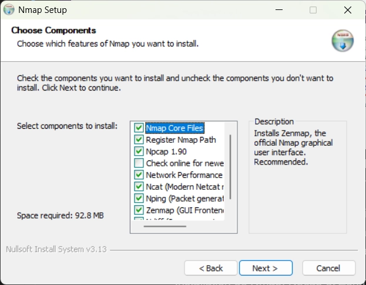
<figcaption>Installation de Nmap, Npcap et Zenmap sous Windows 11</figcaption>
</figure>


<!-- ---------------------------------------------------------------------- -->
#### Pourquoi pas sous WSL2 ?
Par défaut, WSL2 tourne derrière un réseau virtuel en NAT. Il ne voit donc pas vraiment ton réseau local et les scans bas niveau y fonctionnent mal. Si tu tiens absolument à Linux, il faut activer le mode réseau `mirrored` de WSL. Ça marche, mais le Nmap natif reste plus simple.


<!-- ###################################################################### -->
### PowerShell en administrateur

Sans droits administrateur, Nmap ne peut pas forger ses propres paquets. Il se rabat alors sur des méthodes plus lentes et moins précises, et il ne voit pas les adresses MAC des appareils. Donc : clic droit sur Windows Terminal, "Exécuter en tant qu'administrateur".

Alternative : WIN + X puis A.

On vérifie que tout est en place :

```powershell
nmap --version
```

<figure style="max-width: 900px; margin: auto; text-align: center;">
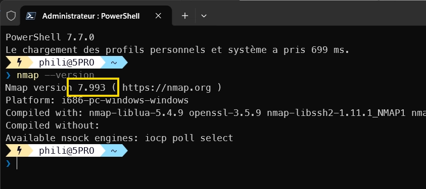
<figcaption>Nmap est installé et répond</figcaption>
</figure>


<!-- ###################################################################### -->
<!-- ###################################################################### -->
<!-- ###################################################################### -->
## Partie 1 : le réseau vu de l'intérieur


<!-- ###################################################################### -->
### Repérer ton réseau

La commande `ipconfig` te donne ton adresse et celle de ta passerelle (la box).

```powershell
ipconfig
```

Si ton adresse ressemble à `192.168.1.x` avec un masque `255.255.255.0`, alors ton réseau c'est `192.168.1.0/24`. C'est-à-dire les 254 adresses de `192.168.1.1` à `192.168.1.254`. Dans la suite j'utilise ce réseau là. Adapte à ton cas (`192.168.0.0/24` est aussi très courant).

<figure style="max-width: 900px; margin: auto; text-align: center;">
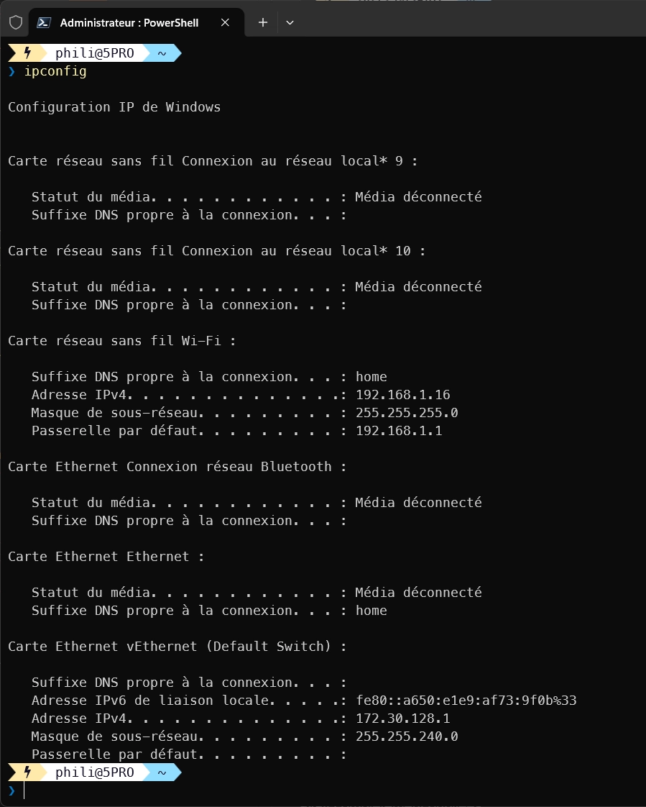
<figcaption>Adresse IPv4, masque et passerelle</figcaption>
</figure>


<!-- ###################################################################### -->
### Inventorier les appareils

On commence par une simple découverte des machines, sans scanner les ports :

```powershell
# Host discovery only (no port scan)
nmap -sn 192.168.1.0/24
```

Tu obtiens la liste des appareils connectés, avec leur adresse MAC et souvent le fabricant. C'est déjà très instructif. On y trouve souvent une prise connectée, une vieille tablette ou une télé qu'on avait complètement oubliées.

Prends le temps de mettre un nom sur chaque ligne. Un appareil que tu n'arrives pas à identifier, c'est déjà un sujet.

<figure style="max-width: 900px; margin: auto; text-align: center;">
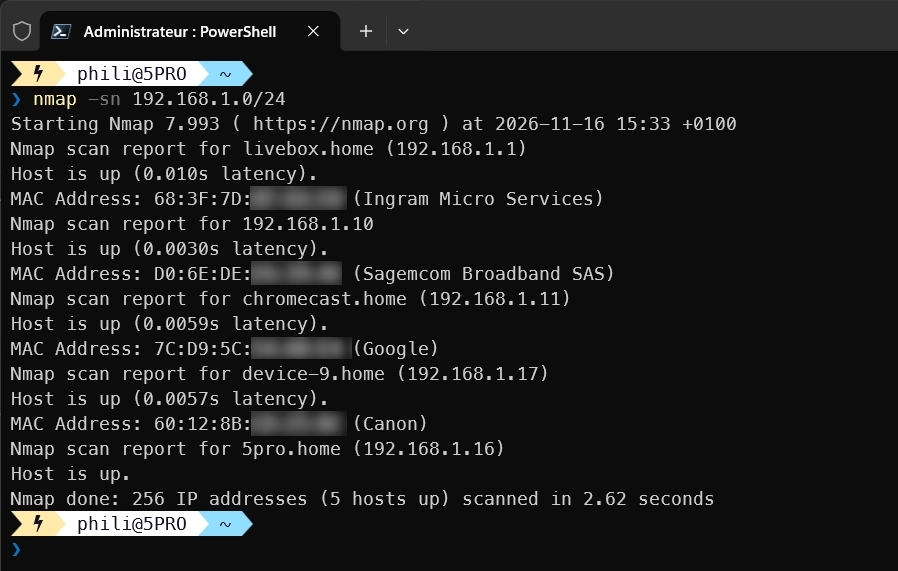
<figcaption>Inventaire des appareils du réseau local</figcaption>
</figure>


<!-- ###################################################################### -->
### Scanner les ports et identifier les services

Ensuite, on regarde quels ports sont ouverts, puis on demande à Nmap d'identifier les services, leurs versions et le système d'exploitation.

```powershell
# Fast scan of the 1000 most common TCP ports
nmap -T4 192.168.1.0/24

# Services, versions, OS detection and default scripts on one host
nmap -A -T4 192.168.1.1

# Top 100 UDP ports (slow)
nmap -sU --top-ports 100 192.168.1.1
```

Quelques explications :

* `-T4` : un profil de timing un peu plus rapide que celui par défaut. Sur un réseau local c'est sans problème.
* `-A` : fait tout d'un coup. Détection des versions (`-sV`), du système d'exploitation (`-O`), scripts par défaut (`-sC`) et traceroute.
* `-sU` : le scan UDP. Il est **beaucoup** plus lent, mais il révèle des choses comme UPnP (port 1900) ou SNMP (port 161) qu'un scan TCP ne verra jamais.

Commencer par la box (`192.168.1.1` ici) est une bonne idée. C'est l'appareil le plus exposé de la maison. Voilà ce que je vois :

<figure style="max-width: 900px; margin: auto; text-align: center;">

<figcaption>Services et versions exposés par la box</figcaption>
</figure>

Une fois nettoyé voilà ce que l'on peut étudier :

```powershell
❯ nmap -A -T4 192.168.1.1
Starting Nmap 7.993 ( https://nmap.org ) at 2026-11-16 15:38 +0100
Nmap scan report for livebox.home (192.168.1.1)
Host is up (0.0042s latency).
Not shown: 996 filtered tcp ports (no-response)
PORT    STATE  SERVICE   VERSION
53/tcp  open   domain    dnsmasq gen_2.86_v1.2.3-3-gf21296c0
| dns-nsid:
|   bind.version:
|_    dnsmasq-gen_2.86_v1.2.3-3-gf21296c0
80/tcp  open   http
| fingerprint-strings:
|   GetRequest:
|     HTTP/1.0 200 OK
|     X-Frame-Options: SAMEORIGIN
|     Strict-Transport-Security: max-age=31536000; includeSubDomains
|     ...
113/tcp closed ident
443/tcp open   ssl/https
|   ...
2 services unrecognized despite returning data.
[...]
MAC Address: 68:3F:7D:XX:XX:XX (Ingram Micro Services)
Device type: general purpose|media device|storage-misc|broadband router
Running (JUST GUESSING): Linux 2.6.X|3.X (92%), ...
Aggressive OS guesses: Linux 2.6.32 (92%), ...
No exact OS matches for host (test conditions non-ideal).
Network Distance: 1 hop

TRACEROUTE
HOP RTT     ADDRESS
1   4.23 ms livebox.home (192.168.1.1)

Nmap done: 1 IP address (1 host up) scanned in 94.37 seconds
```

Pour lire ce résultat, et tous ceux qui suivent, il faut savoir que Nmap classe chaque port dans l'un de ces trois états :

| État       | Ce que ça veut dire                              | Verdict                                    |
|------------|--------------------------------------------------|--------------------------------------------|
| `filtered` | Aucune réponse, le pare-feu ignore la demande    | Le résultat idéal                          |
| `closed`   | La machine répond qu'il n'y a rien sur ce port   | Pas dangereux, mais la machine se montre   |
| `open`     | Un service écoute                                | À chaque fois : est-ce que je l'ai voulu ? |


<!-- ---------------------------------------------------------------------- -->
#### Remarques

- **53 (DNS), 80 et 443 (interface d'administration)** : rien d'anormal pour une box vue du réseau local.
- **Le port 80 répond aussi en HTTP simple** : c'est un des points de la liste « ce qui doit alerter ». Ici le risque est faible, puisque ce n'est visible que depuis le réseau local. Mieux vaut quand même se connecter à l'interface en `https://`.
- **996 ports en `filtered`, même depuis l'intérieur** : la box se protège aussi du réseau local, c'est bon signe.
- **Système d'exploitation « JUST GUESSING »** : la détection de l'OS reste une estimation, ce n'est pas une vérité.
- **« Ingram Micro Services »** : c'est le fabricant associé au préfixe de l'adresse MAC, pas forcément la marque de la box. Faut donc se calmer si on retrouve pas la marque de la box.


<!-- ###################################################################### -->
### Chercher les vulnérabilités connues

Nmap embarque un moteur de scripts, NSE (Nmap Scripting Engine). La catégorie `vuln` regroupe des scripts qui testent des vulnérabilités connues.

```powershell
# Known vulnerability checks on one host
nmap --script vuln 192.168.1.10
```

C'est plus intrusif que les scans précédents. Certains scripts envoient de vraies requêtes d'exploitation (sans charge malveillante, mais quand même). Du coup, cible une machine précise plutôt que tout le réseau, et évite de le faire sur un NAS en pleine sauvegarde.


<!-- ###################################################################### -->
### Ce qui doit nous alerter

Quand tu relis les résultats, voilà ce qui doit faire lever un sourcil :

* **Telnet** (port 23) ou **FTP** (port 21) : protocoles qui transmettent tout en clair, mots de passe compris
* **SMB** (port 445) ouvert sur des appareils qui n'ont aucune raison de partager des fichiers
* l'**interface d'administration de la box en HTTP** simple (port 80) plutôt qu'en HTTPS
* **UPnP** activé (port UDP 1900)
* des **objets connectés** qui exposent des services inattendus (un serveur web sur une ampoule, vraiment ?)
* des **versions de firmware anciennes** repérées par `-sV`


<!-- ###################################################################### -->
### Test sur un portable sous Linux

```powershell
# On va taper un vieux Dell Latitude sous Linux
> nmap --script vuln 192.168.1.30
Starting Nmap 7.993 ( https://nmap.org ) at 2026-11-16 16:18 +0100
Nmap scan report for latitude-2.home (192.168.1.30)
Host is up (0.040s latency).
Not shown: 997 filtered tcp ports (no-response)
PORT    STATE SERVICE
22/tcp  open  ssh
139/tcp open  netbios-ssn
445/tcp open  microsoft-ds
MAC Address: 48:51:B7:XX:XX:XX (Intel Corporate)

Host script results:
|_smb-vuln-ms10-054: false
|_smb-vuln-ms10-061: Could not negotiate a connection:SMB: ERROR: Server returned less data than it was supposed to (one or more fields are missing); aborting [9]
|_samba-vuln-cve-2012-1182: Could not negotiate a connection:SMB: ERROR: Server returned less data than it was supposed to (one or more fields are missing); aborting [9]

Nmap done: 1 IP address (1 host up) scanned in 46.69 seconds
```


<!-- ---------------------------------------------------------------------- -->
#### Remarques
Rien d'alarmant sur ce scan. En revanche, il pose une question utile : as-tu besoin de Samba sur ce portable ?

**Ce que montre le scan**
- **997 ports en `filtered`** : un pare-feu est en effet actif sur la machine. Je sais plus si c'est `ufw` ou `firewalld`. Seuls 3 ports passent.
- **22/tcp (SSH)** : pratique pour administrer le portable à distance.
- **139 et 445 (SMB)** : c'est Samba, le partage de fichiers à la Windows. C'est pile le cas « SMB ouvert sur des appareils qui n'en ont pas besoin ».

**Les résultats des scripts**
- **`smb-vuln-ms10-054: false`** : cette faille-là n'est pas présente.
- **Les deux « Could not negotiate a connection »** : ces scripts datent de 2010 à 2012 et parlent SMBv1. Les Samba récents désactivent SMBv1 par défaut, donc la conversation échoue. Ce n'est pas une preuve d'absence de faille, mais c'est plutôt bon signe : SMBv1 est coupé.


<!-- ---------------------------------------------------------------------- -->
#### Pour aller plus loin, depuis Windows

Je peux saisir

```powershell
# Versions of SSH and Samba
nmap -sV -p 22,139,445 192.168.1.30

# SMB protocol versions accepted (SMBv1 should be absent)
nmap -p 445 --script smb-protocols 192.168.1.30

# SSH authentication methods (password should ideally be absent)
nmap -p 22 --script ssh-auth-methods --script-args ssh.user=root 192.168.1.30
```
Alors je vois

<figure style="max-width: 900px; margin: auto; text-align: center;">

<figcaption>Versions, protocoles SMB et authentification SSH du portable Linux</figcaption>
</figure>


<!-- ---------------------------------------------------------------------- -->
#### Pour aller plus loin, sous Linux

Je peux saisir

```bash
# Who listens on which port
sudo ss -tlnp

# If file sharing is not needed
sudo systemctl disable --now smbd nmbd
```

Dans `/etc/ssh/sshd_config` je vois que 2 lignes sensibles sont toujours commentées
* `#PasswordAuthentication yes`
* `#PermitRootLogin prohibit-password`


En fait tout ça est conforme à l'installation de ma config Linux qui est expliquée sur cette [page]()


<!-- ###################################################################### -->
### Test sur l'imprimante de la maison

Je vois :

```powershell
> # On va taper l'imprimante
> nmap --script vuln 192.168.1.17
Starting Nmap 7.993 ( https://nmap.org ) at 2026-11-16 15:53 +0100
Nmap scan report for device-9.home (192.168.1.17)
Host is up (0.0086s latency).
Not shown: 997 closed tcp ports (reset)
PORT     STATE SERVICE
80/tcp   open  http
|_http-dombased-xss: Couldn't find any DOM based XSS.
|_http-csrf: Couldn't find any CSRF vulnerabilities.
|_http-stored-xss: Couldn't find any stored XSS vulnerabilities.
515/tcp  open  printer
9100/tcp open  jetdirect
MAC Address: 60:12:8B:XX:XX:XX (Canon)

Nmap done: 1 IP address (1 host up) scanned in 74.17 seconds

```

Pendant le scan l'imprimante a imprimé 2 pages avec des signes cabalistiques. C'est pas un piratage, c'est un effet de bord connu de Nmap sur les imprimantes.

<figure style="max-width: 900px; margin: auto; text-align: center;">
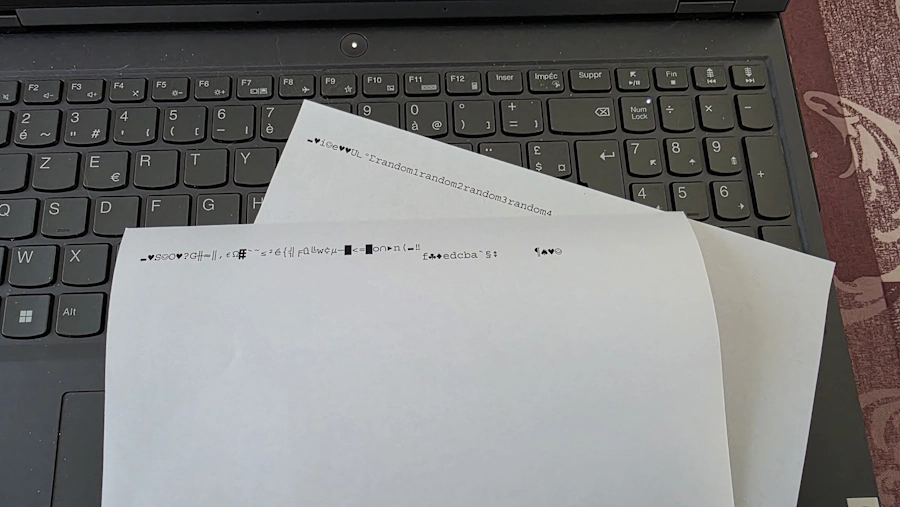
<figcaption>Les 2 feuilles imprimées pendant le nmap --script vuln 192.168.1.17</figcaption>
</figure>


<!-- ---------------------------------------------------------------------- -->
#### Pourquoi l'imprimante a imprimé?
- **Port 9100 (`jetdirect`), l'impression « brute » :** l'imprimante imprime tout ce qu'elle reçoit sur ce port, sans vérification ni authentification.
- **Les scripts NSE de la catégorie `vuln` envoient des requêtes de test sur les ports ouverts.** L'imprimante a reçu ces octets sur le 9100 et les a imprimés tels quels, d'où les signes cabalistiques.
- **La détection de version (`-sV`, `-A`) évite ce problème :** elle exclut par défaut les ports 9100 à 9107 pour cette raison (directive `Exclude` du fichier `nmap-service-probes`). Les scripts lancés par `--script vuln` ne suivent pas cette exclusion. Du moins, c'est l'explication la plus probable ; je n'ai pas identifié lequel a déclenché l'impression.


<!-- ---------------------------------------------------------------------- -->
#### Comment l'éviter?

```powershell
# Skip raw printing ports
nmap --script vuln --exclude-ports 9100-9107 192.168.1.17
```


<!-- ---------------------------------------------------------------------- -->
#### Que dit le résultat?
- **80/tcp (interface web) :** aucune faille XSS ni CSRF détectée. Ce n'est pas une garantie, ces scripts ne testent que quelques cas.
- **515/tcp (LPD) et 9100/tcp :** n'importe quel appareil du réseau local peut imprimer sans authentification. C'est normal pour une imprimante domestique, mais ces ports ne doivent jamais apparaître dans le scan externe.


<!-- ###################################################################### -->
### Suivre le réseau dans le temps

Il vaut mieux se déplacer dans un répertoire temporaire pour faire ses premiers tests

```powershell
cd $env:TEMP
```

Un scan, c'est une photo. Ce qui est intéressant c'est le film. Enregistre tes résultats dans tous les formats avec `-oA` :

```powershell
# Save results in all formats for later comparison
# nmap -A -oA audit_2026-11-16 192.168.1.0/24
nmap -sV -T4 -oA audit_2026-11-16 192.168.1.0/24
```


<!-- ---------------------------------------------------------------------- -->
#### Remarques
Ci-dessus la ligne `-A` est en commentaire car lorsque j'utilise `ndiff` ensuite, ça part en vrille (bug dans un script Python je crois). Du coup je me rabats sur l'option `-sV`


```powershell
ls audit*
```


<figure style="max-width: 826px; margin: auto; text-align: center;">
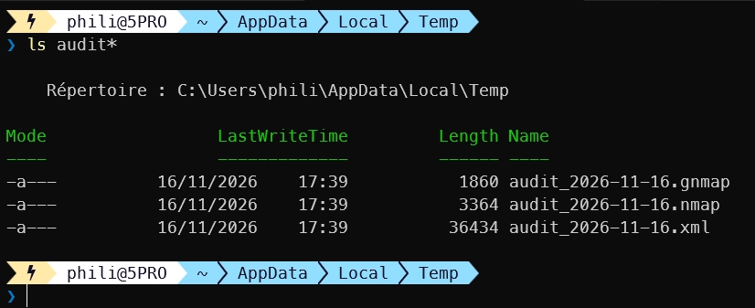
<figcaption>Les 3 fichiers générés avec nmap -oA</figcaption>
</figure>

Tu obtiens trois fichiers : `.nmap` (lisible), `.gnmap` (facile à filtrer) et `.xml`. C'est le XML qui nous intéresse. Un mois plus tard, tu refais le même scan et tu compares avec `ndiff` :

```powershell
ndiff audit_2026-11-16.xml audit_2026-11-16_2.xml
```

`ndiff` te montre les nouveaux appareils, les appareils disparus et les ports qui se sont ouverts ou fermés. Un port qui s'ouvre tout seul sur un objet connecté, c'est typiquement le genre de chose qu'on veut savoir.

<!-- <figure style="max-width: 900px; margin: auto; text-align: center;">

<figcaption>ndiff : ce qui a changé entre deux scans</figcaption>
</figure> -->

Par exemple, ci-dessous j'ai lancé deux scans à 6 minutes d'intervalle. Entre les deux, j'ai éteint le PC Linux.

```powershell
❯ ndiff audit_2026-11-16.xml audit_2026-11-16_2.xml
-Nmap 7.993 scan initiated Mon Nov 16 17:36:45 2026 as: "C:\\Program Files (x86)\\Nmap\\nmap.exe" -sV -T4 -oA audit_2026-11-16 192.168.1.0/24
+Nmap 7.993 scan initiated Mon Nov 16 17:42:42 2026 as: "C:\\Program Files (x86)\\Nmap\\nmap.exe" -sV -T4 -oA audit_2026-11-16_2 192.168.1.0/24

 livebox.home (192.168.1.1, 68:3F:7D:xx:xx:xx):
 PORT    STATE  SERVICE   VERSION
-80/tcp  closed http
+80/tcp  open   http
-443/tcp closed https
+443/tcp open   ssl/https

+s25-40tude.home (192.168.1.12, 06:1F:C7:xx:xx:xx):
+Host is up.
+Not shown: 1000 closed ports

 5pro.home (192.168.1.16):
 PORT     STATE SERVICE VERSION
-5357/tcp open  http    Microsoft HTTPAPI httpd 2.0 (SSDP/UPnP)
+5357/tcp open  wsdapi

-latitude-2.home (192.168.1.30, 48:51:B7:xx:xx:xx):
-Host is up.
-Not shown: 997 filtered ports
-PORT    STATE SERVICE     VERSION
-22/tcp  open  ssh         OpenSSH 8.9p1 Ubuntu 3ubuntu0.18 (Ubuntu Linux; protocol 2.0)
-139/tcp open  netbios-ssn Samba smbd 4
-445/tcp open  netbios-ssn Samba smbd 4
```

Les lignes qui commencent par `-` viennent du premier scan, celles qui commencent par `+` du second. Une ligne sans signe est identique dans les deux. Prenons les blocs un par un :

* **Les deux lignes `Nmap`** : ce sont simplement les commandes des deux scans. `ndiff` les affiche toujours.
* **`livebox.home`** : les ports 80 et 443 passent de `closed` à `open`. Ça ressemble à une alerte... sauf que ces ports étaient déjà ouverts lors du `nmap -A` sur la box un peu plus tôt. Le plus probable, c'est que pendant le premier scan l'interface web de la box a refusé les connexions sous la charge de `-T4`. Avant de paniquer, on rescanne juste ces ports : `nmap -sV -p 80,443 192.168.1.1`. On retrouvera ce phénomène de ports qui "clignotent" dans la partie 2, avec la protection anti-scan de la box.
* **`s25-40tude.home`** : un nouvel appareil. C'est mon téléphone, revenu sur le Wi-Fi entre les deux scans. Remarque son adresse MAC `06:1F:C7:...` : le deuxième caractère, `6`, indique une adresse "administrée localement". C'est l'adresse Wi-Fi privée (aléatoire) d'Android ou d'iOS, c'est pour ça que Nmap n'affiche aucun fabricant. Et ses 1000 ports fermés, c'est ce qu'on attend d'un téléphone.
* **`5pro.home`** : pas d'adresse MAC, c'est normal, c'est le PC qui lance le scan. Nmap n'affiche pas sa propre adresse MAC. Le port 5357 (WSDAPI, la découverte réseau de Windows) est ouvert dans les deux scans. Seul le libellé change : la détection de version (`-sV`) n'a pas donné la même réponse les deux fois. Encore du bruit.
* **`latitude-2.home`** : l'appareil a disparu, puisque je l'ai éteint. Au passage, on récupère les versions repérées par `-sV` : OpenSSH 8.9p1, donc une Ubuntu 22.04, et Samba 4. Attention, Ubuntu corrige les failles sans changer le numéro de version principal. Un "8.9p1" qui a l'air ancien n'est donc pas forcément vulnérable : c'est le suffixe `3ubuntu0.18` qui compte.

Ce qu'il faut retenir : `ndiff` remonte **beaucoup de bruit**. Des appareils qui vont et viennent (téléphones, portables), des libellés de version qui changent, des ports qui "clignotent" sur un scan rapide. Le vrai signal, c'est un **nouveau port ouvert sur un appareil stable** (box, NAS, caméra, imprimante) ou un **appareil inconnu qui reste** d'un scan à l'autre. Dans le doute, on rescanne l'appareil concerné, sur les ports concernés.


<!-- ###################################################################### -->
<!-- ###################################################################### -->
<!-- ###################################################################### -->
## Mais au fait, ma box ne me protège pas ?

C'est LA question que je me posais en regardant la vidéo. La réponse courte : vu de l'extérieur, la box protège déjà bien mais ce n'est pas la seule question à se poser.

<figure style="max-width: 900px; margin: auto; text-align: center;">
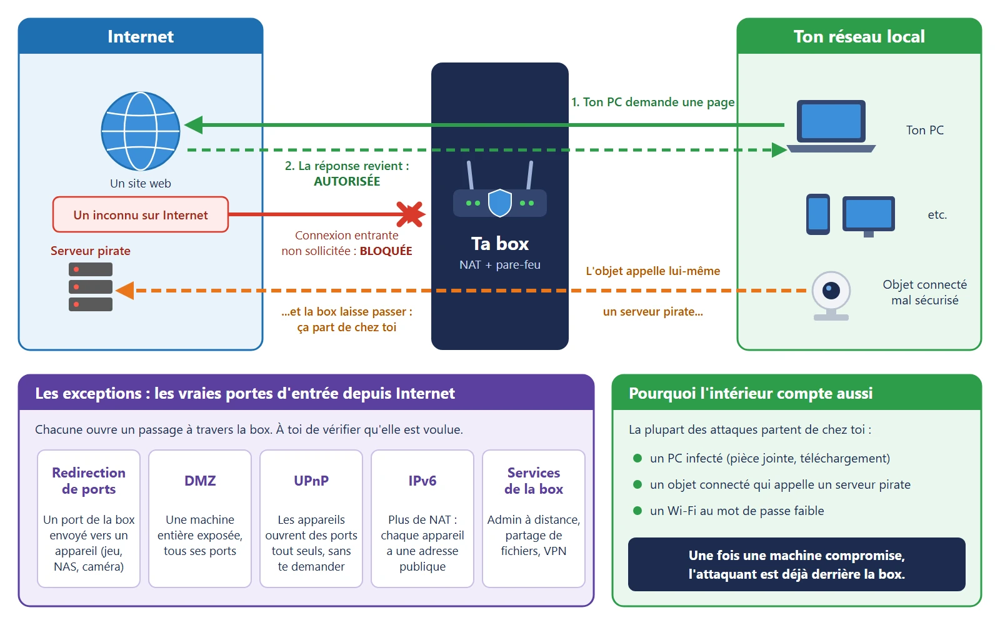
<figcaption>Ce que la box bloque, et ce qu'elle laisse passer</figcaption>
</figure>


<!-- ###################################################################### -->
### Pourquoi la box protège

Par défaut, la box bloque toutes les connexions qui viennent d'Internet sans avoir été demandées depuis chez toi. Quand ton PC va sur un site web, la box se souvient de la demande et laisse passer la réponse. En revanche, si quelqu'un frappe à la porte sans avoir été invité, la box ne sait pas à qui transmettre et elle rejette la demande.

Résultat : quelqu'un à l'extérieur ne voit que la box elle-même, pas tes appareils.


<!-- ###################################################################### -->
### Les vraies failles côté extérieur

Ce sont les exceptions à cette règle. Celles que tu as ouvertes toi-même, parfois sans le savoir :

* **Les redirections de ports** que tu as configurées un jour pour un serveur de jeu, un NAS ou une caméra, et oubliées depuis.
* **La DMZ**, si elle est activée : elle expose une machine **entière** à Internet. Tous ses ports.
* **L'UPnP** : il permet à une console, une caméra ou un logiciel d'ouvrir des ports **tout seul**, sans te demander ton avis.
* **L'IPv6** : là, il n'y a plus de NAT. Chaque appareil a une adresse publique, joignable directement depuis Internet. Tout dépend alors du pare-feu IPv6 de la box, qu'il faut vérifier dans son interface.
* **Les services de la box elle-même** : administration à distance, serveur de fichiers, VPN, etc.


<!-- ###################################################################### -->
### Pourquoi l'intérieur compte quand même

**C'est LE truc que j'avais pas vraiment compris**

La plupart des attaques à la maison ne passent pas par une entrée directe à travers la box. Elles viennent de l'intérieur :

* un PC infecté par une pièce jointe ou un téléchargement douteux
* un objet connecté mal sécurisé qui contacte **lui-même** un serveur pirate. La box laisse passer puisque la connexion part de chez toi. Et une fois la connexion établie, elle fonctionne dans les deux sens.
* un Wi-Fi au mot de passe faible, ou partagé avec des invités

Une fois qu'une machine est compromise, l'attaquant est **derrière** la box. Et c'est exactement là que le scan interne de la partie 1 devient utile : il montre ce que cet attaquant pourrait atteindre depuis la machine infectée.

Donc la vidéo n'avait pas tort. Il manquait juste l'autre moitié du sujet.


<!-- ###################################################################### -->
<!-- ###################################################################### -->
<!-- ###################################################################### -->
## Partie 2 : le réseau vu de l'extérieur

Scanner depuis chez toi ne montre pas ce que voit Internet. Pour ça il faut scanner ton adresse IP publique depuis une **autre** connexion. Deux solutions simples :

* partager la connexion 4G ou 5G de ton téléphone avec ton PC
* louer un petit serveur virtuel (VPS) pour quelques euros par mois

Je pars sur la première option, c'est gratuit et on a tous un téléphone dans la poche.


<!-- ###################################################################### -->
### Récupérer tes adresses publiques

Depuis chez toi, connecté normalement, note :

* **ton adresse IPv4 publique**. Elle est affichée dans l'interface de ta box, ou tu peux la demander à un site comme `ifconfig.me` :

```powershell
curl.exe -4 ifconfig.me
```

<figure style="max-width: 703px; margin: auto; text-align: center;">
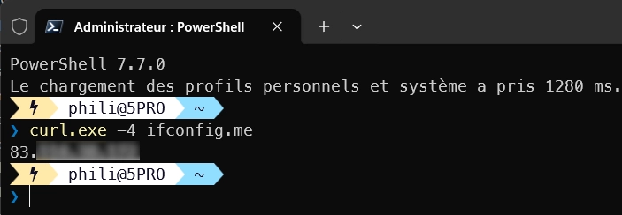
<figcaption>Mon IPv4 publique avec curl.exe -4 ifconfig.me</figcaption>
</figure>

Avec une IPv4 dynamique, l'adresse peut changer. Faut penser à refaire ce relevé juste avant le scan.

* **l'adresse IPv6 de la box** et celles de quelques appareils importants : PC, NAS, caméra... Tu les trouves avec `ipconfig` sur chaque machine (prends la ligne "Adresse IPv6", pas "Adresse IPv6 temporaire"), ou dans la liste des appareils de la box.

```powershell
curl.exe -6 ifconfig.me
```

<!-- ---------------------------------------------------------------------- -->
#### Remarque
Si tu obtiens ceci :

```powershell
curl.exe -6 ifconfig.me
curl: (6) Could not resolve host: ifconfig.me
```

Le message est trompeur. Le DNS fonctionne et `ifconfig.me` a bien une adresse IPv6. Le vrai problème, c'est que ton PC n'a **pas d'adresse IPv6 globale**. Dans ce cas, Windows ne renvoie même pas les adresses IPv6 des sites, et `curl` conclut qu'il ne trouve pas l'hôte.

Pour le vérifier :

```powershell
Get-NetIPAddress -AddressFamily IPv6 | Select-Object InterfaceAlias, IPAddress
Get-NetRoute -AddressFamily IPv6 -DestinationPrefix '::/0'
```

<figure style="max-width: 900px; margin: auto; text-align: center;">
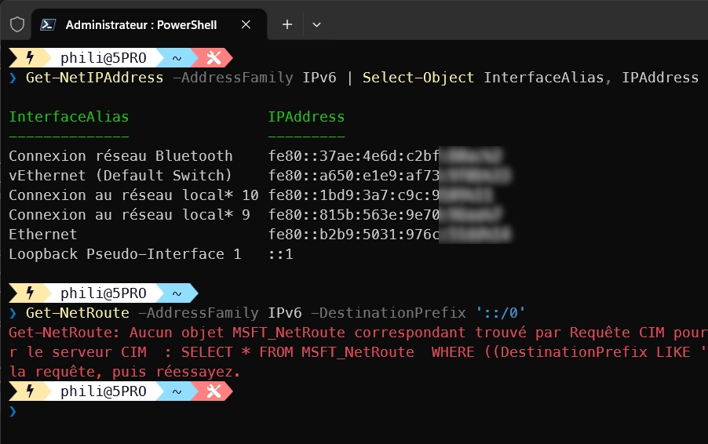
<figcaption>Le PC n'a que des adresses fe80:: et aucune route ::/0</figcaption>
</figure>


Si tu ne vois que des adresses commençant par `fe80::` (adresses locales au lien) et aucune route `::/0`, il y a deux suspects :

* **la box** ne distribue pas d'IPv6. Sur une Livebox Orange, regarde dans l'interface d'administration (`http://192.168.1.1`), menu Réseau, onglet IPv6. La case "Activer la connectivité IPv6" doit être cochée et un préfixe doit être affiché.


<figure style="max-width: 900px; margin: auto; text-align: center;">
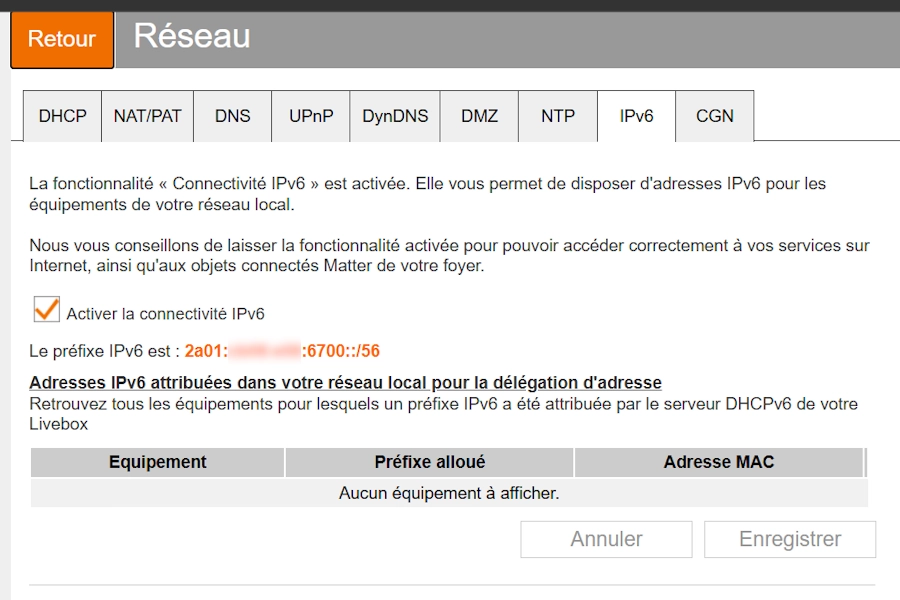
<figcaption>Vérifier la connectivité IPv6 au niveau de la box</figcaption>
</figure>


* **la carte réseau du PC** a l'IPv6 désactivé. Vérifie avec :

```powershell
Get-NetAdapterBinding -ComponentID ms_tcpip6 | Select-Object Name, Enabled
```
<figure style="max-width: 900px; margin: auto; text-align: center;">
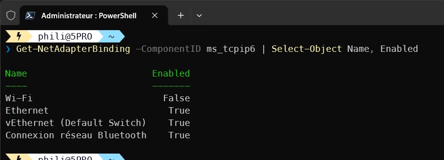
<figcaption>Vérifier la connectivité IPv6 au niveau du PC</figcaption>
</figure>

Si la carte utilisée (ici `Wi-Fi`) affiche `False`, c'est elle qui bloque. Pour la réactiver, dans un terminal administrateur :

```powershell
Enable-NetAdapterBinding -Name 'Wi-Fi' -ComponentID ms_tcpip6
```

C'est mon cas : la Livebox a bien l'IPv6 activé, mais il est désactivé sur la carte Wi-Fi de mon PC. Je ne vais pas l'activer maintenant : **dans la suite, je reste en IPv4**. Si tu as l'IPv6 chez toi, note quand même les adresses : la logique du scan reste la même. J'ai finalement fait le test IPv6 un peu plus tard, tout est raconté dans la partie "Et l'IPv6 ?" plus bas.


<!-- ###################################################################### -->
### Se placer à l'extérieur

Coupe le Wi-Fi de la maison sur ton PC, puis connecte-le au partage de connexion de ton téléphone. C'est indispensable : si tu restes sur ton réseau, la box répond "de l'intérieur" et le résultat est complètement faussé.

Attention au piège : le **téléphone** ne doit pas être connecté au Wi-Fi de la maison non plus. Sinon il partage ce Wi-Fi au lieu de la 4G/5G, et tu sors toujours par la box (sur les Samsung, c'est l'option "Partage Wi-Fi" du point d'accès). Coupe le Wi-Fi du téléphone, garde les données mobiles, et vérifie depuis le PC que `curl.exe -4 ifconfig.me` n'affiche **plus** l'adresse publique de la maison.

Si tu fais aussi l'IPv6, vérifie que ta connexion mobile en a bien une. C'est généralement le cas chez les opérateurs français. Une fois sur le partage de connexion, un `curl.exe -6 ifconfig.me` qui répond te le confirme.

<figure style="max-width: 482px; margin: auto; text-align: center;">
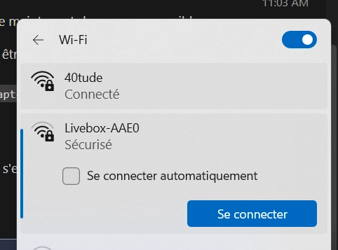
<figcaption>Se placer à l'extérieur avec le partage de connexion du téléphone</figcaption>
</figure>


<!-- ###################################################################### -->
### Lancer les scans

Toujours dans un PowerShell administrateur. L'option `-Pn` est importante : une box bien configurée ne répond pas au ping, et sans cette option Nmap la croirait éteinte et s'arrêterait là.

```powershell
# Replace with your real public addresses
$ip4 = "83.x.x.x"

# Quick scan of the 1000 most common TCP ports
nmap -Pn -T4 $ip4

# Full scan of all 65535 TCP ports (takes longer)
nmap -Pn -T4 -p- $ip4

# Identify services on the ports found open (example ports)
nmap -Pn -sV -p 80,443,8080 $ip4

# Most common UDP ports (slow)
nmap -Pn -sU --top-ports 50 $ip4

# IPv6 only if you have it: the box itself, then a device behind it
nmap -6 -Pn -T4 2a01:xxxx::1
nmap -6 -Pn -T4 2a01:xxxx::abcd
```

Le scan des 65 535 ports peut prendre un moment sur une connexion mobile. Va te faire un café.


<figure style="max-width: 900px; margin: auto; text-align: center;">
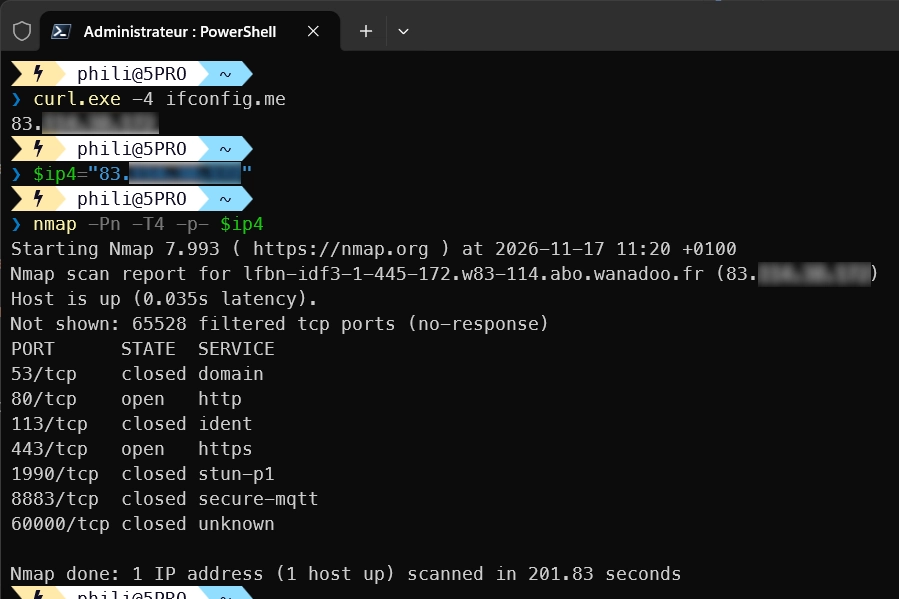
<figcaption>Scan complet des 65 535 ports TCP depuis l'extérieur</figcaption>
</figure>

Ce que je lis dans ce résultat :

* **Le nom de la machine.** Nmap affiche le nom inverse de l'adresse, du genre `lfbn-xxx.abo.wanadoo.fr`. Rien de secret, mais ça dit à n'importe qui que c'est une ligne Orange, et même à peu près dans quelle région.
* **`Host is up` malgré `-Pn`.** La box ne répond pas au ping, mais elle répond sur certains ports. Nmap en déduit qu'il y a bien quelqu'un.
* **65 528 ports `filtered`.** C'est l'essentiel : sur presque tous les ports, la box ne répond rien. C'est ce qu'on veut.
* **5 ports `closed`** (53, 113, 1990, 8883, 60000). La box répond "il n'y a rien ici" au lieu de se taire. Ce n'est pas dangereux, mais elle se montre. Ils sont probablement liés aux services d'Orange (DNS, ident, gestion à distance, MQTT...). Je ne peux pas les régler et je les laisse.
* **2 ports `open`** (80 et 443). C'est ce qui doit retenir l'attention. Un serveur web répond depuis Internet. Soit c'est voulu (un NAS ou un serveur que je publie volontairement), soit c'est l'interface de la box ou une redirection oubliée.
* **La durée.** Le scan complet a pris un peu plus de 3 minutes en 4G. C'est raisonnable.

Les 2 ports ouverts sont à vérifier tout de suite avec :

```powershell
nmap -Pn -sV -p 80,443 $ip4
```

Je vois
```powershell
nmap -Pn -sV -p 80,443 $ip4
Starting Nmap 7.993 ( https://nmap.org ) at 2026-11-17 11:30 +0100
Nmap scan report for lfbn-xxx.abo.wanadoo.fr (83.x.x.x)
Host is up (0.028s latency).

PORT    STATE SERVICE    VERSION
80/tcp  open  http?
443/tcp open  ssl/https?

Service detection performed. Please report any incorrect results at https://nmap.org/submit/ .
Nmap done: 1 IP address (1 host up) scanned in 133.08 seconds
```

Cela veut dire que Nmap n'a pas réussi à identifier ces services. Le `?` après `http` et `ssl/https` veut dire qu'il devine d'après le numéro du port : il a trouvé du TLS sur 443, mais aucune signature connue. Il faut donc regarder directement ce qui répond.

```powershell
curl.exe -v --max-time 10 "http://$ip4"
```

```
* Established connection to 83.x.x.x (83.x.x.x port 80) from 10.x.x.x port 1131
...
curl: (52) Empty reply from server
```

La connexion TCP aboutit, puis le serveur la ferme sans rien répondre. Sur 443, c'est pareil : la négociation TLS va jusqu'au bout, puis le serveur ferme proprement sans envoyer de page. Quelque chose écoute bien, mais refuse de parler à un inconnu.

<!-- ---------------------------------------------------------------------- -->
#### Remarque : des résultats qui changent d'une minute à l'autre
En relançant un scan juste après, je trouve 443 en `filtered`. Puis, avec un scan en connexion complète (`-sT`, comme le ferait un navigateur), 80 et 443 redeviennent `open` :

```powershell
nmap -Pn -sT -p 80,443 --reason $ip4
```

```
PORT    STATE SERVICE REASON
80/tcp  open  http    syn-ack
443/tcp open  https   syn-ack
```

L'explication la plus probable : la box a une protection anti-scan. Après une rafale de paquets SYN (le scan par défaut de Nmap en administrateur), elle ignore temporairement l'adresse qui scanne. Une vraie connexion, elle, passe. Morale : si un résultat te paraît bizarre, relance avec `-sT` et attends quelques minutes entre deux scans complets.

<!-- ---------------------------------------------------------------------- -->
#### Identifier le service avec son certificat
Sur 443, le serveur présente son certificat pendant la négociation TLS, avant toute authentification. Nmap sait le lire :

```powershell
nmap -Pn -sT -p 443 --script ssl-cert $ip4
```

```
443/tcp open  https
| ssl-cert: Subject: commonName=xxxxxx-Livebox Fibre-xxxxxxxxxxxx/organizationName=Orange/countryName=FR
| Subject Alternative Name: IP Address:192.168.1.1
| Issuer: commonName=Orange Devices Generic27 CA/organizationName=Orange/countryName=FR
| Not valid before: 2021-01-11T22:41:36
|_Not valid after:  2036-01-11T22:41:36
```

Plus de doute : c'est **la Livebox elle-même**. Le certificat est émis par Orange, au nom de la Livebox, pour l'adresse `192.168.1.1`. C'est celui de son interface d'administration. Ce n'est ni une redirection oubliée ni un appareil de mon réseau.

Le risque est limité, puisque la box ferme la connexion sans rien afficher. Mais l'interface d'administration de la box est joignable depuis Internet, et ce n'est pas idéal : il suffirait d'une faille dans ce service pour que ça devienne un problème. Prochaine étape : vérifier dans l'interface de la Livebox si l'accès à distance est activé (voir plus bas).

Au passage, le certificat donne le modèle de la box et son numéro de série (masqué ici). N'importe qui peut le lire de la même façon.


<!-- ###################################################################### -->
### Et l'IPv6 ?

Plus haut, j'avais dit que je restais en IPv4. Ayé, j'ai trouvé deux minutes pour faire le test en IPv6 avec le PC Windows. Je vais être honnête : je ne l'ai pas réussi du premier coup. Voilà tout ce que j'ai fait, erreurs comprises, parce qu'elles sont instructives.

<!-- ---------------------------------------------------------------------- -->
#### Premier essai : je scanne mon propre PC
Comme l'IPv6 était désactivé sur la carte Wi-Fi du PC, j'ai branché un câble réseau sur la box pour récupérer une adresse IPv6 sur la carte Ethernet. Ensuite, comme pour l'IPv4 : Wi-Fi du téléphone coupé, partage de connexion activé, PC connecté au téléphone en Wi-Fi. Et j'ai scanné l'adresse IPv6 que `ipconfig` me donnait :

```powershell
nmap -6 -Pn -T4 2a01:xxxx:xxxx:xxxx:xxxx:xxxx:xxxx:6969
```

```
Nmap scan report for 2a01xxxx....ipv6.abo.wanadoo.fr (2a01:xxxx:xxxx:xxxx:xxxx:xxxx:xxxx:6969)
Host is up (0.000084s latency).
Not shown: 996 closed tcp ports (reset)
PORT     STATE SERVICE
135/tcp  open  msrpc
445/tcp  open  microsoft-ds
2179/tcp open  vmrdp
5357/tcp open  wsdapi
```

Au premier coup d'œil, c'est la panique : SMB (445) ouvert sur Internet ! En réalité, ce scan ne veut rien dire :

* **La latence : 84 microsecondes.** À travers la 4G, on est à quelques dizaines de millisecondes. Ici, les paquets ne sont jamais sortis du PC.
* **Les ports** sont ceux de Windows lui-même (RPC, partage de fichiers, Hyper-V, découverte réseau). Le pare-feu Windows ne filtre pas ce qu'une machine s'envoie à elle-même.
* **L'adresse** était celle de la carte Ethernet du PC, encore branchée à la box. Windows a vu que c'était la sienne et s'est répondu tout seul.

Et débrancher le câble n'aurait pas suffi. Dès que le PC quitte la maison, cette adresse n'existe plus, et le scan dirait "filtered" partout simplement parce qu'il n'y a plus personne. **La machine qu'on scanne doit rester à la maison, et celle qui scanne doit en être sortie.** Ce ne peut pas être la même.

<!-- ---------------------------------------------------------------------- -->
#### La bonne configuration
Il faut donc deux machines :

* **La cible : le portable sous Linux**, rallumé et branché **par câble** sur la box. Il reste à la maison et reçoit une adresse IPv6 publique.
* **Le scanneur : le PC Windows**, câble **débranché**, connecté en Wi-Fi au partage de connexion du téléphone. Le téléphone a son Wi-Fi coupé, pour sortir par la 4G/5G.

Sur le portable Linux, `ip -6 addr show scope global` affiche deux adresses en `2a01:...`. Celle marquée `temporary` sert aux connexions sortantes et change régulièrement. L'autre est stable. Les deux font l'affaire pour le test.

Je lance le scan depuis le PC Windows :

```
setup_target: failed to determine route to 2a01:xxxx:xxxx:xxxx:xxxx:xxxx:xxxx:c918
WARNING: No targets were specified, so 0 hosts scanned.
```

Cette fois, Nmap n'a même pas essayé : le PC n'a aucune route IPv6 pour sortir. Normal, je l'avais écrit moi-même plus haut : **l'IPv6 est désactivé sur la carte Wi-Fi**, et c'est justement par le Wi-Fi que le PC passe par le téléphone. Dans un PowerShell administrateur :

```powershell
# Enable IPv6 on the Wi-Fi adapter
Enable-NetAdapterBinding -Name 'Wi-Fi' -ComponentID ms_tcpip6

# Check: must show an address that is NOT the home prefix
curl.exe -6 ifconfig.me
```

Si `curl.exe -6` échoue alors que l'IPv6 est activé sur la carte, c'est la connexion mobile qui n'en fournit pas. Sur un Samsung, ça se règle dans Paramètres > Connexions > Réseaux mobiles > Noms des points d'accès : le protocole APN doit être sur `IPv4/IPv6`.

<!-- ---------------------------------------------------------------------- -->
#### Le résultat... et le piège de l'opérateur
Cette fois, ça passe :

```
nmap -6 -Pn -T4 2a01:xxxx:xxxx:xxxx:xxxx:xxxx:xxxx:c918
Nmap scan report for 2a01xxxx....ipv6.abo.wanadoo.fr (2a01:xxxx:xxxx:xxxx:xxxx:xxxx:xxxx:c918)
Host is up (0.035s latency).
Not shown: 996 filtered tcp ports (no-response)
PORT    STATE SERVICE
21/tcp  open  ftp
80/tcp  open  http
443/tcp open  https
554/tcp open  rtsp
```

La latence de 35 ms confirme qu'on passe bien par la 4G. Les 996 ports `filtered` montrent que le pare-feu IPv6 de la box fait son travail. Mais 4 ports ouverts ? Un portable Linux qui serait serveur FTP et serveur vidéo RTSP, ça m'étonne beaucoup.

21, 80, 443 et 554, c'est exactement la liste des ports que certains opérateurs mobiles interceptent avec un **proxy transparent**. C'est un équipement de l'opérateur qui répond "ouvert" à la place de la cible. Pour en avoir le cœur net, je scanne une adresse qui **n'existe pas** dans mon préfixe :

```powershell
nmap -6 -Pn -T4 --reason -p 21,80,443,554 2a01:xxxx:xxxx:xxxx::dead:beef
```

```
Host is up, received user-set (0.025s latency).

PORT    STATE SERVICE REASON
21/tcp  open  ftp     syn-ack ttl 61
80/tcp  open  http    syn-ack ttl 61
443/tcp open  https   syn-ack ttl 61
554/tcp open  rtsp    syn-ack ttl 61
```

Une machine fantôme avec 4 ports ouverts : c'est donc bien l'opérateur qui répond. Le `ttl 61` le confirme. Un équipement réseau part en général de 64 et chaque routeur retire 1 au passage, donc la réponse vient de 3 sauts seulement, chez l'opérateur mobile, et pas de ma box à l'autre bout d'Internet.

Conclusion pour l'IPv6 : **le portable Linux est protégé par le pare-feu IPv6 de la box.** Pour les ports 21, 80, 443 et 554, Nmap ne peut rien dire depuis cette connexion mobile, puisque ses paquets n'atteignent jamais la cible. Pour les tester vraiment, il faudrait scanner depuis un autre point d'Internet : un VPN activé sur le PC, la box d'un ami, le bureau...

Et retiens la méthode, elle sert partout : **avant de croire un port `open` vu de l'extérieur, scanne une adresse qui n'existe pas.** Si elle a les mêmes ports ouverts, c'est le réseau qui te ment, pas la cible.

Ça m'oblige aussi à relire honnêtement la partie IPv4 : les ports 80 et 443 "ouverts" de la Livebox sont peut-être, eux aussi, d'abord une réponse du proxy. Cela pourrait expliquer les résultats qui changent d'une minute à l'autre. En revanche, le certificat lu sur 443 est bien celui de la Livebox : derrière le proxy, c'est bien elle qui répond. La conclusion sur l'interface d'administration joignable depuis Internet tient donc toujours. Si tu veux vérifier chez toi, fais le même test en IPv4 sur une adresse publique au hasard (`nmap -Pn --reason -p 21,80,443,554 1.2.3.4`) et compare les TTL.

<!-- ---------------------------------------------------------------------- -->
#### Je garde l'IPv6 sur le Wi-Fi
Le test terminé, je me suis posé la question : je remets le Wi-Fi du PC en IPv4 seul, ou pas ? Je le **garde en IPv6**, pour plusieurs raisons :

* **C'est la configuration normale de Windows.** Microsoft déconseille de désactiver l'IPv6, certains composants du système comptent dessus. La carte Ethernet l'avait déjà, c'était la carte Wi-Fi qui faisait exception (un vieux réglage dont je ne me souviens même plus).
* **Le désactiver sur un seul PC ne protège pas la maison.** Le portable Linux, les téléphones, la TV et la box ont tous de l'IPv6. Ce qui les protège, c'est le pare-feu IPv6 de la box, et le test vient de montrer qu'il fait son travail.
* **Mon PC est protégé deux fois** : par le pare-feu de la box, puis par le pare-feu Windows, qui fonctionne aussi bien en IPv6 qu'en IPv4. Sur un Wi-Fi public (hôtel, gare), c'est le profil "Public" du pare-feu Windows qui s'applique, en IPv6 comme en IPv4.
* **Ça peut être un peu plus direct** vers les gros services (Google, Microsoft, Netflix...), sans NAT au milieu. Je ne verrai sans doute pas la différence, mais ça ne coûte rien.

Si le test avait montré un vrai port ouvert sur le portable Linux, la bonne réaction n'aurait pas été de couper l'IPv6 sur le PC, mais de corriger le pare-feu IPv6 dans l'interface de la box. C'est la suite.


<!-- ###################################################################### -->
### Corriger dans l'interface de la box

Pour chaque port ouvert que tu n'as pas voulu, va vérifier dans l'interface de la box :

* les **redirections de ports** : supprime celles qui ne servent plus
* la **DMZ** : désactive-la
* l'**UPnP** : coupe-le si tu n'en as pas besoin
* le **pare-feu IPv6** : règle-le pour bloquer les connexions entrantes
* l'**administration à distance** et les **services de partage de fichiers** : désactive-les

Les menus changent d'une box à l'autre, mais on retrouve à peu près toujours ces rubriques dans une section "Réseau", "Pare-feu" ou "NAT/PAT".

<figure style="max-width: 900px; margin: auto; text-align: center;">
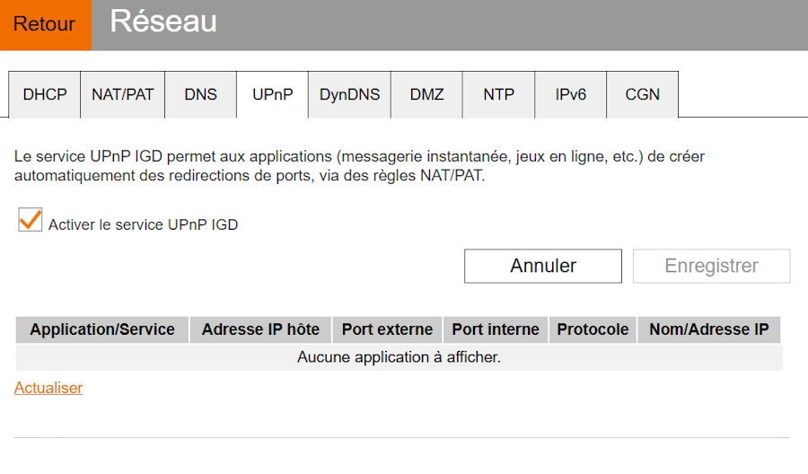
<figcaption>Les réglages à vérifier dans l'interface de la box</figcaption>
</figure>

Ensuite, refais le scan externe pour confirmer que les corrections ont bien été prises en compte.

<!-- ---------------------------------------------------------------------- -->
#### Mon cas
J'ai fait le tour des onglets de la Livebox :

* **NAT/PAT** : aucune redirection de port.
* **DMZ** : désactivée.
* **Accès à distance** : je n'ai trouvé aucune option qui permette de fermer les ports 80 et 443 vus de l'extérieur. C'est un service de la box elle-même, sans doute utilisé par Orange (application, assistance). Il ferme la connexion à tout inconnu. Je le constate, je ne peux pas le régler, je vis avec.
* **UPnP** : "Activer le service UPnP IGD" est coché.

Pour l'UPnP, je le **garde**. Je l'avoue, c'est surtout par flemme. Si j'avais un peu de temps et si j'étais un gars sérieux, je ferais ça :

1. décocher l'UPnP IGD
1. attendre quelques minutes (l'anti-scan...) puis refaire le scan externe, pour vérifier que rien n'a bougé côté Internet
1. vivre quelques jours comme ça : visio, jeux en ligne, consoles, NAS, appareils connectés...
1. si rien ne casse, le laisser désactivé. Si un appareil en a vraiment besoin, créer une redirection de port à la main pour lui seul plutôt que de laisser n'importe quel appareil du réseau ouvrir des ports tout seul

Pourquoi ça vaut le coup ? Parce que l'UPnP, c'est exactement le scénario de la partie "Pourquoi l'intérieur compte quand même" : un appareil infecté derrière la box peut demander lui-même l'ouverture d'un port, sans rien te demander. Et ça, le scan externe ne le verra que le jour où ça arrive.


<!-- ###################################################################### -->
### Deux précautions

* Ne scanne que **ta propre** adresse. Je sais, je me répète.
* Évite les scans trop agressifs (`-T5`, scans massifs en boucle) sur le réseau mobile, ton opérateur pourrait couper ta connexion. Les réglages ci-dessus suffisent largement. Et attends quelques minutes entre deux scans complets, sinon la protection anti-scan de la box fausse les résultats.


<!-- ###################################################################### -->
<!-- ###################################################################### -->
<!-- ###################################################################### -->
## Conclusion

Pour répondre à ma question de départ : oui, derrière ta box tu es relativement protégé. Mais "relativement" fait beaucoup de travail dans cette phrase.

Vu de l'extérieur, la box ne laisse passer que ce qu'on lui a demandé de laisser passer. Le problème, c'est qu'au fil des années on lui demande des choses : une redirection de port pour un jeu, l'UPnP activé par défaut, une DMZ "juste pour tester", l'IPv6 qui arrive sans qu'on s'en rende compte... Le scan externe depuis le téléphone prend dix minutes et permet de vérifier que la porte est bien fermée.

Vu de l'intérieur, c'est une autre histoire. La menace la plus probable n'enfonce pas la porte, elle est déjà dans la maison : un PC qui a ouvert la mauvaise pièce jointe, une caméra à 15 euros qui discute avec un serveur à l'autre bout du monde. Le scan interne te montre ce que cette machine pourrait atteindre.

Du coup une petite alarme mensuelle dans le calendrier avec dans la description la procédure à suivre (passer par le téléphone, le nom du script à lancer...). Un petit script PowerShell qui lance l'audit, garde uniquement les 2 derniers et lance `ndiff`. On devrait être bons. Le script et le mode d'emploi sont dans le bonus, à la fin du billet.


<!-- ###################################################################### -->
<!-- ###################################################################### -->
<!-- ###################################################################### -->
## Webliographie

* [Nmap, page de téléchargement](https://nmap.org/download.html)
* [Nmap, guide de référence (man page)](https://nmap.org/book/man.html)
* [NSE, la liste des scripts](https://nmap.org/nsedoc/)
* [ndiff](https://nmap.org/ndiff/)
* [Npcap](https://npcap.com/)
* [WSL, modes réseau (dont `mirrored`)](https://learn.microsoft.com/en-us/windows/wsl/networking)
* [scanme.nmap.org](http://scanme.nmap.org/), la cible autorisée pour s'entraîner
* [PowerShell, les stratégies d'exécution](https://learn.microsoft.com/fr-fr/powershell/module/microsoft.powershell.core/about/about_execution_policies)


<!-- ###################################################################### -->
<!-- ###################################################################### -->
<!-- ###################################################################### -->
## Bonus : un script pour l'audit mensuel

Pas besoin d'être expert en PowerShell pour suivre cette partie. Il suffit de faire les étapes dans l'ordre.


<!-- ###################################################################### -->
### Ce que fait le script

Le script **Invoke-NmapAudit.ps1** (disponible plus bas) fait en une commande ce qu'on a fait à la main dans ce billet :

* **Audit interne** (par défaut) : il trouve tout seul ton réseau local (`192.168.1.0/24` par exemple) et lance `nmap -sV -T4`.
* **Audit externe IPv4** (`-External -PublicIP`) : il scanne les 65 535 ports TCP de ton adresse publique avec `nmap -Pn -sT -p-`. Il utilise `-sT`, la connexion complète, pour ne pas se faire piéger par l'anti-scan de la box.
* **Audit externe IPv6** (`-External -PublicIPv6`), si tu as l'IPv6 : il scanne les 1000 ports les plus courants de la box et des appareils que tu lui indiques, avec `nmap -6 -Pn -sT`.
* **Sécurité** : avant tout scan externe, il vérifie que tu n'es **pas** sur le réseau de la maison (en IPv4 comme en IPv6), et il s'arrête si c'est le cas.
* **Rangement** : les résultats vont dans `$HOME\nmap-audits\internal`, `\external` (IPv4) ou `\external6` (IPv6). Ces dossiers sont créés automatiquement s'ils n'existent pas. Le script ne garde que les **2 derniers audits** de chaque type, c'est tout ce qu'il faut pour comparer.
* **Comparaison** : à la fin, il lance `ndiff` entre les deux derniers audits, affiche le résultat et l'enregistre dans un fichier `.diff.txt`. Au tout premier lancement, il n'y a rien à comparer et il le dit.

Le script ne modifie rien sur ton réseau ni sur ta box. Il lance Nmap, range des fichiers et en supprime d'anciens, uniquement dans ses propres dossiers.


<!-- ###################################################################### -->
### Étape 1 : créer le dossier et y mettre le script

On met tout au même endroit : le script et ses résultats. Dans un terminal PowerShell (**pas besoin d'être administrateur** pour cette étape) :

```powershell
# Create the folder (no error if it already exists)
New-Item -ItemType Directory -Path "$HOME\nmap-audits" -Force
```

`$HOME`, c'est ton dossier personnel, par exemple `C:\Users\toto`. Le dossier sera donc `C:\Users\toto\nmap-audits`.

Ensuite, télécharge le script : clic droit sur ce lien [Invoke-NmapAudit.ps1](./assets/Invoke-NmapAudit.ps1), "Enregistrer le lien sous...", et choisis le dossier `nmap-audits` qu'on vient de créer.

Tu peux aussi le faire en ligne de commande :

```powershell
# Download the script into the audit folder
Invoke-WebRequest -Uri "https://www.40tude.fr/docs/04_windows/028_nmap_windows/assets/Invoke-NmapAudit.ps1" -OutFile "$HOME\nmap-audits\Invoke-NmapAudit.ps1"
```


<!-- ###################################################################### -->
### Étape 2 : la sécurité, parce que le script vient du web

Bonne question à se poser : **ne jamais lancer un script téléchargé sans savoir ce qu'il fait**. Y compris le mien. Il y a trois choses à faire.

**1. Le lire.** Il fait moins de 250 lignes, avec des commentaires. Ouvre-le avec le Bloc-notes ou l'excellent Edit :

```powershell
edit "$HOME\nmap-audits\Invoke-NmapAudit.ps1"
# notepad "$HOME\nmap-audits\Invoke-NmapAudit.ps1"
```

<figure style="max-width: 900px; margin: auto; text-align: center;">
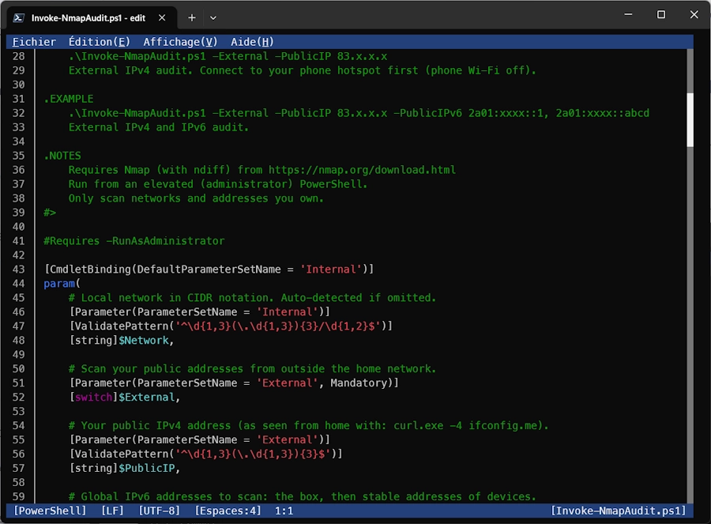
<figcaption>Relecture du script Invoke-NmapAudit.ps1 dans Edit</figcaption>
</figure>


Ce qu'il faut y retrouver : des appels à `nmap` et `ndiff`, des appels à `curl.exe -4 ifconfig.me` et `curl.exe -6 ifconfig.me` (pour vérifier ton adresse publique en mode externe), des créations de dossiers et des suppressions de fichiers `audit_*` dans `nmap-audits`. Rien d'autre. Si tu ne comprends pas un passage, colle le script dans Claude et demande-lui de te l'expliquer ligne par ligne.

**2. Le débloquer.** Windows marque les fichiers téléchargés comme "venant d'Internet". Avec la stratégie par défaut (`RemoteSigned`), PowerShell refuse de lancer un script téléchargé qui n'est pas signé. Une fois que tu l'as lu et que tu es d'accord avec ce qu'il fait, retire cette marque :

```powershell
Unblock-File -Path "$HOME\nmap-audits\Invoke-NmapAudit.ps1"
```

**3. Vérifier la stratégie d'exécution.**

```powershell
Get-ExecutionPolicy
```

* `RemoteSigned` : parfait, rien à faire.
* `Restricted` : aucun script n'est autorisé. Passe en `RemoteSigned` pour ton compte uniquement :

```powershell
Set-ExecutionPolicy -Scope CurrentUser -ExecutionPolicy RemoteSigned
```

Surtout pas de `Bypass` ou de `Unrestricted` "pour que ça marche". `RemoteSigned` autorise tes propres scripts et ceux que tu as explicitement débloqués, et c'est tout.


<!-- ###################################################################### -->
### Étape 3 : lancer l'audit interne

Depuis la maison, dans un **PowerShell administrateur** (WIN + X puis A) :

```powershell
& "$HOME\nmap-audits\Invoke-NmapAudit.ps1"
```

Le `&` au début dit à PowerShell "exécute ce fichier". Il faut le mettre parce que le chemin est entre guillemets. Si tu oublies d'être administrateur, le script s'arrête tout de suite avec un message clair.

Si la détection automatique du réseau se trompe (VPN, plusieurs cartes réseau...), indique-le toi-même :

```powershell
& "$HOME\nmap-audits\Invoke-NmapAudit.ps1" -Network 192.168.1.0/24
```

Compte quelques minutes. Au premier lancement, le script te dit qu'il n'a rien à comparer. C'est normal, la comparaison commence le mois suivant.

L'audit interne ne se fait qu'en IPv4, même si tu as l'IPv6. Ce n'est pas un oubli : tes appareils ont tous aussi une adresse IPv4, donc l'inventaire est complet. Et un réseau IPv6 local contient des milliards de milliards d'adresses, impossible à balayer une par une.


<!-- ###################################################################### -->
### Étape 4 : lancer l'audit externe

1. À la maison, relève ton adresse publique : `curl.exe -4 ifconfig.me`
1. Sur le téléphone, **coupe le Wi-Fi** (garde les données mobiles) et active le partage de connexion
1. Sur le PC, coupe le Wi-Fi de la maison et connecte-toi au partage de connexion du téléphone
1. Vérifie que `curl.exe -4 ifconfig.me` affiche une **autre** adresse que celle relevée à la maison
1. Dans un PowerShell administrateur :

```powershell
& "$HOME\nmap-audits\Invoke-NmapAudit.ps1" -External -PublicIP 83.x.x.x
```

Remplace `83.x.x.x` par ton adresse. Le scan des 65 535 ports prend plusieurs minutes en 4G. Si tu sors encore par la box (Wi-Fi de la maison oublié sur le PC **ou** sur le téléphone), le script le voit et s'arrête avec le message "you are still on the home network".

<!-- ---------------------------------------------------------------------- -->
#### Et si tu as l'IPv6 ?
Alors cette étape est **indispensable** en IPv6 aussi. En IPv6 il n'y a pas de NAT : chaque appareil de la maison a sa propre adresse publique. Seul le pare-feu IPv6 de la box le protège. Scanner l'IPv4 ne dit rien sur l'IPv6.

**À la maison, relève les adresses IPv6** de la box et des appareils importants (PC, NAS, caméra...) :

* dans l'interface de la box, la liste des appareils connectés
* ou avec `ipconfig` sur chaque PC : prends la ligne "Adresse IPv6", **pas** "Adresse IPv6 temporaire". L'adresse temporaire change toutes les quelques heures, elle ne servirait à rien le mois suivant.

Les bonnes adresses commencent par `2` ou `3` (par exemple `2a01:...` chez Orange). Celles en `fe80::` sont locales, inutiles ici.

**Depuis le partage de connexion**, vérifie que ta connexion mobile a l'IPv6 : `curl.exe -6 ifconfig.me` doit répondre une adresse. Puis :

```powershell
# IPv6 only
& "$HOME\nmap-audits\Invoke-NmapAudit.ps1" -External -PublicIPv6 2a01:xxxx::1, 2a01:xxxx::abcd

# IPv4 and IPv6 in one go
& "$HOME\nmap-audits\Invoke-NmapAudit.ps1" -External -PublicIP 83.x.x.x -PublicIPv6 2a01:xxxx::1, 2a01:xxxx::abcd
```

Les adresses sont séparées par des virgules. En IPv6, le script ne scanne que les 1000 ports les plus courants de chaque appareil, sinon ce serait interminable en 4G. Il s'arrête si ta connexion mobile n'a pas l'IPv6, ou si ton adresse IPv6 actuelle est sur le même réseau que les cibles (tu es encore à la maison).

Ce qu'il faut voir dans le résultat : des ports `filtered` partout sur les appareils. Un appareil derrière la box qui a un port `open` en IPv6, c'est le signal d'alarme : le pare-feu IPv6 de la box le laisse passer. Sauf si ce sont 21, 80, 443 ou 554 : vérifie d'abord avec une adresse qui n'existe pas, comme expliqué dans "Et l'IPv6 ?", que ce n'est pas le proxy de l'opérateur mobile.


<figure style="max-width: 900px; margin: auto; text-align: center;">
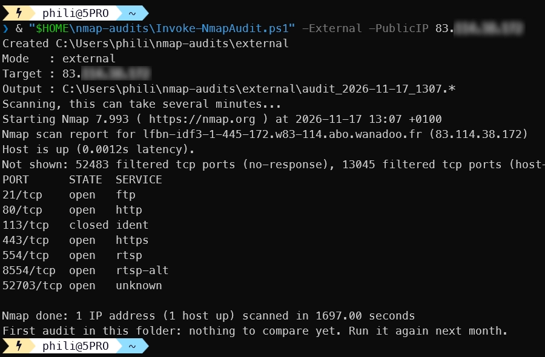
<figcaption>Resultats de l'audit IPv4 externe</figcaption>
</figure>

Bien voir le 1697 secondes tout en bas... Donc pas de panique si ça prend du temps.


<!-- ###################################################################### -->
### Étape 5 : lire le résultat

* **"No difference since the previous audit."** : rien n'a changé. Parfait.
* **Des différences** : elles s'affichent avec des `-` (avant) et des `+` (maintenant). Relis la section "Suivre le réseau dans le temps" pour les interpréter. Le plus souvent c'est du bruit : un téléphone absent, un libellé de version qui change. Ce qui compte, c'est un **nouveau port ouvert sur un appareil stable**, un **appareil inconnu**, et en externe, **n'importe quel nouveau port `open`**.

Dans le doute, colle le contenu du fichier `.diff.txt` dans Claude.

Si tu veux garder plus d'historique, par exemple les 12 derniers mois, ajoute `-Keep 12`.


<!-- ###################################################################### -->
### Étape 6 : ajouter un rappel dans le calendrier

Crée un événement récurrent, le second lundi du mois par exemple, et colle le texte ci-dessous dans la description. Assure toi que ton calendrider garde bien la mise en page du message collé. C'est pas le cas avec Googlge Calendar.

```text
Audit réseau mensuel (Nmap)

1. Audit interne, à la maison
   - PowerShell administrateur (WIN + X puis A)
   - & "$HOME\nmap-audits\Invoke-NmapAudit.ps1"

2. Relever les adresses publiques, à la maison
   - IPv4 : curl.exe -4 ifconfig.me
   - IPv6 (si tu l'as) : adresses de la box et des appareils
     (ipconfig, ligne "Adresse IPv6", pas "temporaire")
     Elles changent rarement : note-les ici une fois pour toutes
     Box : 2a01:...
     NAS : 2a01:...

3. Audit externe, depuis le téléphone
   - Téléphone : couper le Wi-Fi, garder les données mobiles
   - Activer le partage de connexion du téléphone
   - PC : couper le Wi-Fi de la maison, se connecter au téléphone
   - curl.exe -4 ifconfig.me doit afficher une AUTRE adresse
   - IPv6 : curl.exe -6 ifconfig.me doit répondre (sinon pas d'IPv6 en 4G)
   - IPv4 seule :
     & "$HOME\nmap-audits\Invoke-NmapAudit.ps1" -External -PublicIP <IPv4>
   - IPv4 et IPv6 :
     & "$HOME\nmap-audits\Invoke-NmapAudit.ps1" -External -PublicIP <IPv4> -PublicIPv6 <box>, <appareil1>

4. Lire les différences
   - Nouvel appareil inconnu ? Nouveau port ouvert ?
   - IPv6 : un port open sur un appareil derrière la box = alerte
   - Les fichiers sont dans $HOME\nmap-audits\internal, \external et \external6

5. Rebrancher le Wi-Fi de la maison (PC et téléphone)
```

Une vingtaine de minutes par mois, café compris.


<figure style="max-width: 900px; margin: auto; text-align: center;">
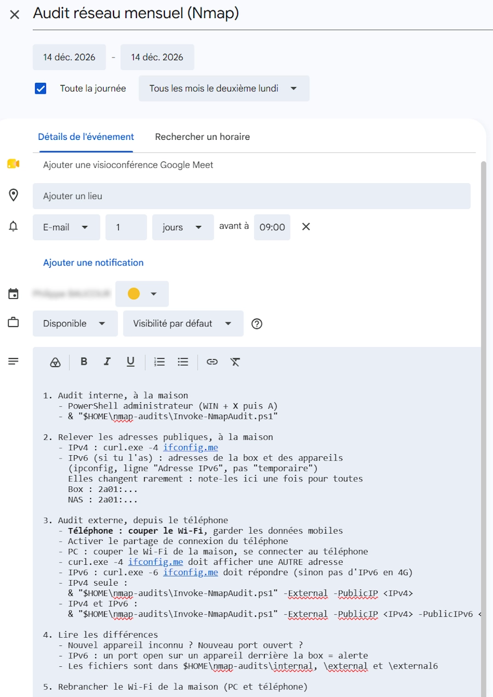
<figcaption>Planification mensuelle avec rappel la veille par mail.</figcaption>
</figure>

