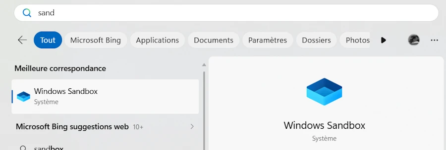
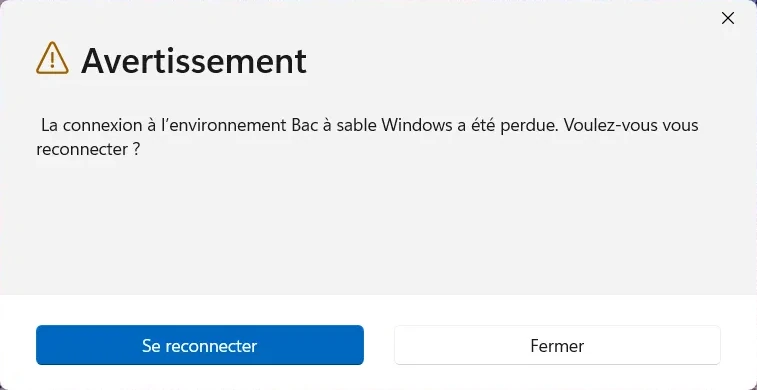
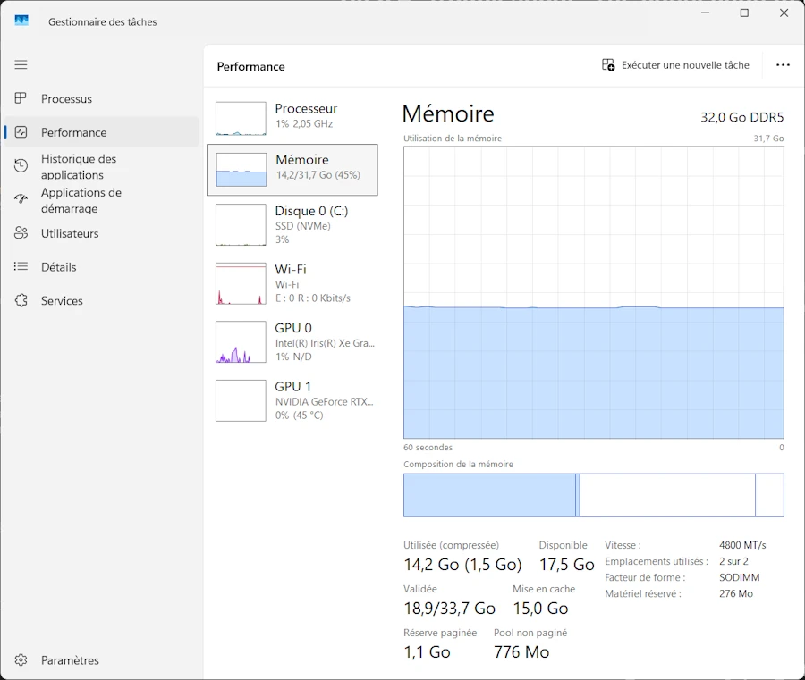
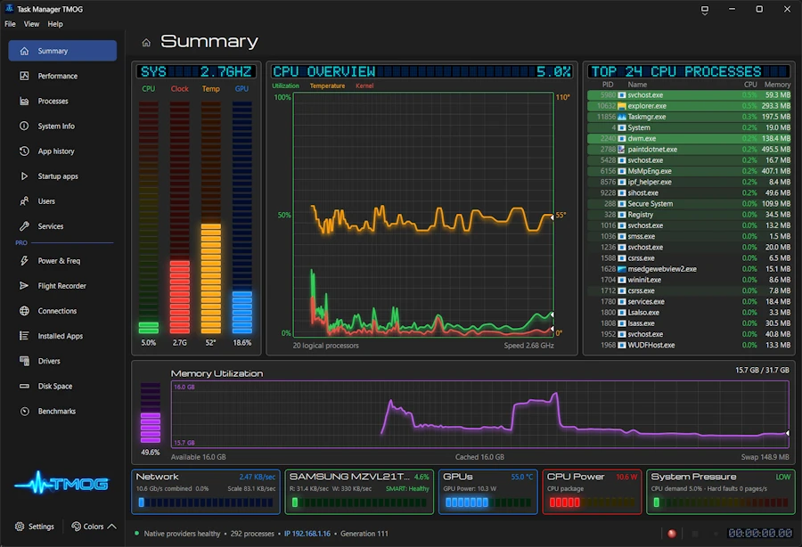
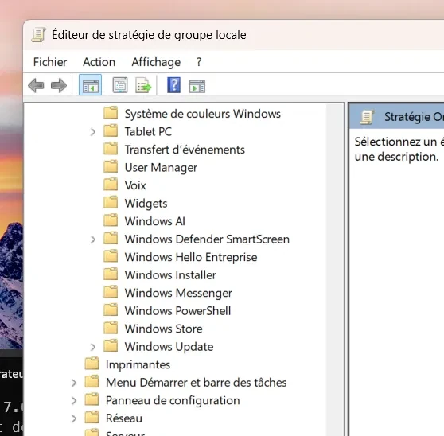
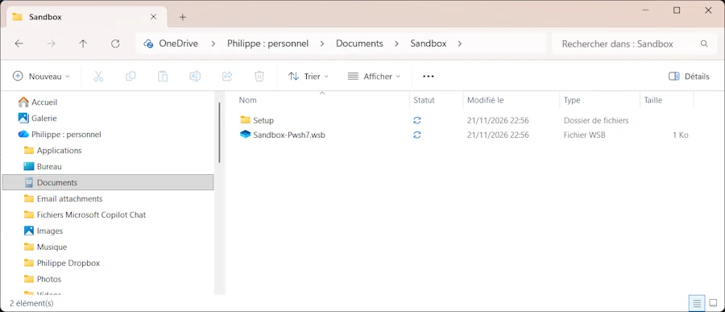
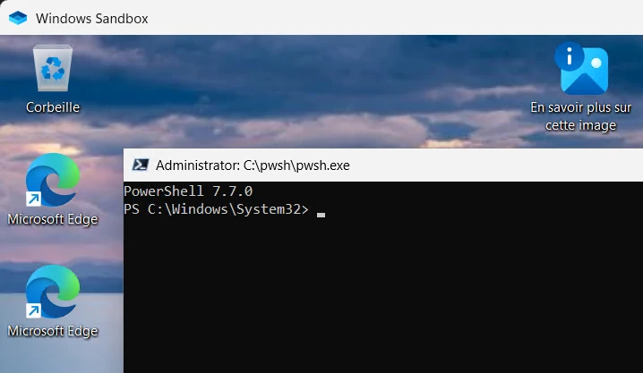

# {{ page.title }}
{: .no_toc }

{{ page.description }}
{: .lead }


<!-- <h2 align="center"><span style="color:orange"><b> 🚧 This post is under construction 🚧</b></span></h2> -->


<!-- ###################################################################### -->
<!-- ###################################################################### -->
<!-- ###################################################################### -->
## TL;DR
{: .no_toc }

* Windows Sandbox is a **disposable VM** built into Windows 11 Pro, Enterprise, and Education. Close the window and everything is gone.
* Check virtualization with `HypervisorPresent`.
* Enable the feature with `dism.exe`, not with `Enable-WindowsOptionalFeature` (unreliable under PowerShell 7).
* "Connection lost" on a hybrid-GPU laptop? Disable vGPU sharing with a registry value.
* Day to day: one `.wsb` file per test scenario.
* Inside the Sandbox, we are **always administrator**. Disable networking and map folders read-only when testing untrusted software.

| Step                  | Command / action                                                                | Gotcha                                                                                                   |
|-----------------------|---------------------------------------------------------------------------------|----------------------------------------------------------------------------------------------------------|
| Check virtualization  | `(Get-CimInstance Win32_ComputerSystem).HypervisorPresent`                      | If `False`, enable Intel VT-x or AMD SVM in the BIOS/UEFI                                                |
| Enable the feature    | `dism /online /Enable-Feature /FeatureName:Containers-DisposableClientVM /All`  | `Enable-WindowsOptionalFeature` fails under PowerShell 7 ("Class not registered"). Wait for 100% before rebooting |
| Fix "connection lost" | Registry: `HKLM\SOFTWARE\Policies\Microsoft\Windows\Sandbox\AllowVGPU = 0`      | The GPO node may be missing from `gpedit.msc`. Write the registry value directly                         |
| Daily use             | One `.wsb` file per test scenario                                               | One instance at a time, no persistence                                                                   |


<figure style="max-width: 900px; margin: auto; text-align: center;">

<figcaption>A clean Windows 11 desktop in a window, inside our own. Test, close, forget.</figcaption>
</figure>


<!-- ###################################################################### -->
<!-- ###################################################################### -->
<!-- ###################################################################### -->
## Table of Contents
{: .no_toc .text-delta}
- TOC
{:toc}


<!-- ###################################################################### -->
<!-- ###################################################################### -->
<!-- ###################################################################### -->
## Prerequisites

This checklist was tested on the following configuration:

* **OS:** Windows 11 Pro. Windows Sandbox is **not** available on Windows 11 Home.
* **Shell:** PowerShell 7.7.0, run **as Administrator** unless stated otherwise.
* **GPU:** hybrid laptop setup, Intel Iris Xe (integrated) + NVIDIA GeForce RTX (discrete).
* **RAM:** 32 GB DDR5.
* **Also installed:** Docker Desktop (WSL2 backend).

The hybrid GPU and Docker Desktop matter: both play a role in the pitfalls below.


<!-- ###################################################################### -->
<!-- ###################################################################### -->
<!-- ###################################################################### -->
## What Windows Sandbox Is (and Is Not)

* **A lightweight, disposable virtual machine** built into Windows 11 Pro, Enterprise, and Education.
* **Use case:** install an unknown piece of software, test it, close the window. The host system is untouched.
* **No persistence.** Closing the Sandbox window wipes everything.
    * Exception: since Windows 11 22H2, data survives a restart *initiated from inside* the Sandbox. Handy for installers that need a reboot.
    * Workaround: map a host folder with write access (see the `.wsb` example in [Step 5](#step-5-use-it-day-to-day)). Anything written there stays on the real disk.
* **One instance at a time.** We cannot run several Sandboxes side by side.
    * We *can* keep several `.wsb` config files (one per test scenario), but each one starts a fresh, non-persistent Sandbox.
* **Nothing to clean up.** Close the window and it is gone. Only mapped folders with write access keep data.
* **Networking is on by default.** Disable it in a `.wsb` file when testing anything suspicious.
* **Inside the Sandbox, we are always administrator.** The session runs under a local account named `WDAGUtilityAccount`, a member of the **Administrators** group, and every process starts elevated, with no UAC prompt. This is by design: the VM is disposable and isolated from the host by the hypervisor, so admin rights inside do not grant anything on the host. See the warning in [Step 5](#step-5-use-it-day-to-day).

{: .note }
> **Need persistent, side-by-side environments?** Use **Hyper-V** VMs (included in Windows 11 Pro, with checkpoints) or **Sandboxie-Plus** (lighter, multiple persistent sandboxes, but weaker isolation).


<!-- ###################################################################### -->
<!-- ###################################################################### -->
<!-- ###################################################################### -->
## Step 1: Check That Virtualization Is Enabled

<!-- - [ ] Run the classic check:

```powershell
(Get-CimInstance Win32_Processor).VirtualizationFirmwareEnabled
```

- [ ] **If it returns `False`, don't panic.** When a hypervisor is already running (Hyper-V, WSL2, Docker Desktop, or Windows memory integrity / HVCI), Windows itself runs *on top of* that hypervisor and can no longer see the CPU virtualization flags. The check then reports `False` even though virtualization *is* enabled.
- [ ] Run the reliable checks instead: -->

- [ ] Run the checks:

```powershell
# True = a hypervisor is running, so virtualization is enabled in firmware
(Get-CimInstance Win32_ComputerSystem).HypervisorPresent

# Look for "A hypervisor has been detected"
systeminfo | Select-String -Pattern "Hyper-V|hypervisor|hyperviseur"
```

- [ ] Expected result: `True`, plus a line saying *"A hypervisor has been detected. Features required for Hyper-V will not be displayed."*
- [ ] Only if `HypervisorPresent` is `False` do we need to enable **Intel VT-x** or **AMD SVM** in the BIOS/UEFI.

{: .note }
> **Is there any reason to keep virtualization disabled?** Not really, for a typical user. It is mostly a legacy manufacturer default. Windows 11 security features (memory integrity / HVCI, Credential Guard) rely on it anyway.


<!-- ###################################################################### -->
<!-- ###################################################################### -->
<!-- ###################################################################### -->
## Step 2: Enable the Windows Sandbox Feature

<!-- ###################################################################### -->
### Pitfall #1: PowerShell 7 and the DISM Cmdlets
{: .no_toc }

The "obvious" command is:

```powershell
Enable-WindowsOptionalFeature -Online -FeatureName "Containers-DisposableClientVM" -All
```

What went wrong on my machine:

* I rebooted while the command still showed `[Running`, so the change never completed.
* On the next attempt, PowerShell 7 returned **`Class not registered`** (`Classe non enregistrée` on a French system), and `Get-WindowsOptionalFeature` hung.

Why: the `*-WindowsOptionalFeature` cmdlets come from the DISM module, which was built for Windows PowerShell 5.1. It is unreliable under PowerShell 7.


<!-- ###################################################################### -->
### The Fix: Call `dism.exe` Directly
{: .no_toc }

- [ ] Close any hung PowerShell window and open a new **elevated** terminal.
- [ ] Check the feature state:

```powershell
dism /online /Get-FeatureInfo /FeatureName:Containers-DisposableClientVM
```

- [ ] Enable it if it is disabled:

```powershell
dism /online /Enable-Feature /FeatureName:Containers-DisposableClientVM /All
```

- [ ] **Wait for 100%**, then answer `Y` to reboot.
- [ ] If `dism` hangs too: reboot once (a previous operation may still be pending), then retry.
- [ ] If it still fails, repair the component store, then retry:

```powershell
dism /online /Cleanup-Image /RestoreHealth
sfc /scannow
```

{: .note }
> **GUI alternative:** `Win + R`, type `optionalfeatures`, check **Windows Sandbox**, click OK, reboot.


<!-- ###################################################################### -->
<!-- ###################################################################### -->
<!-- ###################################################################### -->
## Step 3: First Launch

- [ ] Search for **Windows Sandbox** in the Start menu and launch it.

<figure style="max-width: 900px; margin: auto; text-align: center;">

<figcaption>Typing "sand" in the Start menu is enough to find Windows Sandbox (French UI).</figcaption>
</figure>


- [ ] (Optional) Check for the new CLI, available starting with Windows 11 24H2:

```powershell
wsb --version
# 0.8.114.0 on my machine today
```

- [ ] If `wsb` is not recognized, we are on an older Sandbox version. The Sandbox still works fine. To get the newer version, run Windows Update, then go to Microsoft Store > Library > *Get updates*.

If the Sandbox window opens and stays open, jump to [Step 5](#step-5-use-it-day-to-day). Otherwise, read on.


<!-- ###################################################################### -->
<!-- ###################################################################### -->
<!-- ###################################################################### -->
## Step 4: Troubleshoot "The connection to the Windows Sandbox environment was lost"

<!-- ###################################################################### -->
### Pitfall #2: The Sandbox Starts, then Disconnects
{: .no_toc }

Symptom: every time, a warning dialog shows up saying *"The connection to the Windows Sandbox environment was lost. Do you want to reconnect?"*

<figure style="max-width: 900px; margin: auto; text-align: center;">

<figcaption>The "connection lost" dialog (French UI). Clicking Reconnect does not help: it comes back every time.</figcaption>
</figure>


<!-- ###################################################################### -->
### Things I Ruled Out
{: .no_toc }

* **Memory.** Task Manager (`Ctrl + Shift + Esc`) showed 31.7 GB usable out of 32 GB (276 MB hardware-reserved, which is normal) and 17.5 GB available. Not the issue.

<figure style="max-width: 900px; margin: auto; text-align: center;">

<figcaption>Task Manager > Performance > Memory (French UI). Plenty of free RAM: memory is not the culprit.</figcaption>
</figure>

If Docker/WSL2 is running and RAM is tight, free some memory first:

```powershell
wsl --shutdown
```

{: .note }
> Did you ever try [TMOG](https://tmog.org/){:target="_blank"}?

<figure style="max-width: 450px; margin: auto; text-align: center;">

<figcaption>TMOG Summary page: CPU, GPU, memory, and top processes on a single screen.</figcaption>
</figure>


* **A `.wsb` file with vGPU disabled.**
    * Create a new file `test.wsb` on the desktop.
    * Add the following content, then save it.
    * Double-click on it and see what happens.

```xml
<Configuration>
  <VGpu>Disable</VGpu>
  <MemoryInMB>4096</MemoryInMB>
</Configuration>
```

It did not help in my case.


* **Restarting the related services** (optional):

```powershell
Restart-Service vmcompute, CmService -Force
```


<!-- ###################################################################### -->
### The Fix: Disable vGPU Sharing via Policy (Registry)
{: .no_toc }

On a hybrid-GPU laptop (Intel Iris Xe + NVIDIA RTX), GPU sharing with the Sandbox (vGPU) is the usual suspect. The normal route is a Group Policy setting:

`gpedit.msc` > Computer Configuration > Administrative Templates > Windows Components > Windows Sandbox > *Allow vGPU sharing for Windows Sandbox* > **Disabled**

{: .warning }
> **Pitfall #3:** the *Windows Sandbox* node was **missing** from `gpedit.msc` on my machine (no ADMX template installed).

<figure style="max-width: 900px; margin: auto; text-align: center;">

<figcaption>gpedit.msc > Windows Components (French UI): no Windows Sandbox node in the list.</figcaption>
</figure>

No need to create it. A Group Policy setting is just a registry value, so we can write it directly.

- [ ] In an elevated PowerShell:

```powershell
# Policy key used by the "Allow vGPU sharing for Windows Sandbox" GPO
$key = "HKLM:\SOFTWARE\Policies\Microsoft\Windows\Sandbox"
New-Item -Path $key -Force | Out-Null
New-ItemProperty -Path $key -Name "AllowVGPU" -Value 0 -PropertyType DWord -Force
```

- [ ] Apply it with `gpupdate /force`, or simply reboot.
- [ ] Launch Windows Sandbox. **It works**, both from the Start menu *and* with a `.wsb` file. Since the policy is system-wide, the custom config file is no longer needed for this issue.
- [ ] To revert later:

```powershell
Remove-ItemProperty -Path "HKLM:\SOFTWARE\Policies\Microsoft\Windows\Sandbox" -Name "AllowVGPU"
```


<!-- ###################################################################### -->
### If It Still Does Not Work
{: .no_toc }

- [ ] Check **Event Viewer** > *Applications and Services Logs > Microsoft > Windows > Hyper-V-Compute > Admin* (and *Windows Logs > Application*) for an error code (`0x8007...`).
- [ ] Check the build number. Some Windows 11 builds shipped with known Sandbox bugs:

```powershell
[System.Environment]::OSVersion.Version
```

- [ ] Last resort: **Settings > System > Recovery > Fix problems using Windows Update**. This is an in-place repair that keeps files and apps.


<!-- ###################################################################### -->
<!-- ###################################################################### -->
<!-- ###################################################################### -->
## Step 5: Use It Day to Day

{: .warning }
> **Everything we run in the Sandbox runs as administrator.** Opening PowerShell, for example, always gives an elevated prompt. Even `Win + X`, `I` (normally a non-admin terminal) opens an elevated one. The hypervisor protects the host, but a malicious program has full rights *inside* the Sandbox: it can write to any mapped folder opened in write mode and use the network if it is enabled. When testing untrusted software, disable networking and map folders read-only.

To check the account and elevation level from inside the Sandbox:

```powershell
whoami
# Expected: <computer-name>\wdagutilityaccount

whoami /groups | Select-String "Administrators|Mandatory Label"
# "High Mandatory Level" means the process is elevated
```

- [ ] **Quick test:** launch Windows Sandbox, copy-paste the installer into the Sandbox window, install, test, close the window. Everything is gone.
- [ ] **One `.wsb` file per scenario**, for example `Test-AppA.wsb`, with networking off and a shared folder. To keep things tidy, everything lives under `Documents\Sandbox\`: one subfolder per scenario, plus its `.wsb` file. Putting it in `Documents` means it is backed up if `Documents` is synced with OneDrive.

{: .note }
> When OneDrive backs up `Documents`, the real folder is `C:\Users\<name>\OneDrive\Documents`, **not** `$env:USERPROFILE\Documents`. That is why the scripts below ask Windows for the actual path with `[Environment]::GetFolderPath("MyDocuments")`. Without OneDrive, it simply returns `C:\Users\<name>\Documents`: the scripts work the same, with or without OneDrive.

A `.wsb` file is plain XML and does **not** expand PowerShell variables or environment variables. So we let PowerShell write it, with the real path already filled in:

```powershell
$sandboxRoot = Join-Path ([Environment]::GetFolderPath("MyDocuments")) "Sandbox"
$hostFolder  = Join-Path $sandboxRoot "AppA"
New-Item -ItemType Directory -Path $hostFolder -Force | Out-Null   # HostFolder must exist

@"
<Configuration>
  <Networking>Disable</Networking>
  <MappedFolders>
    <MappedFolder>
      <HostFolder>$hostFolder</HostFolder>
      <SandboxFolder>C:\Test</SandboxFolder>
      <ReadOnly>false</ReadOnly>
    </MappedFolder>
  </MappedFolders>
  <LogonCommand>
    <Command>explorer.exe C:\Test</Command>
  </LogonCommand>
</Configuration>
"@ | Set-Content -Path (Join-Path $sandboxRoot "Test-AppA.wsb") -Encoding UTF8
```

- [ ] Drop the installers to test into `Documents\Sandbox\AppA`. In the Sandbox, they show up in `C:\Test`.
- [ ] Double-click `Test-AppA.wsb` to start a Sandbox with those settings.
- [ ] Use `<ReadOnly>true</ReadOnly>` when the mapped folder only holds installers, so the Sandbox cannot write back to the host.
- [ ] On Windows 11 24H2+, script it with the CLI: `wsb start`, `wsb list`, `wsb exec`, `wsb stop`.


<!-- ###################################################################### -->
### What If We Need PowerShell 7 in Every Sandbox?
{: .no_toc }

The Sandbox only ships with Windows PowerShell 5.1, and it starts from scratch every time. Two options.

{: .note }
> Starting with PowerShell 7.7.0, the GitHub release no longer includes an `.msi` installer (only `.zip` and `.msixbundle`). The commands below use the `.zip` package, which needs no installation.

**Option 1: quick and easy (one-off)**

- [ ] In the Sandbox, open a PowerShell 5.1 terminal (networking must be enabled):

```powershell
iex "& { $(irm https://aka.ms/install-powershell.ps1) } -AddToPath"
```

- [ ] Open a new terminal and run `pwsh`.

Do not add `-UseMSI`: the script would look for an `.msi` that no longer exists and fail.

**Option 2: automatic install on each Sandbox start**

The idea: download the `.zip` once on the host, share its folder read-only with the Sandbox, and let a `LogonCommand` unzip it and open PowerShell 7.

Keep in mind that a `.wsb` file is plain XML: it does **not** expand `$env:USERPROFILE` (nor `%USERPROFILE%`, nor any other variable). On top of that, inside the Sandbox `$env:USERPROFILE` points to `C:\Users\WDAGUtilityAccount`, not to our own profile. So we let PowerShell write the `.wsb` file with the host path already expanded, and we use a fixed path (`C:\Setup`) on the Sandbox side.

- [ ] On the host, in a PowerShell terminal (no need to be admin), copy and paste the code below:

```powershell
$sandboxRoot = Join-Path ([Environment]::GetFolderPath("MyDocuments")) "Sandbox"
$root        = Join-Path $sandboxRoot "Setup"
New-Item -ItemType Directory -Path $root -Force | Out-Null

# 1. Download the latest PowerShell 7 x64 zip from GitHub
$release = Invoke-RestMethod https://api.github.com/repos/PowerShell/PowerShell/releases/latest
$asset   = $release.assets | Where-Object name -like "PowerShell-*-win-x64.zip"
Invoke-WebRequest -Uri $asset.browser_download_url -OutFile (Join-Path $root $asset.name)

# 2. Script run inside the Sandbox at logon
@'
# Unzip PowerShell 7 from the mapped (read-only) folder, add it to PATH, then open it
$zip = Get-ChildItem -Path $PSScriptRoot -Filter "PowerShell-*-win-x64.zip" |
    Sort-Object Name -Descending | Select-Object -First 1
if ($zip) {
    Expand-Archive -Path $zip.FullName -DestinationPath "C:\pwsh" -Force
    # Machine PATH, so pwsh can be relaunched from Win + R or any new terminal
    $machinePath = [Environment]::GetEnvironmentVariable("Path", "Machine")
    if ($machinePath -notlike "*C:\pwsh*") {
        [Environment]::SetEnvironmentVariable("Path", "$machinePath;C:\pwsh", "Machine")
    }
    Start-Process "C:\pwsh\pwsh.exe"
}
'@ | Set-Content -Path (Join-Path $root "setup.ps1") -Encoding UTF8

# 3. Sandbox config, with the host path expanded now
@"
<Configuration>
  <MappedFolders>
    <MappedFolder>
      <HostFolder>$root</HostFolder>
      <SandboxFolder>C:\Setup</SandboxFolder>
      <ReadOnly>true</ReadOnly>
    </MappedFolder>
  </MappedFolders>
  <LogonCommand>
    <Command>powershell.exe -ExecutionPolicy Bypass -File C:\Setup\setup.ps1</Command>
  </LogonCommand>
</Configuration>
"@ | Set-Content -Path (Join-Path $sandboxRoot "Sandbox-Pwsh7.wsb") -Encoding UTF8
```

<figure style="max-width: 900px; margin: auto; text-align: center;">

<figcaption>After running the script: the Setup folder (zip + setup.ps1) and the Sandbox-Pwsh7.wsb file to double-click.</figcaption>
</figure>

- [ ] Check the generated file. `HostFolder` must contain the real path (for example `C:\Users\<name>\OneDrive\Documents\Sandbox\Setup`), not `$root`:

```powershell
Get-Content (Join-Path ([Environment]::GetFolderPath("MyDocuments")) "Sandbox\Sandbox-Pwsh7.wsb")
```

- [ ] On the host, double-click `Sandbox-Pwsh7.wsb`. Once the Sandbox desktop shows up, `setup.ps1` runs in the background and unzips PowerShell 7. Give it a few more seconds: a PowerShell 7 window then opens by itself. The `Setup` folder is shared read-only, so the Sandbox cannot write to our PC.
- [ ] If we close that terminal window, `C:\pwsh` is in the machine `PATH`: `Win + R`, type `pwsh`, Enter.
- [ ] To update PowerShell later, delete the old `.zip` from `Documents\Sandbox\Setup` and rerun the script above.


<figure style="max-width: 900px; margin: auto; text-align: center;">

<figcaption>A few seconds after logon, PowerShell 7 opens by itself. Note the "Administrator" title bar.</figcaption>
</figure>


<!-- ###################################################################### -->
<!-- ###################################################################### -->
<!-- ###################################################################### -->
## Uninstall (If Needed)

```powershell
dism /online /Disable-Feature /FeatureName:Containers-DisposableClientVM
```

Reboot when prompted.


<!-- ###################################################################### -->
<!-- ###################################################################### -->
<!-- ###################################################################### -->
## Conclusion

Once the two traps are out of the way (DISM cmdlets under PowerShell 7, vGPU sharing on a hybrid-GPU laptop), Windows Sandbox becomes a zero-maintenance tool: double-click a `.wsb` file, test, close. For anything that must survive the session or run side by side, switch to Hyper-V.


<!-- ###################################################################### -->
<!-- ###################################################################### -->
<!-- ###################################################################### -->
## Webliography

* [WSL 2 - Windows Subsystem for Linux]()
* [Windows Sandbox overview](https://learn.microsoft.com/en-us/windows/security/application-security/application-isolation/windows-sandbox/windows-sandbox-overview){:target="_blank"} (Microsoft Learn)
* [Use and configure Windows Sandbox (.wsb files)](https://learn.microsoft.com/en-us/windows/security/application-security/application-isolation/windows-sandbox/windows-sandbox-configure-using-wsb-file){:target="_blank"} (Microsoft Learn)
* [Windows Sandbox command line interface](https://learn.microsoft.com/en-us/windows/security/application-security/application-isolation/windows-sandbox/windows-sandbox-cli){:target="_blank"} (Microsoft Learn)
