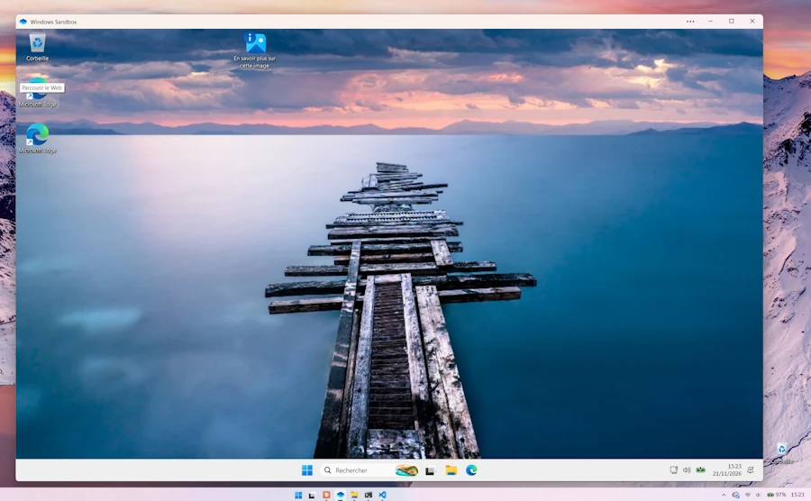

# {{ page.title }}
{: .no_toc }

{{ page.description }}
{: .lead }


<h2 align="center"><span style="color:orange"><b> 🚧 This post is under construction 🚧</b></span></h2>


<!-- ###################################################################### -->
<!-- ###################################################################### -->
<!-- ###################################################################### -->
## TL;DR
{: .no_toc }

* Windows Sandbox is a **disposable VM** built into Windows 11 Pro, Enterprise, and Education. Close the window and everything is gone.
* Check virtualization with `HypervisorPresent`.
* Enable the feature with `dism.exe`, not with `Enable-WindowsOptionalFeature` (unreliable under PowerShell 7).
* "Connection lost" on a hybrid-GPU laptop? Disable vGPU sharing with a registry value.
* Day to day: one `.wsb` file per test scenario.
* Inside the Sandbox, we are **always administrator**. Disable networking and map folders read-only when testing untrusted software.

| Step                  | Command / action                                                                | Gotcha                                                                                                   |
|-----------------------|---------------------------------------------------------------------------------|----------------------------------------------------------------------------------------------------------|
| Check virtualization  | `(Get-CimInstance Win32_ComputerSystem).HypervisorPresent`                      | If `False`, enable Intel VT-x or AMD SVM in the BIOS/UEFI                                                |
| Enable the feature    | `dism /online /Enable-Feature /FeatureName:Containers-DisposableClientVM /All`  | `Enable-WindowsOptionalFeature` fails under PowerShell 7 ("Class not registered"). Wait for 100% before rebooting |
| Fix "connection lost" | Registry: `HKLM\SOFTWARE\Policies\Microsoft\Windows\Sandbox\AllowVGPU = 0`      | The GPO node may be missing from `gpedit.msc`. Write the registry value directly                         |
| Daily use             | One `.wsb` file per test scenario                                               | One instance at a time, no persistence                                                                   |


<figure style="max-width: 900px; margin: auto; text-align: center;">

<figcaption>Windows Sandbox: test, close, forget.</figcaption>
</figure>


<!-- ###################################################################### -->
<!-- ###################################################################### -->
<!-- ###################################################################### -->
## Table of Contents
{: .no_toc .text-delta}
- TOC
{:toc}


<!-- ###################################################################### -->
<!-- ###################################################################### -->
<!-- ###################################################################### -->
## Prerequisites

This checklist was tested on the following configuration:

* **OS:** Windows 11 Pro. Windows Sandbox is **not** available on Windows 11 Home.
* **Shell:** PowerShell 7.7.0, run **as Administrator** unless stated otherwise.
* **GPU:** hybrid laptop setup, Intel Iris Xe (integrated) + NVIDIA GeForce RTX (discrete).
* **RAM:** 32 GB DDR5.
* **Also installed:** Docker Desktop (WSL2 backend).

The hybrid GPU and Docker Desktop matter: both play a role in the pitfalls below.


<!-- ###################################################################### -->
<!-- ###################################################################### -->
<!-- ###################################################################### -->
## What Windows Sandbox Is (and Is Not)

* **A lightweight, disposable virtual machine** built into Windows 11 Pro, Enterprise, and Education.
* **Use case:** install an unknown piece of software, test it, close the window. The host system is untouched.
* **No persistence.** Closing the Sandbox window wipes everything.
    * Exception: since Windows 11 22H2, data survives a restart *initiated from inside* the Sandbox. Handy for installers that need a reboot.
    * Workaround: map a host folder with write access (see the `.wsb` example in [Step 5](#step-5-use-it-day-to-day)). Anything written there stays on the real disk.
* **One instance at a time.** We cannot run several Sandboxes side by side.
    * We *can* keep several `.wsb` config files (one per test scenario), but each one starts a fresh, non-persistent Sandbox.
* **Nothing to clean up.** Close the window and it is gone. Only mapped folders with write access keep data.
* **Networking is on by default.** Disable it in a `.wsb` file when testing anything suspicious.
* **Inside the Sandbox, we are always administrator.** The session runs under a local account named `WDAGUtilityAccount`, a member of the **Administrators** group, and every process starts elevated, with no UAC prompt. This is by design: the VM is disposable and isolated from the host by the hypervisor, so admin rights inside do not grant anything on the host. See the warning in [Step 5](#step-5-use-it-day-to-day).

{: .note }
> **Need persistent, side-by-side environments?** Use **Hyper-V** VMs (included in Windows 11 Pro, with checkpoints) or **Sandboxie-Plus** (lighter, multiple persistent sandboxes, but weaker isolation).


<!-- ###################################################################### -->
<!-- ###################################################################### -->
<!-- ###################################################################### -->
## Step 1: Check That Virtualization Is Enabled

<!-- - [ ] Run the classic check:

```powershell
(Get-CimInstance Win32_Processor).VirtualizationFirmwareEnabled
```

- [ ] **If it returns `False`, don't panic.** When a hypervisor is already running (Hyper-V, WSL2, Docker Desktop, or Windows memory integrity / HVCI), Windows itself runs *on top of* that hypervisor and can no longer see the CPU virtualization flags. The check then reports `False` even though virtualization *is* enabled.
- [ ] Run the reliable checks instead: -->

- [ ] Run the checks:

```powershell
# True = a hypervisor is running, so virtualization is enabled in firmware
(Get-CimInstance Win32_ComputerSystem).HypervisorPresent

# Look for "A hypervisor has been detected"
systeminfo | Select-String -Pattern "Hyper-V|hypervisor|hyperviseur"
```

- [ ] Expected result: `True`, plus a line saying *"A hypervisor has been detected. Features required for Hyper-V will not be displayed."*
- [ ] Only if `HypervisorPresent` is `False` do we need to enable **Intel VT-x** or **AMD SVM** in the BIOS/UEFI.

{: .note }
> **Is there any reason to keep virtualization disabled?** Not really, for a typical user. It is mostly a legacy manufacturer default. Windows 11 security features (memory integrity / HVCI, Credential Guard) rely on it anyway.


<!-- ###################################################################### -->
<!-- ###################################################################### -->
<!-- ###################################################################### -->
## Step 2: Enable the Windows Sandbox Feature

<!-- ###################################################################### -->
### Pitfall #1: PowerShell 7 and the DISM Cmdlets
{: .no_toc }

The "obvious" command is:

```powershell
Enable-WindowsOptionalFeature -Online -FeatureName "Containers-DisposableClientVM" -All
```

What went wrong on my machine:

* I rebooted while the command still showed `[Running`, so the change never completed.
* On the next attempt, PowerShell 7 returned **`Class not registered`** (`Classe non enregistrée` on a French system), and `Get-WindowsOptionalFeature` hung.

Why: the `*-WindowsOptionalFeature` cmdlets come from the DISM module, which was built for Windows PowerShell 5.1. It is unreliable under PowerShell 7.


<!-- ###################################################################### -->
### The Fix: Call `dism.exe` Directly
{: .no_toc }

- [ ] Close any hung PowerShell window and open a new **elevated** terminal.
- [ ] Check the feature state:

```powershell
dism /online /Get-FeatureInfo /FeatureName:Containers-DisposableClientVM
```

- [ ] Enable it if it is disabled:

```powershell
dism /online /Enable-Feature /FeatureName:Containers-DisposableClientVM /All
```

- [ ] **Wait for 100%**, then answer `Y` to reboot.
- [ ] If `dism` hangs too: reboot once (a previous operation may still be pending), then retry.
- [ ] If it still fails, repair the component store, then retry:

```powershell
dism /online /Cleanup-Image /RestoreHealth
sfc /scannow
```

{: .note }
> **GUI alternative:** `Win + R`, type `optionalfeatures`, check **Windows Sandbox**, click OK, reboot.


<!-- ###################################################################### -->
<!-- ###################################################################### -->
<!-- ###################################################################### -->
## Step 3: First Launch

- [ ] Search for **Windows Sandbox** in the Start menu and launch it.

<figure style="max-width: 900px; margin: auto; text-align: center;">

<figcaption>Search for Windows Sandbox in the Start menu.</figcaption>
</figure>


- [ ] (Optional) Check for the new CLI, available starting with Windows 11 24H2:

```powershell
wsb --version
0.8.114.0 # on my machine today
```

- [ ] If `wsb` is not recognized, we are on an older Sandbox version. The Sandbox still works fine. To get the newer version, run Windows Update, then go to Microsoft Store > Library > *Get updates*.

If the Sandbox window opens and stays open, jump to [Step 5](#step-5-use-it-day-to-day). Otherwise, read on.


<!-- ###################################################################### -->
<!-- ###################################################################### -->
<!-- ###################################################################### -->
## Step 4: Troubleshoot "The connection to the Windows Sandbox environment was lost"

<!-- ###################################################################### -->
### Pitfall #2: The Sandbox Starts, then Disconnects
{: .no_toc }

Symptom: every time, a warning dialog shows up saying *"The connection to the Windows Sandbox environment was lost. Do you want to reconnect?"*


<!-- ###################################################################### -->
### Things I Ruled Out
{: .no_toc }

* **Memory.** Task Manager (CTRL+SHIFT+ESC) showed 31.7 GB usable out of 32 GB (276 MB hardware-reserved, which is normal) and 18.6 GB available. Not the issue. If Docker/WSL2 is running and RAM is tight, free some memory first:

<figure style="max-width: 900px; margin: auto; text-align: center;">

<figcaption>Windows Task Manager - Performance pan</figcaption>
</figure>

<!-- Did you ver try TMOG ? -->

```powershell
wsl --shutdown
```

* **A `.wsb` file with vGPU disabled.**

* Create a new file `test.wsb` on the desktop
* Add the following content then save it
* Double click on it and see what happens

```xml
<Configuration>
  <VGpu>Disable</VGpu>
  <MemoryInMB>4096</MemoryInMB>
</Configuration>
```
It did not help in my case.


* **Restarting the related services** (optional):

```powershell
Restart-Service vmcompute, CmService -Force
```


<!-- ###################################################################### -->
### The Fix: Disable vGPU Sharing via Policy (Registry)
{: .no_toc }

On a hybrid-GPU laptop (Intel Iris Xe + NVIDIA RTX), GPU sharing with the Sandbox (vGPU) is the usual suspect. The normal route is a Group Policy setting:

`gpedit.msc` > Computer Configuration > Administrative Templates > Windows Components > Windows Sandbox > *Allow vGPU sharing for Windows Sandbox* > **Disabled**

{: .warning }
> **Pitfall #3:** the *Windows Sandbox* node was **missing** from `gpedit.msc` on my machine (no ADMX template installed).

No need to create it. A Group Policy setting is just a registry value, so we can write it directly.

- [ ] In an elevated PowerShell:

```powershell
# Policy key used by the "Allow vGPU sharing for Windows Sandbox" GPO
$key = "HKLM:\SOFTWARE\Policies\Microsoft\Windows\Sandbox"
New-Item -Path $key -Force | Out-Null
New-ItemProperty -Path $key -Name "AllowVGPU" -Value 0 -PropertyType DWord -Force
```

- [ ] Apply it with `gpupdate /force`, or simply reboot.
- [ ] Launch Windows Sandbox. **It works**, both from the Start menu *and* with a `.wsb` file. Since the policy is system-wide, the custom config file is no longer needed for this issue.
- [ ] To revert later:

```powershell
Remove-ItemProperty -Path "HKLM:\SOFTWARE\Policies\Microsoft\Windows\Sandbox" -Name "AllowVGPU"
```


<!-- ###################################################################### -->
### If It Still Does Not Work
{: .no_toc }

- [ ] Check **Event Viewer** > *Applications and Services Logs > Microsoft > Windows > Hyper-V-Compute > Admin* (and *Windows Logs > Application*) for an error code (`0x8007...`).
- [ ] Check the build number. Some Windows 11 builds shipped with known Sandbox bugs:

```powershell
[System.Environment]::OSVersion.Version
```

- [ ] Last resort: **Settings > System > Recovery > Fix problems using Windows Update**. This is an in-place repair that keeps files and apps.


<!-- ###################################################################### -->
<!-- ###################################################################### -->
<!-- ###################################################################### -->
## Step 5: Use It Day to Day

{: .warning }
> **Everything we run in the Sandbox runs as administrator.** Opening PowerShell, for example, always gives an elevated prompt. Even if you try to open it with `WIN+X, I`. The hypervisor protects the host, but a malicious program has full rights *inside* the Sandbox: it can write to any mapped folder opened in write mode and use the network if it is enabled. When testing untrusted software, disable networking and map folders read-only.

To check the account and elevation level from inside the Sandbox:

```powershell
whoami
# Expected: <computer-name>\wdagutilityaccount

whoami /groups | Select-String "Administrators|Mandatory Label"
# "High Mandatory Level" means the process is elevated
```

- [ ] **Quick test:** launch Windows Sandbox, copy-paste the installer into the Sandbox window, install, test, close the window. Everything is gone.
- [ ] **One `.wsb` file per scenario**, for example `Test-AppA.wsb`, with networking off and a shared folder:

```xml
<Configuration>
  <Networking>Disable</Networking>
  <MappedFolders>
    <MappedFolder>
      <HostFolder>C:\Sandbox\AppA</HostFolder>
      <SandboxFolder>C:\Test</SandboxFolder>
      <ReadOnly>false</ReadOnly>
    </MappedFolder>
  </MappedFolders>
  <LogonCommand>
    <Command>explorer.exe C:\Test</Command>
  </LogonCommand>
</Configuration>
```

- [ ] Double-click the `.wsb` file to start a Sandbox with those settings.
- [ ] Use `<ReadOnly>true</ReadOnly>` when the mapped folder only holds installers, so the Sandbox cannot write back to the host.
- [ ] On Windows 11 24H2+, script it with the CLI: `wsb start`, `wsb list`, `wsb exec`, `wsb stop`.


<!-- ###################################################################### -->
<!-- ###################################################################### -->
<!-- ###################################################################### -->
## Uninstall (If Needed)

```powershell
dism /online /Disable-Feature /FeatureName:Containers-DisposableClientVM
```

Reboot when prompted.


<!-- ###################################################################### -->
<!-- ###################################################################### -->
<!-- ###################################################################### -->
## Conclusion

Once the two traps are out of the way (DISM cmdlets under PowerShell 7, vGPU sharing on a hybrid-GPU laptop), Windows Sandbox becomes a zero-maintenance tool: double-click a `.wsb` file, test, close. For anything that must survive the session or run side by side, switch to Hyper-V.


<!-- ###################################################################### -->
<!-- ###################################################################### -->
<!-- ###################################################################### -->
## Webliography

* [WSL 2 - Windows Subsystem for Linux]()
* [Windows Sandbox overview](https://learn.microsoft.com/en-us/windows/security/application-security/application-isolation/windows-sandbox/windows-sandbox-overview){:target="_blank"} (Microsoft Learn)
* [Use and configure Windows Sandbox (.wsb files)](https://learn.microsoft.com/en-us/windows/security/application-security/application-isolation/windows-sandbox/windows-sandbox-configure-using-wsb-file){:target="_blank"} (Microsoft Learn)
* [Windows Sandbox command line interface](https://learn.microsoft.com/en-us/windows/security/application-security/application-isolation/windows-sandbox/windows-sandbox-cli){:target="_blank"} (Microsoft Learn)
