# {{ page.title }}
{: .no_toc }

{{ page.description }}
{: .lead }


<!-- <h2 align="center"><span style="color:orange"><b> 🚧 This post is under construction 🚧</b></span></h2> -->


<!-- ###################################################################### -->
<!-- ###################################################################### -->
<!-- ###################################################################### -->
## TL;DR
{: .no_toc }

* On **Friday, November 20, 2026**, Levent Alpöge, a mathematician at Anthropic, announced a proof of the **Riemann Hypothesis**, found while working with Claude. He also claims the generalized version. Experts are now checking it.
* Big question: how can anyone **trust** a proof found with an AI? One answer is a **proof assistant** such as **Lean 4**, a program that checks every step of a proof, mechanically, without ever getting tired.
* As a tribute, we replay the whole loop at high-school scale: Claude proves that *the set of even natural numbers is infinite*, translates the proof into Lean 4, and Lean checks it.
* Everything runs inside **Windows Sandbox**: nothing is installed on the main PC.
* The hard part was **not** the math. It was tooling and versions. Six errors, all fixed by sending them back to Claude.
* The post is in **2 parts**. Part 1 (this page): the context, the proof by Claude, and the setup (Steps 1 to 6). [Part 2](): the build, the errors, the validation, and Claude looping on its own (Steps 7 to 10).

| Step               | What we do                                       | Tool                    |
|--------------------|--------------------------------------------------|-------------------------|
| 1. Prove           | Ask for a rigorous, human-readable proof         | Claude                  |
| 2. Formalize       | Ask for the same proof in Lean 4 + Mathlib       | Claude                  |
| 3. Check           | `lake build`                                     | Lean, in Windows Sandbox|
| 4. Fix             | Paste Lean's errors back, repeat                 | Claude + Lean           |
| 5. Trust           | No `sorry`, read the statement yourself          | You                     |


<figure style="max-width: 900px; margin: auto; text-align: center;">

<figcaption>Old questions, new partners.</figcaption>
</figure>


<!-- ###################################################################### -->
<!-- ###################################################################### -->
<!-- ###################################################################### -->
## Table of Contents
{: .no_toc .text-delta}
- TOC
{:toc}


<!-- ###################################################################### -->
<!-- ###################################################################### -->
<!-- ###################################################################### -->
## Introduction

On Friday, November 20, 2026, [Levent Alpöge](https://fr.wikipedia.org/wiki/Levent_Alp%C3%B6ge){:target="_blank"}, a mathematician working at Anthropic, announced that he **believes** he has found a proof of the **Riemann Hypothesis**. He did not find it alone in front of a blackboard. He found it **working with Claude**. Take some time to read this [document](https://alpo.ge/remark.pdf){:target="_blank"}.

If it is confirmed, let's take a second to measure what this means. The Riemann Hypothesis was stated in **1859**. It has resisted the best mathematicians on the planet for more than 160 years. It is on Hilbert's famous list of 23 problems (1900) and on the Clay Institute's list of seven **Millennium Prize Problems** (2000), with one million dollars for whoever solves it. Thousands of published theorems start with the words *"Assume the Riemann Hypothesis..."*.

As I write these lines (Sunday, November 22), the claim is **not yet verified**. Experts are reading it, line by line. This is how mathematics works, and this is how it should work. A proof is not true because someone important says so, and certainly not because an AI says so. It is true because it **survives checking**.

And this is exactly the topic of this article. Not the Riemann Hypothesis itself (I am not crazy), but the **loop** behind it:

1. a human **asks** a question (here, a theorem to prove),
2. an AI **proposes** a proof,
3. a machine **checks** it, step by step,
4. the errors go **back** to the AI,
5. until the proof is accepted.

<figure style="max-width: 900px; margin: auto; text-align: center;">
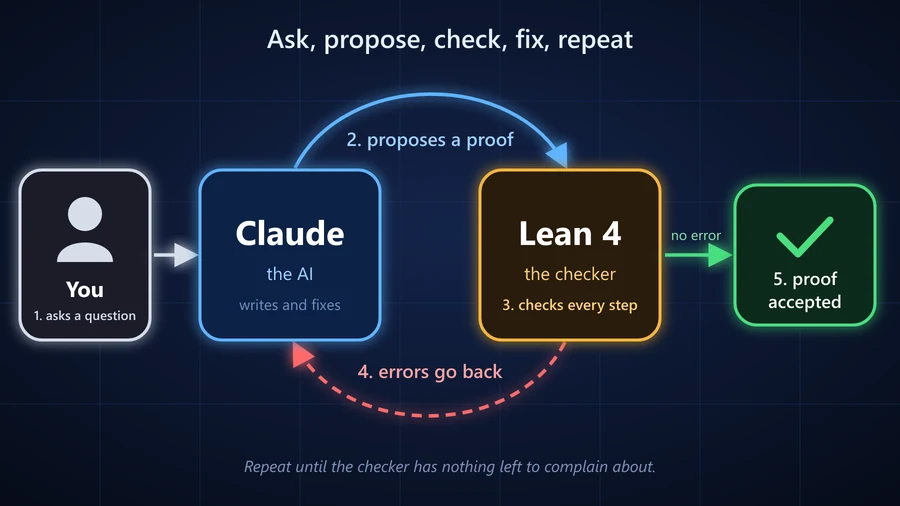
<figcaption>The whole article in one picture: a human asks, the AI proposes, the checker checks, the errors go back, and we go around again until the checker has nothing left to say.</figcaption>
</figure>

We will replay that loop on a deliberately trivial theorem: **"the set of even natural numbers is infinite"**. A high-school student knows it is true and even a [French student](https://www.oecd.org/en/publications/pisa-2025-results-volume-i_73451bc5-en.html){:target="_blank"} should be able to prove it. The point is not the theorem. The point is to see, with our own eyes, on our own Windows 11 PC, what it takes for a machine to *certify* a proof.

My goal: a student in their final year of high school, running Windows 11, should be able to follow this article and redo everything. So, sometimes, I will be *very* explicit. That's on purpose.

Consider this page a modest tribute. Even if not yet confirmed at the time of writing, Levent and Claude climbed Everest. Here, we climb the small hill behind the house, with the same rope and the same harness.

This post is in **2 parts**:

* [Part 1/2]() (this page): the Riemann Hypothesis in five minutes, why we need a machine to check proofs, then Claude writes the proof and its Lean 4 version, and we install everything inside Windows Sandbox (Steps 1 to 6). At the end, Lean and Mathlib are ready, and Claude's file is wired into the project.
* [Part 2/2](): we build, read the errors, send them back to Claude, and repeat until Lean accepts the proof. Then we check that we can trust the result, and finally we let Claude Code run the loop on its own (Steps 7 to 10 and the next level).

Both parts happen in the **same** Sandbox session, so keep it open between the two.


<!-- ###################################################################### -->
<!-- ###################################################################### -->
<!-- ###################################################################### -->
## Prerequisites

* **OS:** Windows 11 **Pro**, Enterprise, or Education. Windows Sandbox is **not** available on Windows 11 Home (see the note below).
* **Windows Sandbox enabled.** If this is not done yet, follow my checklist: [Windows Sandbox on Windows 11: A Hands-On Checklist](). It takes 10 minutes, and it covers the classic traps.
* **A Claude account** ([claude.ai](https://claude.ai){:target="_blank"}). I used the Claude desktop app with Opus 5.5, but the web version works the same.
* **Disk and network:** Lean + Mathlib weigh several GB. A decent connection helps.
* **Math level:** knowing what an even number is, what "by contradiction" means, and what a proof by induction looks like. That's it.
* **Programming level:** none required. We will copy and paste commands into a terminal.

{: .note }
> **Why a Sandbox?** Lean, its version manager, Git, and the Mathlib library are a lot of stuff to install just to "give it a try". Inside Windows Sandbox, everything lives in a disposable virtual machine. When we close the window, it all disappears, and the main PC stays clean. On Windows 11 Home, we can follow the same steps directly on the PC (minus the Sandbox part), it just leaves things installed.


<!-- ###################################################################### -->
<!-- ###################################################################### -->
<!-- ###################################################################### -->
## The Riemann Hypothesis in Five Minutes

Before we get our hands dirty, let's understand why Friday was a big day. Grab a coffee.

<!-- ###################################################################### -->
### Prime Numbers, the Atoms of Arithmetic
{: .no_toc }

A **prime number** is a natural number greater than 1 whose only divisors are 1 and itself: 2, 3, 5, 7, 11, 13... Every integer greater than 1 breaks down, in a unique way, into a product of primes ($$60 = 2^2 \times 3 \times 5$$). Primes are the atoms, the other integers are the molecules.

Around 300 BC, **Euclid** proved that there are infinitely many primes. Keep this in mind, it will come back at the end of the article.

But *how* are they spread? Look at them: 2, 3, 5, 7, 11, 13, 17, 19, 23, 29, 31, 37, 41, 43, 47... They look random. Sometimes two are neighbors (41 and 43), sometimes there is a big gap. And yet, on average, they obey a law. The **prime number theorem** (proven in 1896) says that the number of primes below $$x$$, written $$\pi(x)$$, is roughly:

$$
\pi(x) \approx \frac{x}{\ln x}
$$

For example, there are 168 primes below 1,000, and $$1000 / \ln 1000 \approx 145$$. Not bad, not perfect. The real question is: **how big is the error?**


<!-- ###################################################################### -->
### Riemann's Zeta Function
{: .no_toc }

In 1859, Bernhard Riemann wrote an 8-page paper (yes, eight) built around this function:

$$
\zeta(s) = \sum_{n=1}^{\infty} \frac{1}{n^s} = 1 + \frac{1}{2^s} + \frac{1}{3^s} + \frac{1}{4^s} + \dots
$$

Fun fact: Euler had already shown that $$\zeta(2) = 1 + \frac{1}{4} + \frac{1}{9} + \frac{1}{16} + \dots = \frac{\pi^2}{6}$$. Yes, $$\pi$$ shows up in a sum of inverse squares.

Euler also discovered the bridge between this sum over *all* integers and the *primes*:

$$
\sum_{n=1}^{\infty} \frac{1}{n^s} = \prod_{p \text{ prime}} \frac{1}{1 - p^{-s}}
$$

On the left, all the integers. On the right, only the primes. This identity is a rewriting of "every integer breaks down uniquely into primes". It means that $$\zeta$$ *knows* everything about the primes.

Riemann's stroke of genius was to let $$s$$ be a **complex number** ($$s = a + ib$$, those we meet in the final year of high school). The function then lives on the complex plane, and it has **zeros**: values of $$s$$ where $$\zeta(s) = 0$$. Some are easy to find ($$-2, -4, -6, \dots$$, the "trivial zeros"). The others, the **non-trivial zeros**, are the interesting ones. Riemann showed that the error in the prime number theorem is controlled by where those zeros sit.


<!-- ###################################################################### -->
### The Hypothesis
{: .no_toc }

Riemann computed a few of these non-trivial zeros, noticed something, and wrote (more or less) *"it is very likely that..."*:

{: .important }
> **Riemann Hypothesis.** All the non-trivial zeros of $$\zeta$$ have a real part equal to $$\frac{1}{2}$$. In other words, they all sit on a single vertical line of the complex plane, the "critical line" $$\text{Re}(s) = \frac{1}{2}$$.

Computers have checked that the first **trillions** of zeros are on that line. But "trillions of examples" is not a proof: in mathematics, one counter-example far away is enough to ruin everything.

If the hypothesis is true, the primes are as **regularly** spread as they could possibly be. The error in the counting of primes below $$x$$ stays of the order of $$\sqrt{x}$$ (times a logarithm), which is tiny compared to $$x$$. The apparent chaos of the primes hides a deep order.

The **generalized** Riemann Hypothesis extends the same statement to a whole family of cousins of $$\zeta$$ (the Dirichlet $$L$$-functions). Levent Alpöge claims that one too.

{: .note }
> **Does this break RSA and my credit card?** No. RSA security relies on the difficulty of factoring a number $$n = p \times q$$ into its two big primes. The Riemann Hypothesis describes how primes are distributed *on average*. It gives no method to factor anything. Besides, cryptographers already assumed it was true. The real long-term threat to RSA is quantum computing, not Riemann.

<figure style="max-width: 900px; margin: auto; text-align: center;">
 2, followed by a chain of derivatives and integrals that ends with 'Contradiction for integer n > 2', every line ticked with a green check mark"
    style="width: 100%; height: auto;"
    loading="lazy"
/>
<figcaption>Fermat had no room in the margin. The AI has all the room it wants.</figcaption>
</figure>

<!--
, and ticks every line of a "proof" made of derivatives and integrals that proves nothing at all. Green check marks are not a proof: someone has to check the checker
-->


<!-- ###################################################################### -->
<!-- ###################################################################### -->
<!-- ###################################################################### -->
## Why We Need a Machine to Check Proofs

A proof of the Riemann Hypothesis will not be two pages long (Levent mentions a Claude scrap book of 250,000 pages and a formal proof of 14 blocks of Lean). I suppose it will be a dense document, building on decades of previous results. Checking it by hand takes months, sometimes years. And history shows that even the best make mistakes:

* **Fermat's Last Theorem.** Andrew Wiles announced his proof in 1993. A gap was found during the review. It took him (and Richard Taylor) more than a year to fix it.
* **The Kepler conjecture** (the best way to stack oranges). Thomas Hales proved it in 1998. After years of work, the referees said they were "99% sure". Hales was not satisfied with 99%, so he launched a project to have the proof checked **by a machine**. It was completed in 2014.
* **The four color theorem.** Proven in 1976 with the help of a computer, then fully machine-checked in 2005.
* **Peter Scholze's Liquid Tensor Experiment.** In 2020, this Fields medalist challenged the community to check one of his hardest results with **Lean**. It was done in 2022.

Now, add an AI to the picture. An AI can write a proof that *looks* perfect: clean notation, confident tone, all the right words. And still contains a subtle error. So the question becomes: **how do we trust a proof without having to trust the one who wrote it?**


<!-- ###################################################################### -->
### Lean 4, the Strictest Teacher in the World
{: .no_toc }

**Lean 4** is a **proof assistant**. Think of it as the strictest math teacher in the world:

* It accepts **no** "it is obvious that...". Every step must be justified.
* It never gets tired, never skims, never trusts a famous name.
* If it accepts a proof, the proof is correct. Period.

Behind Lean, there is **Mathlib**, a huge community library of formalized mathematics: more than 200,000 theorems, from basic arithmetic to research-level topics. When our proof says "a finite, non-empty set of natural numbers has a maximum", we don't have to prove it again: Mathlib already has it, already checked.

And why can we trust Lean itself? Because the part that actually checks proofs, the **kernel**, is small. It is a few thousand lines of code that many experts have scrutinized. Everything else (the tactics, the automation, the AI that wrote the proof) can be as clever or as buggy as it wants: in the end of the day, every proof goes through the kernel, and the kernel says yes or no.

{: .important }
> **The trust shifts.** We no longer have to trust the AI's reasoning. We only have to trust Lean's small kernel and **our own reading of the statement**. Lean guarantees that the proof proves the statement. It does **not** guarantee that the statement says what we meant. That part stays our job.


<!-- ###################################################################### -->
### The Loop We Are About to Run
{: .no_toc }

```text
    +-------------------+     informal proof     +-------------------+
    |       Human       | ---------------------> |   Claude          |
    |  (asks, reads,    |                        |   proposes        |
    |   checks the      | <--------------------- |   (math + Lean)   |
    |   statement)      |     Lean 4 file        +-------------------+
    +-------------------+                               ^
             |                                          | errors
             | lake build                               |
             v                                          |
    +-------------------+                               |
    |   Lean 4 kernel   | ------------------------------+
    |   checks every    |
    |   single step     | ---> "Build completed successfully"
    +-------------------+
```

Claude is very good at **finding** proofs. Lean is uncompromising at **checking** them. Together, they make a team where each one covers the other's weakness.


<!-- ###################################################################### -->
<!-- ###################################################################### -->
<!-- ###################################################################### -->
## Step 1: Ask Claude for a Human-Readable Proof

Let's start with the math, on paper, so to speak. I opened Claude and asked (in French, my native language, but English works just as well):

> Prove that the set of even natural numbers is infinite. Give a rigorous, step-by-step proof.

<figure style="max-width: 900px; margin: auto; text-align: center;">
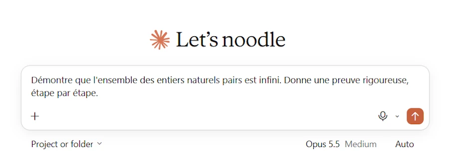
<figcaption>The first prompt (in French). Model: Opus 5.5.</figcaption>
</figure>

Here is the answer I got. Take the time to read it: it is a perfectly classical proof, the kind a math teacher would write on the board.

<figure style="max-width: 900px; margin: auto; text-align: center;">
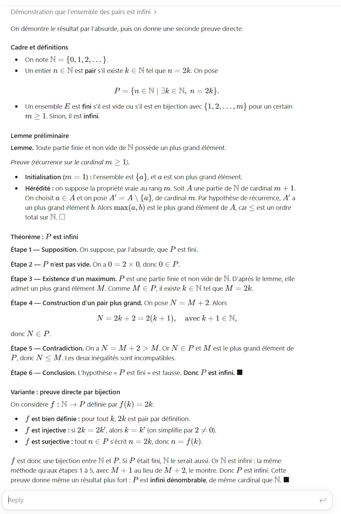
<figcaption>Claude's informal proof (in French): a lemma, a proof by contradiction, and a bonus proof by bijection.</figcaption>
</figure>

For those who don't read French, here is the same proof in English.

**Definitions.** $$\mathbb{N} = \{0, 1, 2, \dots\}$$. A natural number $$n$$ is **even** if there exists $$k \in \mathbb{N}$$ such that $$n = 2k$$. We write $$P$$ for the set of even natural numbers:

$$
P = \{ n \in \mathbb{N} \mid \exists k \in \mathbb{N},\ n = 2k \}
$$

**Lemma.** Every finite, non-empty subset of $$\mathbb{N}$$ has a largest element.

*Proof by induction on the number of elements $$m \geq 1$$.* If $$m = 1$$, the set is $$\{a\}$$ and $$a$$ is its largest element. Now assume the property is true for sets of $$m$$ elements, and let $$A$$ have $$m + 1$$ elements. Pick $$a \in A$$ and let $$A' = A \setminus \{a\}$$, which has $$m$$ elements. By the induction hypothesis, $$A'$$ has a largest element $$b$$. Then $$\max(a, b)$$ is the largest element of $$A$$. $$\square$$

**Theorem.** $$P$$ is infinite.

1. **Assumption.** Assume, by contradiction, that $$P$$ is finite.
2. **$$P$$ is not empty.** $$0 = 2 \times 0$$, so $$0 \in P$$.
3. **A maximum exists.** $$P$$ is a finite, non-empty subset of $$\mathbb{N}$$. By the lemma, it has a largest element $$M$$. Since $$M \in P$$, there is a $$k$$ with $$M = 2k$$.
4. **A bigger even number.** Let $$N = M + 2$$. Then $$N = 2k + 2 = 2(k + 1)$$, so $$N \in P$$.
5. **Contradiction.** On one hand, $$N = M + 2 > M$$. On the other hand, $$N \in P$$ and $$M$$ is the largest element of $$P$$, so $$N \leq M$$. Both cannot be true.
6. **Conclusion.** The assumption "$$P$$ is finite" is false. So $$P$$ is infinite. $$\blacksquare$$

**Bonus: a direct proof.** The function $$f(k) = 2k$$ sends $$\mathbb{N}$$ into $$P$$. It is **injective**: if $$2k = 2k'$$ then $$k = k'$$. So $$P$$ contains a copy of $$\mathbb{N}$$, which is infinite. Hence $$P$$ is infinite.

{: .warning }
> **Before going further, make sure *you* understand this proof.** Lean will check the Lean version of it. But if we don't understand what we are proving, we can't judge whether the Lean statement is the right one. This is the "read the statement yourself" rule, and it starts here.


<!-- ###################################################################### -->
<!-- ###################################################################### -->
<!-- ###################################################################### -->
## Step 2: Ask Claude to Translate It into Lean 4

In the same conversation, I asked:

> Formalize this statement and proof in Lean 4 with Mathlib. Use Mathlib's `Even` definition.

<figure style="max-width: 900px; margin: auto; text-align: center;">
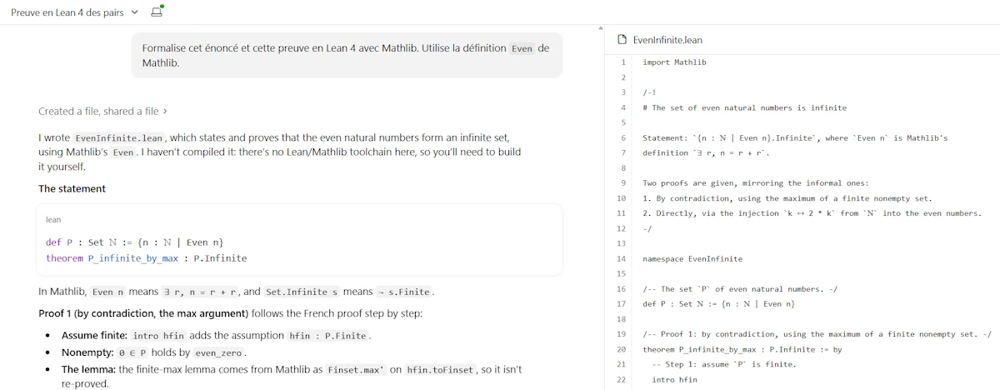
<figcaption>Claude writes a file named EvenInfinite.lean and honestly says it could not compile it: no Lean toolchain on its side.</figcaption>
</figure>

Claude produced a file named [`EvenInfinite.lean`](assets/EvenInfinite.lean). Notice one sentence in its answer: *"I haven't compiled it: there's no Lean/Mathlib toolchain here, so you'll need to build it yourself."* I like that. Claude does not claim the proof is checked. It hands us the file and tells us to check it. Which is precisely what we are going to do.

- [ ] Download the file (button at the top right of the file panel) and keep it somewhere on the main PC, for example in `Downloads`.

{: .note }
> **Tip for a smoother ride.** Tell Claude your exact Lean version (we will find it in the `lean-toolchain` file of the project, in Step 5). For example: *"Target Lean v4.36 and the current Mathlib, which uses the module system."* Models are often trained on older Mathlib versions, and Mathlib renames lemmas regularly. I didn't do it the first time, and you'll see in [Step 7](#step-7-build-read-the-errors-send-them-back-to-claude) (Part 2) what it cost me.


<!-- ###################################################################### -->
<!-- ###################################################################### -->
<!-- ###################################################################### -->
## Step 3: Start a Clean Windows Sandbox with PowerShell 7

Now we need **Lean**. Let's install it inside the Sandbox so that our PC stays untouched.

- [ ] Launch **Windows Sandbox** from the Start menu. If anything goes wrong at this point, see my [Windows Sandbox checklist](){:target="_blank"}.
- [ ] Inside the Sandbox, right-click the Start button, then **Terminal** (or search for **PowerShell** or even faster: `Win + X`, then `I`). We get Windows PowerShell **5.1**, the old one. Note the title bar: we are **Administrator**, always, inside the Sandbox.

<figure style="max-width: 900px; margin: auto; text-align: center;">
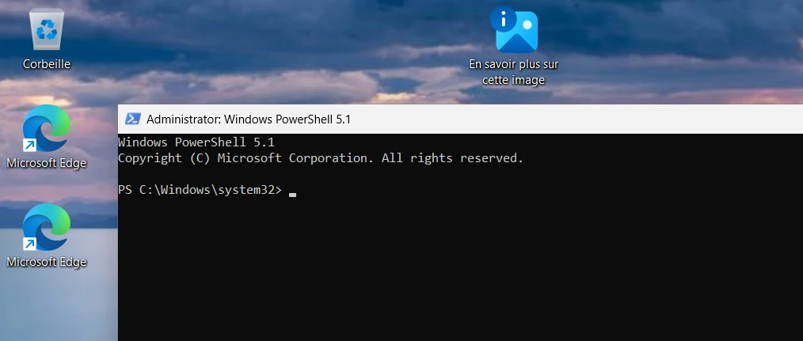
<figcaption>A fresh Sandbox only ships Windows PowerShell 5.1.</figcaption>
</figure>

The Lean installer expects either the old **Command Prompt** (`cmd`) or **PowerShell 7.4.1 or later**. So let's install PowerShell 7.

- [ ] In the PowerShell 5.1 window, copy and paste:

```powershell
iex "& { $(irm https://aka.ms/install-powershell.ps1) } -AddToPath"
```

- [ ] Once it is done (give it some time, you must see a blue progress bar), **in the same window**, copy and paste the line below. It looks useless (it writes back the user `PATH` unchanged), but it tells Windows that the `PATH` has changed, so that every window opened from now on knows where `pwsh` is:

```powershell
[Environment]::SetEnvironmentVariable("Path", [Environment]::GetEnvironmentVariable("Path", "User"), "User")
```

- [ ] Now press `Win + R`, type `pwsh`, then press `Enter`. We are now in PowerShell 7.

<!-- {: .warning }
> **Don't open a new terminal right after the install.** The install script adds PowerShell 7 to the `PATH` directly in the registry, without notifying Windows. The current window knows about it, but a window opened from the Start menu (or with `Win + R`) does not, and complains: `pwsh : The term 'pwsh' is not recognized...`. The line above fixes that. If it happens anyway, run PowerShell 7 with its full path: `& "$env:LOCALAPPDATA\Microsoft\powershell\pwsh.exe"`. -->

<figure style="max-width: 900px; margin: auto; text-align: center;">
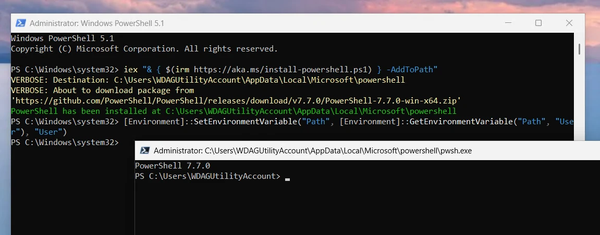
<figcaption>PowerShell 7.7.0 installed, PATH refreshed, and up and running in the Sandbox.</figcaption>
</figure>

{: .note }
> Recent PowerShell releases (7.7.0 and later) no longer ship an `.msi` installer, so the `-UseMSI` flag you may see in older tutorials can fail. Use `-AddToPath` as above. And if you don't want to redo this every time, my [Sandbox checklist]({:target="_blank"}) shows how to get PowerShell 7 automatically at each Sandbox start with a `.wsb` file.

From now on, **every command in this article is typed in the PowerShell 7 window**. The prompt should look like `PS C:\Users\WDAGUtilityAccount>` where `WDAGUtilityAccount` is the name of the user account inside the Sandbox, and `C:\Users\WDAGUtilityAccount` is our home folder.

We can close the PowerShell 5.1 window.


<!-- ###################################################################### -->
<!-- ###################################################################### -->
<!-- ###################################################################### -->
## Step 4: Install Git and elan

Two tools to install:

* **Git**, because Lean projects download their dependencies (Mathlib included) as Git repositories.
* **elan**, the Lean version manager. It installs `lean` (the proof checker) and `lake` (the build tool).


<!-- ###################################################################### -->
### Install Git (MinGit)
{: .no_toc }

No need for the full Git for Windows installer. **MinGit** is a minimal, portable version: a zip file to extract. Perfect for a disposable Sandbox.

- [ ] In the PowerShell 7 window, copy and paste the whole block:

```powershell
# Find the latest MinGit 64-bit release on GitHub
$rel   = Invoke-RestMethod -Uri "https://api.github.com/repos/git-for-windows/git/releases/latest"
$asset = $rel.assets | Where-Object { $_.name -match '^MinGit-[\d.]+-64-bit\.zip$' } | Select-Object -First 1

# Download and extract to C:\MinGit
Invoke-WebRequest -Uri $asset.browser_download_url -OutFile "$env:TEMP\mingit.zip"
Expand-Archive -Path "$env:TEMP\mingit.zip" -DestinationPath "C:\MinGit" -Force

# Add git to PATH: current session + user PATH (so new windows see it too)
$env:Path = "C:\MinGit\cmd;$env:Path"
$userPath = [Environment]::GetEnvironmentVariable("Path", "User")
[Environment]::SetEnvironmentVariable("Path", "C:\MinGit\cmd;$userPath", "User")

git --version
```

- [ ] The last line should print something like `git version 2.56.1.windows.1`.

<figure style="max-width: 900px; margin: auto; text-align: center;">
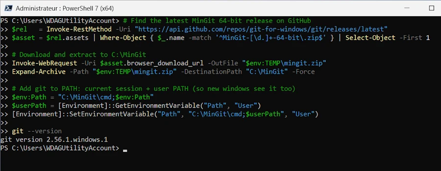
<figcaption>MinGit installed in C:\MinGit and available in the PATH.</figcaption>
</figure>


<!-- ###################################################################### -->
### Install elan
{: .no_toc }

{: .note }
> **If you know [Rust]():** elan is a fork of rustup, and the pieces line up nicely.
>
> | Lean             | Rust                  | Role                                     |
> |------------------|-----------------------|------------------------------------------|
> | `elan`           | `rustup`              | Installs and selects toolchain versions  |
> | `lake`           | `cargo`               | Build tool and package manager           |
> | `lean`           | `rustc`               | The compiler / proof checker             |
> | `lean-toolchain` | `rust-toolchain.toml` | Pins the Lean version per project        |
> | `lakefile.toml`  | `Cargo.toml`          | Project configuration and dependencies   |

- [ ] Download and run the installer. In the PowerShell 7 window, copy and paste the lines below, one at a time:

```powershell
# Download the installer (curl.exe, not the old PowerShell "curl" alias)
curl.exe -O --location https://elan.lean-lang.org/elan-init.ps1

# Run it, bypassing the script execution policy for this one call
powershell -ExecutionPolicy Bypass -f elan-init.ps1
```

- [ ] The installer explains what it will do and offers three options. Type `1` (or just press `Enter`) to **proceed with installation**. It ends with *"Elan is installed now. Great!"*

<figure style="max-width: 900px; margin: auto; text-align: center;">
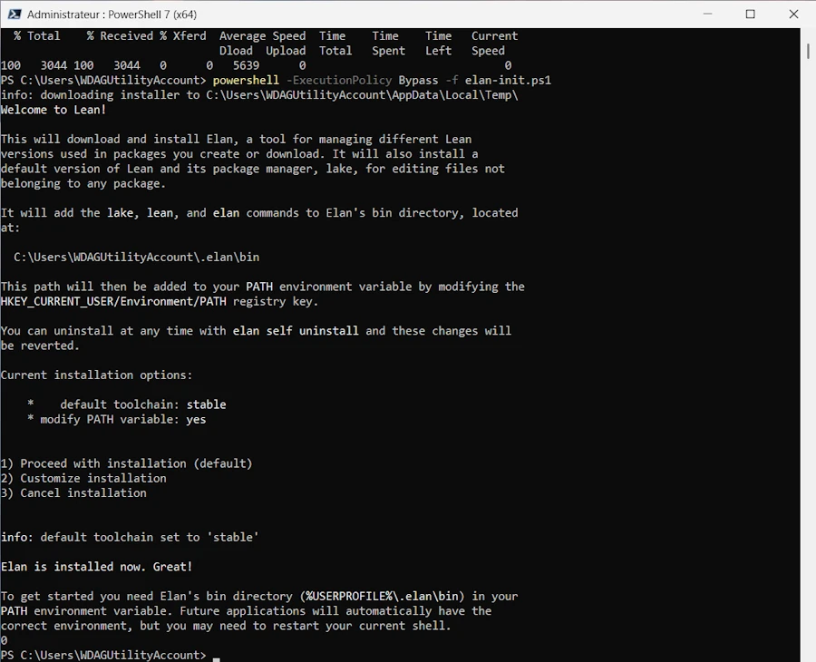
<figcaption>elan installs itself in C:\Users\WDAGUtilityAccount\.elan\bin and adds that folder to the PATH.</figcaption>
</figure>

- [ ] Clean up the installer script:

```powershell
del elan-init.ps1
```

<figure style="max-width: 900px; margin: auto; text-align: center;">
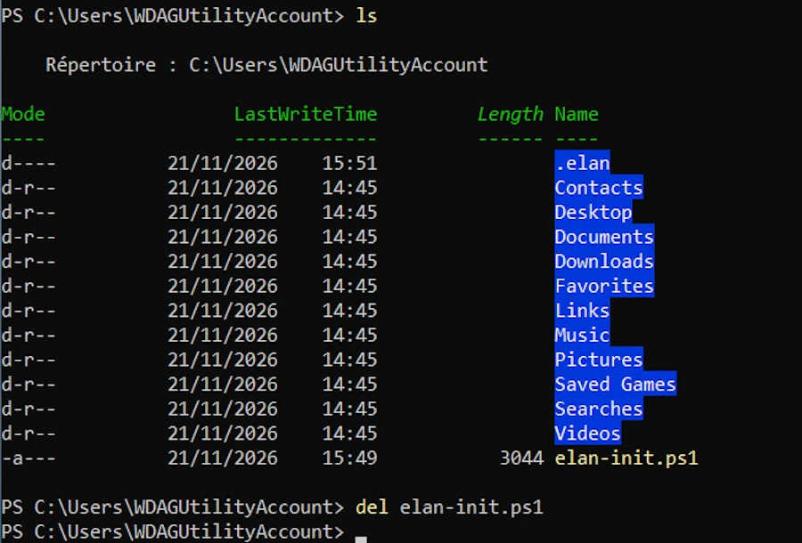
<figcaption>The new .elan folder is there. The installer script can go.</figcaption>
</figure>

- [ ] **Close the terminal and open a new PowerShell 7 window** (`Win + R`, `pwsh`, `Enter`). This matters: the installer updated the `PATH`, and only new windows see the change.
- [ ] Check:

```powershell
elan --version
elan show   # lists installed toolchains
```

<figure style="max-width: 900px; margin: auto; text-align: center;">
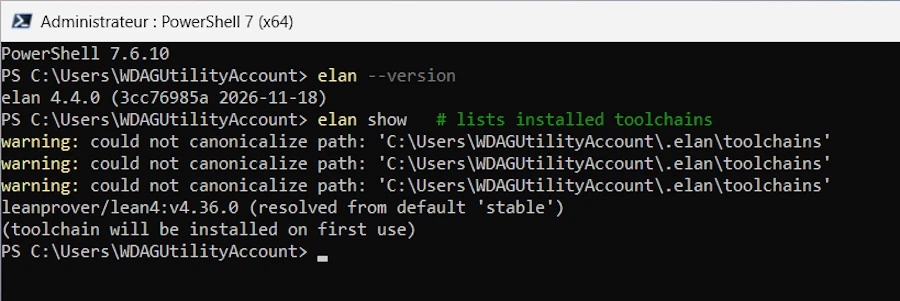
<figcaption>elan 4.4.0. The yellow warnings are harmless: no toolchain has been downloaded yet.</figcaption>
</figure>

Don't worry about the `could not canonicalize path` warnings. elan is looking for its `toolchains` folder, which does not exist yet. Lean itself (the "toolchain") will be downloaded the first time we need it, which is... right now.

What just happened? elan put small "shim" programs (`lean.exe`, `lake.exe`) in `C:\Users\WDAGUtilityAccount\.elan\bin`. When we run `lake` inside a project, the shim reads the project's `lean-toolchain` file, downloads that exact Lean version if it is missing, then runs it. This way, each project uses exactly the Lean version it was written for.


<!-- ###################################################################### -->
<!-- ###################################################################### -->
<!-- ###################################################################### -->
## Step 5: Create a Lean Project with Mathlib

- [ ] Make sure we are in the home folder, then create the project:

```powershell
cd ~
lake new preuves math
```

* `preuves` is the project name ("proofs" in French). lake creates a `preuves\` folder.
* `math` is the template. It creates a project that depends on **Mathlib**. Without it, we would get a bare project.

This command does a lot, so be patient:

1. It downloads the Lean toolchain (about 590 MB, here Lean v4.36.0).
2. It clones Mathlib and its own dependencies with Git (`batteries`, `aesop`, `Qq`, `proofwidgets`...).
3. It downloads a **precompiled** version of Mathlib, about 9,000 files.

<figure style="max-width: 900px; margin: auto; text-align: center;">
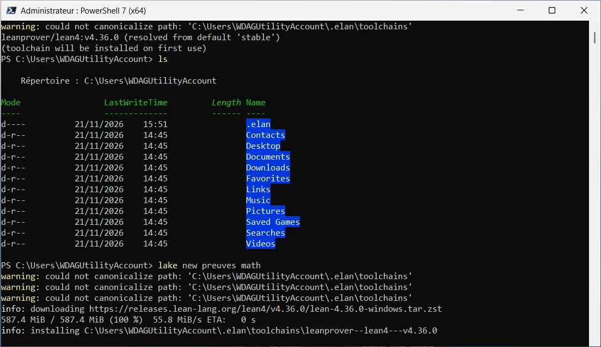
<figcaption>First use of lake: elan downloads the Lean v4.36.0 toolchain.</figcaption>
</figure>

<figure style="max-width: 900px; margin: auto; text-align: center;">
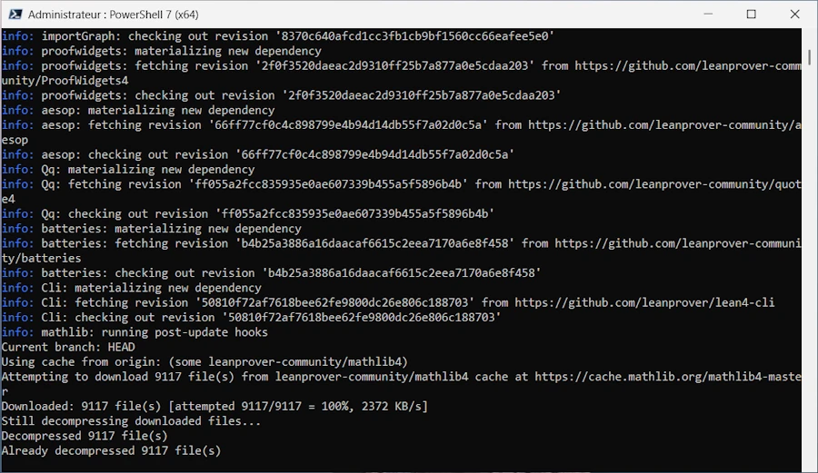
<figcaption>Mathlib's dependencies are cloned, then 9,117 precompiled files are downloaded from the Mathlib cache.</figcaption>
</figure>

- [ ] To be safe, make sure the precompiled Mathlib is really there:

```powershell
cd preuves
lake exe cache get
```

<figure style="max-width: 900px; margin: auto; text-align: center;">
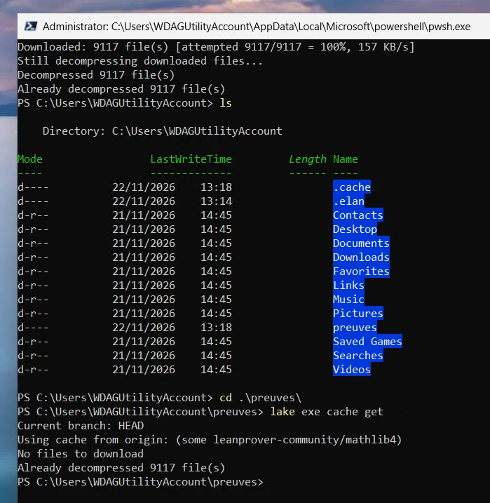
<figcaption>Everything was already downloaded by lake new: "No files to download".</figcaption>
</figure>

If everything was already downloaded, this command just says so and exits. If not, it downloads what's missing. **Do not skip it**: without the cache, Lean would compile Mathlib from source, and that takes **hours**.

- [ ] Look at what was generated:

```text
preuves\
├── lakefile.toml        # declares the "Preuves" library and requires mathlib
├── lean-toolchain       # pins the Lean version Mathlib needs (v4.36.0 here)
├── Preuves.lean         # library root: a list of imports
└── Preuves\
    └── Basic.lean       # placeholder module (def hello := "world")
```

<figure style="max-width: 900px; margin: auto; text-align: center;">
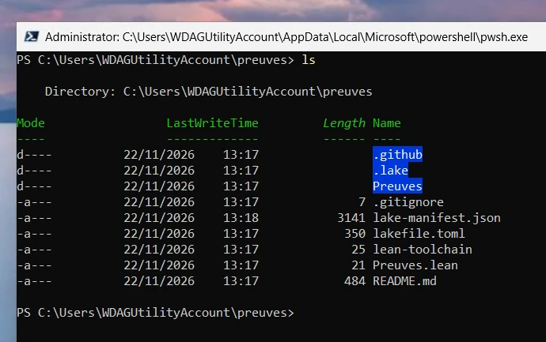
<figcaption>The project folder. The hidden .lake folder holds Mathlib and its precompiled files.</figcaption>
</figure>

```powershell
Get-Content .\lean-toolchain
# leanprover/lean4:v4.36.0 on my PC
```

This prints the exact Lean version of the project. This is the version worth mentioning to Claude (see the tip in Step 2).


<!-- ###################################################################### -->
<!-- ###################################################################### -->
<!-- ###################################################################### -->
## Step 6: Wire Our File into the Project

`lake` does **not** scan the folder `./Preuves` for `.lean` files. It builds the library root (`Preuves.lean`) and everything that root imports. **A file that nobody imports is simply ignored.** If you know Rust: a module not declared from `lib.rs` is never compiled either.

So two things to do: copy the file, and import it.

- [ ] **Copy the file into the Sandbox.** On the main PC, in File Explorer, select `EvenInfinite.lean` (in `Downloads`) and press `Ctrl + C`. In the Sandbox, in the open terminal, use the following command to open the project folder:

```powershell
explorer .\Preuves
```

- [ ] In the Explorer window that opens (inside the Sandbox), press `Ctrl + V`. The Sandbox shares the clipboard with the main PC, so the copy works across the two.

<figure style="max-width: 900px; margin: auto; text-align: center;">
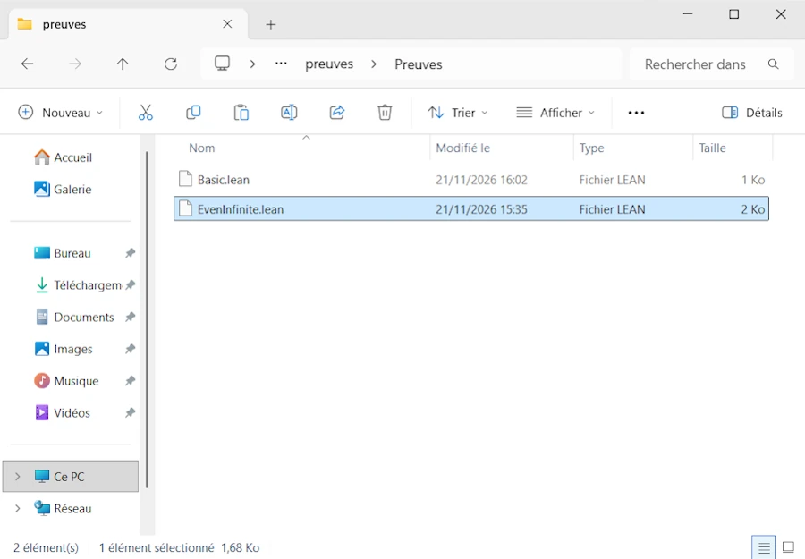
<figcaption>EvenInfinite.lean sits next to the template's Basic.lean (French UI).</figcaption>
</figure>

{: .note }
> The file name uses **UpperCamelCase** (`EvenInfinite.lean`), and the module name follows the path, with `.` instead of `\`: the file `Preuves\EvenInfinite.lean` is the module `Preuves.EvenInfinite`.

- [ ] **Import it.**
  1. In the terminal, we are in `C:\Users\WDAGUtilityAccount\preuves`
  1. Open the file `Preuves.lean` (the library root) with MS Edit (notepad is not available in the sandbox)

```powershell
edit .\Preuves.lean
```

{: .note }
> If the command above does not work, in File Explorer, right-click on the name of the file (`Preuves.lean`), select `Open with...` then point to `C:\Windows\System32\edit.exe`


- [ ] Add a line `import Preuves.EvenInfinite` and save.

<figure style="max-width: 900px; margin: auto; text-align: center;">
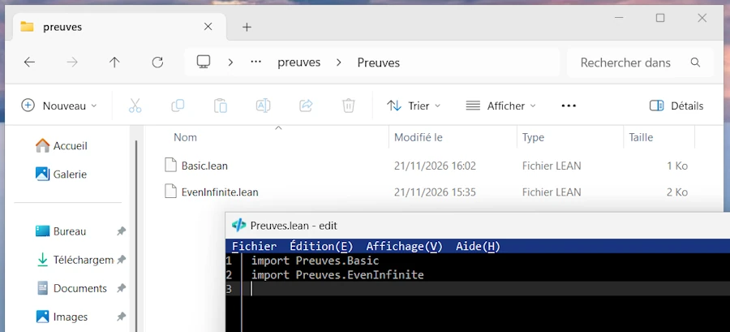
<figcaption>My first version of Preuves.lean (edited with the Microsoft Edit console editor). Spoiler: it is not quite right yet, see error #3 in Part 2.</figcaption>
</figure>

To make things simple, here is the **final** version of `Preuves.lean` that works, so you don't have to go through all my errors:

```lean
module

import Preuves.EvenInfinite
```

And since we no longer import the template's placeholder, we can delete it:

```powershell
Remove-Item .\Preuves\Basic.lean
```

{: .warning }
> If you delete `Basic.lean`, also remove the `import Preuves.Basic` line. Otherwise the build fails with an "unknown module" error.

Two other ways to check a single file without touching `Preuves.lean`, good to know:

```powershell
lake build Preuves.EvenInfinite                 # build just this module and its dependencies
lake env lean .\Preuves\EvenInfinite.lean       # check one file directly
```


<!-- ###################################################################### -->
<!-- ###################################################################### -->
<!-- ###################################################################### -->
## Conclusion

Let's take stock. Claude gave us a human-readable proof, then its Lean 4 version. We have a disposable Windows Sandbox with PowerShell 7, Git, elan, Lean, and a Mathlib project, and Claude's file is wired into it. Everything is in place. The only thing left is to ask Lean what it thinks.

Spoiler: the first `lake build` will fail. And this is exactly what we want. Watching the machine reject a proof, then sending its complaints back to Claude until it accepts it, is the whole point of the exercise.

{: .important }
> **Don't close the Sandbox!** We continue in the very same session. If you close it, you will have to redo Steps 3 to 6.

See you in [Part 2](), where we build, read the errors, and send them back to Claude.


<!-- ###################################################################### -->
<!-- ###################################################################### -->
<!-- ###################################################################### -->
## Webliography

* TODO: Anthropic's post, if any.
* [Levent Alpöge's announcement and preprint](https://alpo.ge/remark.pdf){:target="_blank"}
* [Levent Alpöge](https://fr.wikipedia.org/wiki/Levent_Alp%C3%B6ge){:target="_blank"}, Wikipedia page.
* [Windows Sandbox on Windows 11: A Hands-On Checklist](){:target="_blank"}
* [Lean 4](https://lean-lang.org/){:target="_blank"}, the official website.
* [Mathlib and the Lean community](https://leanprover-community.github.io/){:target="_blank"}.
* [elan](https://github.com/leanprover/elan){:target="_blank"}, the Lean version manager.
* [The Natural Number Game](https://adam.math.hhu.de/#/g/leanprover-community/nng4){:target="_blank"}, learn Lean in the browser, nothing to install.
* [Mathematics in Lean](https://leanprover-community.github.io/mathematics_in_lean/){:target="_blank"}, the free online book, once the game is done.
* [The Riemann Hypothesis](https://www.claymath.org/millennium/riemann-hypothesis/){:target="_blank"}, on the Clay Mathematics Institute website.
* [Git for Windows releases](https://github.com/git-for-windows/git/releases){:target="_blank"} (MinGit is there).


<figure style="max-width: 560px; margin: auto;">
<div style="position: relative; padding-bottom: 56.25%; height: 0;">
    <iframe
    src="https://www.youtube.com/embed/sD0NjbwqlYw?start=0"
    title="
But what is the Riemann hypothesis? Visualizing analytic continuation - 3Blue1Brown"
    style="position: absolute; inset: 0; width: 100%; height: 100%;"
    allowfullscreen>
    </iframe>
</div>
<figcaption style="text-align: center;">
    But what is the Riemann hypothesis? Visualizing analytic continuation - 3Blue1Brown
</figcaption>
</figure>


<figure style="max-width: 560px; margin: auto;">
<div style="position: relative; padding-bottom: 56.25%; height: 0;">
    <iframe
    src="https://www.youtube.com/embed/KvculWl-jhE?start=0"
    title="The Riemann Hypothesis -- Science étonnante #62"
    style="position: absolute; inset: 0; width: 100%; height: 100%;"
    allowfullscreen>
    </iframe>
</div>
<figcaption style="text-align: center;">
    The Riemann Hypothesis -- Science étonnante #62
</figcaption>
</figure>


