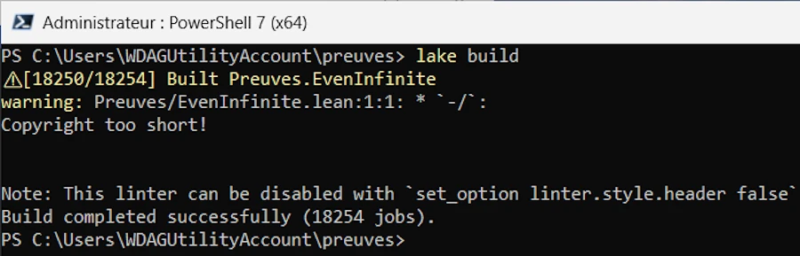

# {{ page.title }}
{: .no_toc }

{{ page.description }}
{: .lead }


<!-- ###################################################################### -->
<!-- ###################################################################### -->
<!-- ###################################################################### -->
## TL;DR
{: .no_toc }

* In [Part 1](), Claude wrote a proof that *the set of even natural numbers is infinite*, translated it into Lean 4, and we set up Lean and Mathlib inside Windows Sandbox. Now, we run the loop.
* `lake build`, copy the errors, paste them back to Claude, repeat. Six issues in my case, **none** of them about the math. All of them about tooling and versions.
* We read the final Lean file line by line, and we check that we can **trust** it: no `sorry`, no extra axiom, and a statement we read ourselves.
* Before closing the Sandbox, one more round with a harder theorem, then we save our files.
* **Next level:** Lean, VS Code and Claude Code installed on the main PC, and Claude runs the loop on its own.


<figure style="max-width: 900px; margin: auto; text-align: center;">

<figcaption>Build, fail, fix, repeat. Sparks included.</figcaption>
</figure>


<!-- ###################################################################### -->
<!-- ###################################################################### -->
<!-- ###################################################################### -->
## Table of Contents
{: .no_toc .text-delta}
- TOC
{:toc}


<!-- ###################################################################### -->
<!-- ###################################################################### -->
<!-- ###################################################################### -->
## Introduction

This post is in **2 parts**:

* [Part 1/2](): the Riemann Hypothesis in five minutes, why we need a machine to check proofs, Claude writes the proof and its Lean 4 version, and we install everything inside Windows Sandbox (Steps 1 to 6).
* [Part 2/2]() (this page): we build, read the errors, send them back to Claude, validate the result, and finally let Claude close the loop on its own (Steps 7 to 10 and the next level).

At the end of Part 1, we had a Windows Sandbox with PowerShell 7, Git, elan, a Lean project named `preuves` with Mathlib, and the file `EvenInfinite.lean` written by Claude, wired into the project. Nothing was built yet. This is where we pick up.

{: .warning }
> **Is your Sandbox still open?** If you closed it between the two parts, everything is gone (this is the whole point of a Sandbox). Go back to [Part 1, Step 3](#step-3-start-a-clean-windows-sandbox-with-powershell-7) and redo Steps 3 to 6. It takes a few minutes, plus the Mathlib download.


<!-- ###################################################################### -->
<!-- ###################################################################### -->
<!-- ###################################################################### -->
## Step 7: Build, Read the Errors, Send Them Back to Claude

This is the heart of the article: the feedback loop.

- [ ] From the `preuves` folder, run:

```powershell
lake build
```

- [ ] If Lean reports an error, copy it (select the text in the terminal, `Ctrl + C`) and paste it back into the Claude conversation:

> Here is Lean's error output. Fix the proof.

- [ ] Copy the corrected file into the Sandbox again (overwrite the old one), then `lake build` again.
- [ ] Repeat until the build succeeds.

Here are the issues I actually hit, in order. I am giving them in full because this is *exactly* the kind of thing a student will run into, and the messages can be intimidating.

| # | Symptom | Cause | Fix |
|---|---------|-------|-----|
| 1 | `failed to read file '...Mathlib\...\X.olean.private'` + warning *"imports Mathlib ... designed for use with the module system"* | Recent Lean and Mathlib use the **module system**: compiled files are split into a public `.olean` and a private `.olean.private`. A plain (non-module) file that imports Mathlib needs the private parts, and some were missing from the cache. | Add `module` as the **first line** of the file. |
| 2 | `Unknown identifier 'even_zero'` | Claude used an **outdated Mathlib lemma name**. | Use `Even.zero` (or the version-proof term `⟨0, rfl⟩`). Or simply send the error back to Claude. |
| 3 | Same `.olean.private` error, now on `Preuves.lean` | The **library root** (and `Basic.lean`) were still plain files importing a module. | Add `module` at the top of `Preuves.lean` (and of `Basic.lean` if you keep it). |
| 4 | `Unknown identifier 'Set'` + *"imported privately; consider adding public import"*, followed by a cascade of strange errors | `public section` makes the theorems public, so the names in their statements must be imported **publicly**. | Use `public import Mathlib` (or remove `public section`). |
| 5 | Warning *"Copyright too short!"* | Mathlib's style checker expects a Mathlib copyright header. The `math` template turns these checks on. | Harmless, ignore it. Or add `weak.linter.style.header = false` under `[leanOptions]` in `lakefile.toml`. |
| 6 | Warning *"The current module only contains private declarations"* | In a module, declarations are **private by default**. | Harmless. Add `public section` (with a `public import`) to silence it. |

Some lessons from this table:

* **Read the first error first.** One real error (such as an unknown name in the statement) turns the rest of the proof into nonsense for Lean, and it then produces confusing follow-up errors. Fix the error at the top, rebuild, and many of the others vanish.
* **Errors vs warnings.** An *error* means the proof is rejected. A *warning* means "it works, but here is a remark". Warnings 5 and 6 are about style, not about math.
* **Private vs public.** Inside a `module`, a theorem is private unless marked `public`. A private theorem is still **fully checked**. It just can't be reused by other files. For our purpose, it makes no difference.
* **Not a single error was about the math.** All of them came from tooling and versions: the module system, a renamed lemma, style checkers. The proof itself was right from the start. Keep this in mind the day you try something harder.


<!-- ###################################################################### -->
### The Final File, Line by Line
{: .no_toc }

Here is the version that Lean accepted:

```lean
module

public import Mathlib

/-!
# The set of even natural numbers is infinite

Statement: `{n : ℕ | Even n}.Infinite`, where `Even n` is Mathlib's
definition `∃ r, n = r + r`.

Two proofs are given, mirroring the informal ones:
1. By contradiction, using the maximum of a finite nonempty set.
2. Directly, via the injection `k ↦ 2 * k` from `ℕ` into the even numbers.
-/

public section

namespace EvenInfinite

/-- The set `P` of even natural numbers. -/
def P : Set ℕ := {n : ℕ | Even n}

/-- Proof 1: by contradiction, using the maximum of a finite nonempty set. -/
theorem P_infinite_by_max : P.Infinite := by
  -- Step 1: assume `P` is finite.
  intro hfin
  -- Step 2: `P` is nonempty, since `0` is even.
  have hne : hfin.toFinset.Nonempty := ⟨0, hfin.mem_toFinset.mpr Even.zero⟩
  -- Step 3 (the lemma): a finite nonempty subset of `ℕ` has a maximum `M`.
  have hMmem := Finset.max'_mem hfin.toFinset hne
  have hMeven : Even (hfin.toFinset.max' hne) := hfin.mem_toFinset.mp hMmem
  -- Write `M = k + k`.
  obtain ⟨k, hk⟩ := hMeven
  -- Step 4: `M + 2 = (k + 1) + (k + 1)` is even, hence belongs to `P`.
  have hN : hfin.toFinset.max' hne + 2 ∈ hfin.toFinset :=
    hfin.mem_toFinset.mpr ⟨k + 1, by omega⟩
  -- Step 5: since `M` is the maximum, `M + 2 ≤ M`, a contradiction.
  have hle := Finset.le_max' hfin.toFinset _ hN
  omega

/-- Proof 2: the map `k ↦ 2 * k` injects `ℕ` (an infinite type) into `P`. -/
theorem P_infinite_by_injection : P.Infinite :=
  Set.infinite_of_injective_forall_mem (f := fun k : ℕ => 2 * k)
    -- Injectivity: `2 * a = 2 * b → a = b`.
    (fun _ _ h => Nat.eq_of_mul_eq_mul_left (by norm_num) h)
    -- Every `2 * k` is even.
    (fun k => even_two_mul k)

end EvenInfinite
```

It looks scary. It is not. Let's read it as we would read the paper proof.

**The header.**

* `module` and `public import Mathlib`: "this file is a module, and it uses all of Mathlib". See errors #1 and #4 above.
* The block between `/-!` and `-/` is a comment for humans. Lean ignores it.
* `namespace EvenInfinite` ... `end EvenInfinite`: a box to put our names in, so that our `P` doesn't collide with another `P` somewhere in Mathlib.

**The statement.**

* `def P : Set ℕ := {n : ℕ | Even n}` reads: "$$P$$ is the set of natural numbers $$n$$ such that $$n$$ is even". Exactly our $$P$$.
* `theorem P_infinite_by_max : P.Infinite` reads: "here is a theorem named `P_infinite_by_max`, which states that $$P$$ is infinite".

{: .important }
> **Read the statement!** In Mathlib, `Even n` means $$\exists r,\ n = r + r$$, not $$\exists k,\ n = 2k$$. Same thing, written differently. This is the kind of detail we must check ourselves: Lean proves *the statement written in the file*, not the one we have in mind. Here, they match. This is the only part of the work where we have to trust ourselves.

**Proof 1, step by step.** After `:= by`, each line is a **tactic**: an instruction that transforms what remains to be proven (the "goal").

* `intro hfin`. In Mathlib, "$$P$$ is infinite" is defined as "$$P$$ is not finite", that is "if $$P$$ is finite, then we get something absurd". So `intro hfin` means: *"Assume $$P$$ is finite, and call this assumption `hfin`."* Our goal is now to reach a contradiction. This is **Step 1** of the paper proof.
* `have hne : ... := ⟨0, ...⟩`. *"Let me state a fact named `hne`: $$P$$ is not empty, and the proof is: $$0$$ is in it, because `Even.zero` says $$0$$ is even."* This is **Step 2**. The `hfin.toFinset` part converts our set into a Mathlib "finite set" object (a `Finset`), on which the notion of maximum is available.
* `have hMmem := Finset.max'_mem ...`. *"The maximum of this finite, non-empty set belongs to the set."* `Finset.max'` is our $$M$$. This is the **lemma** of the paper proof: we don't prove it, Mathlib already did, once and for all.
* `have hMeven : Even (...)`. *"So $$M$$ is even."*
* `obtain ⟨k, hk⟩ := hMeven`. *"Since $$M$$ is even, there is a $$k$$ with $$M = k + k$$. Call this fact `hk`."* This is **Step 3**.
* `have hN : ... + 2 ∈ ...`. *"$$M + 2$$ belongs to $$P$$, because $$M + 2 = (k + 1) + (k + 1)$$."* The small computation is left to `omega`, a tactic that solves arithmetic on integers on its own. This is **Step 4**.
* `have hle := Finset.le_max' ...`. *"Every element is less than or equal to the maximum, so $$M + 2 \leq M$$."*
* `omega`. *"$$M + 2 \leq M$$ is impossible for natural numbers. Contradiction."* This is **Step 5**, and it closes the proof.

Compare with the paper proof: same steps, same order. The Lean version is just **more explicit**. Nothing is "obvious" to Lean, so nothing is left unsaid.

**Proof 2, the bijection bonus.** `Set.infinite_of_injective_forall_mem` is a Mathlib theorem that says: *"if an injective function sends an infinite set into $$P$$, then $$P$$ is infinite."* We give it three things: the function ($$k \mapsto 2k$$), a proof that it is injective ($$2a = 2b \Rightarrow a = b$$, because $$2 \neq 0$$), and a proof that $$2k$$ is always even (`even_two_mul`). Three lines, done.


<!-- ###################################################################### -->
<!-- ###################################################################### -->
<!-- ###################################################################### -->
## Step 8: Validate (and Be Skeptical)

When everything is right, `lake build` ends like this:

<figure style="max-width: 900px; margin: auto; text-align: center;">

<figcaption>"Build completed successfully". Lean has checked every step of both proofs.</figcaption>
</figure>

```text
⚠ [18250/18254] Built Preuves.EvenInfinite
warning: ... Copyright too short!
Build completed successfully (18254 jobs).
```

How to read this:

* `Build completed successfully`: Lean accepted both proofs.
* `⚠` means "built with warnings only". The only warning left is the copyright one (#5), which has nothing to do with math.
* 18,254 jobs: most of them are Mathlib files, already compiled, simply reloaded. If you run `lake build` again without changing anything, you'll see `Replayed` instead of `Built`: lake reuses the previous result.

Now, let's be skeptical, as a good referee should be.

- [ ] **No `sorry` in the output.** In Lean, `sorry` is a keyword that means *"trust me, I'll prove it later"*. Lean accepts it, but prints a warning `declaration uses 'sorry'`. A proof with a `sorry` is **not** a proof. An AI under pressure could be tempted to sneak one in. Check the output: there must be none.
- [ ] *(Optional, stronger check)* Add these lines at the end of `EvenInfinite.lean`, just before `end EvenInfinite`:

```lean
#print axioms P_infinite_by_max
#print axioms P_infinite_by_injection
```

- [ ] Run `lake build` again. Lean lists the axioms (the basic assumptions of mathematics) each proof relies on. We should only see standard ones such as `propext`, `Classical.choice`, or `Quot.sound`, and **never** `sorryAx`. If `sorryAx` appears, somewhere, a gap is hidden.
- [ ] **Read the statement yourself, one last time.** `P.Infinite`, with `P = {n : ℕ | Even n}` and `Even n` meaning $$\exists r,\ n = r + r$$. Yes, this is what we wanted to prove.

That's it. We now **know**, not believe, that the set of even natural numbers is infinite. OK, we already knew. But now, a machine has checked it too, and we know exactly what we had to trust to get there.


<!-- ###################################################################### -->
<!-- ###################################################################### -->
<!-- ###################################################################### -->
## Step 9: One More Round While the Sandbox Is Open

The Sandbox is ready, Lean and Mathlib are installed: this is the perfect moment to try something a little harder, before closing everything.

- [ ] **Try a theorem where Claude's first attempt is likely to fail.** The natural candidate: **"there are infinitely many primes"**, Euclid's theorem, the one we met in the Riemann section of [Part 1](). On the host, ask Claude for the paper proof, then the Lean version, copy the file into `preuves\Preuves`, add the `import` line to `Preuves.lean`, and run `lake build`. How many rounds does the loop take?
- [ ] **Ask Claude to explain each tactic.** *"Explain this Lean proof line by line to a high-school student"* works surprisingly well.

{: .note }
> **Reminder: Claude and Lean don't live in the same place.** Lean runs **inside the Sandbox**. Claude runs **on the main PC** (desktop app or browser). They cannot see each other. *We* are the messenger: select the error in the Sandbox terminal, `Ctrl + C`, click in the Claude window on the main PC, `Ctrl + V`. Then the other way around for the corrected file: download it on the main PC, `Ctrl + C`, paste it into the Sandbox's `preuves\Preuves` folder with `Ctrl + V`, overwriting the old one. It sounds obvious, but when two Windows desktops are on screen, it is easy to lose track of which is which.


<!-- ###################################################################### -->
<!-- ###################################################################### -->
<!-- ###################################################################### -->
## Step 10: Save Our Work and Close the Sandbox

{: .warning }
> The Sandbox is **ephemeral**. Closing it wipes everything: elan, Lean, Mathlib and its GB of cache, **and our files**. Copy what you want to keep before closing.

- [ ] In the Sandbox, open `C:\Users\WDAGUtilityAccount\preuves\Preuves` in Explorer, select the `.lean` files, `Ctrl + C`, then `Ctrl + V` somewhere on the main PC. Same for any screenshot you took.
- [ ] Close the Sandbox with the **X button** of its window, **not** with *Start > Shut down* from inside. Shutting down from inside makes the main PC show a scary error dialog (*"The remote environment is shutting down"*). It's harmless, but the X button closes things cleanly.

And our main PC? Untouched. No Lean, no Git, no Mathlib. Clean.


<figure style="max-width: 900px; margin: auto; text-align: center;">

<figcaption>Next level: same math, new workflow.</figcaption>
</figure>

<!-- the floor has turned into a circuit. Time to let Claude walk the corridor on its own, with Lean lighting the way -->


<!-- ###################################################################### -->
<!-- ###################################################################### -->
<!-- ###################################################################### -->
## Next Level: Install Lean on Our PC and Let Claude Loop on Its Own

Copying errors from one window to the other is fine for five minutes. It is even a good thing at first: we *see* every error, we *read* every fix, we understand what is going on. But after the tenth round trip, let's be honest, it gets old. And we are doing a job a machine could do: copy, paste, rebuild, copy, paste...

If you are convinced and want to go further, it is time to:

1. install Lean **on our own PC**, for good,
2. install **VS Code** and its **Lean 4 extension**, to *see* proofs instead of just building them,
3. let **Claude Code** run `lake build` itself, read the errors, fix the proof, and loop until Lean says yes.

{: .note }
> **Claude Code** is the version of Claude that works either in a terminal or a browser but inside a project folder. It can read and write files and run commands (remember, auto mode is default now). Exactly what we were doing by hand.


<!-- ###################################################################### -->
### Install the Tools on the Main PC
{: .no_toc }

This time, we work on the main PC, in a PowerShell 7 terminal (no need to be administrator). If PowerShell 7 is not installed yet: `winget install --id Microsoft.PowerShell -e`.

- [ ] Install Git and VS Code with `winget`, the package manager built into Windows 11:

```powershell
winget install --id Git.Git -e
winget install --id Microsoft.VisualStudioCode -e
```

- [ ] Install elan, exactly as in the Sandbox:

```powershell
curl.exe -O --location https://elan.lean-lang.org/elan-init.ps1
powershell -ExecutionPolicy Bypass -f elan-init.ps1
del elan-init.ps1
```

- [ ] **Close the terminal and open a new one**, then install the Lean 4 extension for VS Code:

```powershell
code --install-extension leanprover.lean4
```

- [ ] Install Claude Code (it needs Git, installed above):

```powershell
irm https://claude.ai/install.ps1 | iex
```

- [ ] Open a new terminal and check that everything answers:

```powershell
git --version
elan --version
code --version
claude --version
```

- [ ] Create a project, as in the Sandbox, somewhere outside OneDrive (Mathlib's thousands of files and OneDrive don't get along well):

```powershell
New-Item -ItemType Directory -Path C:\lean -Force | Out-Null
cd C:\lean
lake new preuves math
cd preuves
lake exe cache get
code .
```

{: .warning }
> **Disk space.** Each Mathlib project carries its own copy of the precompiled Mathlib (several GB, in the hidden `.lake` folder). So rather than creating a new project for every theorem, let's keep **one** project and add files to it. To uninstall everything later: delete `C:\lean`, then run `elan self uninstall`.


<!-- ###################################################################### -->
### What the Lean 4 Extension Brings
{: .no_toc }

Open `Preuves\EvenInfinite.lean` in VS Code (copy it from the Sandbox session, or ask Claude for it again). The first time, the extension takes a moment to start Lean. Then, place the cursor on any line of the proof: the **Lean Infoview** panel, on the right, shows the **goal**, that is, what remains to be proven at this exact point, and the facts already available (`hfin`, `hne`, `k`, `hk`...).

Move the cursor down the proof, line by line, and watch the goal change at each tactic, until the panel says *"No goals"*. This is the best way to understand what each line of Claude's proof really does. Errors show up too, underlined in red, as we type, without running `lake build`.


<!-- ###################################################################### -->
### Let Claude Close the Loop
{: .no_toc }

- [ ] In VS Code, open a terminal (`` Ctrl + ` ``, `` Ctrl + ù `` on a French keyboard, don't ask me why), make sure we are in the `preuves` folder, and start Claude Code:

```powershell
claude
```

- [ ] Give it a prompt like this one, which describes the task **and** the loop:

```text
This folder is a Lean 4 project using Mathlib (Lean version in lean-toolchain,
Mathlib uses the module system).

1. Create Preuves/InfinitePrimes.lean (start it with `module` and
   `public import Mathlib`) and import it from Preuves.lean.
2. State exactly this theorem. Do NOT change the statement:
   theorem primes_infinite : Set.Infinite {p : ℕ | Nat.Prime p}
3. Prove it with Euclid's argument: any prime factor of n! + 1 is greater than n.
   Do not use Mathlib's ready-made results about infinitely many primes
   (such as Nat.exists_infinite_primes or Nat.infinite_setOf_prime).
4. Loop: run `lake build Preuves.InfinitePrimes`, read the FIRST error, fix it,
   rebuild. Never use `sorry`, `admit`, or a new `axiom`.
5. When the build succeeds, add `#print axioms primes_infinite`, rebuild,
   and show me the output.
6. If it still fails after 6 builds, stop and explain where you are stuck.
```

Depending on the permission mode, Claude Code may ask before running `lake build` the first time. Let's accept, and watch it work: it writes the file, builds, reads Lean's complaints, fixes, builds again. We are no longer the messenger. We are the **referee**.

Why is this prompt written this way?

* **"Do NOT change the statement."** This is the most important line. An AI that struggles to prove something could be tempted to prove something *easier*, a slightly weaker statement that compiles. Lean would happily accept it: Lean checks the proof, not our intentions. By fixing the statement ourselves, we keep control of *what* is proven. Then, at the end, we read it again anyway.
* **"Do not use Mathlib's ready-made results."** Mathlib already knows that there are infinitely many primes. Without this line, the proof could be one line long, calling Mathlib's theorem. Correct, but we would learn nothing.
* **"Never use `sorry`..."** and the **`#print axioms`** check: we want a real proof, with no hidden gap.
* **`lake build Preuves.InfinitePrimes`** rather than `lake build`: only the new file is rebuilt, and the output stays short.
* **"Stop after 6 builds."** See below.

{: .warning }
> **Watch the tokens.** Each round of the loop costs tokens: Claude reads Lean's output (sometimes long), thinks, and rewrites the file. A loop that goes nowhere can burn through a subscription's usage limits, or a budget on the API, surprisingly fast. So: set a maximum number of attempts in the prompt, build only the file being worked on, start a fresh conversation (`/clear`) for each new theorem, and don't hesitate to press `Esc` to interrupt Claude Code if it starts going in circles. When it is stuck, a hint from us (*"use `Nat.exists_prime_and_dvd`"*, *"try a proof by contradiction"*) is often worth ten more rounds.

When it's done, open `Preuves\InfinitePrimes.lean` in VS Code, walk through the proof with the Infoview, and, as always, **read the statement**. It's our job, and it stays our job.

{: .note }
> **Before writing proofs, learn to read them: the Natural Number Game.** If you want to understand what tactics like `intro`, `rw`, or `induction` do, try the **Natural Number Game** (link in the Webliography). It is a free puzzle game that runs in the browser, with Lean built in: nothing to install. We start with almost nothing, the number $$0$$ and the "+1" operation, and level after level, we prove things like $$a + b = b + a$$ ourselves, one tactic at a time. After an evening of it, Claude's Lean proofs become much easier to read and to judge.


<!-- ###################################################################### -->
<!-- ###################################################################### -->
<!-- ###################################################################### -->
## Conclusion

Let's step back for a moment.

What we did today is small. A theorem that fits in five lines, known for more than two thousand years. But the **loop** we ran is exactly the one that will matter for the big results: a human asks, an AI proposes, a machine checks, a human reads the statement. Each one does what it does best. Claude **finds** and **translates**. Lean **certifies**. We **understand** and **decide** what is worth proving.

A few years ago, this loop was reserved for a handful of specialists, after months of training. Today, a high-school student with a Windows 11 PC, a Sandbox, and a chat window can run it on a Sunday afternoon. Errors included, fixed by pasting them back to the AI. This alone would have been science fiction not so long ago.

And on Friday, a mathematician and an AI, working together for 6 weeks, may have solved a problem that resisted humanity for 167 years. Whether the proof holds in every detail, the community will tell, with the patience and the rigor it deserves. Human referees, proof assistants, or both: the tools are ready. But whatever the verdict, something has already changed. **The question is no longer whether AI can do research-level mathematics. The question is what we, humans, will do with such partners.**

We live in amazing times. We are at a tipping point, and we have a front-row seat. So, to Levent Alpöge and to Claude: congratulations, and thank you for the show.

OK, I'll stop here. I hope you will get hooked and keep playing with the Sandbox and Lean. Start small, keep it simple, and be proud of yourself when the machine says *"Build completed successfully"*.


<!-- ###################################################################### -->
<!-- ###################################################################### -->
<!-- ###################################################################### -->
## Webliography

* TODO: Anthropic's post, if any.
* [Levent Alpöge's announcement and preprint](https://alpo.ge/remark.pdf){:target="_blank"}
* [Levent Alpöge](https://fr.wikipedia.org/wiki/Levent_Alp%C3%B6ge){:target="_blank"}, Wikipedia page.
* [Windows Sandbox on Windows 11: A Hands-On Checklist](){:target="_blank"}
* [Lean 4](https://lean-lang.org/){:target="_blank"}, the official website.
* [Mathlib and the Lean community](https://leanprover-community.github.io/){:target="_blank"}.
* [elan](https://github.com/leanprover/elan){:target="_blank"}, the Lean version manager.
* [The Natural Number Game](https://adam.math.hhu.de/#/g/leanprover-community/nng4){:target="_blank"}, learn Lean in the browser, nothing to install.
* [Mathematics in Lean](https://leanprover-community.github.io/mathematics_in_lean/){:target="_blank"}, the free online book, once the game is done.
* [The Riemann Hypothesis](https://www.claymath.org/millennium/riemann-hypothesis/){:target="_blank"}, on the Clay Mathematics Institute website.
* [Git for Windows releases](https://github.com/git-for-windows/git/releases){:target="_blank"} (MinGit is there).


<figure style="max-width: 560px; margin: auto;">
<div style="position: relative; padding-bottom: 56.25%; height: 0;">
    <iframe
    src="https://www.youtube.com/embed/sD0NjbwqlYw?start=0"
    title="
But what is the Riemann hypothesis? Visualizing analytic continuation - 3Blue1Brown"
    style="position: absolute; inset: 0; width: 100%; height: 100%;"
    allowfullscreen>
    </iframe>
</div>
<figcaption style="text-align: center;">
    But what is the Riemann hypothesis? Visualizing analytic continuation - 3Blue1Brown
</figcaption>
</figure>


<figure style="max-width: 560px; margin: auto;">
<div style="position: relative; padding-bottom: 56.25%; height: 0;">
    <iframe
    src="https://www.youtube.com/embed/KvculWl-jhE?start=0"
    title="The Riemann Hypothesis -- Science étonnante #62"
    style="position: absolute; inset: 0; width: 100%; height: 100%;"
    allowfullscreen>
    </iframe>
</div>
<figcaption style="text-align: center;">
    The Riemann Hypothesis -- Science étonnante #62
</figcaption>
</figure>


