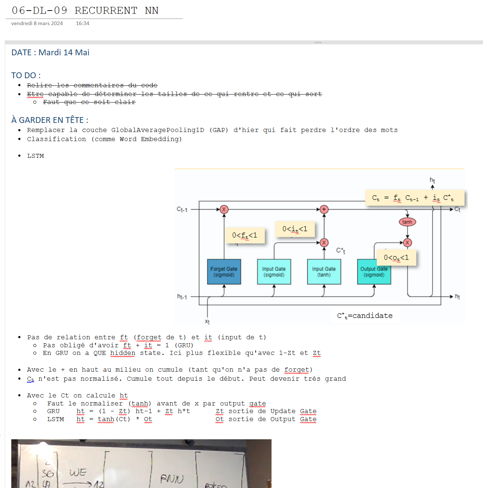
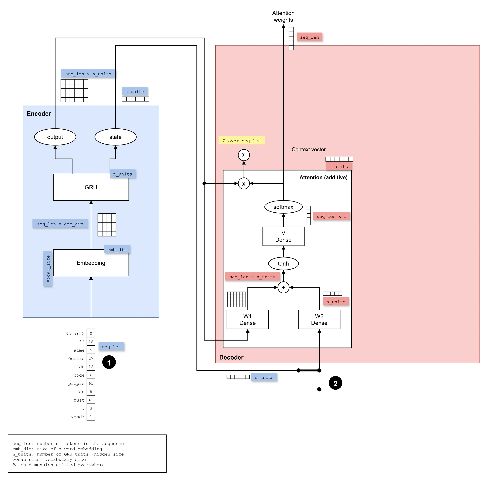
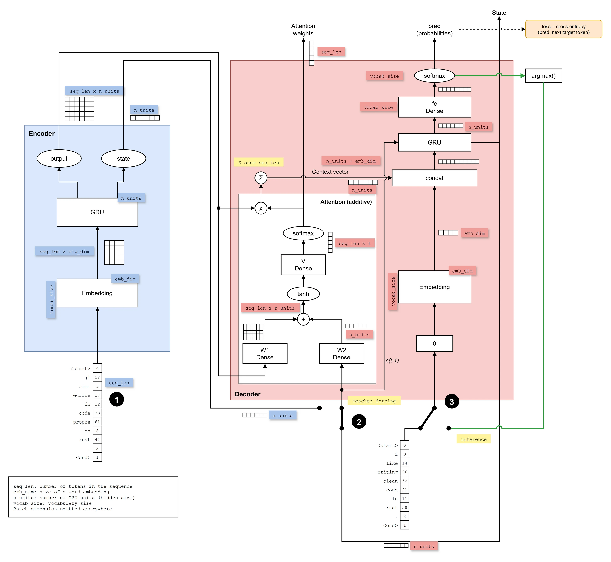
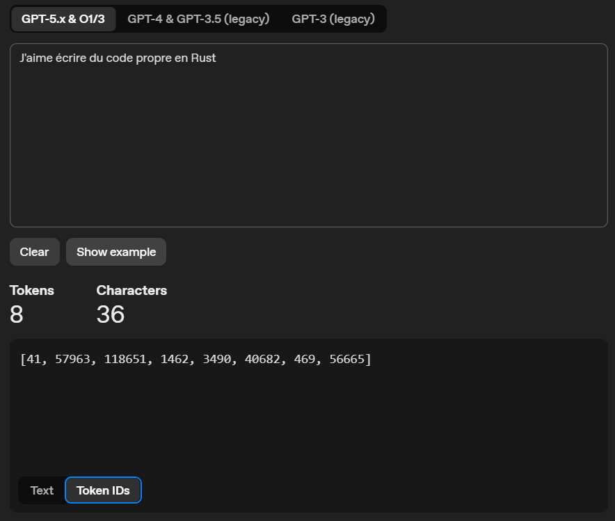
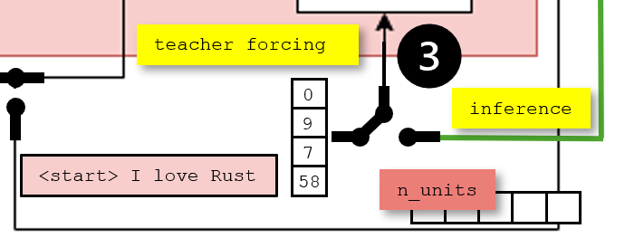
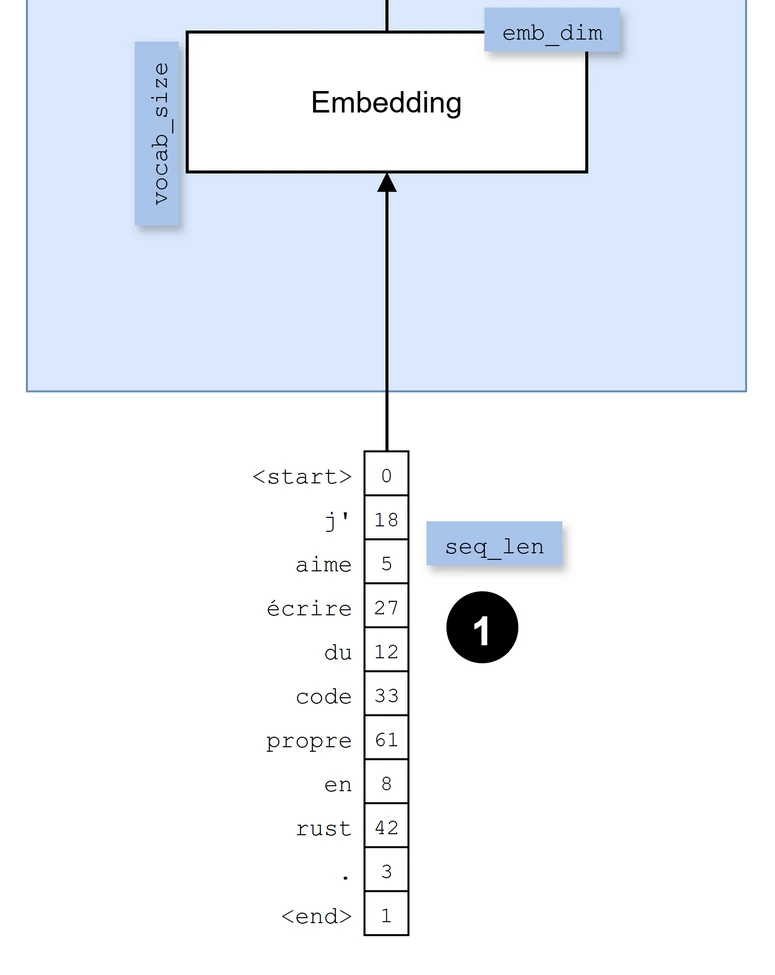
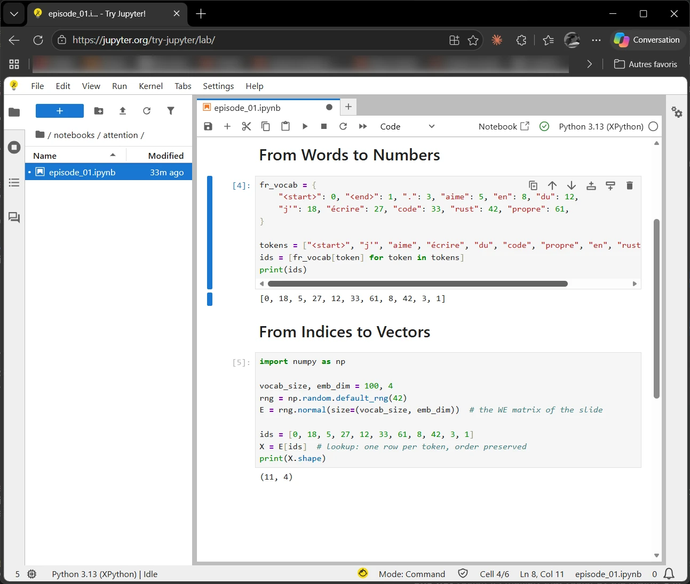
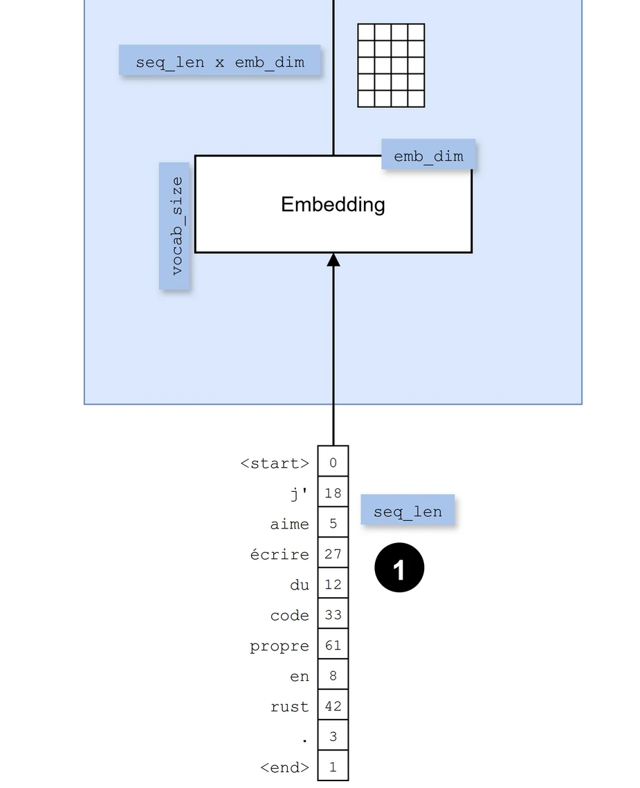
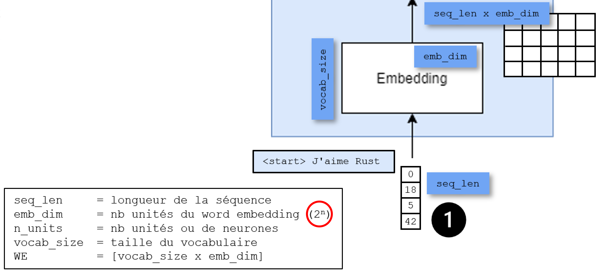
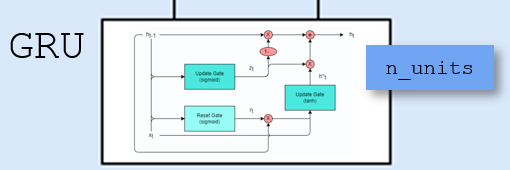

# {{ page.title }}
{: .no_toc }

{{ page.description }}
{: .lead }


<h2 align="center"><span style="color:orange"><b> 🚧 This post is under construction 🚧</b></span></h2>


### This is Episode 00
{: .no_toc }

<!-- TODO: episodes 01..03 are published: false. A  to an unpublished page breaks the Jekyll build.
Restore the links below (and in the Conclusion) when each episode is published:
[Episode 01]()
[Episode 02]()
[Episode 03]()
-->

{: .note }
> This post is a series in **4 episodes**. Alice and Bob need two evenings to rebuild a complex diagram, "one box at a time".
>
> * [Episode 00]() **(you are here)**: Day 1. Leaving class with the printed slide. Why word-by-word translation fails, from words to tokens, from tokens to vectors.
> * Episode 01 *(coming soon)*: Day 1, later that evening. Reading in order with a GRU, encoder and decoder, the bottleneck, and the idea of attention.
> * Episode 02 *(coming soon)*: Day 2. The attention layer step by step: scores, softmax, context vector, one iteration of the decoder.
> * Episode 03 *(coming soon)*: Day 2, later that evening. Training with teacher forcing, inference, what we simplified, and a peek at Transformers.


<!-- ###################################################################### -->
<!-- ###################################################################### -->
<!-- ###################################################################### -->
## TL;DR
{: .no_toc }

* Alice and Bob leave class with a slide about **attention** they don't understand. They decide to rebuild it **one box at a time**, Feynman style: simple words, "explain it differently" always allowed, back to the sources when stuck.
* **Word-by-word translation fails**: words disappear (`du`), the order changes (`code propre` -> `clean code`), the right word depends on the context (`aime` -> `like` or `love`), and the two sentences don't have the same length.
* A sentence is cut into **tokens**, and each token gets an **index** in a vocabulary. `seq_len` is the number of tokens of the sentence, `vocab_size` the number of tokens in the vocabulary (one vocabulary per language).
* Indices are names, not meanings. An **embedding** is a learned lookup table of shape `vocab_size x emb_dim`: it replaces each index with a vector of `emb_dim` numbers. Tokens used the same way end up with similar vectors.
* After the embedding, the sentence is a `seq_len x emb_dim` matrix. But each row only knows its own token. Reading the sentence **in order** is the next step.


<figure style="max-width: 900px; margin: auto; text-align: center;">

<figcaption>One slide, two students, zero idea. Yet.</figcaption>
</figure>


<!-- ###################################################################### -->
<!-- ###################################################################### -->
<!-- ###################################################################### -->
## Table of Contents
{: .no_toc .text-delta}
- TOC
{:toc}


<!-- ###################################################################### -->
<!-- ###################################################################### -->
<!-- ###################################################################### -->
## Prologue

In 2024 I went back to school. Several months of training in data science and AI, with two French professional certifications at the end of the road ([RNCP 35288](https://www.francecompetences.fr/recherche/rncp/35288/){:target="_blank"} and [RNCP 38777](https://www.francecompetences.fr/recherche/rncp/38777/){:target="_blank"}). It was fun, projects oriented and intense. Every week a new topic, every day a new notebook, and every evening the feeling that I had *almost* understood.


During the training I did what many of us do: I built a big OneNote with one page per day plus a review deck with one or more slides per topic, to keep everything in one place. One of those slides was about **attention**, the mechanism that lets a neural network translate a sentence without losing track of what it is translating. It is also the idea that, a few years later, gave birth to the Transformers and therefore to the LLMs we all use today.

<figure style="max-width: 450px; margin: auto; text-align: center;">

<figcaption>One page of my OneNote, the day we studied recurrent neural networks (here, the LSTM).</figcaption>
</figure>

<!-- On that topic, I remember the teacher saying something like: "Watch this YouTube video, it explains it better than I do." I watched it. I nodded. I drew the slide. I moved on. -->

On that topic, I remember spending quite some time designing the slide with my own explanations, and testing it on other students. There was a lot of back and forth. In the end, I had the opportunity to present it to one of our teachers, who advised me to give the same explanations again, but in a YouTube video. Well, you know how it goes... Too many things to do, no time... Priorities change, and in the end I never recorded the video.

Two years later, I opened the slide again. And… nothing. Boxes, arrows, `W1`, `W2`, `V`, `tanh`, `softmax`, a few switches, two embeddings (a blue one and a red one) and absolutely no idea of what was going on. I had forgotten everything. Worse: I was not even sure I had understood it in the first place.

So this article is my second attempt. This time I will not stop halfway. I will rebuild the slide piece by piece, asking the dumb questions out loud, until every box and every arrow makes sense. The target reader is someone like me two years ago (or today): curious, comfortable with a bit of Python, who has heard of neural networks but who gets lost as soon as the diagrams start to look like the plumbing of a submarine.

<figure style="max-width: 450px; margin: auto; text-align: center;">

<figcaption>We all live in a yellow submarine 🎶</figcaption>
</figure>

To do that, I need help. You may already know them from [Why Alice and Bob are here?](#why-alice-and-bob-are-here){:target="_blank"}: **Alice** and **Bob** are back. There is a twist, though. In the [Rust series](){:target="_blank"}, Bob was the expert. Here, neither of them is. They just came out of class with the very same slide in their hands, and they are just as lost as I was.

From now on, I'll let them speak.


<!-- ###################################################################### -->
<!-- ###################################################################### -->
<!-- ###################################################################### -->
## Prerequisites

Not much, really:

* **Python**: we will read a few lines of code, nothing fancy.
* **The idea of a neural network**: layers with weights, a loss that tells how wrong we are, and weights that get adjusted to reduce that loss. If "gradient descent" does not ring a bell, start with [Understanding Gradient Descent](){:target="_blank"}.
* **Matrix-vector product**: knowing that a matrix of shape `m x n` times a vector of length `n` gives a vector of length `m`. If you want a visual refresher, the [Essence of Linear Algebra](https://www.youtube.com/playlist?list=PLZHQObOWTQDPD3MizzM2xVFitgF8hE_ab){:target="_blank"} series by 3Blue1Brown is perfect.

Everything else (tokens, embeddings, RNN, GRU, softmax...) will be explained along the way, or linked when a good explanation already exists somewhere else.


<!-- ###################################################################### -->
<!-- ###################################################################### -->
<!-- ###################################################################### -->
## Scene 1: Leaving the Classroom

*Day 1, late afternoon. The class is over. Alice and Bob are standing in the hallway, each one staring at the same printed slide.*

<figure style="max-width: 900px; margin: auto; text-align: center;">

<figcaption>The diagram we will rebuild, one box at a time. Click on it to zoom in.</figcaption>
</figure>

**Bob:** So... Did you get it?

**Alice:** Get what? The slide? I got that there is a blue part and a red part. And that the teacher went through it very fast. She said a student from a previous class made it.

**Bob:** Same. At some point she said "and then softmax highlights the interesting word" and everybody nodded. I nodded too. I have no idea why I nodded.

**Alice:** Look at this thing. `W1`, `W2`, `V`, a `+`, a `tanh`, a `softmax`, a multiplication, a sum... And these little switches, numbered 2 and 3. What are they doing in a neural network? It looks like an electrical diagram.

**Bob:** She said to sleep on it tonight and to look for videos on YouTube tomorrow morning.

**Alice:** Yeah, and we'll nod again. I don't want to nod. I want to be able to explain it. To someone. Without the slide.

**Bob:** Okay, honest question: if the exam was tomorrow and the question was "explain attention in five sentences", what would you write?

**Alice:** *(thinks)* "Attention is... a mechanism... that pays attention." There. Full marks.

**Bob:** Circular definition, zero marks. Mine would be "it's the thing that made ChatGPT possible". Also zero marks, but at least it sounds cool.

**Alice:** We're doomed.

**Bob:** No, wait. You know the Feynman thing? My cousin told me about it. The idea is: you don't really understand something until you can explain it with simple words. If you can't, it means there's a hole somewhere, and you go back to the sources to fill it.

**Alice:** The [Feynman technique](https://fs.blog/feynman-technique/){:target="_blank"}. I've heard of it. But it's supposed to work with someone who understands, no? Neither of us understands anything.

**Bob:** That's the point. Two people who don't understand, it's perfect: nobody can bluff. If one of us says something that sounds smart but isn't clear, the other one is allowed to say "explain it differently".

**Alice:** Okay. Let's write down the rules then, otherwise we'll cheat.

*Alice turns the slide over and writes on the back:*

1. **Explain with simple words.** No word we can't explain ourselves.
2. **"Explain it differently"** is always allowed. Jargon is a red flag, not a proof of intelligence.
3. **When we're stuck, we go back to the sources** (articles, docs, videos), then we try again.

**Bob:** I'd add a fourth one: **4. one box at a time**. We should rebuild the slide piece by piece. Not the whole thing at once, and we only move on when we can redraw the box ourselves.

**Alice:** Deal. And I'll keep asking "*what size is that thing?*" every time a matrix shows up. Half of my confusion comes from not knowing what goes through the arrows.

**Bob:** And I'll keep asking "*what would that look like in code?*". Between the two of us, we might end up with something.

**Alice:** When?

**Bob:** Now I need food. Library, 6 pm? We start from the beginning: what problem is this whole thing trying to solve?

**Alice:** 6 pm. Bring the slide. And snacks.


<!-- ###################################################################### -->
<!-- ###################################################################### -->
<!-- ###################################################################### -->
## The Problem: Translating a Sentence

*6 pm, the library. A table in the back, the slide in the middle, a bag of cookies next to it.*

**Bob:** Okay. Rule number 4: one box at a time. But before the boxes, what is this machine supposed to do?

**Alice:** Translate. French in, English out. Look, it's written at the bottom: `<start> J'aime Rust` on the blue side, `<start> I love Rust` on the red side.

**Bob:** "J'aime Rust". *(grins)* That student had good taste.

**Alice:** Sure, but that example is way too easy. Three words in, three words out, same order. `j'` gives `i`, `aime` gives `love`, `rust` gives `rust`. A dictionary would do it.

**Bob:** Wait, I remember something she said. Right before the slide. Something like "in real life, the word order changes, and the translation can be longer or shorter than the original".

**Alice:** I remember that too. And with "J'aime Rust", none of that happens.

**Bob:** Exactly. If we work on that example, we'll fall into the word-by-word trap and we'll never see why we need all these boxes. Let's pick a sentence where the order changes and where a word disappears. *(writes)*

> J'aime écrire du code propre en Rust.

**Alice:** Of course you'd keep Rust.

**Bob:** I keep the beginning of the slide, I just add stuff. In English, it gives:

> I like writing clean code in Rust.

**Alice:** "Like"? The slide says "love".

**Bob:** "J'aime Rust" is a declaration of love. "J'aime écrire du code propre" is... a preference. Trust me.

**Alice:** Hmm. Keep that in mind, we'll come back to it. Now, what's hard about your sentence? Because honestly, it still looks easy. Each French word has its English word, we swap them, done.

**Bob:** Let's try. That's exactly the kind of thing I can code in two minutes. A dictionary and we replace word by word.

```python
fr_to_en = {
    "j'": "i", "aime": "like", "écrire": "write", "du": "some",
    "code": "code", "propre": "clean", "en": "in", "rust": "rust", ".": ".",
}

sentence = "j' aime écrire du code propre en rust ."
print(" ".join(fr_to_en[word] for word in sentence.split()))
```

```text
i like write some code clean in rust .
```

{: .note }
> Check by yourself.
>
> Go to [jupyter.org](https://jupyter.org/){:target="_blank"}, click `Try` then `JupyterLab`. In the Notebook, copy'n paste the code above. Press `CTRL+ENTER` (run the cell) or `SHIFT+ENTER` (run the cell and move to the next one).
>


<figure style="max-width: 900px; margin: auto; text-align: center;">

<figcaption>Bob's word-by-word translator in JupyterLab, straight from the browser. Nothing to install, and the same wrong translation.</figcaption>
</figure>

**Alice:** *(laughs)* "I like write some code clean in Rust." Sounds like my English in sixth grade.

**Bob:** Okay, okay. But it's interesting, it's wrong in several different ways. Let's list them.

**Alice:** First, "écrire" became "write", but in English we need "writing". The right word depends on the word *before*: after "I like", it's "writing", not "write".

**Bob:** Second, "du". In French we need it, in English it just... vanishes. My dictionary translated it as "some" because it has to put something.

**Alice:** Third, "code propre" gives "clean code". The two words are **swapped**. Adjective after the noun in French, before the noun in English.

**Bob:** And there, a word-by-word approach is stuck by design. When it's time to write "clean", the word it needs ("propre") comes *after* "code" in the French sentence. You have to look ahead.

**Alice:** Wait, let me write it down. I want to see which word goes where.

| French | English | What happens |
|---|---|---|
| `j' aime` | `i like` | fine, one for one |
| `écrire` | `writing` | form depends on the context |
| `du` | (nothing) | disappears |
| `code propre` | `clean code` | order swapped |
| `en` | `in` | looks literal, but only by luck |
| `rust` | `rust` | simply copied |
| `.` | `.` | copied |

**Bob:** Why "by luck" for `en`?

**Alice:** Because "en" can be anything. "En France" is "in France", "en voiture" is "by car", "en mangeant" is "while eating", "j'en veux" is "I want some". Here it happens to be "in", but your dictionary got it right by accident.

**Bob:** Okay, that one hurts. And that's exactly what you said about "aime": "j'aime Rust" on the slide gives "I love Rust", "j'aime écrire du code" gives "I like writing code". Same word, two translations, and the choice depends on the rest of the sentence.

**Alice:** And there's the length. Let me count. On the French side: `j'`, `aime`, `écrire`, `du`, `code`, `propre`, `en`, `rust`, `.`... that's 9. On the English side: `i`, `like`, `writing`, `clean`, `code`, `in`, `rust`, `.`... 8.

**Bob:** So the output doesn't even have the same length as the input. My `for word in sentence.split()` produces exactly one English word per French word. It can't work, whatever the dictionary.

**Alice:** Okay, let me try a Feynman summary. Rule 1, simple words. *(slowly)* To translate a sentence, you can't go word by word, because:
1. some words disappear, others appear;
2. the order changes;
3. the right translation of a word depends on the other words of the sentence;
4. so the two sentences don't have the same length.

**Bob:** I agree with all four. Now, what does that mean for the machine?

**Alice:** That it has to **read the whole French sentence first**. Otherwise it can't know that "propre" is coming, or that "en" means "in" here.

**Bob:** And then **write the English sentence one word at a time**, with its own length. It stops when it decides the sentence is finished, not when the French sentence is finished.

**Alice:** Read everything, then write word by word. That's... two different jobs.

**Bob:** *(points at the slide)* Two jobs. Blue part, red part. You think that's it?

**Alice:** Maybe. Don't get excited, we've understood one sentence of the slide, not the slide.

**Bob:** One sentence out of fifty, that's a start. But there's an obvious problem before the blue box even starts: a neural network doesn't read words. It reads numbers. How do we get from "j'aime écrire du code propre" to numbers?

**Alice:** The little column under the blue box. `0`, `18`, `5`, `42`. Four numbers, and `<start> J'aime Rust` is four pieces. I bet that's the sentence.

**Bob:** Let's find out. *(grabs a cookie)*


<!-- ###################################################################### -->
<!-- ###################################################################### -->
<!-- ###################################################################### -->
## From Words to Numbers

**Alice:** So: `<start>` is `0`, `j'` is `18`, `aime` is `5`, `rust` is `42`. Each word gets a number.

**Bob:** Like a locker number. The word `aime` lives in locker `5`, the word `rust` in locker `42`.

**Alice:** Who decides the numbers?

**Bob:** We do. We make a list of all the words we know (that's the **vocabulary**) and we number them. First word in the list, index `0`. Second word, index `1`. And so on. For our sentence, I keep the slide's numbers for `<start>`, `j'`, `aime` and `rust`, and I invent the others. In Python it's just a dictionary:

```python
fr_vocab = {
    "<start>": 0, "<end>": 1, ".": 3, "aime": 5, "en": 8, "du": 12,
    "j'": 18, "écrire": 27, "code": 33, "rust": 42, "propre": 61,
}

tokens = ["<start>", "j'", "aime", "écrire", "du", "code", "propre", "en", "rust", ".", "<end>"]
ids = [fr_vocab[token] for token in tokens]
print(ids)
```

```text
[0, 18, 5, 27, 12, 33, 61, 8, 42, 3, 1]
```

**Alice:** Hold on, the list has holes. Where are `2`, `4`, `6`, `7`...?

**Bob:** Other words of the vocabulary. In real life the vocabulary is built from a big pile of texts, it has thousands of entries: "chat", "maison", "mangeant", all of them. I only kept the ones of our sentence. The numbers on the slide are invented anyway, it doesn't matter.

**Alice:** Okay. And why do you write `tokens` and not `words`? You did it on purpose.

**Bob:** I did. Because look at what we cut: `j'` is separated from `aime`, the `.` is a piece on its own, and there are two weird pieces, `<start>` and `<end>`, that aren't words at all. So we don't say "words", we say **tokens**: the pieces we decided to cut the sentence into.

**Alice:** "We decided"? It's not obvious how to cut a sentence?

**Bob:** Not at all, it's a choice. We could cut letter by letter: tiny vocabulary (the alphabet plus a few symbols), but very long sequences. We could cut word by word, like here: short sequences, but a huge vocabulary, and every new word is unknown. And the real models cut *in between*, into pieces of words. Something like "unbelievable" becomes `un` + `believ` + `able`.

**Alice:** Why would that be better?

**Bob:** Because with a few tens of thousands of pieces you can rebuild almost any word, even ones you've never seen. If you want to play with it, the [OpenAI tokenizer](https://platform.openai.com/tokenizer){:target="_blank"} shows how a real model cuts your text, and the [Hugging Face course](https://huggingface.co/learn/llm-course/chapter2/4){:target="_blank"} explains the different strategies.


<figure style="max-width: 900px; margin: auto; text-align: center;">

<figcaption>Our sentence in the OpenAI tokenizer: 8 tokens, and much bigger lockers than ours (the vocabulary has about 200,000 entries).</figcaption>
</figure>

**Alice:** Okay. So for us, today: lowercase everything, so that "Rust" and "rust" are the same token, split `j'` off, punctuation is a token. Good enough.

**Bob:** Good enough. And what about `<start>` and `<end>`?

**Alice:** Wait, there's no `<end>` on the slide. Just `<start> J'aime Rust`. You added it.

**Bob:** I did. We said earlier that the machine has to decide when to stop writing. If `<end>` is a token like the others, it can just... produce it. "I'm done." Without it, how would it know?

**Alice:** Fair. Maybe the student skipped it to keep the slide readable. It was already crowded enough. And `<start>`?

**Bob:** To give the red part something to begin with, I suppose. We'll see when we get there. On the French side, they mostly frame the sentence.

**Alice:** Wait, the red part. If it writes English, it needs English tokens. Same dictionary?

**Bob:** No, a second one. One vocabulary for French, one for English. Look at the red side of the slide: `0`, `9`, `7`, `58` for `<start> I love Rust`. So `i` is in locker `9`, `love` in `7`, `rust` in `58`. For our sentence I'll put `like` in `14`, and so on. And here's the trap: `rust` is `42` in French but `58` in English. And `5` in the English vocabulary could be anything. Same number, different lockers in a different building.


<figure style="max-width: 900px; margin: auto; text-align: center;">

<figcaption>Zoom on the red side of the slide: the English sentence and its own indices (0, 9, 7, 58).</figcaption>
</figure>

**Alice:** Okay. Now my question. *(taps the slide)* What size is that thing?

**Bob:** Which thing?

**Alice:** The column. What goes into the blue box.

**Bob:** A list of integers. One per token. On the slide, 4. With our sentence, 11, `<start>` and `<end>` included.

**Alice:** So I'll call that **`seq_len`**, the number of tokens in the sequence. Slide: `seq_len = 4`. Us: `seq_len = 11`. So it changes with every sentence. A longer sentence, a bigger `seq_len`.

**Bob:** Yes. *(checks the slide)* Look, there's a blue label `seq_len` right next to the column. And the other label, on the side of the first box: `vocab_size`.

**Alice:** Wait. Whoever made this slide left us notes everywhere. Sizes on every arrow, names on every box. It's like Harry's old potions book in *Harry Potter and the Half-Blood Prince*: a second-hand book, full of notes in the margins written by a mysterious former student.

**Bob:** And those notes made Harry the best in the class. I'll take it. From now on, every time we're stuck, we look for the Prince's notes first.

<figure style="max-width: 900px; margin: auto; text-align: center;">

<figcaption>A second-hand book, full of notes from its previous owner. Sounds familiar?</figcaption>
</figure>


*Alice redraws the bottom of the blue part on a sheet of paper, with their sentence instead of "J'aime Rust".*

<figure style="max-width: 450px; margin: auto; text-align: center;">

<figcaption>Zoom on the bottom of the blue part, with our sentence: 11 token indices (seq_len) go into the Embedding (vocab_size, emb_dim).</figcaption>
</figure>

**Alice:** The number of lockers. The number of tokens in the vocabulary. That one doesn't change from one sentence to the next, it's fixed once the vocabulary is built.

**Bob:** And there's one per language. A `vocab_size` for French, another one for English.

**Alice:** Let me write it down, I don't want to lose them.

| Name | What it is | In our example |
|---|---|---|
| `seq_len` | number of tokens in the sentence | 11 (French side) |
| `vocab_size` | number of tokens in the vocabulary | thousands, one per language |

**Bob:** Feynman check. Explain the column to me as if I were your little brother.

**Alice:** We cut the sentence into pieces called tokens. Each token has a number, its position in a big list of known tokens. So the sentence becomes a list of numbers. Done.

**Bob:** Perfect. Now, something bothers me.

**Alice:** Only one thing?

**Bob:** `code` is `33` and `rust` is `42`. Does that mean `rust` is "bigger" than `code`? Or that `propre`, at `61`, is closer to `rust` than to `code`? And in English, `rust` is `58`. Same word, different number.

**Alice:** *(thinks)* No. The numbers are just names. Locker `42` is not "more" than locker `33`. If we had numbered the vocabulary in a different order, we'd get other numbers and it would be the same sentence.

**Bob:** So these numbers say nothing about the words. Nothing about the meaning. And yet the network will have to compute with them.

**Alice:** Which means we need other numbers. Numbers that *mean* something.

**Bob:** *(points at the slide)* Next box: `Embedding`.


<!-- ###################################################################### -->
<!-- ###################################################################### -->
<!-- ###################################################################### -->
## From Indices to Vectors

**Alice:** Okay, `Embedding`. There's a label `emb_dim` on the box, and `vocab_size` on its side. And at the bottom left, in the legend: `WE = [vocab_size x emb_dim]`.

**Bob:** `WE`, Word Embedding. So it's a matrix. `vocab_size` rows, `emb_dim` columns.

**Alice:** One row per token of the vocabulary, then. Row `0` for `<start>`, row `18` for `j'`, row `33` for `code`...

**Bob:** And each row is a list of `emb_dim` numbers. That's the trick, I think: instead of describing `code` with a single locker number, we describe it with a whole row of numbers.

**Alice:** And what does the box *do* with that matrix?

**Bob:** Nothing fancy. It's a **lookup**. You give it `33`, it gives you back row number `33`. You give it the 11 indices of our sentence, it gives you back 11 rows. Look:

```python
import numpy as np

vocab_size, emb_dim = 100, 4
rng = np.random.default_rng(42)
E = rng.normal(size=(vocab_size, emb_dim))  # the WE matrix of the slide

ids = [0, 18, 5, 27, 12, 33, 61, 8, 42, 3, 1]
X = E[ids]  # lookup: one row per token, order preserved
print(X.shape)
```

```text
(11, 4)
```

<figure style="max-width: 900px; margin: auto; text-align: center;">

<figcaption>Bob's third Python script, right after the vocabulary: the embedding turns the 11 indices into an (11, 4) matrix, that is seq_len x emb_dim.</figcaption>
</figure>

**Alice:** `(11, 4)`. So `seq_len x emb_dim`. *(checks the slide)* Yes! It's written right above the box: `seq_len x emb_dim`, with the little grid. We still have 11 tokens, in the same order, but each one is now a row of `emb_dim` numbers instead of one integer.

**Bob:** Told you, rule 4 works. One box at a time.

<figure style="max-width: 900px; margin: auto; text-align: center;">

<figcaption>Still seq_len tokens, in the same order, but each one is now a row of emb_dim numbers.</figcaption>
</figure>

**Alice:** Don't celebrate yet. Something bugs me. You say “lookup”, but this is a neural network. Networks multiply matrices, they don't look things up in tables.

**Bob:** Explain it differently?

**Alice:** *(grabs a pen)* Imagine I write the index `33` as a vector of length `vocab_size` full of zeros, with a single `1` at position `33`. A **one-hot** vector. If I multiply that vector by the matrix `E`...

**Bob:** ...all the rows get multiplied by zero, except row `33`. So you get row `33`.

**Alice:** Yes. In math:

$$
\underbrace{\text{onehot}(33)^\top}_{1 \times vocab\_size} \; \underbrace{E}_{vocab\_size \times emb\_dim} = \underbrace{E_{33}}_{1 \times emb\_dim}
$$

So the lookup *is* a matrix product. A very lazy one. And the sizes match: `vocab_size` cancels out, `emb_dim` remains.

**Bob:** And nobody computes it that way, because multiplying thousands of zeros is a waste of time. The lookup gives the same result, faster. In PyTorch it's `nn.Embedding(vocab_size, emb_dim)`, and that's what it does inside.

**Alice:** Fine. Now the real question. In your code, `E` is random. `rng.normal()`. Where do the "good" numbers come from? Who decides that row `33` describes `code`?

**Bob:** Nobody. That's the beautiful part. At the beginning, the matrix is random. Then, during training, its values are adjusted like any other weight of the network. Gradient descent, the loss, all that. If moving row `33` a little bit makes the translation better, it moves.

**Alice:** So the embedding is **learned**. It's not a dictionary somebody wrote. It's a table of weights that ends up being useful for the task.

**Bob:** Exactly. And here's what I find crazy: since the network sees `code` and `programme` in similar sentences, their rows tend to end up close to each other. Same for `aime` and `adore`. Nobody asked for it. It's just the most convenient way for the network to do its job.

**Alice:** "Close"? Rows aren't places.

**Bob:** They are, kind of. A row of `emb_dim` numbers is a point in a space with `emb_dim` dimensions. With `emb_dim = 2`, you could draw each word as a dot on a sheet of paper, and similar words would form little clusters. With `emb_dim = 256`, you can't draw it, but the idea is the same.

**Alice:** Hmm. I'd like to see that before I believe it.

**Bob:** Rule 3. *(types on his phone)* [The Illustrated Word2vec](https://jalammar.github.io/illustrated-word2vec/){:target="_blank"} by Jay Alammar. It's about a slightly different way to learn embeddings, but the pictures show exactly this: words as vectors, and similar words being close.

*(Five minutes of silence. Cookies disappear.)*

**Alice:** Okay, I'm convinced. The "king minus man plus woman gives queen" thing is fun. And it answers your question from before: with locker numbers, `42` is not "more" than `33`. With vectors, being close actually means something.

**Bob:** And what does the $$2^n$$ mean in the legend, next to `emb_dim`?

<figure style="max-width: 900px; margin: auto; text-align: center;">

<figcaption>The legend of the original slide (in French), and the mysterious (2^n) next to emb_dim.</figcaption>
</figure>

**Alice:** I'd say it's just a habit: people pick powers of 2, like 64, 128, 256. Processors like to manipulate blocks of memory whose size is a power of 2. Remember, computer hardware operates entirely in binary (base-2), making powers of 2 the most natural, fast, and cost-effective way to address and route data. Nothing magic.

**Bob:** Last thing. There are two `Embedding` boxes on the slide. A blue one in the encoder, a red one in the decoder.

**Alice:** Two vocabularies, two matrices. The blue one has French rows, the red one has English rows. `rust` is row `42` in the blue one and row `58` in the red one, and the two rows have nothing to do with each other.

**Bob:** Feynman check, my turn. The embedding turns each token number into a row of numbers, by picking a row in a big table. The table starts random and is learned during training. At the end, tokens that are used the same way have similar rows. In: `seq_len` integers. Out: a `seq_len x emb_dim` matrix.

**Alice:** Approved. Let me update the table.

| Name | What it is | In our example |
|---|---|---|
| `seq_len` | number of tokens in the sentence | 11 (French side) |
| `vocab_size` | number of tokens in the vocabulary | thousands, one per language |
| `emb_dim` | number of values describing one token | 4 in the toy code, often 256 or more |

**Bob:** So now we have 11 nice vectors. Are we done with the blue part?

**Alice:** No. Look at them. Each row only knows about its own token. Row `61` is `propre`, and it has no idea that it comes right after `code`. It's exactly the same row in "code propre" as in "une chambre propre".

**Bob:** So we still need something that reads the rows **in order**, and remembers what it has read. *(points at the slide)* The `GRU`.

**Alice:** The box with the tiny unreadable drawing inside. Great.


<figure style="max-width: 900px; margin: auto; text-align: center;">

<figcaption>Zoom on the GRU box of the slide. Unreadable, as promised. That's for Episode 01.</figcaption>
</figure>


<!-- ###################################################################### -->
<!-- ###################################################################### -->
<!-- ###################################################################### -->
## Conclusion

Let's step out of the library for a minute.

In this first episode, Alice and Bob have not touched the attention mechanism yet. But they now know what problem the slide is trying to solve: a translation is not a word-by-word substitution. And they know how a sentence enters the network: cut into tokens, turned into indices, then into vectors by a learned embedding.

What they have at the end of the episode is a `seq_len x emb_dim` matrix where each row describes one token, but knows nothing about its neighbors. In Episode 01 (coming soon), same evening, same table, they will read that matrix in order with a GRU, build an encoder and a decoder, hit the bottleneck, and finally understand why attention was invented.


<!-- ###################################################################### -->
<!-- ###################################################################### -->
<!-- ###################################################################### -->
## Webliography

* [The Feynman Technique](https://fs.blog/feynman-technique/){:target="_blank"}, Farnam Street.
* [Tokenizers](https://huggingface.co/learn/llm-course/chapter2/4){:target="_blank"}, Hugging Face LLM course, and the [OpenAI tokenizer](https://platform.openai.com/tokenizer){:target="_blank"} to play with.
* Jay Alammar, [The Illustrated Word2vec](https://jalammar.github.io/illustrated-word2vec/){:target="_blank"}.
* 3Blue1Brown, [Essence of Linear Algebra](https://www.youtube.com/playlist?list=PLZHQObOWTQDPD3MizzM2xVFitgF8hE_ab){:target="_blank"}.
* [Understanding Gradient Descent](), on this site.
* [Rust Error Handling, Demystified - 00](), where Alice and Bob first appeared.
* Vaswani et al. (2017), [Attention Is All You Need](https://arxiv.org/abs/1706.03762){:target="_blank"}.


<figure style="max-width: 560px; margin: auto;">
<div style="position: relative; padding-bottom: 56.25%; height: 0;">
    <iframe
    src="https://www.youtube.com/embed/eMlx5fFNoYc?start=0"
    title="Attention in transformers, step-by-step | Deep Learning Chapter 6 - 3Blue1Brown"
    style="position: absolute; inset: 0; width: 100%; height: 100%;"
    allowfullscreen>
    </iframe>
</div>
<figcaption style="text-align: center;">
    Attention in transformers, step-by-step | Deep Learning Chapter 6 - 3Blue1Brown
</figcaption>
</figure>


