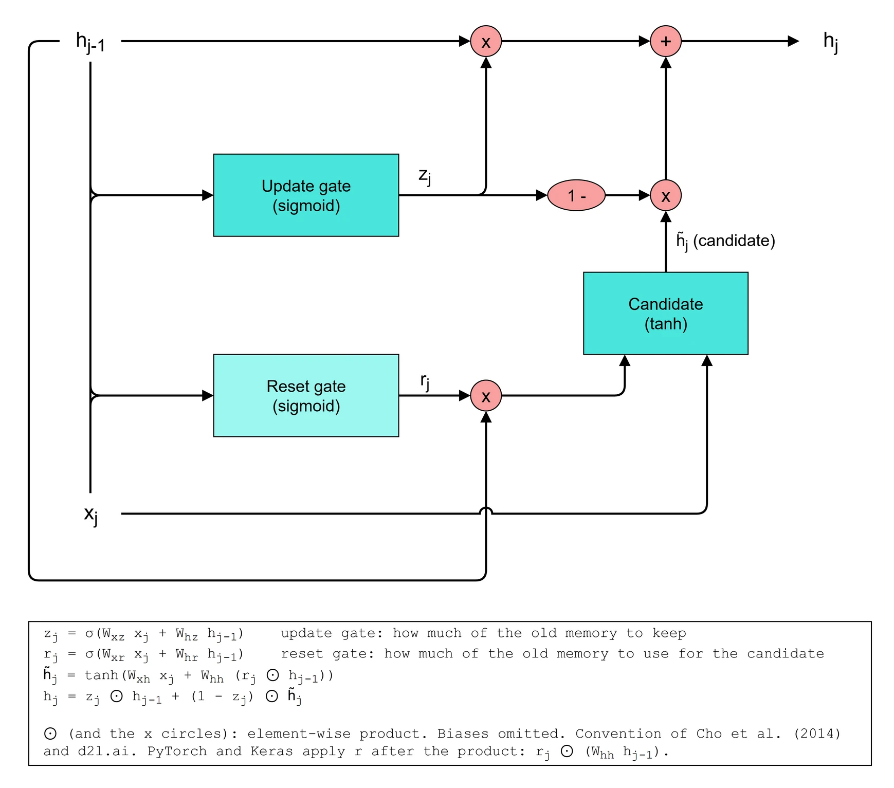
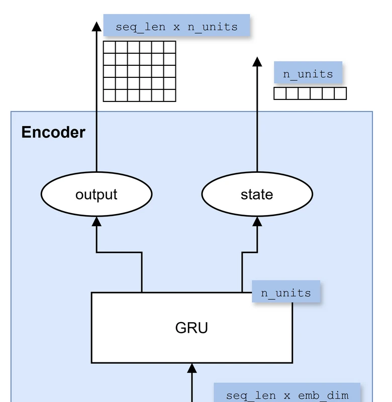
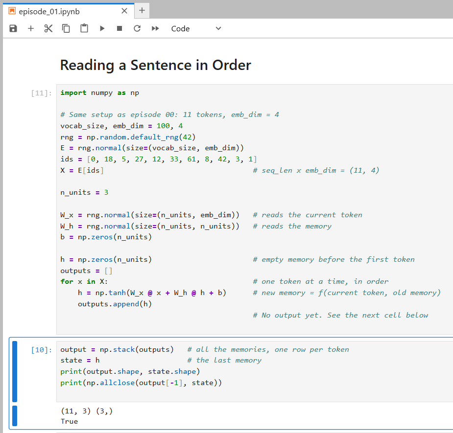
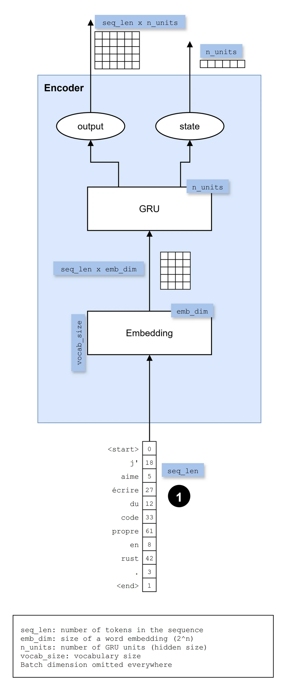
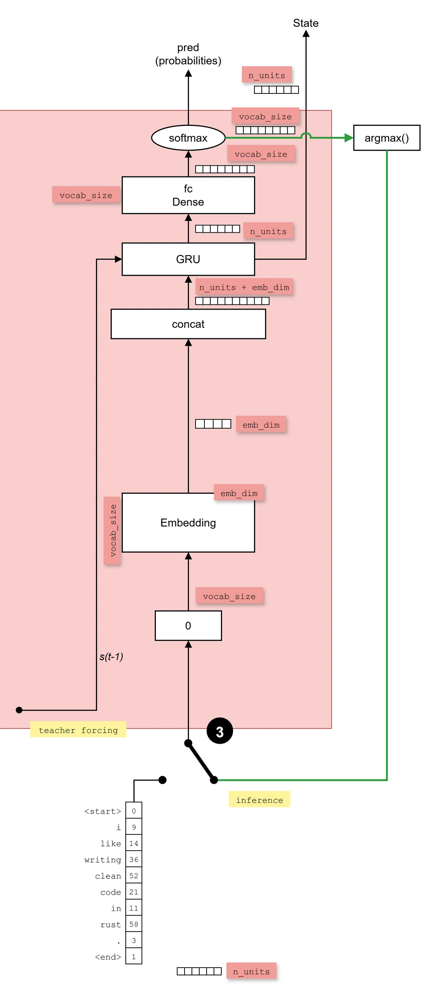
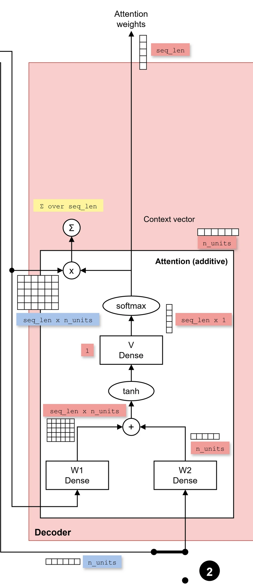

# {{ page.title }}
{: .no_toc }

{{ page.description }}
{: .lead }


<h2 align="center"><span style="color:orange"><b> 🚧 This post is under construction 🚧</b></span></h2>


### This is Episode 01
{: .no_toc }


<!-- TODO: episodes 02..03 are published: false. A  to an unpublished page breaks the Jekyll build.
Restore the links below (and in the Conclusion) when each episode is published:
[Episode 00]()
[Episode 01]()
[Episode 02]()
[Episode 03]()
-->

{: .note }
> This post is a series in **4 episodes**. Alice and Bob need two evenings to rebuild the slide, one box at a time.
>
> * [Episode 00](): Day 1. Leaving class with the slide. Why word-by-word translation fails, from words to tokens, from tokens to vectors.
> * [Episode 01]() **(you are here)**: Day 1, later that evening. Reading in order with a GRU, encoder and decoder, the bottleneck, and the idea of attention.
> * Episode 02 *(coming soon)*: Day 2. The attention layer step by step: scores, softmax, context vector, one iteration of the decoder.
> * Episode 03 *(coming soon)*: Day 2, later that evening. Training with teacher forcing, inference, what we simplified, and a peek at Transformers.


<!-- ###################################################################### -->
<!-- ###################################################################### -->
<!-- ###################################################################### -->
## TL;DR
{: .no_toc }

* A **GRU** reads the embedded sentence one token at a time and keeps a memory (the hidden state) of `n_units` numbers. It returns `output`, all the memories (`seq_len x n_units`), and `state`, the last one (`n_units`), which is also the last row of `output`.
* **seq2seq** (2014): an **encoder** reads the source sentence, a **decoder** writes the translation one token at a time, starting from `state` and stopping on `<end>`. Lengths and word order are free.
* The **bottleneck**: the whole sentence has to fit in `state`, a fixed-size vector. Like translating a novel from a post-it. Quality drops on long sentences.
* The idea of **attention**: keep `output`, the whole encoded sentence, and at every step build a new post-it, the **context vector**, as a weighted mix of its rows. Big weights on the rows that matter for the next word.
* Still open: how the decoder computes these weights. That's the left half of the red box, and that's for Episode 02.


<figure style="max-width: 900px; margin: auto; text-align: center;">

<figcaption>TODO: Add a legend</figcaption>
</figure>


<!-- ###################################################################### -->
<!-- ###################################################################### -->
<!-- ###################################################################### -->
## Table of Contents
{: .no_toc .text-delta}
- TOC
{:toc}


<!-- ###################################################################### -->
<!-- ###################################################################### -->
<!-- ###################################################################### -->
## Previously

In [Episode 00](), Alice and Bob left class with the slide below and realized they had understood nothing. They met at the library at 6 pm and decided to rebuild it one box at a time, with the Feynman rules: simple words, "explain it differently" always allowed, back to the sources when stuck.

They chose a sentence harder than the one on the slide, "J'aime écrire du code propre en Rust." -> "I like writing clean code in Rust.", to avoid the word-by-word trap. They cut it into 11 tokens, turned the tokens into indices, then the indices into vectors with a learned embedding. They now have a `seq_len x emb_dim` matrix where each row describes one token, but knows nothing about its neighbors.

<figure style="max-width: 900px; margin: auto; text-align: center;">

<figcaption>The slide, still on the table.</figcaption>
</figure>


<!-- ###################################################################### -->
<!-- ###################################################################### -->
<!-- ###################################################################### -->
## Prerequisites

* [Episode 00](): tokens, `seq_len`, `vocab_size`, embeddings, `emb_dim`.
* The same as for Episode 00: a bit of Python, the idea of a neural network trained by [gradient descent](), and the matrix-vector product.

*Same evening, same table. The bag of cookies is half empty.*

<!-- ###################################################################### -->
<!-- ###################################################################### -->
<!-- ###################################################################### -->
## Reading a Sentence in Order

**Bob:** GRU. Gated Recurrent Unit. Three words, let's take them one by one. Backwards. "Unit", it's a block of the network. "Recurrent"...

**Alice:** Recurrent means it comes back. It loops.

**Bob:** Loops on what?

**Alice:** On the sentence, I guess. It takes the rows one at a time, in order. `<start>`, then `j'`, then `aime`... And each time, it keeps something from the previous step.

**Bob:** Okay, let me try an analogy. You're reading a novel. You don't remember every word you've read, but you have a kind of running summary in your head: who's who, where we are, what just happened. Each new sentence updates that summary a little. When you reach the last page, the summary is what's left of the whole book.

**Alice:** And that summary is...

**Bob:** The **hidden state**. The memory of the network. It's a vector, and it gets updated at every token: new memory = something computed from the current token and the old memory.

**Alice:** "Something computed". Rule 1, Bob.

**Bob:** Fine. In code, it's a loop. I'll do the simplest version first, a plain RNN, not a GRU:

```python
import numpy as np

# Same setup as episode 00: 11 tokens, emb_dim = 4
vocab_size, emb_dim = 100, 4
rng = np.random.default_rng(42)
E = rng.normal(size=(vocab_size, emb_dim))
ids = [0, 18, 5, 27, 12, 33, 61, 8, 42, 3, 1]
X = E[ids]                                  # seq_len x emb_dim = (11, 4)

n_units = 3

W_x = rng.normal(size=(n_units, emb_dim))   # reads the current token
W_h = rng.normal(size=(n_units, n_units))   # reads the memory
b = np.zeros(n_units)

h = np.zeros(n_units)                       # empty memory before the first token
outputs = []
for x in X:                                 # one token at a time, in order
    h = np.tanh(W_x @ x + W_h @ h + b)      # new memory = f(current token, old memory)
    outputs.append(h)
                                            # No output yet. See the next cell below
```

**Alice:** Wait, let me check the sizes, it's the only way I'll trust this. `x` is one row of `X`, so `emb_dim`. `W_x` is `n_units x emb_dim`, so `W_x @ x` is a vector of `n_units`. Matrix times vector, that's the prerequisite. `h` is `n_units`, `W_h` is `n_units x n_units`, so `W_h @ h` is also `n_units`. I add the two, I squash with `tanh` between -1 and +1, and I get the new `h`, still `n_units`.

$$
h_j = \tanh(W_x\, x_j + W_h\, h_{j-1} + b)
$$

**Bob:** And $$j$$ is the position in the sentence. $$h_1$$ after `<start>`, $$h_2$$ after `j'`... $$h_{11}$$ after `<end>`.

**Alice:** So `n_units` is the size of the memory. That's the label on the GRU box on the slide: `n_units`.

**Bob:** Yes. Bigger `n_units`, bigger memory. 3 in my toy code, a few hundred in real life.

**Alice:** One thing surprises me. There's only one `W_x` and one `W_h`. They're the same at every step?

**Bob:** Same weights for every token. It's one single cell that we reuse 11 times. That's why it works for any `seq_len`: a sentence of 4 tokens, the loop turns 4 times, a sentence of 11, it turns 11 times. The number of weights doesn't change.

**Alice:** Okay, that's elegant. So why a GRU and not this?

**Bob:** Because this simple version has a bad memory. On long sentences, the beginning fades away. Each step mixes the old `h` with the new token, again and again, and after twenty steps the first words are almost gone. And during training it's even worse: the gradient has to travel back through all the steps, and it gets smaller and smaller on the way. The network can barely learn to remember things from far away.

**Alice:** And the GRU fixes that how?

**Bob:** With **gates**. Small switches, computed from the data, that decide at each step how much of the old memory to keep and how much to replace with the new token. That's the "Gated" in GRU. Sometimes it can just say "nothing interesting here, keep the memory as it is".

**Alice:** And that's the tiny drawing inside the box? The green rectangles?

**Bob:** Yes, "Update Gate" and "Reset Gate". But honestly, I don't think we need the details to understand attention. From the outside, a GRU does exactly what my loop does: it reads one token, it updates a memory of size `n_units`. It's just better at it.

<figure style="max-width: 700px; margin: auto; text-align: center;">

<figcaption>For the curious: inside a GRU cell. Not needed to follow the rest of the story.</figcaption>
</figure>

**Alice:** I'm not totally satisfied, but okay. Rule 3, we write the links down and we'll read them later.

* [Gated Recurrent Units (GRU)](https://d2l.ai/chapter_recurrent-modern/gru.html){:target="_blank"} in *Dive into Deep Learning*, with the equations and the code.
* [Understanding LSTM Networks](https://colah.github.io/posts/2015-08-Understanding-LSTMs/){:target="_blank"} by Christopher Olah, the classic explanation of gated recurrent networks (LSTM is the GRU's big brother, and there is a section on GRU at the end).

**Bob:** Now look at the top of the blue box. Two exits: `output` and `state`.

<figure style="max-width: 450px; margin: auto; text-align: center;">

<figcaption>Zoom on the top of the blue part: the GRU (n_units) and its two exits, output (seq_len x n_units) and state (n_units).</figcaption>
</figure>

**Alice:** `output` has the label `seq_len x n_units`. `state` has the label `n_units`.

**Bob:** In my loop, `outputs` is the list of all the `h`, one per token. If I stack them...

```python
output = np.stack(outputs)   # all the memories, one row per token
state = h                    # the last memory
print(output.shape, state.shape)
print(np.allclose(output[-1], state))
```

```text
(11, 3) (3,)
True
```

<figure style="max-width: 900px; margin: auto; text-align: center;">

<figcaption>I'm a legend</figcaption>
</figure>

**Alice:** `(11, 3)`: `seq_len x n_units`. And `(3,)`: `n_units`. It matches the slide. And `True` means...

**Bob:** ...that `state` is exactly the last row of `output`. The memory after reading `<end>`. Not a new thing, just the last line of the table.

**Alice:** *(slowly)* Okay, I think I get something. Each row of `output` is the memory *at that point* of the sentence. Row 7 is the memory just after reading `propre`. So, unlike the embedding, that row knows that `propre` came after `code`, after `du`, after `écrire`...

**Bob:** Yes! That's what we were missing at the end of the embedding. The embedding row of `propre` is the same in every sentence. The GRU row of `propre` depends on what came before.

**Alice:** But only on what came *before*. Row 6, the one for `code`, has no idea that `propre` is coming.

**Bob:** Hmm. True. *(thinks)* We could run a second GRU from right to left and glue the two together... I think some models do that. Let's write it down for later and keep the slide as it is: one GRU, left to right.

**Alice:** Deal. Let me redraw the blue part cleanly, with everything we know now.

<figure style="max-width: 500px; margin: auto; text-align: center;">

<figcaption>The blue part of the slide, redrawn by Alice with our sentence.</figcaption>
</figure>

**Bob:** Feynman check, your turn.

**Alice:** The GRU reads the rows of the embedding one by one, in order. It keeps a memory of size `n_units` and updates it at every token. At the end we get two things: `output`, all the memories, one per token, so `seq_len x n_units`. And `state`, the last memory, so `n_units`, which is also the last row of `output`. A GRU is an RNN with gates, so it remembers better.

**Bob:** Approved. And the table?

| Name | What it is | In our example |
|---|---|---|
| `seq_len` | number of tokens in the sentence | 11 (French side) |
| `vocab_size` | number of tokens in the vocabulary | thousands, one per language |
| `emb_dim` | number of values describing one token | 4 in the toy code, often 256 or more |
| `n_units` | size of the GRU memory (hidden state) | 3 in the toy code, often 256 or more |

**Alice:** Something still bugs me, though. If `state` is just the last row of `output`, why does the slide carry both? Two wires, two exits. `output` goes all the way up and into the red part, to `W1`. `state` goes down, through switch 2.

**Bob:** Maybe because they're not used for the same thing. And maybe because, before attention, people only had one of the two.

**Alice:** Which one?

**Bob:** Let's find out how translation worked *before* this slide.


<!-- ###################################################################### -->
<!-- ###################################################################### -->
<!-- ###################################################################### -->
## Encoder, Decoder, and Nothing in Between

**Alice:** Before the slide... You mean before attention?

**Bob:** Yes. Attention didn't fall from the sky, it fixed something. So there was a "before". *(types on his phone)* Here. 2014, [Sequence to Sequence Learning with Neural Networks](https://arxiv.org/abs/1409.3215){:target="_blank"}, by Sutskever, Vinyals and Le. People call it **seq2seq**. And the same year, Cho et al. published [almost the same idea](https://arxiv.org/abs/1406.1078){:target="_blank"}. Fun fact: that's the paper where the GRU was introduced.

**Alice:** So our GRU and the translation problem were born together. Okay. What's the idea?

**Bob:** Exactly what we said an hour ago: two jobs. One network reads the whole French sentence: the **encoder**. That's our blue part. Another network writes the English sentence, one token at a time: the **decoder**. The red part.

**Alice:** And what goes from one to the other?

**Bob:** That's the point. In seq2seq, only one thing: `state`. The last memory of the encoder. The decoder starts with that vector as its own memory, and writes.

**Alice:** Only `state`? And `output`, the whole `seq_len x n_units` table?

**Bob:** Thrown away. Not used.

**Alice:** Huh. Okay, let me draw it, I need to see it.

```text
 j' aime écrire du code propre en rust .        i like writing clean code in rust .
                 |                                              ^
                 v                                              |
          +-------------+              state             +-------------+
          |   ENCODER   | -----------------------------> |   DECODER   |
          | (blue part) |         n_units numbers        |  (red part) |
          +-------------+                                +-------------+
```

**Bob:** That's it. Everything the decoder knows about the French sentence is in that arrow.

**Alice:** Okay, now the decoder. How does it write? On the slide, the red part is full of stuff. `W1`, `W2`, `V`, `softmax`, `concat`...

**Bob:** Rule 4. For now we mentally erase everything on the left of the red box: `W1`, `W2`, `+`, `tanh`, `V`, `softmax`, the multiplication, the sum, `concat`. That's the attention part, we keep it for later. What's left?

**Alice:** *(covers half of the slide with her hand)* At the bottom, a red `Embedding`. Above, a `GRU`. Above, `fc Dense`, with `vocab_size` written on it. Then `pred`. And a green wire that goes from `argmax()` all the way down to switch 3.

<figure style="max-width: 450px; margin: auto; text-align: center;">

<figcaption>The red part with the attention erased (Rule 4): Embedding, GRU, fc Dense, pred, and the green wire back to switch 3.</figcaption>
</figure>

**Bob:** Let me tell the story of one step and you check the sizes.

**Alice:** Go.

**Bob:** The decoder has its own memory. To avoid confusion with the `h` of the encoder, let's call it `s`. At the very beginning, `s` is the `state` of the encoder: we'll call it $$s_0$$. Then we need a first token to give to the decoder. It hasn't written anything yet, so...

**Alice:** ...`<start>`! That's what it's for. It's the "go" signal. *(checks the slide)* Yes, there's a little `0` in the box under the red `Embedding`. Index `0`, `<start>`.

**Bob:** Yes. So: `<start>` goes through the red embedding, we get a vector of `emb_dim`. The GRU takes that vector and the memory $$s_0$$, and computes a new memory $$s_1$$.

**Alice:** Same as in the encoder. Token in, memory updated. $$s_1$$ is `n_units`. *(back to the slide, frowns)* Wait. On the slide, only one wire goes into the GRU, the one coming from below. Where does $$s_0$$ come in?

**Bob:** *(follows the wires with his finger)* Hmm. Switch 2 sends `state` to `W2`, in the part we erased. And that's it. Nothing goes into the GRU from the side.

**Alice:** Then the GRU has no memory. Your encoder loop has `W_h @ h` in it. No `h`, no memory.

**Bob:** Right. A GRU always has two inputs: the current token and the old memory. Without the second one, it starts from zero at every step, and the decoder forgets what it has already written.

**Alice:** So the slide is wrong?

**Bob:** Incomplete, I'd say. My guess is that it was drawn from the code of an old TensorFlow tutorial. In that code, the previous memory was given to the attention, but not to the GRU. The drawing is faithful to the code. The code forgot a wire.

**Alice:** Then I'm adding it. In my drawings, the memory of the previous step, $$s_{t-1}$$, goes into the GRU from the side.

**Bob:** Deal. Two inputs, like every GRU.

<!--
TODO: CHECK THE TENSORFLOW TUTORIAL CLAIM
Bob says the slide follows an old TensorFlow NMT tutorial where the decoder called
self.gru(x) without passing the previous hidden state (hidden only fed the attention).
Verify in the archived tutorial before publishing, or soften Bob's line.
-->

**Bob:** Then `fc Dense`. A plain dense layer that goes from `n_units` to `vocab_size`, the size of the *English* vocabulary. So we get one score per English token.

**Alice:** A matrix `vocab_size x n_units` times the vector $$s_1$$. One score for `i`, one for `love`, one for `rust`, one for `table`, one for `banana`... thousands of scores.

**Bob:** And we turn these scores into probabilities with a softmax: all positive, sum equal to 1. That's `pred` on the slide.

**Alice:** Wait. There's a `softmax` on the slide, but it's in the middle, in the part we just erased.

<!--
######################################################################
TODO: CHECK THE OUTPUT SOFTMAX
The original slide (img03) shows no softmax box after "fc Dense", only "pred (x)" with vocab_size.
The text below assumes the output softmax is implied by "pred". The author no longer remembers
what was intended on the slide. Our own diagram (attention.drawio) labels it "pred (probabilities)".
Options: keep as is / redraw a softmax box in img15..img17 / reword Bob's answer.
See raw_assets/TODO.md.
######################################################################
-->
**Bob:** Yeah, that one belongs to the attention, different story. The softmax of the output is not drawn as a box, it's hidden in `pred`. Don't ask me why, ask whoever drew it.

**Alice:** Fine. And then?

**Bob:** `argmax()`. We pick the English token with the highest probability. If the network is well trained, it's `i`. And the green wire brings that token back to the input, for the next step: `i` goes through the red embedding, the GRU updates the memory to $$s_2$$, `fc Dense`, `argmax()`, `like`. And again. And again.

**Alice:** Until?

**Bob:** Until it produces `<end>`. That's your idea from before: `<end>` is just a token like the others, so the decoder can choose it. "I'm done." And in case it never does, we stop after a maximum number of tokens.

**Alice:** Show me in code. Even if it's fake.

**Bob:** Pseudo-Python, then. `gru_step()` is the GRU cell, I don't write it again:

```python
s = state                                   # decoder memory starts with the encoder summary
token = en_vocab["<start>"]
translation = []

for _ in range(max_len):
    y = E_en[token]                         # red embedding: emb_dim
    s = gru_step(y, s)                      # new decoder memory: n_units
    probs = softmax(W_o @ s)                # fc Dense + softmax: vocab_size
    token = int(np.argmax(probs))           # most likely English token
    if token == en_vocab["<end>"]:
        break
    translation.append(token)
```

**Alice:** *(reads it twice)* Okay, three things I like. First, the loop doesn't depend on `seq_len`. It runs until `<end>`, so the English sentence can be shorter or longer than the French one. Our 9 tokens against 8.

**Bob:** Second?

**Alice:** Second, the decoder writes what it wants, in the order it wants. Nothing forces it to write `clean` at position 6 because `propre` was at position 6. So in theory, `code propre` can become `clean code`.

**Bob:** And `du` can just vanish. And third?

**Alice:** Third, each new token depends on the previous one, through the green wire, and on the memory `s`, which keeps track of what has been written so far. So it can choose `writing` and not `write` after `i like`. All the problems of our table, solved.

**Bob:** In theory.

**Alice:** In theory. *(pause)* And the switches? Switch 2 on the wire of `state`, switch 3 with "teacher forcing" written next to it?

**Bob:** I think it's about training versus actually using the model. The green wire is labeled "inference". I'd keep that for later, it's another big chunk.

**Alice:** Okay, written down: "switches = later".

**Bob:** Feynman check?

**Alice:** Me again? Fine. The encoder reads the French sentence and summarizes it in one vector, `state`. The decoder starts from that summary and writes the English sentence one token at a time: each token it writes becomes the input of the next step. It stops when it writes `<end>`. The two sentences can have different lengths and different orders.

**Bob:** Approved. Now... *(taps the arrow in Alice's drawing)* Read your own summary again. "Summarizes it in one vector".

**Alice:** Yes?

**Bob:** One vector. `n_units` numbers. For the whole sentence.

**Alice:** *(stares at the arrow)* Oh.


<!-- ###################################################################### -->
<!-- ###################################################################### -->
<!-- ###################################################################### -->
## The Bottleneck

**Alice:** Wait. Let me say it with sizes, it's my thing. `state` has `n_units` numbers. Always. Whatever the sentence.

**Bob:** Yes.

**Alice:** "J'aime Rust": 4 tokens, squeezed into `n_units` numbers. Our sentence: 11 tokens, squeezed into the same `n_units` numbers. A whole paragraph of 60 tokens, with commas, a subordinate clause and a joke at the end: still the same `n_units` numbers.

**Bob:** The input grows, the summary doesn't.

**Alice:** That's a **bottleneck**. A wide bottle, a narrow neck, and everything has to go through the neck.

**Bob:** Let me find an analogy. *(thinks)* Okay. Imagine I give you a novel. You read it, but you're not allowed to keep it. Before giving it back, you can write a summary on one post-it. Then, with only the post-it, you have to translate the novel into English. Sentence by sentence.

**Alice:** That's impossible.

**Bob:** For a novel, yes. For "J'aime Rust", a post-it is plenty. For our sentence, it's probably okay. The longer the text, the worse it gets.

**Alice:** And the post-it is written once, at the end of the reading. If I forgot something on it, there's no way back. The decoder can't go and check the French sentence.

**Bob:** And there's something worse. Look at the decoder loop again. The memory `s` starts as the post-it, $$s_0$$. But at each step, the GRU updates it with the token it just wrote. So after a few words, `s` is a mix of "what the French sentence said" and "what I have written so far".

**Alice:** So the post-it gets... overwritten. Little by little. By the time the decoder reaches `rust .`, what's left of the original summary?

**Bob:** Not much, probably. The GRU is good at keeping things, but it's the same memory doing two jobs: remembering the source and keeping track of the translation.

**Alice:** Okay, so it's a nice theory. Did someone check? Rule 3: sources.

**Bob:** *(phone again)* Yes. Same year, 2014, Cho et al. again: [On the Properties of Neural Machine Translation: Encoder-Decoder Approaches](https://arxiv.org/abs/1409.1259){:target="_blank"}. They measured the quality of the translation depending on the length of the sentence. Short sentences: fine. Then, as sentences get longer, the quality drops. Fast.

**Alice:** So it's not just us being pessimistic.

**Bob:** No. And look at this, it's in the seq2seq paper, I read it while you were drawing. Sutskever and the others found a trick that improved their results a lot: they fed the French sentence to the encoder **backwards**.

**Alice:** Backwards? "rust en propre code du écrire aime j'"?

**Bob:** Yes!

**Alice:** That's absurd. Why would that help?

**Bob:** Think about it with the post-it.

**Alice:** *(thinks)* Hmm. If I read it backwards, the last thing the encoder reads is `j' aime`. So the beginning of the sentence is the freshest thing in the memory. And the decoder starts by writing `i like`... which is exactly what it needs first. The first words of the source end up close to the first words of the translation.

**Bob:** That's my understanding too.

**Alice:** But that's not a solution, that's a hack. It helps the beginning of the sentence and it makes the end worse. And it only works because French and English roughly have the same order. For a language where the verb goes at the end...

**Bob:** Agreed, it's a patch. But it's a clue: the decoder struggles because the useful word is "far away" in the memory. If the trick of reversing the sentence helps, it means the distance is the problem.

**Alice:** Okay, Feynman check, my version. Without attention, the decoder only gets one vector of `n_units` numbers to describe the whole French sentence. Whatever the length. Like translating a book from a post-it. Short sentences are okay, long ones get worse, and people even had to reverse the sentences to help.

**Bob:** Approved. And now... *(taps the slide)* Something annoys me.

**Alice:** Only one thing?

**Bob:** You remember `output`? The `seq_len x n_units` table we threw away?

**Alice:** One row per token. The memory at each position of the sentence. *(slowly)* And it grows with the sentence. 4 tokens, 4 rows. 60 tokens, 60 rows. It's not a post-it. It's...

**Bob:** ...the whole book. And on this slide, it's not thrown away. Look where the wire goes.

**Alice:** All the way up, then into the red part. To `W1`.


<!-- ###################################################################### -->
<!-- ###################################################################### -->
<!-- ###################################################################### -->
## The Idea of Attention, in Words

**Bob:** Okay, before we dive into `W1`, `W2` and the rest, let's do something different. No slide. How would *you* translate our sentence?

**Alice:** Me? A human?

**Bob:** Yes. Not a network. You. Step by step.

**Alice:** *(puts the slide face down)* Okay. I read the whole French sentence once, to get the general idea. Then I start writing. `I`... I glance at `j'`. `like`... I look at `aime`, and also at `écrire`, because "j'aime écrire" is a preference, not a declaration of love. You convinced me earlier.

**Bob:** Ha! Go on.

**Alice:** `writing`, I look at `écrire`. Then... I need the next word. My eyes go to `code propre`. And since in English the adjective comes first, I write `clean` while looking at `propre`. Then `code`, I look back at `code`. `in`, I look at `en`. `rust`, at `rust`. Dot.

**Bob:** And `du`?

**Alice:** *(laughs)* Nobody looks at `du`. I skipped it. My eyes went over it, but it didn't help me write anything.

**Bob:** Now the important question. While you were writing, did you work from memory? From a summary of the sentence in your head?

**Alice:** No. Of course not. I kept going back to the French sentence. At every word, I looked at it again. Not the whole thing: the part that matters for the word I'm about to write.

**Bob:** That's it. That's the whole idea. A human translator doesn't work from a post-it. They keep the book open on the desk, and at every word they **look back** at the right place in the source.

**Alice:** And that's possible for the network only if it keeps the book. If we keep `output`, the `seq_len x n_units` table, instead of throwing it away.

**Bob:** Exactly. With `output`, the decoder has one row per French token. Each row is the memory of the encoder at that position, so it knows its token and what came before. At every step, instead of relying only on its memory `s`, the decoder could look at the rows that matter *now*.

**Alice:** "Look at the rows that matter". Rule 1. What does "look" mean for a network? It doesn't have eyes.

**Bob:** Hmm. Explain it differently... *(thinks)* It means: give a weight to each row. A big weight to the rows that matter right now, a tiny weight to the others. Then mix the rows according to these weights.

**Alice:** So when it's about to write `clean`, the row of `propre` gets a big weight, `code` maybe a small one, and `du`, almost nothing. And the mix is mostly `propre`.

**Bob:** Yes. And when it's about to write `like`, big weight on `aime`, some weight on `écrire`. Several rows can matter at the same time. That's why it's a mix and not a choice.

**Alice:** Wait, let me check the size of that mix. *(writes)* Rows of `n_units` numbers, mixed together: the result is `n_units` numbers. *(pause)* The same size as `state`. The same size as the post-it!

**Bob:** Huh. True.

**Alice:** But it's not the same post-it. It's a **new post-it at every step**. Written by looking at the book, specifically for the word we're about to write. For `clean`, a post-it that says mostly "propre". For `like`, a post-it that says "aime, écrire".

**Bob:** That's beautiful. I'm stealing it.

**Alice:** *(flips the slide back)* And I bet that's what's written here. In the middle. `Context Vector`. With the little `Σ colonnes` next to it. A sum. The mix.

**Bob:** And the weights must be the thing called `Attention weights` at the top. With a `seq_len` label. One weight per French token.

**Alice:** It fits. One weight per row of the book.

<figure style="max-width: 400px; margin: auto; text-align: center;">

<figcaption>Zoom on the left half of the red box: Attention weights (seq_len) at the top, and the Context vector (n_units) coming out of the sum.</figcaption>
</figure>

**Bob:** *(phone)* Rule 3, let me check we're not inventing it. Here: Bahdanau, Cho and Bengio, 2014 again, [Neural Machine Translation by Jointly Learning to Align and Translate](https://arxiv.org/abs/1409.0473){:target="_blank"}. That's the paper of the slide, I'm pretty sure. "Align": which French words go with which English word. That's exactly what you did with your eyes.

**Alice:** And "jointly learning": the network learns to translate and, at the same time, learns where to look. Nobody tells it that `clean` goes with `propre`.

**Bob:** Nobody. It figures it out from thousands of sentence pairs.

**Alice:** Okay, but then... *(frowns)* Here's the thing. When I translate, I know where to look because I understand French. I know `propre` is the adjective, I know English puts it first. The network doesn't understand anything. So how does it decide, at each step, which rows get a big weight?

**Bob:** It must use what it knows at that moment. Its memory `s`. "Where am I in the translation, what have I written so far". Something like: "I've written `i like writing`, so now I need... the thing that comes next".

**Alice:** And it compares that with each row of the book? And how do you "compare" a memory with a row? And how do you turn that into weights? And how do you make sure the weights make a decent mix?

**Bob:** *(points at the left half of the red box, the part they erased earlier)* `W1`. `W2`. `+`. `tanh`. `V`. `softmax`. The multiplication. The sum.

**Alice:** That's the answer to my question. All of it. That's the machine that decides where to look.

**Bob:** Yep.

**Alice:** *(looks at her watch)* It's 9 pm, Bob.


<!-- ###################################################################### -->
<!-- ###################################################################### -->
<!-- ###################################################################### -->
## Feynman Check: What Did We Understand Today?

**Bob:** 9 pm? We've been here three hours?

**Alice:** And the cookies are gone. My brain is full. If we start `W1` now, we'll nod again, like in class.

**Bob:** Okay. But before we leave, a real Feynman check. Not one box. Everything. You explain the whole day in five sentences, and I play the annoying guy who tries to break it.

**Alice:** You don't have to play.

**Bob:** Go.

**Alice:** *(takes a breath)* One. We cut the French sentence into tokens, each token gets an index in a vocabulary, and the embedding replaces each index with a row of `emb_dim` numbers, learned during training.

**Bob:** Fine.

**Alice:** Two. The encoder, a GRU, reads these rows one by one, in order, and keeps a memory of `n_units` numbers. It gives us `output`, all the memories, one per token, and `state`, the last one.

**Bob:** Fine.

**Alice:** Three. The decoder, another GRU, writes the English sentence one token at a time. It starts from `state`, each token it writes is fed back as the next input, and it stops on `<end>`.

**Bob:** Still fine.

**Alice:** Four. Without attention, the decoder only gets `state`: the whole sentence on a post-it of `n_units` numbers. It works for short sentences, and it gets worse and worse as sentences get longer.

**Bob:** Objection. Why not just make the post-it bigger? Take `n_units = 10000` and the problem is gone.

**Alice:** *(thinks)* No. Bigger, but still fixed. Whatever size you choose, I can find a longer sentence. And it doesn't fix the other problem: the decoder memory gets overwritten while it writes. Plus every weight matrix of the GRU grows with `n_units`, so the network gets huge and slow.

**Bob:** Okay, objection rejected. Five?

**Alice:** Five. With attention, the decoder keeps `output`, the whole book, and at every step it writes itself a new post-it: a mix of the rows of `output`, with big weights on the rows that matter for the next word. That new post-it is the context vector.

**Bob:** Objection. So attention picks *the* French word that corresponds to the English word.

**Alice:** No. It mixes. For `like`, it needs `aime` *and* `écrire`. Big weights, small weights, but always a mix. And for `du`, nothing ever gives it a big weight, and that's fine.

**Bob:** Last objection. The decoder knows where to look because it understands the sentence.

**Alice:** No. It doesn't understand anything. It *learns* where to look, from thousands of sentence pairs. And *how* it decides, that's tomorrow's question.

**Bob:** *(raises his hands)* I surrender. Five sentences, three objections, zero bluff.

**Alice:** One more thing. The table. I want all the sizes in one place before my brain deletes them overnight.

*Alice turns the slide over again and writes under the rules.*

| What | Shape | Where on the slide |
|---|---|---|
| source token indices | `seq_len` (11 for us, 4 on the slide) | column under the blue box |
| French embedding matrix `WE` | `vocab_size x emb_dim` | blue `Embedding` |
| embedded sentence | `seq_len x emb_dim` | between blue `Embedding` and `GRU` |
| `output`: the book | `seq_len x n_units` | top left, goes to `W1` |
| `state`: the post-it, also $$s_0$$ | `n_units` | top of the blue box, goes to switch 2 |
| attention weights (guessed) | `seq_len` | `Attention weights`, top |
| context vector (guessed) | `n_units` | `Context Vector`, middle of the red box |
| English embedding matrix | `vocab_size x emb_dim` (English vocabulary) | red `Embedding` |
| `pred` | `vocab_size` (English vocabulary) | top of the red box |

**Bob:** And the list of what we *don't* understand yet. So that tomorrow we don't pretend.

**Alice:** *(writes)*

* How `W1`, `W2`, `+`, `tanh`, `V` and `softmax` turn the memory `s` and the book into weights.
* Why the mix is a multiplication followed by a sum.
* What `concat` glues together, and why.
* Switches 2 and 3, "teacher forcing" versus "inference", the green wire.
* How the whole thing is trained.

**Bob:** That's... the rest of the slide.

**Alice:** Yes. But this afternoon we didn't even know what the slide was *for*. Now we know why every box on the left exists, and we know what question the right part answers. I'll take it.

**Bob:** Tomorrow, same place, 6 pm?

**Alice:** 6 pm. Let it cool overnight. And this time, *you* bring the cookies.


<!-- ###################################################################### -->
<!-- ###################################################################### -->
<!-- ###################################################################### -->
## Conclusion

Let's step out of the library for a minute.

At the end of this first evening, Alice and Bob have not computed a single attention weight. And yet they have done the most important part: they know **why** attention exists. A word-by-word translation cannot work. An encoder-decoder can, but as long as the decoder only receives one fixed-size vector, long sentences get crushed in the bottleneck. Attention keeps the whole encoded sentence available and lets the decoder build, at every step, a context made for the word it is about to write.

That is the idea. What remains is the machinery: how the decoder scores each source token, how these scores become weights, how the weights become a context vector, and how the whole thing is trained and then used. In other words, the left half of the red box and the switches.

That will be the topic of Episode 02 (coming soon), on the evening of day 2. Alice and Bob will have slept on it. So will we.


<!-- ###################################################################### -->
<!-- ###################################################################### -->
<!-- ###################################################################### -->
## Webliography

**Papers**
* Sutskever, Vinyals, Le (2014), [Sequence to Sequence Learning with Neural Networks](https://arxiv.org/abs/1409.3215){:target="_blank"}.
* Cho et al. (2014), [Learning Phrase Representations using RNN Encoder-Decoder for Statistical Machine Translation](https://arxiv.org/abs/1406.1078){:target="_blank"}. The paper that introduced the GRU.
* Cho et al. (2014), [On the Properties of Neural Machine Translation: Encoder-Decoder Approaches](https://arxiv.org/abs/1409.1259){:target="_blank"}. The quality drop on long sentences.
* Bahdanau, Cho, Bengio (2014), [Neural Machine Translation by Jointly Learning to Align and Translate](https://arxiv.org/abs/1409.0473){:target="_blank"}. The attention of the slide.

**Explanations**
* [Gated Recurrent Units (GRU)](https://d2l.ai/chapter_recurrent-modern/gru.html){:target="_blank"}, *Dive into Deep Learning*.
* Christopher Olah, [Understanding LSTM Networks](https://colah.github.io/posts/2015-08-Understanding-LSTMs/){:target="_blank"}.


