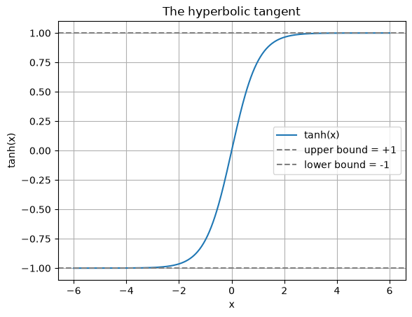
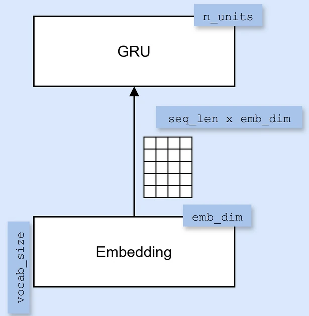
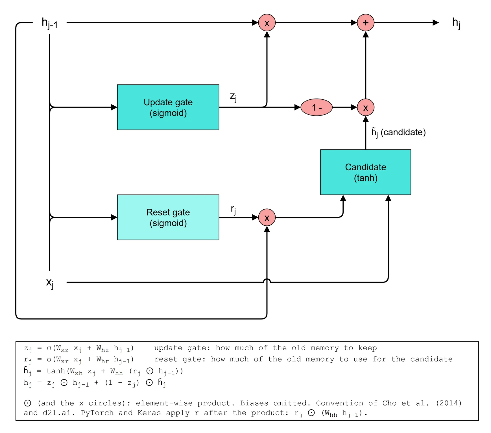
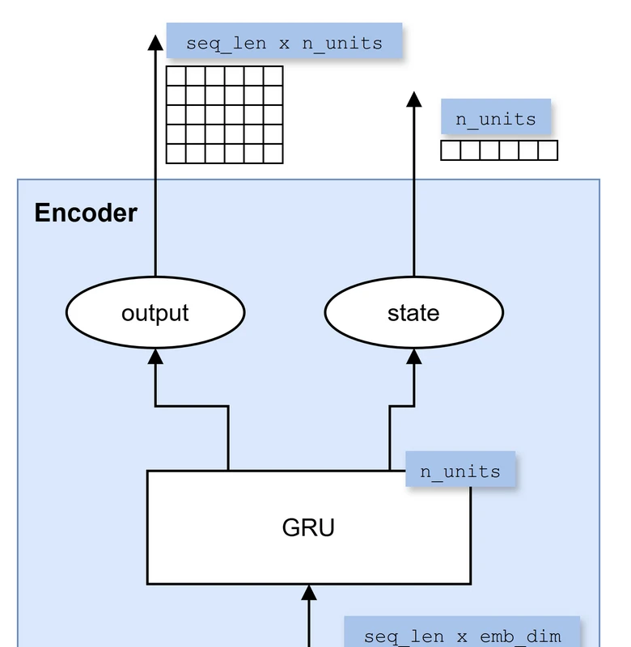
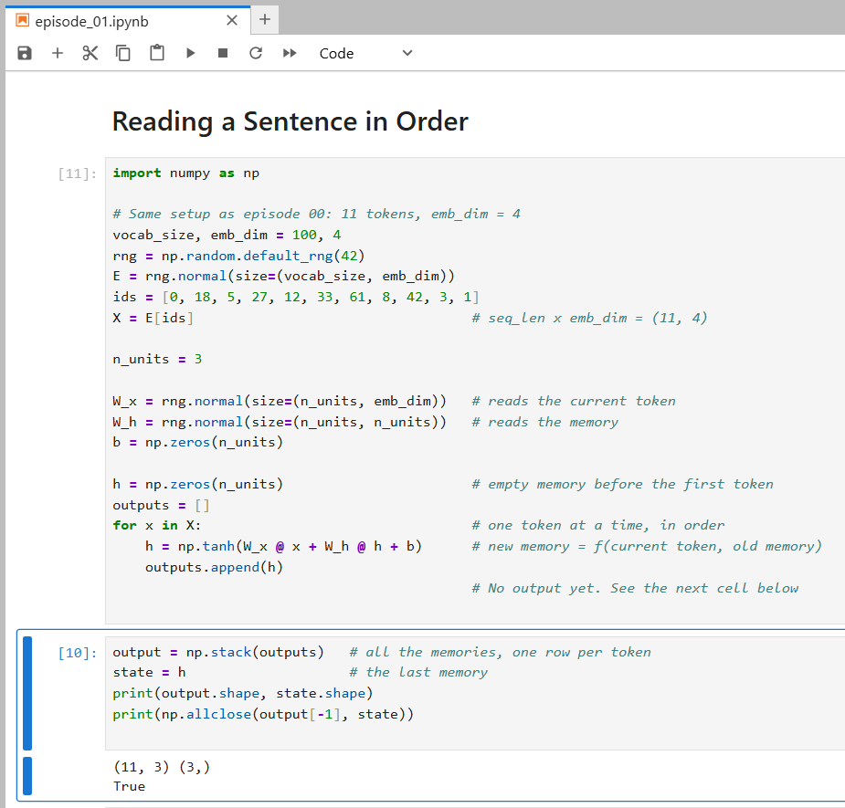
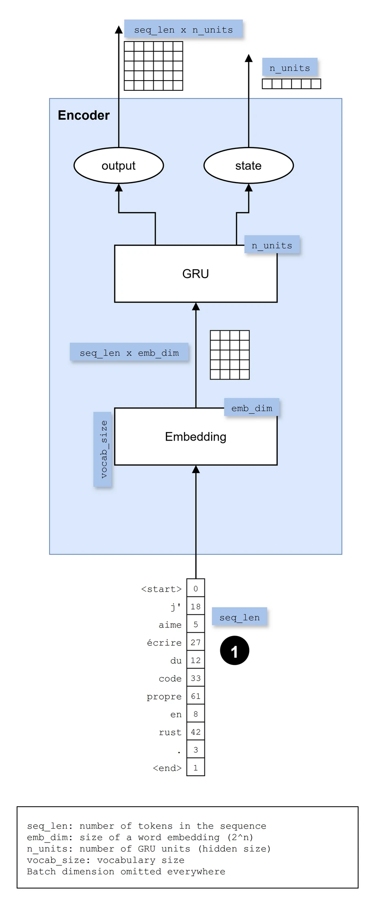
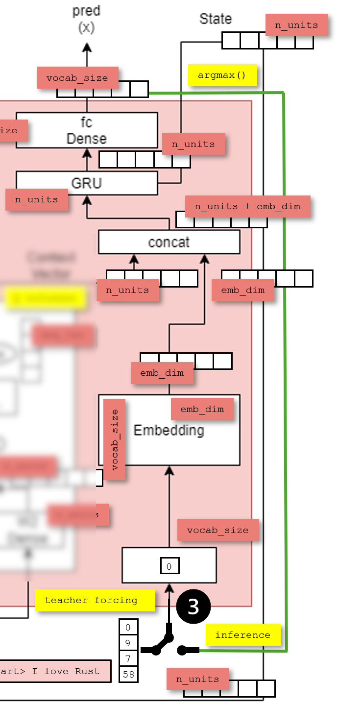
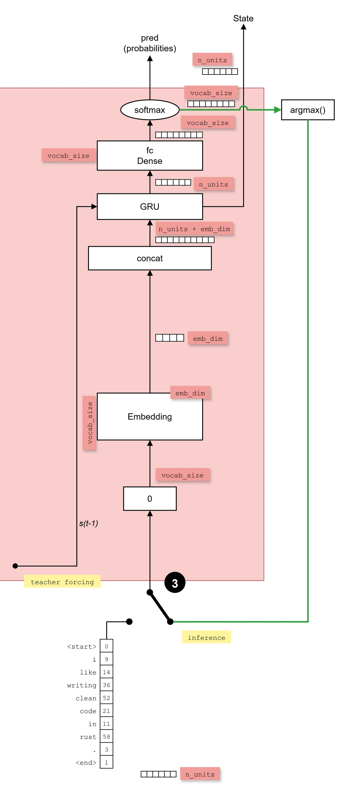

# {{ page.title }}
{: .no_toc }

{{ page.description }}
{: .lead }


<!-- <h2 align="center"><span style="color:#F87115"><b> 🚧 This post is under construction 🚧</b></span></h2> -->


### This is Episode 01, Part 00
{: .no_toc }


{: .note }
> This post is a series in **4 episodes**, some of them in two or three parts. Alice and Bob need two evenings to rebuild the slide, one box at a time.
>
> * [Episode 00](): Day 1. Leaving class with the slide. Why word-by-word translation fails, from words to tokens, from tokens to vectors.
> * Episode 01: Day 1, later that evening.
>   * [Part 00]() **(you are here)**: Reading in order with a GRU, encoder and decoder.
>   * [Part 01](): The bottleneck and the idea of attention.
> * Episode 02: Day 2. The attention layer step by step.
>   * [Part 00](): The question attention asks, and the scores.
>   * [Part 01](): Softmax and the context vector.
>   * [Part 02](): One iteration of the decoder.
> * Episode 03: Day 2, later that evening.
>   * [Part 00](): Training with teacher forcing, and inference.
>   * [Part 01](): A real translation, what we simplified, and a peek at Transformers.


<!-- ###################################################################### -->
<!-- ###################################################################### -->
<!-- ###################################################################### -->
## TL;DR
{: .no_toc }

* A **GRU** (Gated Recurrent Unit) is a type of recurrent neural network (RNN) designed to process sequential data (text, audio, time series) while retaining information over long sequences.
* Here the **GRU** reads the embedded sentence one token at a time and keeps a memory (the hidden state) of `n_units` numbers. It returns `output` (a matrix), all the memories (`seq_len x n_units`), and `state` (a vector), the last one (`n_units`), which is also the last row of `output`.
* **seq2seq** (2014): an **encoder** reads the source sentence, a **decoder** writes the translation one token at a time, starting from `state` and stopping on `<end>`. Lengths and word order are free.
* The slide misses a wire: the decoder GRU also needs the memory of the previous step, $$s_{t-1}$$. And the output softmax deserves its own box.
* Still open: the decoder knows the French sentence only through `state`, one vector of `n_units` numbers. Is that enough? That's for Part 01.


<figure style="max-width: 900px; margin: auto; text-align: center;">

<figcaption>Can a whole sentence fit on a post-it? Same evening, same table, one more box.</figcaption>
</figure>


<!-- ###################################################################### -->
<!-- ###################################################################### -->
<!-- ###################################################################### -->
## Table of Contents
{: .no_toc .text-delta}
- TOC
{:toc}


<!-- ###################################################################### -->
<!-- ###################################################################### -->
<!-- ###################################################################### -->
## Previously

In [Episode 00](), Alice and Bob left class with the slide below and realized they had understood nothing. They met at the library at 6 pm and decided to rebuild it one box at a time, with the Feynman rules: simple words, "explain it differently" always allowed, back to the sources when stuck.

They chose a sentence harder than the one on the slide, "J'aime écrire du code propre en Rust." -> "I like writing clean code in Rust.", to avoid the word-by-word trap. They cut it into 11 tokens, turned the tokens into indices, then the indices into vectors with a learned embedding. They now have a `seq_len x emb_dim` matrix where each row describes one token, but knows nothing about its neighbors.

<figure style="max-width: 900px; margin: auto; text-align: center;">

<figcaption>The slide, still on the table.</figcaption>
</figure>


<!-- ###################################################################### -->
<!-- ###################################################################### -->
<!-- ###################################################################### -->
## Prerequisites

* [Episode 00](): tokens, `seq_len`, `vocab_size`, embeddings, `emb_dim`.
* The same as for Episode 00: a bit of Python, the idea of a neural network trained by [gradient descent](), and the matrix-vector product.

*Same evening, same table. The bag of cookies is half empty.*

<!-- ###################################################################### -->
<!-- ###################################################################### -->
<!-- ###################################################################### -->
## Reading a Sentence in Order

**Bob:** GRU. Gated Recurrent Unit. Three words, let's take them one by one. Backwards. "Unit", it's a block of the network. "Recurrent"...

**Alice:** Recurrent means it comes back. It loops.

**Bob:** Loops on what?

**Alice:** On the sentence, I guess. It takes the rows one at a time, in order. `<start>`, then `j'`, then `aime`... And each time, it keeps something from the previous step.

**Bob:** Okay, let me try an analogy. You're reading a novel. You don't remember every word you've read, but you have a kind of running summary in your head: who's who, where we are, what just happened. Each new sentence updates that summary a little. When you reach the last page, the summary is what's left of the whole book.

**Alice:** And that summary is...

**Bob:** The **hidden state**. The memory of the network. It's a vector, and it gets updated at every token: new memory = something computed from the current token and the old memory.

**Alice:** "Something computed". Rule 1, Bob.

**Bob:** Fine. In code, it's a loop. I'll do the simplest version first, a plain RNN, not a GRU:

```python
import numpy as np

# Same setup as episode 00: 11 tokens, emb_dim = 4
vocab_size, emb_dim = 100, 4
rng = np.random.default_rng(42)
E = rng.normal(size=(vocab_size, emb_dim))
ids = [0, 18, 5, 27, 12, 33, 61, 8, 42, 3, 1]
X = E[ids]                                  # seq_len x emb_dim = (11, 4)

n_units = 3

W_x = rng.normal(size=(n_units, emb_dim))   # reads the current token
                                            # n_units x emb_dim = (3, 4)
W_h = rng.normal(size=(n_units, n_units))   # reads the memory
                                            # n_units x n_units = (3, 3)

b = np.zeros(n_units)                       # 1 x n_units = (1, 3)

h = np.zeros(n_units)                       # empty memory before the first token
                                            # 1 x n_units = (1, 3)
outputs = []
for x in X:                                 # one token at a time, in order
    h = np.tanh(W_x @ x + W_h @ h + b)      # new memory = f(current token, old memory)
    outputs.append(h)
                                            # No output yet. See the next cell below

```

**Alice:** Let me read it out loud. The first block is Episode 00 again: an embedding table `E`, the 11 token ids of our sentence, and `X = E[ids]` picks one row per token. Then `n_units = 3`, two weight matrices drawn at random, `W_x` for the token and `W_h` for the memory, a bias `b` full of zeros, and `h` full of zeros too, because before the first token we remember nothing.

**Bob:** So far, so good.

**Alice:** Then the loop. `for x in X` walks through the rows of `X`, so `x` is one token at a time, in the order of the sentence. The line `h = np.tanh(...)` is the heart of it. And what is this `@`? I've never seen it in Python.

**Bob:** It's the matrix multiplication operator. It has been in Python since version 3.5, and NumPy implements it. `W_x @ x` is exactly the matrix-vector product of the prerequisites, the same thing as `np.matmul(W_x, x)` or `W_x.dot(x)`, just easier to read.

**Alice:** And `*` would not do the job?

**Bob:** No. With NumPy arrays, `*` multiplies element by element. `@` is the "row times column" product we learned at school.

**Alice:** Okay. So that line reads: take the current token, pass it through `W_x`; take the old memory, pass it through `W_h`; add the two plus the bias; squash the whole thing with `tanh`; and that becomes the new memory. Then `outputs.append(h)` keeps a copy of `h`, one per token.

**Bob:** Exactly. One small nuance about the comments: for NumPy, `b` and `h` are plain 1D arrays of shape `(3,)`, not `(1, 3)`. A 1D array is neither a row nor a column, and that's why `W_x @ x` works without any transpose.

**Alice:** Noted. Wait, let me check the sizes, it's the only way I'll trust this. `x` is one row of `X`, so `emb_dim`. `W_x` is `n_units x emb_dim`, so `W_x @ x` is a vector of `n_units`. Matrix times vector, that's the prerequisite. `h` is `n_units`, `W_h` is `n_units x n_units`, so `W_h @ h` is also `n_units`. I add the two, I squash with `tanh` between -1 and +1, and I get the new `h`, still `n_units`.

$$
h_j = \tanh(W_x\, x_j + W_h\, h_{j-1} + b)
$$

**Bob:** Two words about `tanh`, since it does the squashing. It's the hyperbolic tangent, an S-shaped curve. It's a cousin of the **logistic function** (the sigmoid): same S shape, but stretched to go from -1 to +1 instead of 0 to 1. Let's draw it:

```python
import numpy as np
import matplotlib.pyplot as plt

x = np.linspace(-6, 6, 500)

plt.plot(x, np.tanh(x), label="tanh(x)")
plt.axhline(1, color="gray", linestyle="--", label="upper bound = +1")
plt.axhline(-1, color="gray", linestyle="--", label="lower bound = -1")
plt.xlabel("x")
plt.ylabel("tanh(x)")
plt.title("The hyperbolic tangent")
plt.grid(True)
plt.legend()
plt.show()
```

<figure style="max-width: 900px; margin: auto; text-align: center;">

<figcaption>The hyperbolic tangent - tanh(x)</figcaption>
</figure>

**Bob:** Now put your finger anywhere on the x-axis. -6, 0.5, 1000, whatever. Go up or down to the curve: each time, the result $$f(x)$$ is between the lower bound and the upper bound, -1 and +1. Near 0 the curve is almost a straight line, and far away it flattens and sticks to the bounds.

**Alice:** So whatever comes out of `W_x @ x + W_h @ h + b`, even a huge number, `tanh` brings it back between -1 and +1. And since the loop turns 11 times and feeds `h` back into itself, without that squashing the memory could blow up step after step.

**Bob:** That's it. The memory always stays in a box of known size.

**Alice:** Got it.

**Bob:** And $$j$$ is the position in the sentence. $$h_1$$ after `<start>`, $$h_2$$ after `j'`... $$h_{11}$$ after `<end>`.

**Alice:** So `n_units` is the size of the memory. That's the label on the GRU box on the slide: `n_units`.

<figure style="max-width: 450px; margin: auto; text-align: center;">

<figcaption>The Embedding feeds the GRU, one row (one token) at a time. The memory of the GRU has n_units values.</figcaption>
</figure>

**Bob:** Yes. Bigger `n_units`, bigger memory. 3 in my toy code, a few hundred in real life.

**Alice:** One thing surprises me. There's only one `W_x` and one `W_h`. They're the same at every step?

**Bob:** Same weights for every token. It's one single cell that we reuse 11 times. That's why it works for any `seq_len`: a sentence of 4 tokens, the loop turns 4 times, a sentence of 11, it turns 11 times. The number of weights doesn't change.

**Alice:** Okay, that's elegant. So why a GRU and not this?

**Bob:** Because this simple version has a bad memory. A bit like French students who, in the last PISA assessment, showed they [struggle with texts longer than 400 words](https://colombiaone.com/2026/09/09/reading-comprehension-pisa/){:target="_blank"}. On long sentences, the beginning fades away. Each step mixes the old `h` with the new token, again and again, and after twenty steps the first words are almost gone. And during training it's even worse: the gradient has to travel back through all the steps, and it gets smaller and smaller on the way. The network can barely learn to remember things from far away.

**Alice:** And the GRU fixes that how?

**Bob:** With **gates**. Small switches, computed from the data, that decide at each step how much of the old memory to keep and how much to replace with the new token. That's the "Gated" in GRU. Sometimes it can just say "nothing interesting here, keep the memory as it is".

**Alice:** And that's the tiny drawing inside the box? The light blue rectangles?

**Bob:** Yes, "Update Gate" and "Reset Gate". But honestly, I don't think we need the details to understand attention. From the outside, a GRU does exactly what my loop does: it reads one token, it updates a memory of size `n_units`. It's just better at it.

<figure style="max-width: 700px; margin: auto; text-align: center;">

<figcaption>For the curious: inside a GRU cell. Not needed to follow the rest of the story.</figcaption>
</figure>

**Alice:** I'm not totally satisfied, but okay. Rule 3, we write the links down and we'll read them later.

* [Gated Recurrent Units (GRU)](https://d2l.ai/chapter_recurrent-modern/gru.html){:target="_blank"} in *Dive into Deep Learning*, with the equations and the code.
* [Understanding LSTM Networks](https://colah.github.io/posts/2015-08-Understanding-LSTMs/){:target="_blank"} by Christopher Olah, the classic explanation of gated recurrent networks (LSTM is the GRU's big brother, and there is a section on GRU at the end).

**Bob:** Now look at the top of the blue box. Two exits: `output` and `state`.

<figure style="max-width: 450px; margin: auto; text-align: center;">

<figcaption>Zoom on the top of the blue part: the GRU (n_units) and its two exits, output (seq_len x n_units) and state (n_units).</figcaption>
</figure>

**Alice:** `output` has the label `seq_len x n_units`. `state` has the label `n_units`.

**Bob:** In my loop, `outputs` is the list of all the `h`, one per token. If I stack them...

```python
output = np.stack(outputs)   # all the memories, one row per token
state = h                    # the last memory
print(output.shape, state.shape)
print(np.allclose(output[-1], state))
```

```text
(11, 3) (3,)
True
```

<figure style="max-width: 900px; margin: auto; text-align: center;">

<figcaption>Bob's RNN loop in JupyterLab: output is seq_len x n_units, state is n_units, and state is the last row of output.</figcaption>
</figure>

**Alice:** `(11, 3)`: `seq_len x n_units`. And `(3,)`: `n_units`. It matches the slide. And `True` means...

**Bob:** ...that `state` is exactly the last row of `output`. The memory after reading `<end>`. Not a new thing, just the last line of the table.

**Alice:** *(slowly)* Okay, I think I get something. Each row of `output` is the memory *at that point* of the sentence. Row 7 is the memory just after reading `propre`. So, unlike the embedding, that row knows that `propre` came after `code`, after `du`, after `écrire`...

**Bob:** Yes! That's what we were missing at the end of the embedding. The embedding row of `propre` is the same in every sentence. The GRU row of `propre` depends on what came before.

**Alice:** But only on what came *before*. Row 6, the one for `code`, has no idea that `propre` is coming.

**Bob:** Hmm. True. *(thinks)* We could run a second GRU from right to left and glue the two together... I think some models do that. Let's write it down for later and keep the slide as it is: one GRU, left to right.

**Alice:** Deal. Let me redraw the blue part cleanly, with everything we know now.

<figure style="max-width: 500px; margin: auto; text-align: center;">

<figcaption>The blue part of the slide, redrawn by Alice with our sentence.</figcaption>
</figure>

**Bob:** Feynman check, your turn.

**Alice:** The GRU reads the rows of the embedding one by one, in order. It keeps a memory of size `n_units` and updates it at every token. At the end we get two things: `output`, all the memories, one per token, so `seq_len x n_units`. And `state`, the last memory, so `n_units`, which is also the last row of `output`. A GRU is an RNN with gates, so it remembers better.

**Bob:** Approved. And the table?

| Name | What it is | In our example |
|---|---|---|
| `seq_len` | number of tokens in the sentence | 11 (French side) |
| `vocab_size` | number of tokens in the vocabulary | thousands, one per language |
| `emb_dim` | number of values describing one token | 4 in the toy code, often 256 or more |
| `n_units` | size of the GRU memory (hidden state) | 3 in the toy code, often 256 or more |

**Alice:** Something still bugs me, though. If `state` is just the last row of `output`, why does the slide carry both? Two wires, two exits. `output` goes all the way up and into the red part, to `W1`. `state` goes down, through switch 2.

**Bob:** Maybe because they're not used for the same thing. And maybe because, before attention, people only had one of the two.

**Alice:** Which one?

**Bob:** Let's find out how translation worked *before* this slide.


<!-- ###################################################################### -->
<!-- ###################################################################### -->
<!-- ###################################################################### -->
## Encoder, Decoder, and Nothing in Between

**Alice:** Before the slide... You mean before attention?

**Bob:** Yes. Attention didn't fall from the sky, it fixed something. So there was a "before". *(types on his phone)* Here. 2014, [Sequence to Sequence Learning with Neural Networks](https://arxiv.org/abs/1409.3215){:target="_blank"}, by Sutskever, Vinyals and Le (on right hand side, click on `View PDF`). People call it **seq2seq**. And the same year, Cho et al. published [almost the same idea](https://arxiv.org/abs/1406.1078){:target="_blank"}. Fun fact: that's the paper where the GRU was introduced.

**Alice:** So our GRU and the translation problem were born together. Okay. What's the idea?

**Bob:** Exactly what we said an hour ago: two jobs. One network reads the whole French sentence: the **encoder**. That's our blue part. Another network writes the English sentence, one token at a time: the **decoder**. The red part.

**Alice:** And what goes from one to the other?

**Bob:** That's the point. In seq2seq, only one thing: `state`. The last memory of the encoder. The decoder starts with that vector as its own memory, and writes.

**Alice:** Only `state`? And `output`, the whole `seq_len x n_units` table?

**Bob:** Thrown away. Not used.

**Alice:** Huh. Okay, let me draw it, I need to see it.

```text
 j' aime écrire du code propre en rust .        i like writing clean code in rust .
                 |                                              ^
                 v                                              |
          +-------------+              state             +-------------+
          |   ENCODER   | -----------------------------> |   DECODER   |
          | (blue part) |         n_units numbers        |  (red part) |
          +-------------+                                +-------------+
```

**Bob:** That's it. Everything the decoder knows about the French sentence is in that arrow.

**Alice:** Okay, now the decoder. How does it write? On the slide, the red part is full of stuff. `W1`, `W2`, `V`, `softmax`, `concat`...

**Bob:** Rule 4. For now we mentally erase everything on the left of the red box: `W1`, `W2`, `+`, `tanh`, `V`, `softmax`, the multiplication, the sum. That's the attention part, we keep it for later. What's left?

**Alice:** *(covers half of the slide with her hand)* At the bottom, a red `Embedding`. Above, a `concat`, but its left input comes from the part under my hand. So for now it just lets the embedding through. Above, a `GRU`. Above, `fc Dense`, with `vocab_size` written on it. Then `pred`. And a green wire that goes from `argmax()` all the way down to switch 3.

<figure style="max-width: 450px; margin: auto; text-align: center;">

<figcaption>The red part of the original slide, with the attention half hidden by Alice's hand (Rule 4).</figcaption>
</figure>

**Bob:** Let me tell the story of one step and you check the sizes.

**Alice:** Go.

**Bob:** The decoder has its own memory. To avoid confusion with the `h` of the encoder, let's call it `s`. At the very beginning, `s` is the `state` of the encoder: we'll call it $$s_0$$. Then we need a first token to give to the decoder. It hasn't written anything yet, so...

**Alice:** ...`<start>`! That's what it's for. It's the "go" signal. *(checks the slide)* Yes, there's a little `0` in the box under the red `Embedding`. Index `0`, `<start>`.

**Bob:** Yes. So: `<start>` goes through the red embedding, we get a vector of `emb_dim`. The GRU takes that vector and the memory $$s_0$$, and computes a new memory $$s_1$$.

**Alice:** Same as in the encoder. Token in, memory updated. $$s_1$$ is `n_units`. *(back to the slide, frowns)* Wait. On the slide, only one wire goes into the GRU, the one coming from below. Where does $$s_0$$ come in?

**Bob:** *(follows the wires with his finger)* Hmm. Switch 2 sends `state` to `W2`, in the part we erased. And that's it. Nothing goes into the GRU from the side.

**Alice:** Then the GRU has no memory. Your encoder loop has `W_h @ h` in it. No `h`, no memory.

**Bob:** Right. A GRU always has two inputs: the current token and the old memory. Without the second one, it starts from zero at every step, and the decoder forgets what it has already written.

**Alice:** Hold on. Then my drawing of the encoder is wrong too. In the blue part, only one wire goes into the GRU: the `seq_len x emb_dim` matrix. Nothing comes from the side.

**Bob:** Good catch. The difference is *who runs the loop*. In the encoder, we give the GRU the whole sentence at once, all 11 rows. The `for` loop is *inside* the box. Look at my code: `h` comes out of one step and goes back into the next one, but it never leaves the loop. The second input is there, it's just a wire that loops back inside the box, so nobody draws it. And before the first token, `h = np.zeros(n_units)`: the starting memory is zero, nobody needs to bring it from outside.

**Alice:** And in the decoder?

**Bob:** In the decoder, we can't give the whole sentence at once. The English sentence doesn't exist yet: the token of step 2 is the prediction of step 1. So the loop is *outside* the GRU. We call the GRU once per token, and at each call we must hand it the memory left by the previous call. That memory comes from outside, so it needs a visible wire. And for the very first call, it's not zero: it's $$s_0$$, the `state` of the encoder.

**Alice:** Loop inside the box, the wire is hidden. Loop outside the box, the wire must be drawn. And on the slide, it's missing.

**Bob:** Exactly.

**Alice:** So the slide is wrong?

**Bob:** Incomplete, I'd say. My guess is that it was drawn from the code of an old TensorFlow tutorial. In that code, the previous memory was given to the attention, but not to the GRU. The drawing is faithful to the code. The code forgot a wire.

**Alice:** Then I'm adding it. In my drawings, the memory of the previous step, $$s_{t-1}$$, goes into the GRU from the side.

<figure style="max-width: 450px; margin: auto; text-align: center;">

<figcaption>The red part redrawn by Alice, attention erased (Rule 4), with the missing wire: the previous memory s(t-1) enters the GRU from the side.</figcaption>
</figure>


**Bob:** Deal. Two inputs, like every GRU.

<!--
TODO: CHECK THE TENSORFLOW TUTORIAL CLAIM
Bob says the slide follows an old TensorFlow NMT tutorial where the decoder called
self.gru(x) without passing the previous hidden state (hidden only fed the attention).
Verify in the archived tutorial before publishing, or soften Bob's line.
-->

**Alice:** One more thing on my drawing. Above the GRU, two wires: `State`, with `n_units`, leaves the red part, and a vector of `n_units` goes up into `fc Dense`. But where is `output`? In the encoder, the GRU gave us a whole `seq_len x n_units` matrix.

**Bob:** Because the encoder GRU read 11 tokens in one call, so it had 11 memories to give back, one row per token. Here, one call reads *one* token. One token in, one memory out: $$s_1$$, a single row of `n_units`. There is no `seq_len` in a decoder step.

**Alice:** And `State`? It's also `n_units`.

**Bob:** It's the same vector. Remember the `True` in the encoder: `state` was the last row of `output`. With a single row, the last row *is* the output. So both wires carry $$s_1$$. One goes up, to predict the current token. The other leaves the red part because we need it again: it becomes the $$s_{t-1}$$ of the next step.

**Alice:** So the matrix doesn't exist in the decoder. We could build it by stacking $$s_1$$, $$s_2$$, $$s_3$$... step after step, but nobody needs it: each memory is used right away to predict one token, and then it's passed on.

**Bob:** Exactly. Now `fc Dense`. "fc" means *fully connected*: each of the `vocab_size` outputs is connected to each of the `n_units` inputs. In practice it's one matrix and one bias, like `W_x @ x + b` in my loop, without the `tanh`. Here, the matrix is `vocab_size x n_units`, and `vocab_size` is the size of the *English* vocabulary.

**Alice:** A matrix `vocab_size x n_units` times the vector $$s_1$$. So we get one score per English token. One score for `i`, one for `love`, one for `rust`, one for `table`, one for `banana`... thousands of scores.

**Bob:** Think of it as a jury. One judge per English word, `vocab_size` judges. They all look at the same memory $$s_1$$, the `n_units` numbers. But each judge has their own row of weights, so each one reads the memory in their own way, and gives a score to their word. The judge of `i` gives a high score if the memory looks like "we're at the beginning of a sentence that starts with *je*". Training is what teaches each judge their row.

**Alice:** And with `vocab_size` in the thousands and `n_units` in the hundreds, that's millions of weights.

**Bob:** Yes. It's often the biggest layer of the decoder. Its only job: translate the memory, which is in a language only the network speaks, into one score per English word. Then we turn these scores into probabilities with a softmax: all positive, sum equal to 1. That's `pred` on the slide.

**Alice:** Wait. There's a `softmax` on the slide, but it's in the middle, in the part we just erased.

**Bob:** Yeah, that one belongs to the attention, different story. The softmax of the output is not drawn as a box, it's hidden in `pred`. Don't ask me why, ask whoever drew it.

**Alice:** Not in my drawing. I gave it its own box, right above `fc Dense`: scores in, probabilities out. And that's where the green wire starts.

**Bob:** Good. A box that does something deserves to be drawn.

**Alice:** Fine. And then?

**Bob:** `argmax()`. We pick the English token with the highest probability. If the network is well trained, it's `i`. And the green wire brings that token back to the input, for the next step: `i` goes through the red embedding, the GRU updates the memory to $$s_2$$, `fc Dense`, `argmax()`, `like`. And again. And again.

**Alice:** Until?

**Bob:** Until it produces `<end>`. That's your idea from before: `<end>` is just a token like the others, so the decoder can choose it. "I'm done." And in case it never does, we stop after a maximum number of tokens.

**Alice:** Show me in code. Even if it's fake.

**Bob:** Pseudo-Python, then. `gru_step()` is the GRU cell, I don't write it again:

```python
s = state                                   # decoder memory starts with the encoder summary
token = en_vocab["<start>"]
translation = []

for _ in range(max_len):
    y = E_en[token]                         # red embedding: emb_dim
    s = gru_step(y, s)                      # new decoder memory: n_units
    probs = softmax(W_o @ s)                # fc Dense + softmax: vocab_size
    token = int(np.argmax(probs))           # most likely English token
    if token == en_vocab["<end>"]:
        break
    translation.append(token)
```

**Alice:** *(reads it twice)* Okay, three things I like. First, the loop doesn't depend on `seq_len`. It runs until `<end>`, so the English sentence can be shorter or longer than the French one. Our 9 tokens against 8.

**Bob:** Second?

**Alice:** Second, the decoder writes what it wants, in the order it wants. Nothing forces it to write `clean` at position 6 because `propre` was at position 6. So in theory, `code propre` can become `clean code`.

**Bob:** And `du` can just vanish. And third?

**Alice:** Third, each new token depends on the previous one, through the green wire, and on the memory `s`, which keeps track of what has been written so far. So it can choose `writing` and not `write` after `i like`. All the problems of our table, solved.

**Bob:** In theory.

**Alice:** In theory. *(pause)* And the switches? Switch 2 on the wire of `state`, switch 3 with "teacher forcing" written next to it?

**Bob:** I think it's about training versus actually using the model. The green wire is labeled "inference". I'd keep that for later, it's another big chunk.

**Alice:** Okay, written down: "switches = later".

**Bob:** Feynman check?

**Alice:** Me again? Fine. The encoder reads the French sentence and summarizes it *in one vector*, `state`. The decoder starts from that summary and writes the English sentence one token at a time: each token it writes becomes the input of the next step. It stops when it writes `<end>`. The two sentences can have different lengths and different orders.

**Bob:** Approved. Now... *(taps the arrow in Alice's drawing)* Read your own summary again. "Summarizes it *in one vector*".

**Alice:** Yes?

**Bob:** One vector. `n_units` numbers. For the whole sentence.

**Alice:** *(stares at the arrow)* Oh.


<!-- ###################################################################### -->
<!-- ###################################################################### -->
<!-- ###################################################################### -->
## To Be Continued

One vector, `n_units` numbers, for the whole sentence. Alice just saw the problem, and so did we.

The rest of the evening is in [Part 01](): the bottleneck, and the idea that fixes it.


<!-- ###################################################################### -->
<!-- ###################################################################### -->
<!-- ###################################################################### -->
## Webliography

**Papers**
* Sutskever, Vinyals, Le (2014), [Sequence to Sequence Learning with Neural Networks](https://arxiv.org/abs/1409.3215){:target="_blank"}.
* Cho et al. (2014), [Learning Phrase Representations using RNN Encoder-Decoder for Statistical Machine Translation](https://arxiv.org/abs/1406.1078){:target="_blank"}. The paper that introduced the GRU.

**Explanations**
* [Gated Recurrent Units (GRU)](https://d2l.ai/chapter_recurrent-modern/gru.html){:target="_blank"}, *Dive into Deep Learning*.
* Christopher Olah, [Understanding LSTM Networks](https://colah.github.io/posts/2015-08-Understanding-LSTMs/){:target="_blank"}.


