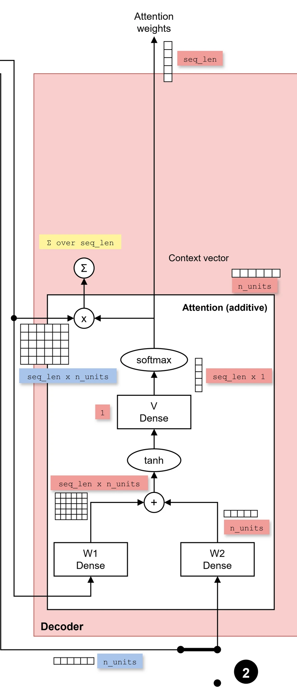

# {{ page.title }}
{: .no_toc }

{{ page.description }}
{: .lead }

### This is Episode 01, Part 01
{: .no_toc }

{: .note }
> This post is a series in **4 episodes**, some of them in two or three parts. Alice and Bob need two evenings to rebuild the slide, one box at a time.
>
> * [Episode 00](): Day 1. Leaving class with the slide. Why word-by-word translation fails, from words to tokens, from tokens to vectors.
> * Episode 01: Day 1, later that evening.
>   * [Part 00](): Reading in order with a GRU, encoder and decoder.
>   * [Part 01]() **(you are here)**: The bottleneck and the idea of attention.
> * Episode 02: Day 2. The attention layer step by step.
>   * [Part 00](): The question attention asks, and the scores.
>   * [Part 01](): Softmax and the context vector.
>   * [Part 02](): One iteration of the decoder.
> * Episode 03: Day 2, later that evening.
>   * [Part 00](): Training with teacher forcing, and inference.
>   * [Part 01](): A real translation, what we simplified, and a peek at Transformers.

<!-- ###################################################################### -->
<!-- ###################################################################### -->
<!-- ###################################################################### -->
## TL;DR
{: .no_toc }

* The **bottleneck**: in seq2seq, the whole sentence has to fit in `state`, a fixed-size vector. Like translating a novel from a post-it. Quality drops on long sentences.
* The idea of **attention**: keep the `output` matrix, the whole encoded sentence, and at every step build a new post-it, the **context vector**, as a weighted mix of its rows. Big weights on the rows that matter for the next word.
* Still open: how the decoder computes these weights. That's the left half of the red box, and that's for Episode 02.

<figure style="max-width: 900px; margin: auto; text-align: center;">

<figcaption>Can a whole sentence fit on a post-it? Same evening, same table, one more box.</figcaption>
</figure>

<!-- ###################################################################### -->
<!-- ###################################################################### -->
<!-- ###################################################################### -->
## Table of Contents
{: .no_toc .text-delta}
- TOC
{:toc}

*Same table, a few seconds later. Alice is still staring at the arrow of her drawing: everything the decoder knows about the French sentence goes through `state`, one vector of `n_units` numbers.*

<!-- ###################################################################### -->
<!-- ###################################################################### -->
<!-- ###################################################################### -->
## The Bottleneck

**Alice:** Wait. Let me say it with sizes, it's my thing. `state` has `n_units` numbers. Always. Whatever the sentence.

**Bob:** Yes.

**Alice:** "J'aime Rust": 4 tokens, squeezed into `n_units` numbers. Our sentence: 11 tokens, squeezed into the same `n_units` numbers. A whole paragraph of 60 tokens, with commas, a subordinate clause and a joke at the end: still the same `n_units` numbers.

**Bob:** The input grows, the summary doesn't.

**Alice:** That's a **bottleneck**. A wide bottle, a narrow neck, and everything has to go through the neck.

**Bob:** Let me find an analogy. *(thinks)* Okay. Imagine I give you a novel. You read it, but you're not allowed to keep it. Before giving it back, you can write a summary on one post-it. Then, with only the post-it, you have to translate the novel into English. Sentence by sentence.

**Alice:** That's impossible.

**Bob:** For a novel, yes. For "J'aime Rust", a post-it is plenty. For our sentence, it's probably okay. The longer the text, the worse it gets.

**Alice:** And the post-it is written once, at the end of the reading. If I forgot something on it, there's no way back. The decoder can't go and check the French sentence.

**Bob:** And there's something worse. Look at the decoder loop again. The memory `s` starts as the post-it, $$s_0$$. But at each step, the GRU updates it with the token it just wrote. So after a few words, `s` is a mix of "what the French sentence said" and "what I have written so far".

**Alice:** So the post-it gets... overwritten. Little by little. By the time the decoder reaches `rust .`, what's left of the original summary?

**Bob:** Not much, probably. The GRU is good at keeping things, but it's the same memory doing two jobs: remembering the source and keeping track of the translation.

**Alice:** Okay, so it's a nice theory. Did someone check? Rule 3: sources.

**Bob:** *(phone again)* Yes. Same year, 2014, Cho et al. again: [On the Properties of Neural Machine Translation: Encoder-Decoder Approaches](https://arxiv.org/abs/1409.1259){:target="_blank"}. They measured the quality of the translation depending on the length of the sentence. Short sentences: fine. Then, as sentences get longer, the quality drops. Fast.

**Alice:** So it's not just us being pessimistic.

**Bob:** No. And look at this, it's in the seq2seq paper, I read it while you were drawing. Sutskever and the others found a trick that improved their results a lot: they fed the French sentence to the encoder **backwards**.

**Alice:** Backwards? "rust en propre code du écrire aime j'"?

**Bob:** Yes!

**Alice:** That's absurd. Why would that help?

**Bob:** Think about it with the post-it.

**Alice:** *(thinks)* Hmm. If I read it backwards, the last thing the encoder reads is `j' aime`. So the beginning of the sentence is the freshest thing in the memory. And the decoder starts by writing `i like`... which is exactly what it needs first. The first words of the source end up close to the first words of the translation.

**Bob:** That's my understanding too.

**Alice:** But that's not a solution, that's a hack. It helps the beginning of the sentence and it makes the end worse. And it only works because French and English roughly have the same order. For a language where the verb goes at the end...

**Bob:** Agreed, it's a patch. But it's a clue: the decoder struggles because the useful word is "far away" in the memory. If the trick of reversing the sentence helps, it means the distance is the problem.

**Alice:** Okay, Feynman check, my version. Without attention, the decoder only gets one vector of `n_units` numbers to describe the whole French sentence. Whatever the length. Like translating a book from a post-it. Short sentences are okay, long ones get worse, and people even had to reverse the sentences to help.

**Bob:** Approved. And now... *(taps the slide)* Something annoys me.

**Alice:** Only one thing?

**Bob:** You remember `output`? The `seq_len x n_units` table we threw away?

**Alice:** One row per token. The memory at each position of the sentence. *(slowly)* And it grows with the sentence. 4 tokens, 4 rows. 60 tokens, 60 rows. It's not a post-it. It's...

**Bob:** ...the whole book. And on this slide, it's not thrown away. Look where the wire goes.

**Alice:** All the way up, then into the red part. To `W1`.

<!-- ###################################################################### -->
<!-- ###################################################################### -->
<!-- ###################################################################### -->
## The Idea of Attention, in Words

**Bob:** Okay, before we dive into `W1`, `W2` and the rest, let's do something different. No slide. How would *you* translate our sentence?

**Alice:** Me? A human?

**Bob:** Yes. Not a network. You. Step by step.

**Alice:** *(puts the slide face down)* Okay. I read the whole French sentence once, to get the general idea. Then I start writing. `I`... I glance at `j'`. `like`... I look at `aime`, and also at `écrire`, because "j'aime écrire" is a preference, not a declaration of love. You convinced me earlier.

**Bob:** Ha! Go on.

**Alice:** `writing`, I look at `écrire`. Then... I need the next word. My eyes go to `code propre`. And since in English the adjective comes first, I write `clean` while looking at `propre`. Then `code`, I look back at `code`. `in`, I look at `en`. `rust`, at `rust`. Dot.

**Bob:** And `du`?

**Alice:** *(laughs)* Nobody looks at `du`. I skipped it. My eyes went over it, but it didn't help me write anything.

**Bob:** Now the important question. While you were writing, did you work from memory? From a summary of the sentence in your head?

**Alice:** No. Of course not. I kept going back to the French sentence. At every word, I looked at it again. Not the whole thing: the part that matters for the word I'm about to write.

**Bob:** That's it. That's the whole idea. A human translator doesn't work from a post-it. They keep the book open on the desk, and at every word they **look back** at the right place in the source.

**Alice:** And that's possible for the network only if it keeps the book. If we keep `output`, the `seq_len x n_units` table, instead of throwing it away.

**Bob:** Exactly. With `output`, the decoder has one row per French token. Each row is the memory of the encoder at that position, so it knows its token and what came before. At every step, instead of relying only on its memory `s`, the decoder could look at the rows that matter *now*.

**Alice:** "Look at the rows that matter". Rule 1. What does "look" mean for a network? It doesn't have eyes.

**Bob:** Hmm. Explain it differently... *(thinks)* It means: give a weight to each row. A big weight to the rows that matter right now, a tiny weight to the others. Then mix the rows according to these weights.

**Alice:** So when it's about to write `clean`, the row of `propre` gets a big weight, `code` maybe a small one, and `du`, almost nothing. And the mix is mostly `propre`.

**Bob:** Yes. And when it's about to write `like`, big weight on `aime`, some weight on `écrire`. Several rows can matter at the same time. That's why it's a mix and not a choice.

**Alice:** Wait, let me check the size of that mix. *(writes)* Rows of `n_units` numbers, mixed together: the result is `n_units` numbers. *(pause)* The same size as `state`. The same size as the post-it!

**Bob:** Huh. True.

**Alice:** But it's not the same post-it. It's a **new post-it at every step**. Written by looking at the book, specifically for the word we're about to write. For `clean`, a post-it that says mostly "propre". For `like`, a post-it that says "aime, écrire".

**Bob:** That's beautiful. I'm stealing it.

**Alice:** *(flips the slide back)* And I bet that's what's written here. In the middle. `Context Vector`. With the little `Σ colonnes` next to it. A sum. The mix.

**Bob:** And the weights must be the thing called `Attention weights` at the top. With a `seq_len` label. One weight per French token.

**Alice:** It fits. One weight per row of the book.

<figure style="max-width: 400px; margin: auto; text-align: center;">

<figcaption>Zoom on the left half of the red box: Attention weights (seq_len) at the top, and the Context vector (n_units) coming out of the sum.</figcaption>
</figure>

**Bob:** *(phone)* Rule 3, let me check we're not inventing it. Here: Bahdanau, Cho and Bengio, 2014 again, [Neural Machine Translation by Jointly Learning to Align and Translate](https://arxiv.org/abs/1409.0473){:target="_blank"}. That's the paper of the slide, I'm pretty sure. "Align": which French words go with which English word. That's exactly what you did with your eyes.

**Alice:** And "jointly learning": the network learns to translate and, at the same time, learns where to look. Nobody tells it that `clean` goes with `propre`.

**Bob:** Nobody. It figures it out from thousands of sentence pairs.

**Alice:** Okay, but then... *(frowns)* Here's the thing. When I translate, I know where to look because I understand French. I know `propre` is the adjective, I know English puts it first. The network doesn't understand anything. So how does it decide, at each step, which rows get a big weight?

**Bob:** It must use what it knows at that moment. Its memory `s`. "Where am I in the translation, what have I written so far". Something like: "I've written `i like writing`, so now I need... the thing that comes next".

**Alice:** And it compares that with each row of the book? And how do you "compare" a memory with a row? And how do you turn that into weights? And how do you make sure the weights make a decent mix?

**Bob:** *(points at the left half of the red box, the part they erased earlier)* `W1`. `W2`. `+`. `tanh`. `V`. `softmax`. The multiplication. The sum.

**Alice:** That's the answer to my question. All of it. That's the machine that decides where to look.

**Bob:** Yep.

**Alice:** *(looks at her watch)* It's 9 pm, Bob.

<!-- ###################################################################### -->
<!-- ###################################################################### -->
<!-- ###################################################################### -->
## Feynman Check: What Did We Understand Today?

**Bob:** 9 pm? We've been here three hours?

**Alice:** And the cookies are gone. My brain is full. If we start `W1` now, we'll nod again, like in class.

**Bob:** Okay. But before we leave, a real Feynman check. Not one box. Everything. You explain the whole day in five sentences, and I play the annoying guy who tries to break it.

**Alice:** You don't have to play.

**Bob:** Go.

**Alice:** *(takes a breath)* One. We cut the French sentence into tokens, each token gets an index in a vocabulary, and the embedding replaces each index with a row of `emb_dim` numbers, learned during training.

**Bob:** Fine.

**Alice:** Two. The encoder, a GRU, reads these rows one by one, in order, and keeps a memory of `n_units` numbers. It gives us `output`, all the memories, one per token, and `state`, the last one.

**Bob:** Fine.

**Alice:** Three. The decoder, another GRU, writes the English sentence one token at a time. It starts from `state`, each token it writes is fed back as the next input, and it stops on `<end>`.

**Bob:** Still fine.

**Alice:** Four. Without attention, the decoder only gets `state`: the whole sentence on a post-it of `n_units` numbers. It works for short sentences, and it gets worse and worse as sentences get longer.

**Bob:** Objection. Why not just make the post-it bigger? Take `n_units = 10000` and the problem is gone.

**Alice:** *(thinks)* No. Bigger, but still fixed. Whatever size you choose, I can find a longer sentence. And it doesn't fix the other problem: the decoder memory gets overwritten while it writes. Plus every weight matrix of the GRU grows with `n_units`, so the network gets huge and slow.

**Bob:** Okay, objection rejected. Five?

**Alice:** Five. With attention, the decoder keeps `output`, the whole book, and at every step it writes itself a new post-it: a mix of the rows of `output`, with big weights on the rows that matter for the next word. That new post-it is the context vector.

**Bob:** Objection. So attention picks *the* French word that corresponds to the English word.

**Alice:** No. It mixes. For `like`, it needs `aime` *and* `écrire`. Big weights, small weights, but always a mix. And for `du`, nothing ever gives it a big weight, and that's fine.

**Bob:** Last objection. The decoder knows where to look because it understands the sentence.

**Alice:** No. It doesn't understand anything. It *learns* where to look, from thousands of sentence pairs. And *how* it decides, that's tomorrow's question.

**Bob:** *(raises his hands)* I surrender. Five sentences, three objections, zero bluff.

**Alice:** One more thing. The table. I want all the sizes in one place before my brain deletes them overnight.

*Alice turns the slide over again and writes under the rules.*

| What | Shape | Where on the slide |
|---|---|---|
| source token indices | `seq_len` (11 for us, 4 on the slide) | column under the blue box |
| French embedding matrix `WE` | `vocab_size x emb_dim` | blue `Embedding` |
| embedded sentence | `seq_len x emb_dim` | between blue `Embedding` and `GRU` |
| `output`: the book | `seq_len x n_units` | top left, goes to `W1` |
| `state`: the post-it, also $$s_0$$ | `n_units` | top of the blue box, goes to switch 2 |
| attention weights (guessed) | `seq_len` | `Attention weights`, top |
| context vector (guessed) | `n_units` | `Context Vector`, middle of the red box |
| English embedding matrix | `vocab_size x emb_dim` (English vocabulary) | red `Embedding` |
| `pred` | `vocab_size` (English vocabulary) | top of the red box |

**Bob:** And the list of what we *don't* understand yet. So that tomorrow we don't pretend.

**Alice:** *(writes)*

* How `W1`, `W2`, `+`, `tanh`, `V` and `softmax` turn the memory `s` and the book into weights.
* Why the mix is a multiplication followed by a sum.
* What `concat` glues together, and why.
* Switches 2 and 3, "teacher forcing" versus "inference", the green wire.
* How the whole thing is trained.

**Bob:** That's... the rest of the slide.

**Alice:** Yes. But this afternoon we didn't even know what the slide was *for*. Now we know why every box on the left exists, and we know what question the right part answers. I'll take it.

**Bob:** Tomorrow, same place, 6 pm?

**Alice:** 6 pm. Let it cool overnight. And this time, *you* bring the cookies.

<!-- ###################################################################### -->
<!-- ###################################################################### -->
<!-- ###################################################################### -->
## Conclusion

Let's step out of the library for a minute.

At the end of this first evening, Alice and Bob have not computed a single attention weight. And yet they have done the most important part: they know **why** attention exists. A word-by-word translation cannot work. An encoder-decoder can, but as long as the decoder only receives one fixed-size vector, long sentences get crushed in the bottleneck. Attention keeps the whole encoded sentence available and lets the decoder build, at every step, a context made for the word it is about to write.

That is the idea. What remains is the machinery: how the decoder scores each source token, how these scores become weights, how the weights become a context vector, and how the whole thing is trained and then used. In other words, the left half of the red box and the switches.

That will be the topic of [Episode 02](), on the evening of day 2. Alice and Bob will have slept on it. So will we.

<!-- ###################################################################### -->
<!-- ###################################################################### -->
<!-- ###################################################################### -->
## Webliography

**Papers**
* Sutskever, Vinyals, Le (2014), [Sequence to Sequence Learning with Neural Networks](https://arxiv.org/abs/1409.3215){:target="_blank"}.
* Cho et al. (2014), [On the Properties of Neural Machine Translation: Encoder-Decoder Approaches](https://arxiv.org/abs/1409.1259){:target="_blank"}. The quality drop on long sentences.
* Bahdanau, Cho, Bengio (2014), [Neural Machine Translation by Jointly Learning to Align and Translate](https://arxiv.org/abs/1409.0473){:target="_blank"}. The attention of the slide.

