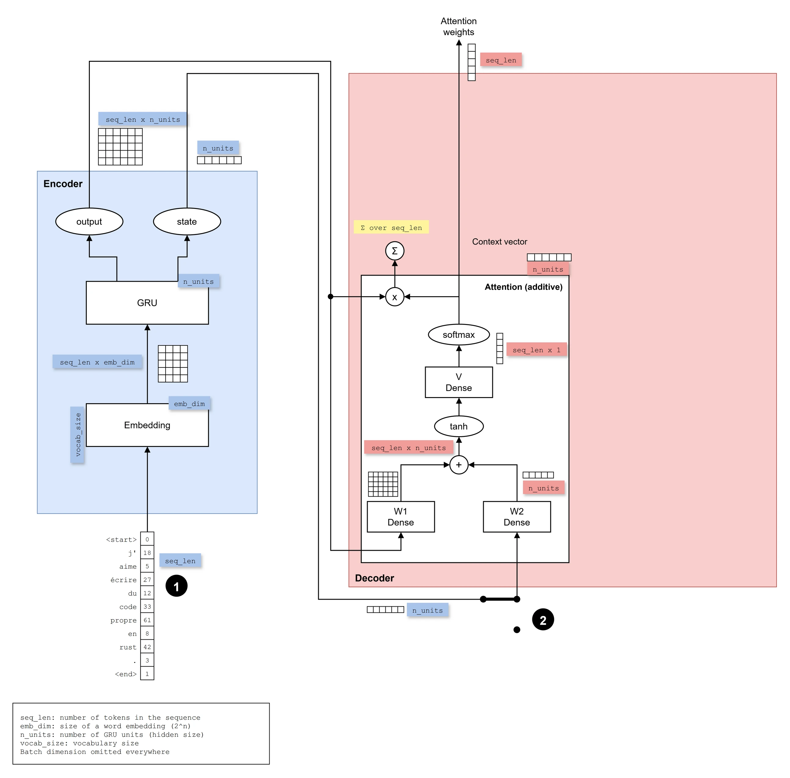
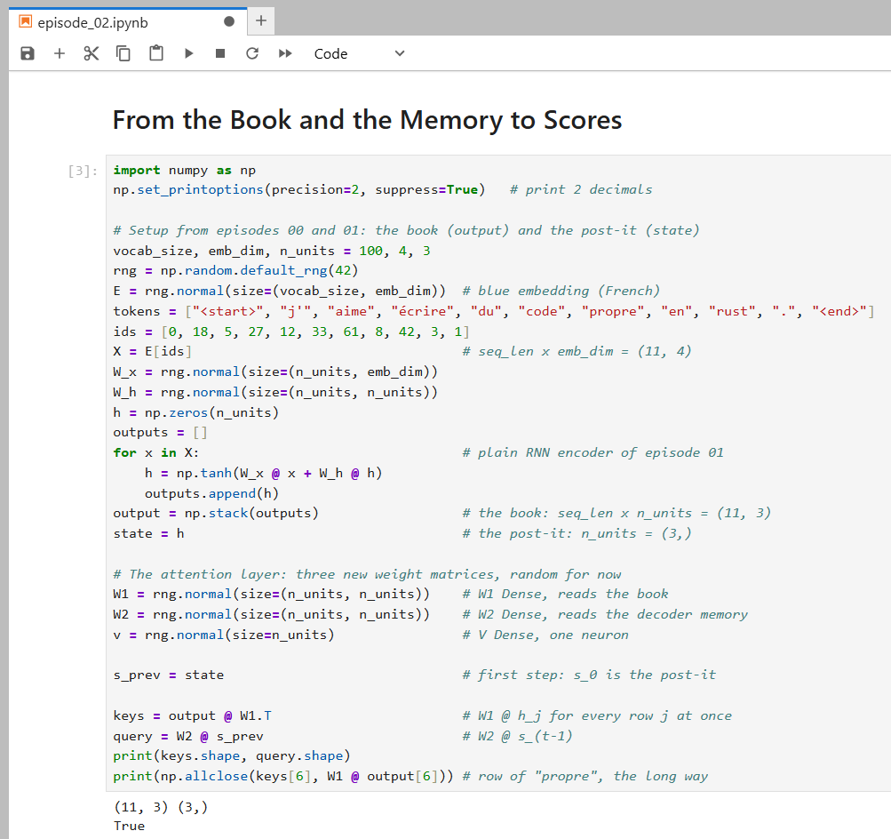
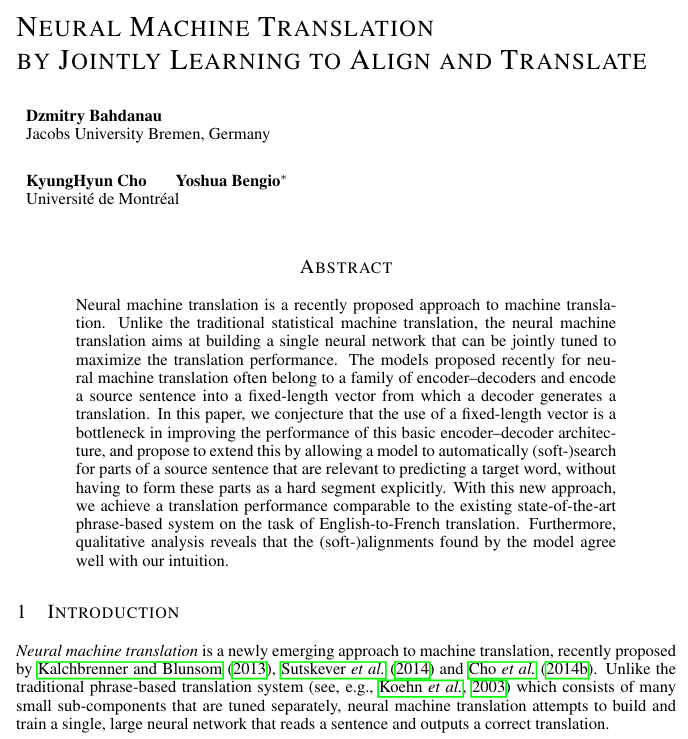

# {{ page.title }}
{: .no_toc }

{{ page.description }}
{: .lead }


<h2 align="center"><span style="color:#F87115"><b> 🚧 This post is under construction 🚧</b></span></h2>


### This is Episode 02
{: .no_toc }

{: .note }
> This post is a series in **4 episodes**. Alice and Bob need two evenings to rebuild the slide, one box at a time.
>
> * [Episode 00](): Day 1. Leaving class with the slide. Why word-by-word translation fails, from words to tokens, from tokens to vectors.
> * [Episode 01](): Day 1, later that evening. Reading in order with a GRU, encoder and decoder, the bottleneck, and the idea of attention.
> * [Episode 02]() **(you are here)**: Day 2. The attention layer step by step: scores, softmax, context vector, one iteration of the decoder.
> * [Episode 03](): Day 2, later that evening. Training with teacher forcing, inference, what we simplified, and a peek at Transformers.


<!-- ###################################################################### -->
<!-- ###################################################################### -->
<!-- ###################################################################### -->
## TL;DR
{: .no_toc }

* At every step $$t$$, the decoder asks one question: "given my memory $$s_{t-1}$$, which rows of the book ($$h_1 \dots h_T$$, the encoder `output`) matter *now*?"
* **Scores**: $$e_{tj} = v^\top \tanh(W_1 h_j + W_2 s_{t-1})$$. `W1` and `W2` translate the book and the memory into a common language, `+` puts them together (the same question is copied on every row, that's broadcasting), `tanh` tangles them, `V` turns each row into one number.
* **Softmax** turns the `seq_len` scores into `seq_len` **attention weights**: all positive, sum equal to 1. Without the `tanh`, the memory would vanish from the weights: softmax ignores what is added to every score.
* **Context vector**: $$c_t = \sum_j \alpha_{tj} h_j$$, a weighted average of the rows of the book, `n_units` numbers. Not "all rows are zero but one": a mix, dosed by the weights. The new post-it.
* **One iteration of the decoder**: embedding of the previous English token, `concat` with the context, GRU with $$s_{t-1}$$ gives $$s_t$$, `fc Dense` and softmax give one probability per English token, `argmax()` picks one. At the next step, the book stays the same, the memory changes, so the weights change.


<figure style="max-width: 900px; margin: auto; text-align: center;">

<figcaption>Day 2, 6 pm. Where to look? Scores, softmax, weights, context.</figcaption>
</figure>


<!-- ###################################################################### -->
<!-- ###################################################################### -->
<!-- ###################################################################### -->
## Table of Contents
{: .no_toc .text-delta}
- TOC
{:toc}


<!-- ###################################################################### -->
<!-- ###################################################################### -->
<!-- ###################################################################### -->
## Previously

In [Episode 00](), Alice and Bob left class with a slide they did not understand. They chose a sentence, "J'aime écrire du code propre en Rust." -> "I like writing clean code in Rust.", cut it into 11 tokens, and turned the tokens into vectors with an embedding.

In [Episode 01](), a GRU read these vectors in order and gave them two things: `output`, one memory per token (`seq_len x n_units`), that they called **the book**, and `state`, the last memory (`n_units`), **the post-it**. Without attention, the decoder translates from the post-it only, and long sentences get crushed in this bottleneck. With attention, the decoder keeps the book open and writes itself **a new post-it at every step**, the context vector: a mix of the rows of the book, with big weights on the rows that matter for the next word.

To get there, Alice had to hide the left half of the red box with her hand: `W1`, `W2`, `+`, `tanh`, `V`, `softmax`, the multiplication and the sum. That is the machine that decides where to look. They left the library at 9 pm, with a list of questions and a promise: same place, tomorrow, 6 pm.

<figure style="max-width: 900px; margin: auto; text-align: center;">

<figcaption>The slide. Tonight, Alice takes her hand off the left half of the red box.</figcaption>
</figure>


<!-- ###################################################################### -->
<!-- ###################################################################### -->
<!-- ###################################################################### -->
## Prerequisites

* [Episode 00]() and [Episode 01](): tokens, embeddings, the GRU, `output` and `state`, the bottleneck.
* A bit of Python and NumPy, and the matrix-vector product. Broadcasting is explained along the way.

{: .note-title }
> How to run the code of this episode
>
> Go to [jupyter.org](https://jupyter.org/){:target="_blank"}, click `Try` then `JupyterLab`, open a new notebook and copy'n paste the cells.
>
> * The **first cell of each section** is self-contained. It starts with `import numpy as np` and rebuilds everything from scratch: the embedding, the encoder, the book and the post-it, with the same random numbers as in Episodes 00 and 01. You can start reading (and running) at any section.
> * The **other cells of a section** continue from the cells above them, in the same section. Run them in order, without restarting the kernel.
> * The setup lines repeat from one section to the next. That's on purpose: no cell depends on a section you may have skipped.

*Day 2, 6 pm. The library, the same table in the back. Bob arrives with a bag of cookies and drops it in the middle, on top of the slide.*


<!-- ###################################################################### -->
<!-- ###################################################################### -->
<!-- ###################################################################### -->
## "I Thought About It Last Night"

**Bob:** As promised. Chocolate chips.

**Alice:** Accepted. *(moves the bag to uncover the slide)* So?

**Bob:** So I thought about it last night. In bed. Which is not great for sleeping.

**Alice:** Same. I kept seeing the book and the post-it. Let's start from there, before we touch anything new. Rule 1: simple words. You go.

**Bob:** Okay. The encoder reads the French sentence, one token at a time, and writes one row per token: its memory at that point. All the rows together, that's `output`, the book. `seq_len x n_units`, 11 rows of 3 numbers in my toy code. The last row is `state`, the post-it. The decoder writes the English sentence one token at a time, and at every step it should look at the book and write itself a new post-it, made for the word it's about to write.

**Alice:** Good. Now, I want to write it with letters, because tonight there will be formulas and I don't want to be lost in them. *(takes a pen)* The rows of the book: $$h_1$$, $$h_2$$... up to $$h_T$$. $$T$$ is the number of French tokens, so `seq_len`, 11 for us. When I stack them, I get a matrix. Let's call it $$H$$. That's `output`.

**Bob:** And `j` for the position in the French sentence, like yesterday. $$h_7$$ is the row of `propre`.

**Alice:** Yes. Now the decoder. It has its own memory. You called it `s` yesterday. At the beginning, it's the post-it: $$s_0$$, which is `state`, which is $$h_T$$. Then the decoder writes a token, the memory becomes $$s_1$$. Another token, $$s_2$$. And so on.

**Bob:** So we need a second index. One for "where am I in the French sentence", one for "how many English tokens have I written".

**Alice:** $$j$$ walks along the French sentence. $$t$$ counts the steps of the decoder. At step $$t$$, the decoder is about to write the $$t$$-th English token, and what it knows is $$s_{t-1}$$: its memory after the previous step.

**Bob:** Why $$t-1$$ and not $$t$$?

**Alice:** Because $$s_t$$ doesn't exist yet. It will be computed at the end of the step. At step 1, it only has $$s_0$$, the post-it. At step 2, it has $$s_1$$. It's always one step behind.

**Bob:** Okay. Let me print the book, I want to *see* it. Same numbers as yesterday, same seed.

```python
import numpy as np
np.set_printoptions(precision=2, suppress=True)   # print 2 decimals

# Self-contained cell. Setup from episodes 00 and 01: the book and the post-it
vocab_size, emb_dim, n_units = 100, 4, 3
rng = np.random.default_rng(42)
E = rng.normal(size=(vocab_size, emb_dim))  # blue embedding (French)
tokens = ["<start>", "j'", "aime", "écrire", "du", "code", "propre", "en", "rust", ".", "<end>"]
ids = [0, 18, 5, 27, 12, 33, 61, 8, 42, 3, 1]
X = E[ids]                                  # seq_len x emb_dim = (11, 4)
W_x = rng.normal(size=(n_units, emb_dim))
W_h = rng.normal(size=(n_units, n_units))
h = np.zeros(n_units)
outputs = []
for x in X:                                 # plain RNN encoder of episode 01
    h = np.tanh(W_x @ x + W_h @ h)
    outputs.append(h)
output = np.stack(outputs)                  # the book: seq_len x n_units = (11, 3)
state = h                                   # the post-it: n_units = (3,)

for token, row in zip(tokens, output):
    print(f"{token:>8} {row}")
print("state:", state)
```

```text
 <start> [-0.01  0.81 -0.99]
      j' [ 0.76 -0.45  0.36]
    aime [ 0.   -0.06 -0.68]
  écrire [-0.08  0.08 -0.65]
      du [ 0.17  0.03 -1.  ]
    code [-0.65 -0.91  1.  ]
  propre [-0.99  1.   -1.  ]
      en [ 0.94  0.36 -0.14]
    rust [-0.77  0.64  0.61]
       . [0.94 0.31 0.6 ]
   <end> [-0.25  0.36  1.  ]
state: [-0.25  0.36  1.  ]
```

{: .note }
> Compared to the RNN loop of Episode 01, the bias `b` is gone. It was a vector of zeros, so removing it changes none of the numbers. It just makes the setup two lines shorter.

**Alice:** There's the book. 11 rows, 3 numbers each. And `state` is the last row, the one of `<end>`. Yesterday's `True`, in plain sight.

**Bob:** Note that the weights are random. Nothing is trained, so these numbers mean nothing. But the *shapes* are right, and the shapes are what we're after tonight.

**Alice:** *(writes in the corner of the slide)*

$$
H = \begin{bmatrix} h_1 \\ h_2 \\ \vdots \\ h_T \end{bmatrix} \quad (T \times n), \qquad s_0 = h_T \quad (n)
$$

**Alice:** With $$n$$ for `n_units`, so the formulas stay short. Okay, I'm ready. *(lifts her hand off the left half of the red box)* No more hiding.


<!-- ###################################################################### -->
<!-- ###################################################################### -->
<!-- ###################################################################### -->
## The Question Attention Asks

**Bob:** Before the boxes, the question. What is this whole left part supposed to answer?

**Alice:** Yesterday's question. At step $$t$$, the decoder knows where it is: $$s_{t-1}$$. Something like "I've written `i like writing`". And it wants to know which rows of the book matter *now*, for the next word.

**Bob:** So the output of the machine is one number per row. "How much does this row matter right now?" A big number for `propre` when we're about to write `clean`, a small one for `du`.

**Alice:** One number per row, so `seq_len` numbers. *(checks the slide)* And at the top, `Attention weights`, with the label `seq_len`. It matches what we guessed yesterday.

**Bob:** And the input of the machine is two things: the book $$H$$, and the memory $$s_{t-1}$$. On the slide, the book arrives from the left, on the wire that goes into `W1`. And the memory arrives from below, through switch 2, into `W2`.

**Alice:** So, if I write it as a function, for each row $$j$$ we need something like:

$$
\text{score}(h_j, s_{t-1}) \rightarrow \text{one number}
$$

**Bob:** A function that compares a row of the book with the memory, and says "match" or "no match". Like... a search engine. You type a question, it gives a relevance score to every page, and the best pages come first.

**Alice:** Here the question is the memory, and the pages are the rows. Okay. But how do you "compare" a row and a memory? Rule 1.

**Bob:** That's the bottom of the box. `W1`, `W2`, `+`, `tanh`, `V`. Five boxes for one score. Let's take them one by one.


<!-- ###################################################################### -->
<!-- ###################################################################### -->
<!-- ###################################################################### -->
## From the Book and the Memory to Scores

<figure style="max-width: 900px; margin: auto; text-align: center;">

<figcaption>Alice's redrawing of the attention part. Tonight's menu, from W1 and W2 at the bottom to the context vector at the top.</figcaption>
</figure>

**Alice:** First question, and I want an honest answer. Why not compare $$h_j$$ and $$s_{t-1}$$ directly? They're both `n_units` long. Same size. We could just multiply them coordinate by coordinate and add, a dot product, and get a number.

**Bob:** Hmm. *(thinks)* Same size, yes. But who wrote them?

**Alice:** $$h_j$$ was written by the encoder. $$s_{t-1}$$... at step 1 it's the post-it, so the encoder too. But after that, it's written by the decoder's GRU.

**Bob:** Two different networks. Each one decides on its own what its 3 numbers mean. Maybe the first number of the encoder ends up meaning "this is a verb", and the first number of the decoder ends up meaning "I'm in the middle of a sentence". Nobody told them to agree.

**Alice:** So comparing them coordinate by coordinate is like... comparing a temperature in Celsius and a price in euros. Both are numbers, both fit in a cell of a spreadsheet, but subtracting them means nothing.

**Bob:** Exactly. So we translate both into a common language first. `W1` translates the rows of the book, `W2` translates the memory. Two matrices, learned during training. The network will figure out by itself what the common language should be.

**Alice:** Explain it differently. "Common language".

**Bob:** Okay. *(thinks)* `W1` turns each row into an answer to "what do I have to offer?". `W2` turns the memory into "what am I looking for?". Once both are written in the same terms, comparing them makes sense.

**Alice:** I'll take that. Sizes now. `W1 Dense`, with `n_units` written on it. So `W1` is `n_units x n_units`: it takes a row of 3 numbers and gives back 3 numbers. Applied to the 11 rows, I get 11 new rows: `seq_len x n_units`. That's the label above `W1` on the drawing.

**Bob:** And `W2` is also `n_units x n_units`, applied to one vector, so it gives one vector of `n_units`.

$$
W_1 h_j \quad (n \text{ for each } j), \qquad W_2 s_{t-1} \quad (n)
$$

**Bob:** In code, I could loop over the rows and do `W1 @ h_j` 11 times. But NumPy can do all the rows at once.

```python
import numpy as np
np.set_printoptions(precision=2, suppress=True)   # print 2 decimals

# Self-contained cell. Setup from episodes 00 and 01: the book and the post-it
vocab_size, emb_dim, n_units = 100, 4, 3
rng = np.random.default_rng(42)
E = rng.normal(size=(vocab_size, emb_dim))  # blue embedding (French)
tokens = ["<start>", "j'", "aime", "écrire", "du", "code", "propre", "en", "rust", ".", "<end>"]
ids = [0, 18, 5, 27, 12, 33, 61, 8, 42, 3, 1]
X = E[ids]                                  # seq_len x emb_dim = (11, 4)
W_x = rng.normal(size=(n_units, emb_dim))
W_h = rng.normal(size=(n_units, n_units))
h = np.zeros(n_units)
outputs = []
for x in X:                                 # plain RNN encoder of episode 01
    h = np.tanh(W_x @ x + W_h @ h)
    outputs.append(h)
output = np.stack(outputs)                  # the book: seq_len x n_units = (11, 3)
state = h                                   # the post-it: n_units = (3,)

# The attention layer: three new weight matrices, random for now
W1 = rng.normal(size=(n_units, n_units))    # W1 Dense, reads the book
W2 = rng.normal(size=(n_units, n_units))    # W2 Dense, reads the decoder memory
v = rng.normal(size=n_units)                # V Dense, one neuron

s_prev = state                              # first step: s_0 is the post-it

keys = output @ W1.T                        # W1 @ h_j for every row j at once
query = W2 @ s_prev                         # W2 @ s_(t-1)
print(keys.shape, query.shape)
print(np.allclose(keys[6], W1 @ output[6])) # row of "propre", the long way
```

```text
(11, 3) (3,)
True
```

<figure style="max-width: 900px; margin: auto; text-align: center;">

<figcaption>The first cell of the section in JupyterLab: keys is seq_len x n_units, query is n_units.</figcaption>
</figure>


**Alice:** Wait, what's this `.T`?

**Bob:** Transpose. `output` has one token per *row*. `W1 @ h_j` wants `h_j` as a column. Multiplying the rows by `W1.T` on the right does the same thing for all of them in one go. That's what the second line checks: `keys[6]`, the row of `propre`, is exactly `W1 @ output[6]`, done the long way.

**Alice:** `[6]`? `propre` is the 7th token. $$h_7$$.

**Bob:** Python counts from 0. `output[6]` is your $$h_7$$. Sorry, two worlds.

**Alice:** `True`. Okay, I trust it. `(11, 3)` and `(3,)`: `seq_len x n_units` and `n_units`, like on the drawing. And why do you call them `keys` and `query`?

**Bob:** I stole the names from the PyTorch tutorial that implements this exact slide. The memory is the `query`, the question. The translated rows are the `keys`. Funny names. I have a feeling they'll come back one day. Let's keep them in a corner.

{: .note }
> The PyTorch tutorial [NLP From Scratch: Translation with a Sequence to Sequence Network and Attention](https://pytorch.org/tutorials/intermediate/seq2seq_translation_tutorial.html){:target="_blank"} implements this attention in a class called `BahdanauAttention`. Its three layers are named differently: `Ua` is our `W1` (applied to the `keys`, the book), `Wa` is our `W2` (applied to the `query`, the memory) and `Va` is our `V`. Same machine, other labels[^1]. In this series, we stick to the names of the slide: `W1`, `W2`, `V`.

**Alice:** Next box: `+`. And here I have a problem. *(points at the two labels)* On the left, `seq_len x n_units`. On the right, `n_units`. A matrix plus a vector? That's not allowed. In my math class, that's not allowed.

**Bob:** In NumPy, it is. It's called **broadcasting**. When you add a vector of 3 numbers to a matrix of 11 rows of 3 numbers, NumPy copies the vector on every row, then adds row by row.

**Alice:** It just... copies it 11 times?

**Bob:** Conceptually, yes. In practice it's smarter than that, it doesn't really copy anything in memory, but the result is the same.

**Alice:** *(thinks)* Actually, it makes sense. The memory is the question. And the decoder asks the *same* question to every row of the book. "Do you have what I'm looking for?", 11 times. So yes, the same vector on every row.

**Bob:** Let's check, then `tanh`, then `V`, all in one go:

```python
summed = keys + query                       # broadcasting: query added to every row
print(summed.shape)
print(np.allclose(summed[6], keys[6] + query))

squashed = np.tanh(summed)                  # every value between -1 and +1
scores = squashed @ v                       # one number per row
print(scores.shape)
for token, score in zip(tokens, scores):
    print(f"{token:>8} {score:5.2f}")
```

```text
(11, 3)
True
(11,)
 <start>  0.18
      j'  0.05
    aime  0.17
  écrire  0.13
      du  0.26
    code -0.34
  propre  0.10
      en -0.01
    rust -0.62
       . -0.18
   <end> -0.80
```

**Alice:** `(11, 3)` after the sum, still `seq_len x n_units`. And `summed[6]` is `keys[6] + query`: what the row of `propre` offers, plus what the decoder is looking for.

**Bob:** That's the `+` of the slide. And look at the title of the box on your drawing.

**Alice:** "Attention (additive)". Oh. That's why. Because the two sides are *added*.

**Bob:** Yes. People call this one **additive attention**, or Bahdanau attention. Others, a bit later, compared the two sides with a product instead of a sum: Luong et al. (2015), [Effective Approaches to Attention-based Neural Machine Translation](https://arxiv.org/abs/1508.04025){:target="_blank"}. I wrote it down, it's for later.

**Alice:** Fine. Then `tanh`. Every value squashed between -1 and +1. Same `tanh` as in your RNN loop yesterday. Why is it here?

**Bob:** Hmm. To keep the values in a reasonable range? And because a network without non-linearity is just one big matrix multiplication, and a matrix multiplication can't do much.

**Alice:** That's the general answer. "Neural networks need non-linearities". It's true, but it's a bit like saying "cars need wheels". Why *here*? What would go wrong without it?

**Bob:** *(stares at the box)* I don't know. Honestly.

**Alice:** Okay. Rule 3: written down, we come back to it. Next. `V Dense`, with a `1` next to it.

**Bob:** One neuron. A Dense layer with one neuron takes a vector and gives back one number. Here it takes each row of 3 numbers, and gives back one number per row.

**Alice:** One neuron with 3 inputs... so 3 weights. `V` is not a matrix, it's a vector of `n_units` numbers. And "one number from a vector of 3" is a dot product. That's why the formula in the paper has a little $$\top$$ and a lowercase $$v$$: it's a vector, transposed, times a column.

**Bob:** And after `V`, we have `(11,)`. `seq_len` numbers. One per French token. The label on your drawing says `seq_len x 1`.

**Alice:** Same thing, written as a column. Let me write the whole thing.

$$
e_{tj} = v^\top \tanh\left(W_1 h_j + W_2 s_{t-1}\right)
$$

**Alice:** Why $$e$$?

**Bob:** *(phone)* Rule 3. In [Bahdanau et al. (2014)](https://arxiv.org/abs/1409.0473){:target="_blank"}, section 3.1, they call it the "energy". And the function that computes it, they call it the "alignment model": it scores how well the inputs around position $$j$$ and the output at position $$t$$ match. The paper uses $$i$$ instead of our $$t$$, but it's the same formula.

<figure style="max-width: 900px; margin: auto; text-align: center;">

<figcaption>Neural Machine Translation by Jointly Learning to Align and Translate</figcaption>
</figure>

**Alice:** "Energy". Okay, whatever. These are the **scores**. And now I look at the numbers... `du` has the highest score. `0.26`. And `rust`, `-0.62`.

**Bob:** Random weights. The network has never seen a translation. It has no reason to prefer anything. Tonight we check the plumbing, not the water.

**Alice:** Fair enough. Feynman check, your turn. The scores in five sentences.

**Bob:** One. We want one number per row of the book, saying how much it matters for the next word. Two. `W1` translates the rows of the book, `W2` translates the memory, so that both speak the same language. Three. We add the translated memory to every translated row: broadcasting, the same question asked to every row. Four. `tanh` squashes everything between -1 and +1, for a reason we don't know yet. Five. `V` turns each row into one number: the score.

**Alice:** Approved. With one hole, and we both know where it is.


<!-- ###################################################################### -->
<!-- ###################################################################### -->
<!-- ###################################################################### -->
## Softmax: From Scores to Weights

**Bob:** Next box. `softmax`. The one the teacher was talking about when everybody nodded.

**Alice:** "And then softmax highlights the interesting word". I remember. Let's not nod this time. What does it do?

**Bob:** It takes the scores and turns them into weights. Yesterday we said we wanted weights to make a mix: big weights for the rows that matter, tiny weights for the others.

**Alice:** We already have numbers. Why not use the scores as weights directly?

**Bob:** Because they're ugly. Some are negative. What's a negative weight in a mix? "I'll take minus 0.62 of `rust`"?

**Alice:** Okay. Then we divide each score by the sum of the scores, and they add up to 1.

**Bob:** With negative numbers, the sum can be zero. Or tiny. Then you divide by almost nothing and everything explodes.

**Alice:** *(sighs)* Fine. So we want: all weights positive, sum equal to 1. And the higher the score, the higher the weight.

**Bob:** That's softmax. Step one: take the exponential of each score. The exponential of anything is positive, and it keeps the order: a bigger score gives a bigger exponential. Step two: divide by the sum. Now they add up to 1.

$$
\alpha_{tj} = \frac{\exp(e_{tj})}{\sum_{k=1}^{T} \exp(e_{tk})}
$$

**Alice:** $$\alpha_{tj}$$: the weight of row $$j$$ at step $$t$$. And the sum at the bottom goes over all the French tokens, $$k$$ from 1 to $$T$$. So the weights depend on the scores of *all* the rows, not just on their own. If one row goes up, the others go down.

**Bob:** Like slices of a cake. If someone takes a bigger slice, there's less for the others. The cake is always 1.

```python
import numpy as np
np.set_printoptions(precision=2, suppress=True)   # print 2 decimals

# Self-contained cell. Setup from episodes 00 and 01: the book and the post-it
vocab_size, emb_dim, n_units = 100, 4, 3
rng = np.random.default_rng(42)
E = rng.normal(size=(vocab_size, emb_dim))  # blue embedding (French)
tokens = ["<start>", "j'", "aime", "écrire", "du", "code", "propre", "en", "rust", ".", "<end>"]
ids = [0, 18, 5, 27, 12, 33, 61, 8, 42, 3, 1]
X = E[ids]                                  # seq_len x emb_dim = (11, 4)
W_x = rng.normal(size=(n_units, emb_dim))
W_h = rng.normal(size=(n_units, n_units))
h = np.zeros(n_units)
outputs = []
for x in X:                                 # plain RNN encoder of episode 01
    h = np.tanh(W_x @ x + W_h @ h)
    outputs.append(h)
output = np.stack(outputs)                  # the book: seq_len x n_units = (11, 3)
state = h                                   # the post-it: n_units = (3,)

W1 = rng.normal(size=(n_units, n_units))
W2 = rng.normal(size=(n_units, n_units))
v = rng.normal(size=n_units)

def softmax(z):
    return np.exp(z) / np.exp(z).sum()

def scores_for(s_prev):
    return np.tanh(output @ W1.T + W2 @ s_prev) @ v

scores = scores_for(state)
weights = softmax(scores)                   # the attention weights
for token, score, w in zip(tokens, scores, weights):
    print(f"{token:>8} {score:5.2f} -> {w:.2f}")
print("sum:", round(weights.sum(), 6))
```

```text
 <start>  0.18 -> 0.11
      j'  0.05 -> 0.10
    aime  0.17 -> 0.11
  écrire  0.13 -> 0.11
      du  0.26 -> 0.12
    code -0.34 -> 0.07
  propre  0.10 -> 0.11
      en -0.01 -> 0.09
    rust -0.62 -> 0.05
       . -0.18 -> 0.08
   <end> -0.80 -> 0.04
sum: 1.0
```

**Alice:** All positive. Sum: 1. The order is kept: `du` is still first, `<end>` still last. But... they're all around 0.1. That's not "highlighting the interesting word". That's spreading butter evenly on the toast.

**Bob:** 11 tokens, so a perfectly flat mix would be 1/11, about 0.09. We're close to that. Our scores are all between -0.8 and 0.3: they're close to each other, so the weights are close to each other.

**Alice:** So softmax doesn't "highlight" anything by itself. It only highlights if the scores are far apart.

**Bob:** Let me check that with a tiny example. Three scores, and I play with them.

```python
toy = np.array([2.0, 1.0, -1.0])
print(softmax(toy))
print(softmax(toy + 100))                   # same shift for everyone
print(softmax(toy * 5))                     # bigger gaps
```

```text
[0.71 0.26 0.04]
[0.71 0.26 0.04]
[0.99 0.01 0.  ]
```

**Alice:** First line: the biggest score gets 0.71. Not 1, not "the" word. A clear favorite, and the others still get something. Third line: I multiply the scores by 5, the gaps get bigger, and now the favorite takes almost everything. 0.99.

**Bob:** So "softmax highlights the interesting word" is the extreme case. When the trained network is very sure, the scores are far apart and one weight is close to 1. When it hesitates, the weights are shared.

**Alice:** And the second line is weird. I added 100 to every score, and *nothing* changed.

**Bob:** Huh. *(thinks)* Because of the exponential. $$\exp(e + 100) = \exp(e) \times \exp(100)$$. Every term on top gets multiplied by the same $$\exp(100)$$, and the sum at the bottom too. It cancels out.

**Alice:** So softmax doesn't care about the scores themselves, only about the *differences* between them. If I add the same number to all the scores, the weights don't move.

**Bob:** Right. Only who's ahead of whom, and by how much.

*Alice stops writing. She looks at the formula of the scores, then at the second line of the output, then at the formula again.*

**Alice:** Bob. I think I know why there's a `tanh`.

**Bob:** Go.

**Alice:** Imagine there's no `tanh`. The score is $$v^\top (W_1 h_j + W_2 s_{t-1})$$. No `tanh`, so I can distribute $$v^\top$$:

$$
e_{tj} = v^\top W_1 h_j + v^\top W_2 s_{t-1}
$$

**Alice:** Look at the second term. $$v^\top W_2 s_{t-1}$$. There's no $$j$$ in it. It's the same number for every row. It's exactly my "+100".

**Bob:** And softmax ignores it...

**Alice:** ...so the memory disappears from the weights! The weights would only depend on the book, never on $$s_{t-1}$$. The decoder would look at the same places at every step, whether it's about to write `i` or `rust`. The whole point of the machine is gone.

**Bob:** Okay, wait. That's a strong claim. Let me test it. Two very different memories, without `tanh`, then with `tanh`.

```python
def scores_without_tanh(s_prev):
    return (output @ W1.T + W2 @ s_prev) @ v

s_a = state                                 # one decoder memory
s_b = np.array([0.9, -0.5, 0.1])            # another one, very different

print(softmax(scores_without_tanh(s_a)))
print(softmax(scores_without_tanh(s_b)))
print(softmax(scores_for(s_a)))
print(softmax(scores_for(s_b)))
```

```text
[0.1  0.12 0.14 0.12 0.17 0.06 0.06 0.11 0.03 0.07 0.03]
[0.1  0.12 0.14 0.12 0.17 0.06 0.06 0.11 0.03 0.07 0.03]
[0.11 0.1  0.11 0.11 0.12 0.07 0.11 0.09 0.05 0.08 0.04]
[0.08 0.11 0.1  0.09 0.12 0.08 0.1  0.1  0.05 0.1  0.06]
```

**Bob:** *(leans back)* The first two lines are identical. Different memories, same weights.

**Alice:** And with `tanh`, the last two lines are different. Not by much, the weights are random, but different. The memory has a say.

**Bob:** So the `tanh` is not decoration. It tangles the row and the memory together. With it, the effect of the memory on the score depends on the row. Without it, the memory just adds the same constant to every row, and softmax throws it away.

**Alice:** That's the honest answer I wanted. Not "networks need non-linearities". "Without this one, the decoder can't change where it looks." Hole filled.

**Bob:** I'm writing that down. *(writes)* And for Rule 3, if you want to see softmax and attention weights with good animations, there's a 3Blue1Brown video, [Attention in transformers, step-by-step](https://www.youtube.com/watch?v=eMlx5fFNoYc){:target="_blank"}. It's about another architecture, but the "scores, then softmax, then weights" part is the same idea.

**Alice:** Feynman check, mine. Softmax turns the `seq_len` scores into `seq_len` weights: all positive, sum equal to 1, bigger score, bigger weight. It only looks at the differences between scores: adding the same number to all of them changes nothing. Far apart scores give one big weight, close scores give a flat mix. And that's why we need the `tanh` before: without it, the memory would only add a constant, and softmax would erase it.

**Bob:** Approved. And the weights go out of the box, at the top. `Attention weights`, `seq_len`.

**Alice:** Where do they go, up there?

**Bob:** Nowhere, I think. Nothing on the slide uses them after that exit. It's a window, so that *we* can look at where the network looks. The real use of the weights is on the other wire, the one that goes left, into the `x`.


<!-- ###################################################################### -->
<!-- ###################################################################### -->
<!-- ###################################################################### -->
## The Context Vector: a Weighted Average

**Alice:** The `x`. A multiplication. Two wires go in: the weights, from softmax, `seq_len`. And... *(follows the wire with her finger)* ...a big `seq_len x n_units` matrix, coming from the left. That's the book.

**Bob:** The translated book, then. The output of `W1`, the `keys`. We computed them, we have them, it's the obvious thing to multiply. *(starts typing)* `weights @ keys`...

**Alice:** Wait. Why "obvious"?

**Bob:** Because... it's the last version of the book we've seen? Everything after `W1` uses the translated rows. The `+`, the `tanh`, `V`...

**Alice:** *(follows the wire with her finger, all the way down)* Hmm. No. Look. This wire doesn't come out of `W1`. It comes straight from `output`, and it splits *before* `W1`. One branch goes into `W1`, the other one goes up to the `x`.

**Bob:** *(leans over the slide)* Oh. You're right. I'd have bet my cookies on `keys`. *(deletes the line)*

**Alice:** Good thing you didn't. *(pause)* And it makes sense, actually. The translated rows were in the "common language", only to compare them with the memory. To decide *where* to look. But once we know where to look, what do we want to read?

**Bob:** The book itself. The content, not the comparison language. Okay, I'm convinced. And a bit vexed.

**Bob:** Now, the multiplication. A vector of 11 weights times a matrix of 11 rows.

**Alice:** Broadcasting again?

**Bob:** Yes, but the other way around. Each weight multiplies its own row: row 1 times $$\alpha_{t1}$$, row 2 times $$\alpha_{t2}$$... Row of `propre` times the weight of `propre`. We get a matrix of the same shape, `seq_len x n_units`, with each row scaled by its weight.

**Alice:** And then the $$\Sigma$$. On the original slide, next to it, there's a little yellow label: "$$\Sigma$$ colonnes". Sum of the columns.

**Bob:** Sum *along* the columns. We add the 11 rows together, column by column. We get one row of `n_units` numbers.

**Alice:** The context vector. `n_units`. The new post-it.

```python
import numpy as np
np.set_printoptions(precision=2, suppress=True)   # print 2 decimals

# Self-contained cell. Setup from episodes 00 and 01: the book and the post-it
vocab_size, emb_dim, n_units = 100, 4, 3
rng = np.random.default_rng(42)
E = rng.normal(size=(vocab_size, emb_dim))  # blue embedding (French)
tokens = ["<start>", "j'", "aime", "écrire", "du", "code", "propre", "en", "rust", ".", "<end>"]
ids = [0, 18, 5, 27, 12, 33, 61, 8, 42, 3, 1]
X = E[ids]                                  # seq_len x emb_dim = (11, 4)
W_x = rng.normal(size=(n_units, emb_dim))
W_h = rng.normal(size=(n_units, n_units))
h = np.zeros(n_units)
outputs = []
for x in X:                                 # plain RNN encoder of episode 01
    h = np.tanh(W_x @ x + W_h @ h)
    outputs.append(h)
output = np.stack(outputs)                  # the book: seq_len x n_units = (11, 3)
state = h                                   # the post-it: n_units = (3,)

W1 = rng.normal(size=(n_units, n_units))
W2 = rng.normal(size=(n_units, n_units))
v = rng.normal(size=n_units)

def softmax(z):
    return np.exp(z) / np.exp(z).sum()

scores = np.tanh(output @ W1.T + W2 @ state) @ v
weights = softmax(scores)                   # seq_len = (11,)

weighted = weights[:, None] * output        # row j multiplied by weight j
print(weighted.shape)
context = weighted.sum(axis=0)              # sum over seq_len, column by column
print(context.shape)
print(context)
print(np.allclose(context, weights @ output))
```

```text
(11, 3)
(3,)
[ 0.05  0.2  -0.28]
True
```

**Alice:** `weights[:, None]`?

**Bob:** It turns the 11 weights into a column, 11 rows of 1 number. Then broadcasting stretches each weight along its row. Without it, NumPy would try to match the 11 weights with the 3 columns, and complain.

**Alice:** Okay. `(11, 3)`, then `(3,)`. And the last line?

**Bob:** The shortcut. The vector of weights times the book, `weights @ output`, gives exactly the same thing. Multiply, then sum: that's what a vector-matrix product does anyway.

**Alice:** So the "multiplication then sum" of the slide is one product. That was on my list of questions. *(crosses it out)* Let me write it.

$$
c_t = \sum_{j=1}^{T} \alpha_{tj} \, h_j
$$

**Alice:** The context at step $$t$$: each row of the book, times its weight, all added up. And since the weights are positive and add up to 1... *(pauses)* That's an average. A **weighted average** of the rows.

**Bob:** Like your grade at the end of the year. Each exam has a coefficient, the coefficients add up to 1, and your final grade is a mix of all your grades, closer to the ones with a big coefficient.

**Alice:** Now I remember what bothered me in class. The teacher said: "after the multiplication, all the rows are zero except one". And then "okay, I'm exaggerating".

**Bob:** That's the extreme case. If softmax gives 1 to one row and 0 to all the others, then yes: after the multiplication, all the rows are zero except one, and the sum just gives back that row. Attention picks one row of the book. Like a lookup.

**Alice:** But we just saw that softmax almost never gives exactly 1. So in real life, nothing is zero. Every row contributes a little, and the rows with big weights contribute a lot.

**Bob:** Let me fake it. I pretend the network is trained and is about to write `clean`. I invent scores, with a big one for `propre` and a medium one for `code`:

```python
# Pretend the network is trained and is about to write "clean"
fake_scores = np.array([-2, -1, 0, 0.5, -2, 1.5, 3.5, -1, 0, -2, -2])
fake_weights = softmax(fake_scores)
for token, w in zip(tokens, fake_weights):
    print(f"{token:>8} {w:.2f}")

context = fake_weights @ output
print("context:", context)
print("propre: ", output[6])
```

```text
 <start> 0.00
      j' 0.01
    aime 0.02
  écrire 0.04
      du 0.00
    code 0.11
  propre 0.78
      en 0.01
    rust 0.02
       . 0.00
   <end> 0.00
context: [-0.84  0.7  -0.7 ]
propre:  [-0.99  1.   -1.  ]
```

**Alice:** `propre` takes 0.78, `code` 0.11, the rest gets crumbs. And the context is *close* to the row of `propre`, but not equal. Same signs, a bit smaller. A post-it that says "mostly `propre`, a bit of `code`".

**Bob:** That's your new post-it from yesterday, in numbers.

**Alice:** One more question, because I know you'll ask it in the Feynman check. Why a mix at all? Why not just take the row with the biggest weight? An `argmax`, and we're done. Cleaner.

**Bob:** Hmm. Two reasons, I think. One, yesterday's: sometimes several rows matter. For `like`, `aime` *and* `écrire`. A mix can keep both, a single row can't. Two... training. To learn, the network nudges its weights a tiny bit and looks at whether the result gets better. With a mix, a tiny nudge on a score gives a tiny change in the context. With an `argmax`, a tiny nudge changes nothing at all, until suddenly it jumps to another row. There's nothing to learn from "nothing, nothing, nothing, jump".

**Alice:** So the mix is a *soft* lookup. You can turn the knob smoothly. That's why it's called softmax and not max.

**Bob:** I'd never thought of the name like that. I like it.

**Alice:** Feynman check, yours.

**Bob:** The weights multiply the rows of the *original* book, row by row, then we add the rows: that's one vector-matrix product. The result is the context vector, `n_units` numbers. Since the weights are positive and add up to 1, it's a weighted average of the rows. If one weight is 1, it's the row of that token. Usually it's a mix, closer to the rows with big weights. And a mix, unlike a hard choice, can be trained.

**Alice:** Approved. *(looks at the slide)* That's the whole attention box. From the book and the memory to the post-it.

**Bob:** Cookie break?

**Alice:** Cookie break. Then the right half of the red box.


<!-- ###################################################################### -->
<!-- ###################################################################### -->
<!-- ###################################################################### -->
## One Iteration of the Decoder

*A few cookies later.*

**Alice:** Okay. We have the context vector, `n_units`. It leaves the attention part on the wire labeled `Context vector` and goes right, into `concat`. Let me redraw the whole red box, with everything.

<figure style="max-width: 900px; margin: auto; text-align: center;">

<figcaption>The whole red box, redrawn by Alice. One iteration of the decoder, from the bottom (previous English token) to the top (pred).</figcaption>
</figure>

**Bob:** Yesterday we did the decoder without attention: `Embedding`, `GRU`, `fc Dense`, `pred`, the green wire. What changes now?

**Alice:** One box: `concat`. Before, the embedding went straight into the GRU. Now, it goes into `concat` first, and the context vector joins it there.

**Bob:** Let's do one step, from the bottom. Step $$t = 1$$. Switch 3 gives the decoder the index of the previous English token. At step 1, there's no previous token, so...

**Alice:** `<start>`. Index `0`. It goes through the red embedding, the English one, `vocab_size x emb_dim`. A lookup, like the blue one yesterday. We get a vector of `emb_dim` numbers. 4 in the toy code.

**Bob:** Careful, though. It's easy to get this wrong. That embedding is *not* the word we're about to write. It's the last word we *wrote*. At step 1, `<start>`. At step 2, `i`. At step 3, `like`. The word to predict is the next one.

**Alice:** Always one step behind, like $$s_{t-1}$$. Okay. Then `concat`. Two vectors go in, the embedding, `emb_dim`, and the context, `n_units`. And the label above `concat` says `n_units + emb_dim`.

**Bob:** Concat just puts them end to end. 4 numbers, then 3 numbers: one vector of 7.

$$
\left[\, E\,y_{t-1} \,;\, c_t \,\right]
$$

**Alice:** $$y_{t-1}$$ is the previous English token, $$E\,y_{t-1}$$ its embedding, and the semicolon means "glued". The label says `n_units + emb_dim` and you put the embedding first.

**Bob:** The PyTorch code puts the embedding first. The slide draws the context coming from the left. It doesn't matter, as long as we always glue them in the same order: the GRU learns which of its 7 inputs is which.

**Alice:** Fine. Now *why* glue them? What does each piece bring?

**Bob:** The context says: "here is the part of the French sentence that matters right now". The embedding says: "here is the word I just wrote". Both are useful. To write `writing` after `like`, you want to know that the source talks about `écrire`, and that you just wrote `like`, which calls for an `-ing`.

**Alice:** And the third piece of information? The memory, "where am I in the sentence"?

**Bob:** That's $$s_{t-1}$$. It doesn't go through `concat`. It goes into the GRU from the side.

**Alice:** *(taps the drawing)* My wire. The one I added yesterday, because the original slide forgot it. The GRU has its two inputs: the glued vector from below, and the old memory from the side. And it gives the new memory.

$$
s_t = \text{GRU}\left(\left[\, E\,y_{t-1} \,;\, c_t \,\right],\ s_{t-1}\right) \quad (n)
$$

**Bob:** `n_units` again. And look: $$s_{t-1}$$ is used twice. Once in the attention, through `W2`, to decide where to look. Once in the GRU, to remember where we are.

**Alice:** Same memory, two jobs. Okay, and the top is like yesterday. `fc Dense`, from `n_units` to `vocab_size`: one score per English token.

**Bob:** Those raw scores have a name, by the way: **logits**. Then a softmax turns them into probabilities.

**Alice:** Wait. Yesterday you told me this softmax was "hidden in `pred`". On my drawing, I gave it its own box, at the top. *(points)* So there are two softmaxes in the red box.

**Bob:** Two softmaxes, two jobs. The one in the attention works over `seq_len`: it shares the attention between the French tokens. This one works over `vocab_size`: it shares the probability between all the English tokens. Same function, different cakes.

$$
p_t = \text{softmax}\left(W_o\, s_t\right)
$$

**Alice:** $$W_o$$ is the matrix of `fc Dense`, `vocab_size x n_units`. And $$p_t$$ is `pred`: one probability per English token. Then `argmax()`, the most likely one, and the green wire.

{: .note }
> On the original slide, there is no softmax box after `fc Dense`: `pred (x)` comes straight out of it, with `vocab_size` written next to it. The output softmax is implied. In our redrawings, from the figure above on, it gets its own box and `pred` is labeled "probabilities", so that every operation is visible. In real code, `fc Dense` often outputs the logits only, and the softmax is merged into the loss function. More on that in Episode 03, with the training.

**Bob:** Code. Everything in one cell. The GRU is replaced by my plain RNN cell from yesterday, same shapes, fewer lines. And for the toy, the English vocabulary also has 100 tokens.

```python
import numpy as np
np.set_printoptions(precision=2, suppress=True)   # print 2 decimals

# Self-contained cell. Setup from episodes 00 and 01: the book and the post-it
vocab_size, emb_dim, n_units = 100, 4, 3
rng = np.random.default_rng(42)
E = rng.normal(size=(vocab_size, emb_dim))  # blue embedding (French)
tokens = ["<start>", "j'", "aime", "écrire", "du", "code", "propre", "en", "rust", ".", "<end>"]
ids = [0, 18, 5, 27, 12, 33, 61, 8, 42, 3, 1]
X = E[ids]                                  # seq_len x emb_dim = (11, 4)
W_x = rng.normal(size=(n_units, emb_dim))
W_h = rng.normal(size=(n_units, n_units))
h = np.zeros(n_units)
outputs = []
for x in X:                                 # plain RNN encoder of episode 01
    h = np.tanh(W_x @ x + W_h @ h)
    outputs.append(h)
output = np.stack(outputs)                  # the book: seq_len x n_units = (11, 3)
state = h                                   # the post-it: n_units = (3,)

# Attention layer (random weights, not trained)
W1 = rng.normal(size=(n_units, n_units))
W2 = rng.normal(size=(n_units, n_units))
v = rng.normal(size=n_units)

# Decoder (random weights, not trained)
E_en = rng.normal(size=(vocab_size, emb_dim))           # red embedding (English)
Wd_x = rng.normal(size=(n_units, emb_dim + n_units))    # reads the concat
Wd_h = rng.normal(size=(n_units, n_units))              # reads the decoder memory
W_o = rng.normal(size=(vocab_size, n_units))            # fc Dense

def softmax(z):
    return np.exp(z) / np.exp(z).sum()

def attention(s_prev):
    scores = np.tanh(output @ W1.T + W2 @ s_prev) @ v
    weights = softmax(scores)
    context = weights @ output
    return weights, context

# One iteration of the decoder, t = 1
s_prev = state                              # s_0: the post-it
y_prev = 0                                  # index of <start> in the English vocabulary

weights, context = attention(s_prev)        # (11,) and (3,)
y_emb = E_en[y_prev]                        # red embedding: (4,)
gru_in = np.concatenate([y_emb, context])   # concat: (7,)
s = np.tanh(Wd_x @ gru_in + Wd_h @ s_prev)  # new decoder memory s_1: (3,)
logits = W_o @ s                            # fc Dense: (100,)
probs = softmax(logits)                     # pred: (100,)
y_hat = int(np.argmax(probs))               # most likely English token

print(y_emb.shape, context.shape, gru_in.shape, s.shape, logits.shape, probs.shape)
print("sum of probs:", probs.sum())
print("predicted index:", y_hat, "with probability", round(probs[y_hat], 2))
```

```text
(4,) (3,) (7,) (3,) (100,) (100,)
sum of probs: 1.0
predicted index: 95 with probability 0.3
```

**Alice:** *(goes through the shapes one by one)* Embedding, 4: `emb_dim`. Context, 3: `n_units`. Concat, 7: `n_units + emb_dim`. New memory, 3: `n_units`. Logits, 100: `vocab_size`. Probabilities, 100, and they add up to 1. Every label of the red box, checked.

**Bob:** And the decoder says: index 95. We wanted 9, `i`.

**Alice:** Random weights. It has never seen a single English sentence. Index 95 is as good as any.

**Bob:** Still, look at the probability: 0.3. Out of 100 tokens. For a network that knows nothing, it's oddly sure of itself.

**Alice:** Random weights give random confidence. A trained network can be wrong *and* sure of itself too, by the way. Something to remember when we talk about using it for real.

**Bob:** Noted. Now, the new memory $$s_1$$. Where does it go?

**Alice:** *(follows the wire on the drawing)* It leaves the GRU on the right, goes up to `State`, and down again, all the way to the bottom... to switch 2. And from there, at the next step, it would feed `W2` and the GRU. It becomes $$s_{t-1}$$ for step 2.

**Bob:** So at step 2, the attention gets a new memory. The book doesn't change: same 11 rows, the French sentence hasn't moved. But the question changes. So...

**Alice:** ...the scores change, so the weights change. Let me guess how. At step 1, it should look at the beginning of the sentence. At step 2, one row further. At step 3, one more. The attention slides along the French sentence, like a finger under the words.

**Bob:** Sounds reasonable. Let's see if the weights agree.

```python
weights_2, context_2 = attention(s)         # step t = 2: same book, new memory s_1
for token, w1, w2 in zip(tokens, weights, weights_2):
    print(f"{token:>8} {w1:.2f}  {w2:.2f}")
```

```text
 <start> 0.11  0.08
      j' 0.10  0.09
    aime 0.11  0.12
  écrire 0.11  0.11
      du 0.12  0.13
    code 0.07  0.08
  propre 0.11  0.09
      en 0.09  0.09
    rust 0.05  0.05
       . 0.08  0.09
   <end> 0.04  0.07
```

**Alice:** Small changes, because nothing is trained. But they move. `<start>` goes from 0.11 to 0.08, `<end>` from 0.04 to 0.07. *(frowns)* But not the way I said. `j'` goes *down*. `<end>`, at the other end of the sentence, goes *up*. No finger sliding to the next row.

**Bob:** Random weights, maybe? A trained one would slide?

**Alice:** *(thinks, then shakes her head)* No, it's not about the training. Look at the code. Where is the "next row" in there? There's no counter, no position, nothing that says "row 2 now". There's only the book, always all of it, and the memory. My finger doesn't exist.

**Bob:** So at every step, it looks at *all* the rows again and recomputes all the weights. What changes is only the memory, so the question.

**Alice:** Same book, new memory, new weights. New post-it. And if a trained network looks at the rows in order, it's because it *learned* to, not because the machine forces it.

**Bob:** And that's a big deal. Because sometimes the order should *not* be followed.

**Alice:** `code propre` -> `clean code`. To write `clean`, at step 4, it can look at `propre`, row 7, even though it hasn't "used" row 6, `code`, yet. With my finger sliding left to right, it would have looked at `code` first, and written `code clean`. Without the finger, the decoder can jump anywhere at any step.

**Bob:** Feynman check? I'll do this one, it's the biggest.

**Alice:** Go.

**Bob:** One iteration of the decoder. The previous English token goes through the red embedding: `emb_dim` numbers. It's the word we just wrote, not the one we're about to write. The attention uses $$s_{t-1}$$ and the book to build the context vector, `n_units`. `concat` glues the embedding and the context: `emb_dim + n_units`. The GRU takes that vector and the old memory $$s_{t-1}$$, and gives the new memory $$s_t$$, `n_units`. `fc Dense` turns $$s_t$$ into one score per English token, softmax turns the scores into probabilities, `argmax()` picks one. $$s_t$$ goes back down to switch 2 and becomes the memory of the next step.

**Alice:** Objection. You said "the previous English token". At step 2, which one? The one the decoder *predicted*, index 95, garbage? Or the one it *should* have predicted, `i`, index 9?

**Bob:** *(looks at switch 3, then at the green wire, then at the column `<start> i like writing...` under the red box)* That's... exactly what switch 3 is about. "Teacher forcing" on one side, "inference" on the other.

**Alice:** So, objection not rejected. Just postponed.


<!-- ###################################################################### -->
<!-- ###################################################################### -->
<!-- ###################################################################### -->
## Feynman Check: The Red Box, Halfway

*7:30 pm. The bag of cookies is lighter. Alice flips the slide over, to the list of questions she wrote yesterday.*

**Alice:** Let's go through yesterday's list. Honestly.

**Bob:** First one. "How `W1`, `W2`, `+`, `tanh`, `V` and `softmax` turn the memory `s` and the book into weights."

**Alice:** Done. `W1` and `W2` translate the book and the memory into a common language. `+` asks the same question to every row. `tanh` tangles the row and the memory, otherwise softmax would erase the memory. `V` gives one score per row. Softmax turns the scores into positive weights that add up to 1. *(crosses it out)*

**Bob:** Second. "Why the mix is a multiplication followed by a sum."

**Alice:** Because the mix is a weighted average: each row times its weight, then everything added up. It's one vector-matrix product. And it's a mix and not a choice because several rows can matter, and because a mix can be trained. *(crosses it out)*

**Bob:** Third. "What `concat` glues together, and why."

**Alice:** The embedding of the last English token we wrote, and the context vector. "What I just wrote" and "what matters in the source right now". The third piece, "where I am", comes through the GRU's side door: $$s_{t-1}$$. *(crosses it out)*

**Bob:** Fourth. "Switches 2 and 3, teacher forcing versus inference, the green wire."

**Alice:** Half. Switch 2: at step 1 it gives $$s_0$$, the post-it, and after that, the decoder's own memory. That part I get. Switch 3 and the green wire... that's your objection. Not crossed out.

**Bob:** Fifth. "How the whole thing is trained."

**Alice:** Not at all. We have a machine full of random weights that says "95" instead of "i". *(leaves it)*

**Bob:** Three and a half out of five.

**Alice:** And the table. Yesterday, two lines were "guessed". Let me fix them and add the new boxes.

| What | Math | Shape | Where on the slide |
|---|---|---|---|
| `output`: the book | $$H$$, rows $$h_j$$ | `seq_len x n_units` | top left, goes to `W1` and to `x` |
| `state`: the post-it | $$s_0 = h_T$$ | `n_units` | goes to switch 2 |
| decoder memory | $$s_{t-1}$$ | `n_units` | out of switch 2, into `W2` and the red `GRU` |
| translated book | $$W_1 h_j$$ | `seq_len x n_units` | out of `W1 Dense` |
| translated memory | $$W_2 s_{t-1}$$ | `n_units`, copied on every row | out of `W2 Dense` |
| scores | $$e_{tj} = v^\top \tanh(W_1 h_j + W_2 s_{t-1})$$ | `seq_len` | out of `V Dense` (1 neuron) |
| attention weights | $$\alpha_{tj}$$, positive, sum 1 | `seq_len` | out of the attention `softmax` |
| context vector: the new post-it | $$c_t = \sum_j \alpha_{tj} h_j$$ | `n_units` | out of `x` and $$\Sigma$$ |
| previous English token | $$y_{t-1}$$ | 1 index | switch 3, then red `Embedding` |
| its embedding | $$E\,y_{t-1}$$ | `emb_dim` | out of the red `Embedding` |
| glued vector | $$[E\,y_{t-1} ; c_t]$$ | `emb_dim + n_units` | out of `concat` |
| new decoder memory | $$s_t$$ | `n_units` | out of the red `GRU`, back to switch 2 |
| `pred` | $$p_t = \text{softmax}(W_o s_t)$$ | `vocab_size` | top of the red box |

**Bob:** That's the whole red box. Every wire.

**Alice:** Every wire of *one* step. *(taps switch 3)* What we don't know yet is how the steps follow each other, and how this thing learns anything at all. That's the bottom of the slide: the switches, "teacher forcing", "inference". And the loss.

**Bob:** Pizza first?

**Alice:** Pizza first. Then switches.


<!-- ###################################################################### -->
<!-- ###################################################################### -->
<!-- ###################################################################### -->
## Conclusion

Let's step out of the library again.

In this episode, Alice and Bob opened the attention box and computed every number inside. At each step, the decoder compares its memory with every row of the encoded sentence. `W1` and `W2` put both in a common space, broadcasting asks the same question to every row, `tanh` keeps the memory in the game, and `V` turns each row into a score. Softmax turns the scores into weights, and the context vector is the weighted average of the rows: a soft lookup, not a hard choice. One iteration of the decoder then glues this context with the previous English token, updates the memory with the GRU, and produces a probability for every English token.

Two ideas deserve to be kept. First, softmax only cares about differences between scores, which is exactly why the `tanh` cannot be removed. Second, the decoder does not move along the source sentence: at every step it looks at all the rows again, and only its memory changes. That is what lets "code propre" become "clean code".

What remains is the part where steps follow one another and where the random weights become useful: training with teacher forcing, the switches, inference, and what we simplified. That will be the topic of [Episode 03](), later the same evening, after the pizza.


<!-- ###################################################################### -->
<!-- ###################################################################### -->
<!-- ###################################################################### -->
## Webliography

**Papers**
* Bahdanau, Cho, Bengio (2014), [Neural Machine Translation by Jointly Learning to Align and Translate](https://arxiv.org/abs/1409.0473){:target="_blank"}. Section 3.1 for the scores ("energy"), the weights and the context vector.
* Luong, Pham, Manning (2015), [Effective Approaches to Attention-based Neural Machine Translation](https://arxiv.org/abs/1508.04025){:target="_blank"}. Other ways to compute the scores, including with a product instead of a sum.

**Code**
* PyTorch tutorial, [NLP From Scratch: Translation with a Sequence to Sequence Network and Attention](https://pytorch.org/tutorials/intermediate/seq2seq_translation_tutorial.html){:target="_blank"}. Classes `BahdanauAttention` and `AttnDecoderRNN`.
* NumPy documentation, [Broadcasting](https://numpy.org/doc/stable/user/basics.broadcasting.html){:target="_blank"}.

**Videos**
* 3Blue1Brown, another architecture, but the same "scores, softmax, weights" idea, animated.

<figure style="max-width: 560px; margin: auto;">
<div style="position: relative; padding-bottom: 56.25%; height: 0;">
    <iframe
    src="https://www.youtube.com/embed/eMlx5fFNoYc?start=0"
    title="Attention in transformers, step-by-step - 3Blue1Brown"
    style="position: absolute; inset: 0; width: 100%; height: 100%;"
    allowfullscreen>
    </iframe>
</div>
<figcaption style="text-align: center;">
    Attention in transformers, step-by-step - 3Blue1Brown
</figcaption>
</figure>


----

[^1]: The `nn.Linear` layers of PyTorch also add a bias to each product. We leave the biases out: they change nothing to the shapes or to the story.
