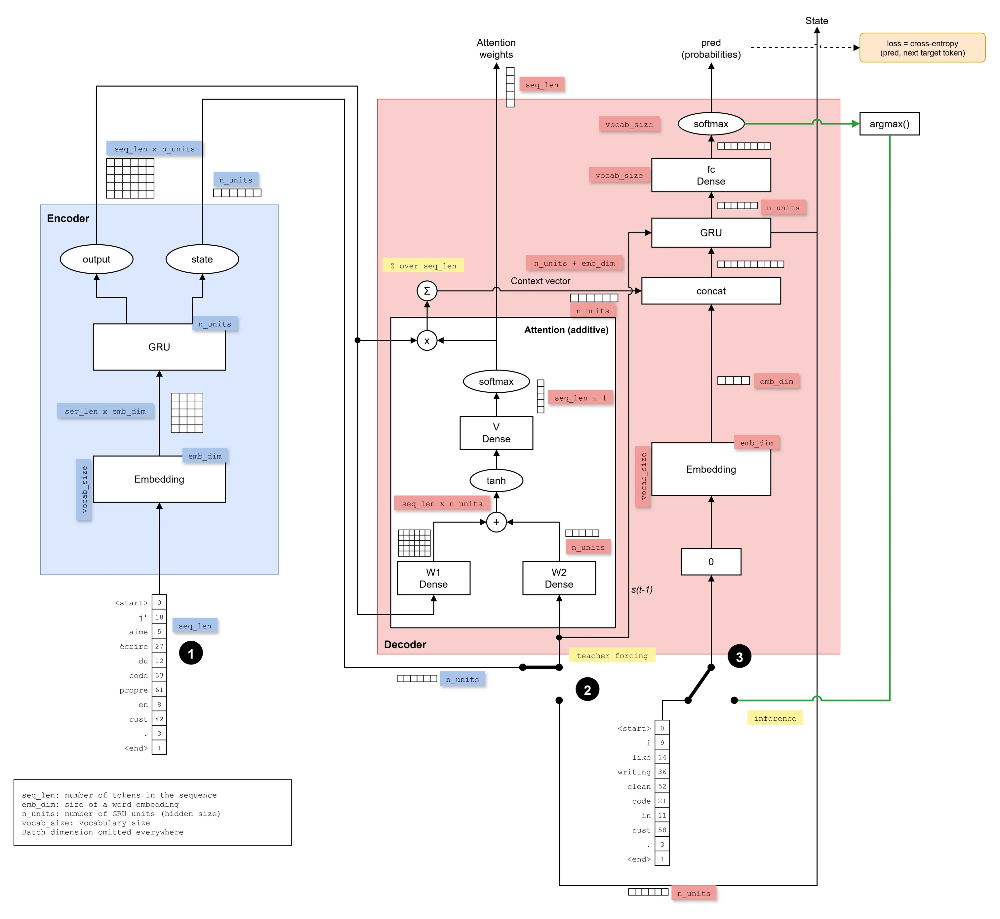
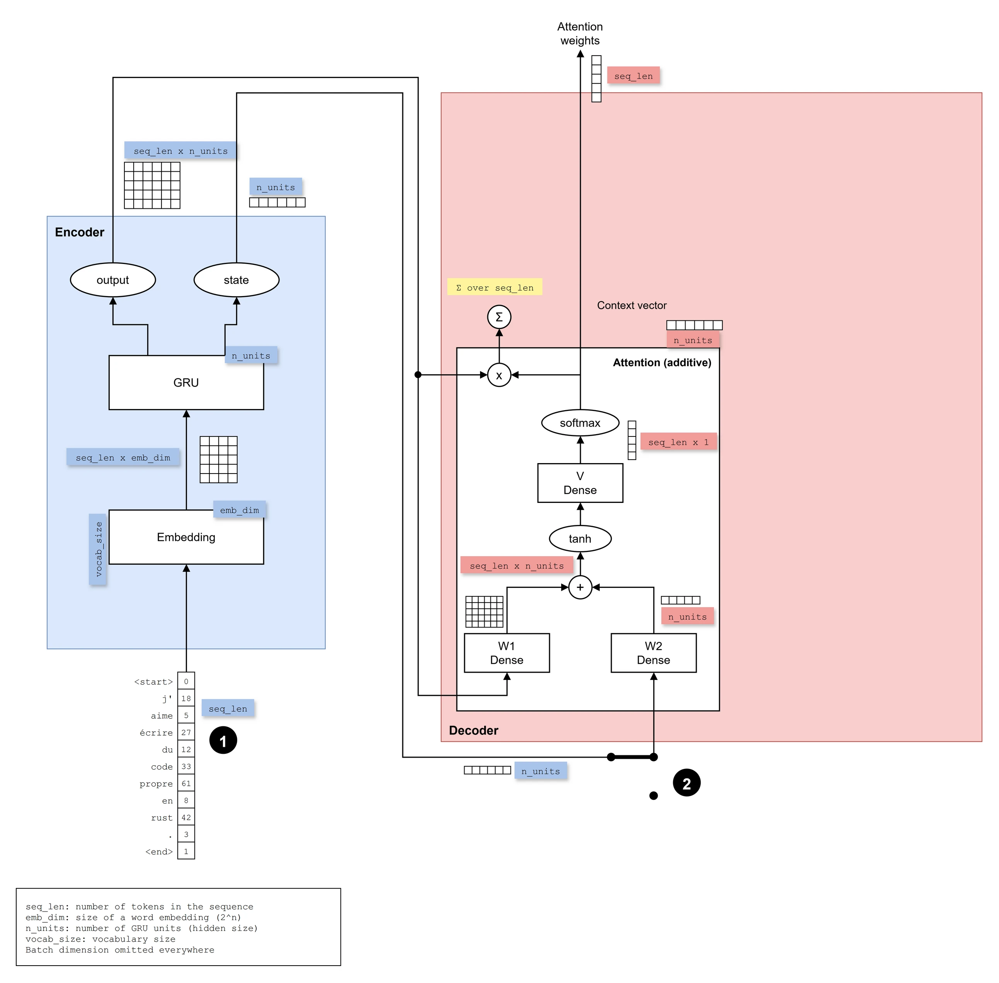
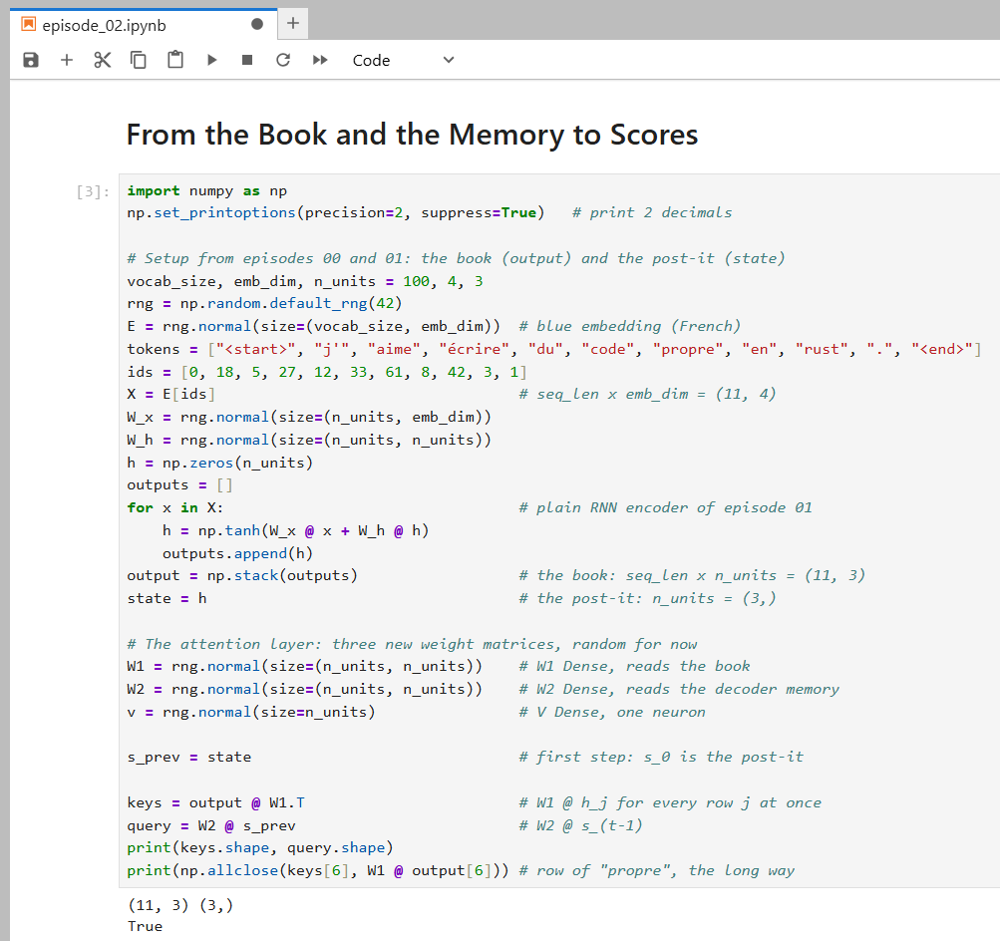
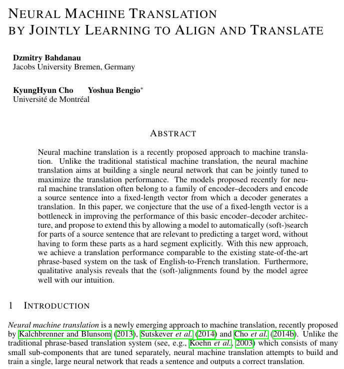

# {{ page.title }}
{: .no_toc }

{{ page.description }}
{: .lead }


<h2 align="center"><span style="color:#F87115"><b> 🚧 This post is under construction 🚧</b></span></h2>


### This is Episode 02, Part 00
{: .no_toc }


{: .note }
> This post is a series in **4 episodes**, some of them in two or three parts. Alice and Bob need two evenings to rebuild the slide, one box at a time.
>
> * [Episode 00](): Day 1. Leaving class with the slide. Why word-by-word translation fails, from words to tokens, from tokens to vectors.
> * Episode 01: Day 1, later that evening.
>   * [Part 00](): Reading in order with a GRU, encoder and decoder.
>   * [Part 01](): The bottleneck and the idea of attention.
> * Episode 02: Day 2. The attention layer step by step.
>   * [Part 00]() **(you are here)**: The question attention asks, and the scores.
>   * [Part 01](): Softmax and the context vector.
>   * [Part 02](): One iteration of the decoder.
> * Episode 03: Day 2, later that evening.
>   * [Part 00](): Training with teacher forcing, and inference.
>   * [Part 01](): A real translation, what we simplified, and a peek at Transformers.


<!-- ###################################################################### -->
<!-- ###################################################################### -->
<!-- ###################################################################### -->
## TL;DR
{: .no_toc }

* At every step $$t$$, the decoder asks one question: "given my memory $$s_{t-1}$$, which rows of the book ($$h_1 \dots h_T$$, the encoder `output`) matter *now*?"
* **Scores**: $$e_{tj} = v^\top \tanh(W_1 h_j + W_2 s_{t-1})$$. `W1` and `W2` translate the book and the memory into a common language, `+` puts them together (the same question is copied on every row, that's broadcasting), `tanh` tangles them, `V` turns each row into one number.
* Still open: the `tanh`. Why is it there? The answer comes with the next box, softmax, in Part 01.


<figure style="max-width: 900px; margin: auto; text-align: center;">

<figcaption>Day 2, 6 pm. Where to look? Scores, softmax, weights, context.</figcaption>
</figure>


<!-- ###################################################################### -->
<!-- ###################################################################### -->
<!-- ###################################################################### -->
## Table of Contents
{: .no_toc .text-delta}
- TOC
{:toc}


<!-- ###################################################################### -->
<!-- ###################################################################### -->
<!-- ###################################################################### -->
## Previously

In [Episode 00](), Alice and Bob left class with a slide they did not understand. They chose a sentence, "J'aime écrire du code propre en Rust." -> "I like writing clean code in Rust.", cut it into 11 tokens, and turned the tokens into vectors with an embedding.

In Episode 01 ([Part 00]() and [Part 01]()), a GRU read these vectors in order and gave them two things: `output`, one memory per token (`seq_len x n_units`), that they called **the book**, and `state`, the last memory (`n_units`), **the post-it**. Without attention, the decoder translates from the post-it only, and long sentences get crushed in this bottleneck. With attention, the decoder keeps the book open and writes itself **a new post-it at every step**, the context vector: a mix of the rows of the book, with big weights on the rows that matter for the next word.

To get there, Alice had to hide the left half of the red box with her hand: `W1`, `W2`, `+`, `tanh`, `V`, `softmax`, the multiplication and the sum. That is the machine that decides where to look. They left the library at 9 pm, with a list of questions and a promise: same place, tomorrow, 6 pm.

<figure style="max-width: 900px; margin: auto; text-align: center;">

<figcaption>The slide. Tonight, Alice takes her hand off the left half of the red box.</figcaption>
</figure>


<!-- ###################################################################### -->
<!-- ###################################################################### -->
<!-- ###################################################################### -->
## Prerequisites

* [Episode 00]() and Episode 01 ([Part 00]() and [Part 01]()): tokens, embeddings, the GRU, `output` and `state`, the bottleneck.
* A bit of Python and NumPy, and the matrix-vector product. Broadcasting is explained along the way.

{: .note-title }
> How to run the code of this episode
>
> Go to [jupyter.org](https://jupyter.org/){:target="_blank"}, click `Try` then `JupyterLab`, open a new notebook and copy'n paste the cells.
>
> * The **first cell of each section** is self-contained. It starts with `import numpy as np` and rebuilds everything from scratch: the embedding, the encoder, the book and the post-it, with the same random numbers as in Episodes 00 and 01. You can start reading (and running) at any section.
> * The **other cells of a section** continue from the cells above them, in the same section. Run them in order, without restarting the kernel.
> * The setup lines repeat from one section to the next. That's on purpose: no cell depends on a section you may have skipped.

*Day 2, 6 pm. The library, the same table in the back. Bob arrives with a bag of cookies and drops it in the middle, on top of the slide.*


<!-- ###################################################################### -->
<!-- ###################################################################### -->
<!-- ###################################################################### -->
## "I Thought About It Last Night"

**Bob:** As promised. Chocolate chips.

**Alice:** Accepted. *(moves the bag to uncover the slide)* So?

**Bob:** So I thought about it last night. In bed. Which is not great for sleeping.

**Alice:** Same. I kept seeing the book and the post-it. Let's start from there, before we touch anything new. Rule 1: simple words. You go.

**Bob:** Okay. The encoder reads the French sentence, one token at a time, and writes one row per token: its memory at that point. All the rows together, that's `output`, the book. `seq_len x n_units`, 11 rows of 3 numbers in my toy code. The last row is `state`, the post-it. The decoder writes the English sentence one token at a time, and at every step it should look at the book and write itself a new post-it, made for the word it's about to write.

**Alice:** Good. Now, I want to write it with letters, because tonight there will be formulas and I don't want to be lost in them. *(takes a pen)* The rows of the book: $$h_1$$, $$h_2$$... up to $$h_T$$. $$T$$ is the number of French tokens, so `seq_len`, 11 for us. When I stack them, I get a matrix. Let's call it $$H$$. That's `output`.

**Bob:** And `j` for the position in the French sentence, like yesterday. $$h_7$$ is the row of `propre`.

**Alice:** Yes. Now the decoder. It has its own memory. You called it `s` yesterday. At the beginning, it's the post-it: $$s_0$$, which is `state`, which is $$h_T$$. Then the decoder writes a token, the memory becomes $$s_1$$. Another token, $$s_2$$. And so on.

**Bob:** So we need a second index. One for "where am I in the French sentence", one for "how many English tokens have I written".

**Alice:** $$j$$ walks along the French sentence. $$t$$ counts the steps of the decoder. At step $$t$$, the decoder is about to write the $$t$$-th English token, and what it knows is $$s_{t-1}$$: its memory after the previous step.

**Bob:** Why $$t-1$$ and not $$t$$?

**Alice:** Because $$s_t$$ doesn't exist yet. It will be computed at the end of the step. At step 1, it only has $$s_0$$, the post-it. At step 2, it has $$s_1$$. It's always one step behind.

**Bob:** Okay. Let me print the book, I want to *see* it. Same numbers as yesterday, same seed.

```python
import numpy as np
np.set_printoptions(precision=2, suppress=True)   # print 2 decimals

# Self-contained cell. Setup from episodes 00 and 01: the book and the post-it
vocab_size, emb_dim, n_units = 100, 4, 3
rng = np.random.default_rng(42)
E = rng.normal(size=(vocab_size, emb_dim))  # blue embedding (French)
tokens = ["<start>", "j'", "aime", "écrire", "du", "code", "propre", "en", "rust", ".", "<end>"]
ids = [0, 18, 5, 27, 12, 33, 61, 8, 42, 3, 1]
X = E[ids]                                  # seq_len x emb_dim = (11, 4)
W_x = rng.normal(size=(n_units, emb_dim))
W_h = rng.normal(size=(n_units, n_units))
h = np.zeros(n_units)
outputs = []
for x in X:                                 # plain RNN encoder of episode 01
    h = np.tanh(W_x @ x + W_h @ h)
    outputs.append(h)
output = np.stack(outputs)                  # the book: seq_len x n_units = (11, 3)
state = h                                   # the post-it: n_units = (3,)

for token, row in zip(tokens, output):
    print(f"{token:>8} {row}")
print("state:", state)
```

```text
 <start> [-0.01  0.81 -0.99]
      j' [ 0.76 -0.45  0.36]
    aime [ 0.   -0.06 -0.68]
  écrire [-0.08  0.08 -0.65]
      du [ 0.17  0.03 -1.  ]
    code [-0.65 -0.91  1.  ]
  propre [-0.99  1.   -1.  ]
      en [ 0.94  0.36 -0.14]
    rust [-0.77  0.64  0.61]
       . [0.94 0.31 0.6 ]
   <end> [-0.25  0.36  1.  ]
state: [-0.25  0.36  1.  ]
```

{: .note }
> Compared to the RNN loop of Episode 01, the bias `b` is gone. It was a vector of zeros, so removing it changes none of the numbers. It just makes the setup two lines shorter.

**Alice:** There's the book. 11 rows, 3 numbers each. And `state` is the last row, the one of `<end>`. Yesterday's `True`, in plain sight.

**Bob:** Note that the weights are random. Nothing is trained, so these numbers mean nothing. But the *shapes* are right, and the shapes are what we're after tonight.

**Alice:** *(writes in the corner of the slide)*

$$
H = \begin{bmatrix} h_1 \\ h_2 \\ \vdots \\ h_T \end{bmatrix} \quad (T \times n), \qquad s_0 = h_T \quad (n)
$$

**Alice:** With $$n$$ for `n_units`, so the formulas stay short. Okay, I'm ready. *(lifts her hand off the left half of the red box)* No more hiding.


<!-- ###################################################################### -->
<!-- ###################################################################### -->
<!-- ###################################################################### -->
## The Question Attention Asks

**Bob:** Before the boxes, the question. What is this whole left part supposed to answer?

**Alice:** Yesterday's question. At step $$t$$, the decoder knows where it is: $$s_{t-1}$$. Something like "I've written `i like writing`". And it wants to know which rows of the book matter *now*, for the next word.

**Bob:** So the output of the machine is one number per row. "How much does this row matter right now?" A big number for `propre` when we're about to write `clean`, a small one for `du`.

**Alice:** One number per row, so `seq_len` numbers. *(checks the slide)* And at the top, `Attention weights`, with the label `seq_len`. It matches what we guessed yesterday.

**Bob:** And the input of the machine is two things: the book $$H$$, and the memory $$s_{t-1}$$. On the slide, the book arrives from the left, on the wire that goes into `W1`. And the memory arrives from below, through switch 2, into `W2`.

**Alice:** So, if I write it as a function, for each row $$j$$ we need something like:

$$
\text{score}(h_j, s_{t-1}) \rightarrow \text{one number}
$$

**Bob:** A function that compares a row of the book with the memory, and says "match" or "no match". Like... a search engine. You type a question, it gives a relevance score to every page, and the best pages come first.

**Alice:** Here the question is the memory, and the pages are the rows. Okay. But how do you "compare" a row and a memory? Rule 1.

**Bob:** That's the bottom of the box. `W1`, `W2`, `+`, `tanh`, `V`. Five boxes for one score. Let's take them one by one.


<!-- ###################################################################### -->
<!-- ###################################################################### -->
<!-- ###################################################################### -->
## From the Book and the Memory to Scores

<figure style="max-width: 900px; margin: auto; text-align: center;">

<figcaption>Alice's redrawing of the attention part. Tonight's menu, from W1 and W2 at the bottom to the context vector at the top.</figcaption>
</figure>

**Alice:** First question, and I want an honest answer. Why not compare $$h_j$$ and $$s_{t-1}$$ directly? They're both `n_units` long. Same size. We could just multiply them coordinate by coordinate and add, a dot product, and get a number.

**Bob:** Hmm. *(thinks)* Same size, yes. But who wrote them?

**Alice:** $$h_j$$ was written by the encoder. $$s_{t-1}$$... at step 1 it's the post-it, so the encoder too. But after that, it's written by the decoder's GRU.

**Bob:** Two different networks. Each one decides on its own what its 3 numbers mean. Maybe the first number of the encoder ends up meaning "this is a verb", and the first number of the decoder ends up meaning "I'm in the middle of a sentence". Nobody told them to agree.

**Alice:** So comparing them coordinate by coordinate is like... comparing a temperature in Celsius and a price in euros. Both are numbers, both fit in a cell of a spreadsheet, but subtracting them means nothing.

**Bob:** Exactly. So we translate both into a common language first. `W1` translates the rows of the book, `W2` translates the memory. Two matrices, learned during training. The network will figure out by itself what the common language should be.

**Alice:** Explain it differently. "Common language".

**Bob:** Okay. *(thinks)* `W1` turns each row into an answer to "what do I have to offer?". `W2` turns the memory into "what am I looking for?". Once both are written in the same terms, comparing them makes sense.

**Alice:** I'll take that. Sizes now. `W1 Dense`, with `n_units` written on it. So `W1` is `n_units x n_units`: it takes a row of 3 numbers and gives back 3 numbers. Applied to the 11 rows, I get 11 new rows: `seq_len x n_units`. That's the label above `W1` on the drawing.

**Bob:** And `W2` is also `n_units x n_units`, applied to one vector, so it gives one vector of `n_units`.

$$
W_1 h_j \quad (n \text{ for each } j), \qquad W_2 s_{t-1} \quad (n)
$$

**Bob:** In code, I could loop over the rows and do `W1 @ h_j` 11 times. But NumPy can do all the rows at once.

```python
import numpy as np
np.set_printoptions(precision=2, suppress=True)   # print 2 decimals

# Self-contained cell. Setup from episodes 00 and 01: the book and the post-it
vocab_size, emb_dim, n_units = 100, 4, 3
rng = np.random.default_rng(42)
E = rng.normal(size=(vocab_size, emb_dim))  # blue embedding (French)
tokens = ["<start>", "j'", "aime", "écrire", "du", "code", "propre", "en", "rust", ".", "<end>"]
ids = [0, 18, 5, 27, 12, 33, 61, 8, 42, 3, 1]
X = E[ids]                                  # seq_len x emb_dim = (11, 4)
W_x = rng.normal(size=(n_units, emb_dim))
W_h = rng.normal(size=(n_units, n_units))
h = np.zeros(n_units)
outputs = []
for x in X:                                 # plain RNN encoder of episode 01
    h = np.tanh(W_x @ x + W_h @ h)
    outputs.append(h)
output = np.stack(outputs)                  # the book: seq_len x n_units = (11, 3)
state = h                                   # the post-it: n_units = (3,)

# The attention layer: three new weight matrices, random for now
W1 = rng.normal(size=(n_units, n_units))    # W1 Dense, reads the book
W2 = rng.normal(size=(n_units, n_units))    # W2 Dense, reads the decoder memory
v = rng.normal(size=n_units)                # V Dense, one neuron

s_prev = state                              # first step: s_0 is the post-it

keys = output @ W1.T                        # W1 @ h_j for every row j at once
query = W2 @ s_prev                         # W2 @ s_(t-1)
print(keys.shape, query.shape)
print(np.allclose(keys[6], W1 @ output[6])) # row of "propre", the long way
```

```text
(11, 3) (3,)
True
```

<figure style="max-width: 900px; margin: auto; text-align: center;">

<figcaption>The first cell of the section in JupyterLab: keys is seq_len x n_units, query is n_units.</figcaption>
</figure>


**Alice:** Wait, what's this `.T`?

**Bob:** Transpose. `output` has one token per *row*. `W1 @ h_j` wants `h_j` as a column. Multiplying the rows by `W1.T` on the right does the same thing for all of them in one go. That's what the second line checks: `keys[6]`, the row of `propre`, is exactly `W1 @ output[6]`, done the long way.

**Alice:** `[6]`? `propre` is the 7th token. $$h_7$$.

**Bob:** Python counts from 0. `output[6]` is your $$h_7$$. Sorry, two worlds.

**Alice:** `True`. Okay, I trust it. `(11, 3)` and `(3,)`: `seq_len x n_units` and `n_units`, like on the drawing. And why do you call them `keys` and `query`?

**Bob:** I stole the names from the PyTorch tutorial that implements this exact slide. The memory is the `query`, the question. The translated rows are the `keys`. Funny names. I have a feeling they'll come back one day. Let's keep them in a corner.

{: .note }
> The PyTorch tutorial [NLP From Scratch: Translation with a Sequence to Sequence Network and Attention](https://pytorch.org/tutorials/intermediate/seq2seq_translation_tutorial.html){:target="_blank"} implements this attention in a class called `BahdanauAttention`. Its three layers are named differently: `Ua` is our `W1` (applied to the `keys`, the book), `Wa` is our `W2` (applied to the `query`, the memory) and `Va` is our `V`. Same machine, other labels[^1]. In this series, we stick to the names of the slide: `W1`, `W2`, `V`.

**Alice:** Next box: `+`. And here I have a problem. *(points at the two labels)* On the left, `seq_len x n_units`. On the right, `n_units`. A matrix plus a vector? That's not allowed. In my math class, that's not allowed.

**Bob:** In NumPy, it is. It's called **broadcasting**. When you add a vector of 3 numbers to a matrix of 11 rows of 3 numbers, NumPy copies the vector on every row, then adds row by row.

**Alice:** It just... copies it 11 times?

**Bob:** Conceptually, yes. In practice it's smarter than that, it doesn't really copy anything in memory, but the result is the same.

**Alice:** *(thinks)* Actually, it makes sense. The memory is the question. And the decoder asks the *same* question to every row of the book. "Do you have what I'm looking for?", 11 times. So yes, the same vector on every row.

**Bob:** Let's check, then `tanh`, then `V`, all in one go:

```python
summed = keys + query                       # broadcasting: query added to every row
print(summed.shape)
print(np.allclose(summed[6], keys[6] + query))

squashed = np.tanh(summed)                  # every value between -1 and +1
scores = squashed @ v                       # one number per row
print(scores.shape)
for token, score in zip(tokens, scores):
    print(f"{token:>8} {score:5.2f}")
```

```text
(11, 3)
True
(11,)
 <start>  0.18
      j'  0.05
    aime  0.17
  écrire  0.13
      du  0.26
    code -0.34
  propre  0.10
      en -0.01
    rust -0.62
       . -0.18
   <end> -0.80
```

**Alice:** `(11, 3)` after the sum, still `seq_len x n_units`. And `summed[6]` is `keys[6] + query`: what the row of `propre` offers, plus what the decoder is looking for.

**Bob:** That's the `+` of the slide. And look at the title of the box on your drawing.

**Alice:** "Attention (additive)". Oh. That's why. Because the two sides are *added*.

**Bob:** Yes. People call this one **additive attention**, or Bahdanau attention. Others, a bit later, compared the two sides with a product instead of a sum: Luong et al. (2015), [Effective Approaches to Attention-based Neural Machine Translation](https://arxiv.org/abs/1508.04025){:target="_blank"}. I wrote it down, it's for later.

**Alice:** Fine. Then `tanh`. Every value squashed between -1 and +1. Same `tanh` as in your RNN loop yesterday. Why is it here?

**Bob:** Hmm. To keep the values in a reasonable range? And because a network without non-linearity is just one big matrix multiplication, and a matrix multiplication can't do much.

**Alice:** That's the general answer. "Neural networks need non-linearities". It's true, but it's a bit like saying "cars need wheels". Why *here*? What would go wrong without it?

**Bob:** *(stares at the box)* I don't know. Honestly.

**Alice:** Okay. Rule 3: written down, we come back to it. Next. `V Dense`, with a `1` next to it.

**Bob:** One neuron. A Dense layer with one neuron takes a vector and gives back one number. Here it takes each row of 3 numbers, and gives back one number per row.

**Alice:** One neuron with 3 inputs... so 3 weights. `V` is not a matrix, it's a vector of `n_units` numbers. And "one number from a vector of 3" is a dot product. That's why the formula in the paper has a little $$\top$$ and a lowercase $$v$$: it's a vector, transposed, times a column.

**Bob:** And after `V`, we have `(11,)`. `seq_len` numbers. One per French token. The label on your drawing says `seq_len x 1`.

**Alice:** Same thing, written as a column. Let me write the whole thing.

$$
e_{tj} = v^\top \tanh\left(W_1 h_j + W_2 s_{t-1}\right)
$$

**Alice:** Why $$e$$?

**Bob:** *(phone)* Rule 3. In [Bahdanau et al. (2014)](https://arxiv.org/abs/1409.0473){:target="_blank"}, section 3.1, they call it the "energy". And the function that computes it, they call it the "alignment model": it scores how well the inputs around position $$j$$ and the output at position $$t$$ match. The paper uses $$i$$ instead of our $$t$$, but it's the same formula.

<figure style="max-width: 900px; margin: auto; text-align: center;">

<figcaption>Neural Machine Translation by Jointly Learning to Align and Translate</figcaption>
</figure>

**Alice:** "Energy". Okay, whatever. These are the **scores**. And now I look at the numbers... `du` has the highest score. `0.26`. And `rust`, `-0.62`.

**Bob:** Random weights. The network has never seen a translation. It has no reason to prefer anything. Tonight we check the plumbing, not the water.

**Alice:** Fair enough. Feynman check, your turn. The scores in five sentences.

**Bob:** One. We want one number per row of the book, saying how much it matters for the next word. Two. `W1` translates the rows of the book, `W2` translates the memory, so that both speak the same language. Three. We add the translated memory to every translated row: broadcasting, the same question asked to every row. Four. `tanh` squashes everything between -1 and +1, for a reason we don't know yet. Five. `V` turns each row into one number: the score.

**Alice:** Approved. With one hole, and we both know where it is.


<!-- ###################################################################### -->
<!-- ###################################################################### -->
<!-- ###################################################################### -->
## To Be Continued

One score per row of the book, and one hole: why the `tanh`? The answer comes with the next box, softmax, in [Part 01]().


<!-- ###################################################################### -->
<!-- ###################################################################### -->
<!-- ###################################################################### -->
## Webliography

**Papers**
* Bahdanau, Cho, Bengio (2014), [Neural Machine Translation by Jointly Learning to Align and Translate](https://arxiv.org/abs/1409.0473){:target="_blank"}. Section 3.1 for the scores ("energy").
* Luong, Pham, Manning (2015), [Effective Approaches to Attention-based Neural Machine Translation](https://arxiv.org/abs/1508.04025){:target="_blank"}. Other ways to compute the scores, including with a product instead of a sum.

**Code**
* PyTorch tutorial, [NLP From Scratch: Translation with a Sequence to Sequence Network and Attention](https://pytorch.org/tutorials/intermediate/seq2seq_translation_tutorial.html){:target="_blank"}. Classes `BahdanauAttention` and `AttnDecoderRNN`.
* NumPy documentation, [Broadcasting](https://numpy.org/doc/stable/user/basics.broadcasting.html){:target="_blank"}.


----

[^1]: The `nn.Linear` layers of PyTorch also add a bias to each product. We leave the biases out: they change nothing to the shapes or to the story.
