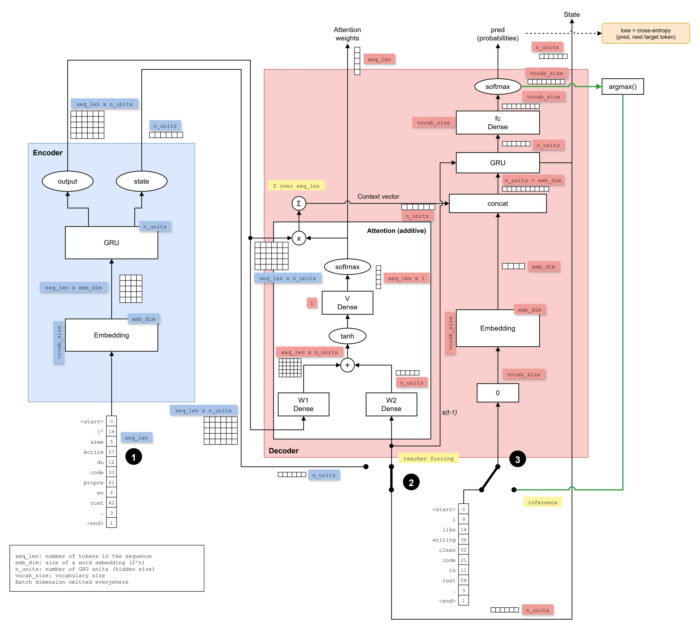
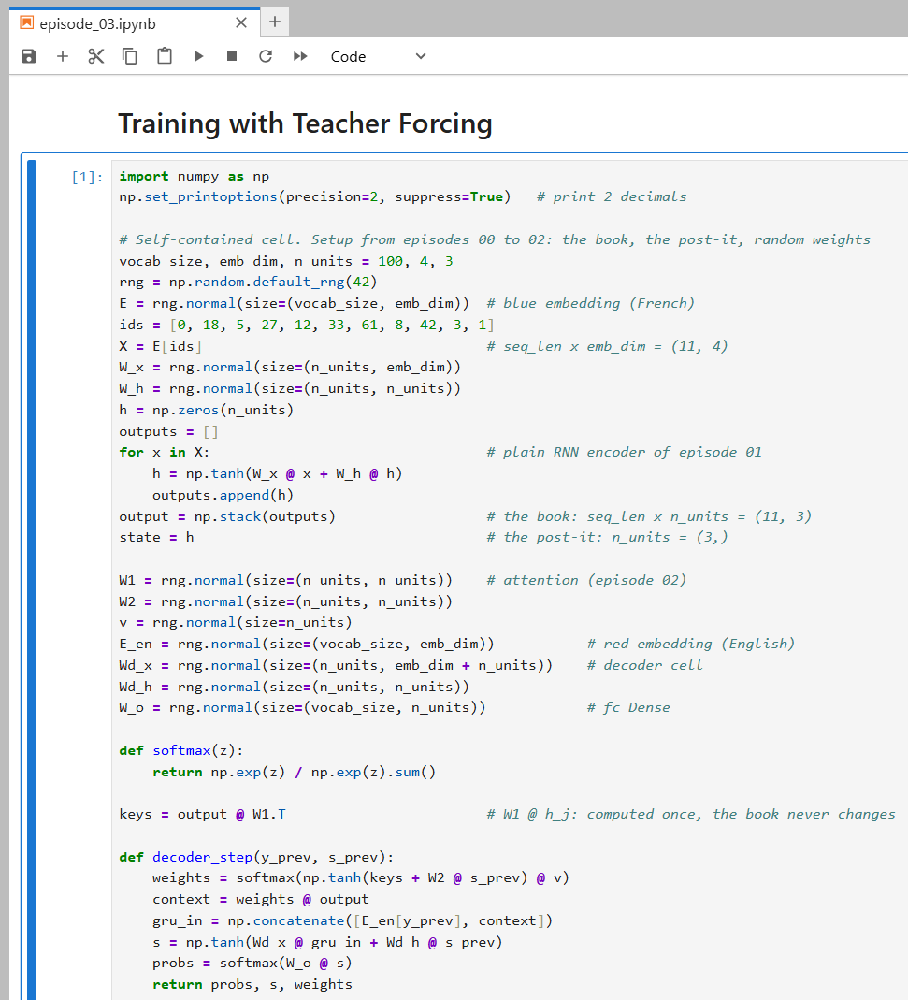
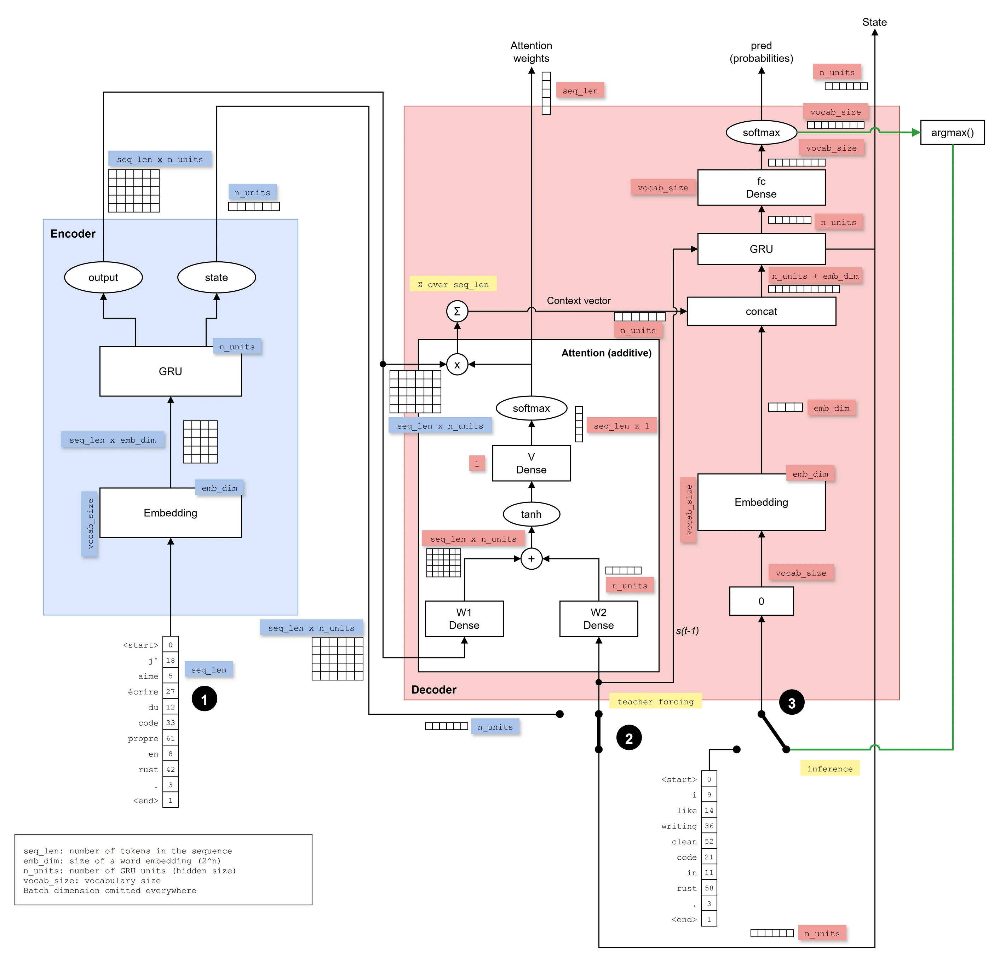
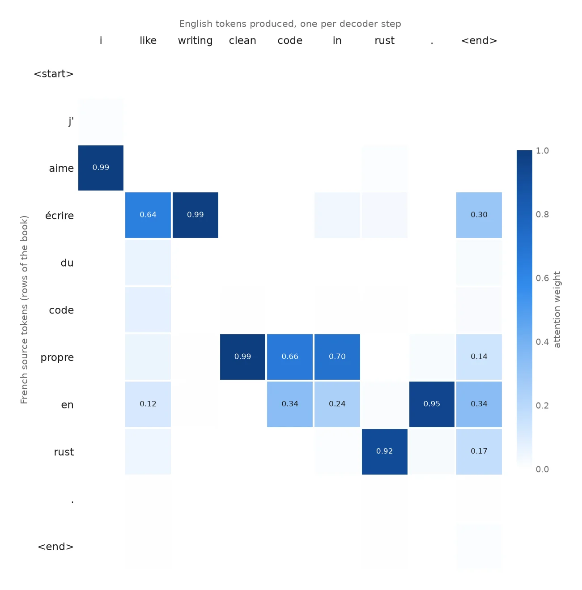

# {{ page.title }}
{: .no_toc }

{{ page.description }}
{: .lead }


<h2 align="center"><span style="color:#F87115"><b> 🚧 This post is under construction 🚧</b></span></h2>


### This is Episode 03
{: .no_toc }

{: .note }
> This post is a series in **4 episodes**. Alice and Bob need two evenings to rebuild the slide, one box at a time.
>
> * [Episode 00](): Day 1. Leaving class with the slide. Why word-by-word translation fails, from words to tokens, from tokens to vectors.
> * [Episode 01](): Day 1, later that evening. Reading in order with a GRU, encoder and decoder, the bottleneck, and the idea of attention.
> * [Episode 02](): Day 2. The attention layer step by step: scores, softmax, context vector, one iteration of the decoder.
> * [Episode 03]() **(you are here)**: Day 2, later that evening. Training with teacher forcing, inference, what we simplified, and a peek at Transformers.


<!-- ###################################################################### -->
<!-- ###################################################################### -->
<!-- ###################################################################### -->
## TL;DR
{: .no_toc }

* **Training** uses **teacher forcing**: at every step, switch 3 gives the decoder the *true* previous English token, whatever it predicted. Switch 2 gives $$s_0$$ at step 1, then the decoder's own memory. The loop runs over the *target* sentence, and the last token to predict is `<end>`.
* The **loss** is the cross-entropy: $$-\log$$ of the probability given to the expected token, summed over the steps. Backpropagation then adjusts every weight of the slide at once: embeddings, both GRUs, `W1`, `W2`, `V`, `fc`. Nobody tells the network where to look: it learns it because looking at the right place lowers the loss.
* **Inference**: no target sentence. Switch 3 flips to the green wire, `argmax()` feeds each prediction back as the next input (greedy decoding) until `<end>` or a maximum length. A mistake is never corrected and can drag the next words with it. Beam search keeps several candidates instead of one.
* A tiny trained model translates our sentence without ever having seen it, and its **attention heatmap** shows `clean` looking at `propre`. The weights are sharp where the source really decides the next word, and wander where the memory already knows it.
* The slide simplifies Bahdanau et al. (2014) in three places. And the triplet memory / translated rows / rows becomes **query / keys / values** in the Transformers.


<figure style="max-width: 900px; margin: auto; text-align: center;">

<figcaption>Day 2, after the pizza. Training, inference, and a peek at what came next.</figcaption>
</figure>


<!-- ###################################################################### -->
<!-- ###################################################################### -->
<!-- ###################################################################### -->
## Table of Contents
{: .no_toc .text-delta}
- TOC
{:toc}


<!-- ###################################################################### -->
<!-- ###################################################################### -->
<!-- ###################################################################### -->
## Previously

In [Episode 02](), Alice and Bob opened the attention box. At step $$t$$, the decoder scores every row $$h_j$$ of the book with its memory $$s_{t-1}$$: $$e_{tj} = v^\top \tanh(W_1 h_j + W_2 s_{t-1})$$. Softmax turns the scores into weights $$\alpha_{tj}$$, positive, summing to 1, and the context vector $$c_t = \sum_j \alpha_{tj} h_j$$ is the weighted average of the rows: the new post-it. Then one iteration of the decoder glues the embedding of the previous English token with the context, the GRU updates the memory to $$s_t$$, and `fc Dense` plus a softmax give one probability per English token.

They checked every shape with random weights. The decoder answered `95` instead of `i`, and Alice raised an objection that Bob could not answer: at step 2, which token goes into the decoder, the predicted one or the expected one? That is the job of switch 3. Then they ordered a pizza.

<figure style="max-width: 900px; margin: auto; text-align: center;">

<figcaption>The slide. Only the switches are left, and the reason why any of this works.</figcaption>
</figure>


<!-- ###################################################################### -->
<!-- ###################################################################### -->
<!-- ###################################################################### -->
## Prerequisites

* Episodes [00](), [01]() and [02](). Episode 02 above all: this episode reuses its decoder step as is.
* The idea of a loss minimized by [gradient descent](). We won't compute any gradient by hand.

{: .note-title }
> How to run the code of this episode
>
> Go to [jupyter.org](https://jupyter.org/){:target="_blank"}, click `Try` then `JupyterLab`, open a new notebook and copy'n paste the cells.
>
> * The **first cell of each section** is self-contained. It starts with `import numpy as np` and rebuilds everything from scratch: the encoder, the book, the post-it, the attention and the decoder of Episode 02, with the same random numbers. You can start reading (and running) at any section.
> * The **other cells of a section** continue from the cells above them, in the same section. Run them in order, without restarting the kernel.
> * The setup lines repeat from one section to the next. That's on purpose: no cell depends on a section you may have skipped.

*8 pm. The pizza box is empty, pushed to the edge of the table. Alice puts the slide back in the middle and taps switch 3.*


<!-- ###################################################################### -->
<!-- ###################################################################### -->
<!-- ###################################################################### -->
## Training with Teacher Forcing

**Alice:** My objection. Step 2. The decoder predicted `95`. The right answer was `i`, index 9. What goes into the red embedding now?

**Bob:** Let's read the slide. Switch 3 has two positions. On one side, "teacher forcing", and a column of indices: `0`, `9`, `7`, `58`. On our redrawing, the English sentence: `<start> i like writing clean code in rust . <end>`. On the other side, "inference", and the green wire coming back from `argmax()`.

**Alice:** So, two worlds. One where we *have* the English sentence, one where we don't.

**Bob:** When do we have it?

**Alice:** *(thinks)* During training. To train a translator, you need pairs: a French sentence and its correct English translation. Thousands of them. So during training, we know the answer.

**Bob:** And "teacher forcing" means... the teacher forces the answer?

**Alice:** Let me guess. In training mode, switch 3 is on the side of the English sentence. At step 1 the decoder gets `<start>`. At step 2 it gets `i`, the *true* `i`, whatever it predicted. At step 3, `like`. And so on.

**Bob:** Even if it said `95` at step 1?

**Alice:** Even then. That's the "forcing". The teacher doesn't let it continue from its own mistake.

**Bob:** Okay, let me find an analogy. *(thinks)* A dictation, in primary school. The teacher dictates a sentence, you write word by word. A nice teacher checks every word as you go: you wrote "the cat sat on the hat", she says "no, *mat*", you correct it, and you write the next word from the right sentence. You never write a whole page built on top of your first mistake.

**Alice:** And at each word, she also gives you a mark. "Right" or "wrong", or better, "how far from right". That's the loss, I suppose.

**Bob:** Yes. Let me draw the training position of the switches first.

<figure style="max-width: 900px; margin: auto; text-align: center;">

<figcaption>Training mode, from step 2 on. Switch 2 has flipped to the decoder's own memory, switch 3 stays on the English sentence, and pred goes to the loss.</figcaption>
</figure>

**Alice:** Switch 2 has flipped too.

**Bob:** That's the other half of yesterday's question. At step 1, switch 2 is connected to the encoder: it gives $$s_0$$, the post-it, to `W2` and to the GRU. From step 2 on, it flips: it gives the decoder's *own* memory, $$s_{t-1}$$, the one that comes back down from `State`.

**Alice:** So switch 2 is not about training versus inference. It flips at step 2, in both modes.

**Bob:** Right. Switch 2 is "first step or not". Switch 3 is "training or not".

**Alice:** Okay. And the loop. How many steps?

**Bob:** As many as tokens in the English sentence, after `<start>`. We loop over the *target*, not over the source. And the last token to predict is `<end>`.

**Alice:** Of course. That's how it learns to stop. After `.`, the right answer is `<end>`, and it gets a bad mark if it says anything else.

**Alice:** Now the mark. Easy one. At step 1, `argmax()` says `95`, the right answer is `i`: wrong, 1 point of penalty. If it had said `i`: right, 0. We add the penalties over the sentence, and training means making that number smaller.

**Bob:** Like counting the mistakes in the dictation. *(thinks)* Hmm, wait. With our random weights, it's wrong everywhere: 9 mistakes out of 9. Now I nudge one weight a tiny bit. What happens?

**Alice:** The probabilities move a tiny bit, and... `argmax()` still picks `95`. Still wrong. Still 9.

**Bob:** And another tiny nudge, still 9. And another one... Until one day, the `argmax()` jumps to another token, and the count jumps too.

**Alice:** *(groans)* "Nothing, nothing, nothing, jump". The `argmax` wall, again. We had exactly this discussion about the mix, before the pizza. A count of mistakes can't tell the network which way to go.

**Bob:** So the mark must change smoothly when the weights change smoothly. Not "right or wrong", but "how close to right".

**Alice:** Then forget `argmax()`. The decoder gives a probability to every English token: `pred`, `vocab_size` numbers. At step 1, the expected token is `i`. We only look at one number: the probability given to `i`. That number moves a tiny bit at every nudge.

**Bob:** If it gives 0.99 to `i`, good mark. If it gives 0.001, bad mark. And everything in between.

**Bob:** And the "mark" is a loss: small is good. We take minus the log of that probability.

$$
\mathcal{L}_t = -\log p_t(y_t)
$$

**Alice:** $$y_t$$ is the expected token at step $$t$$, and $$p_t(y_t)$$ is the probability the decoder gave to it. Why the log?

**Bob:** Let me show you rather than explain.

```python
import numpy as np
np.set_printoptions(precision=2, suppress=True)   # print 2 decimals

# Self-contained cell. Setup from episodes 00 to 02: the book, the post-it, random weights
vocab_size, emb_dim, n_units = 100, 4, 3
rng = np.random.default_rng(42)
E = rng.normal(size=(vocab_size, emb_dim))  # blue embedding (French)
ids = [0, 18, 5, 27, 12, 33, 61, 8, 42, 3, 1]
X = E[ids]                                  # seq_len x emb_dim = (11, 4)
W_x = rng.normal(size=(n_units, emb_dim))
W_h = rng.normal(size=(n_units, n_units))
h = np.zeros(n_units)
outputs = []
for x in X:                                 # plain RNN encoder of episode 01
    h = np.tanh(W_x @ x + W_h @ h)
    outputs.append(h)
output = np.stack(outputs)                  # the book: seq_len x n_units = (11, 3)
state = h                                   # the post-it: n_units = (3,)

W1 = rng.normal(size=(n_units, n_units))    # attention (episode 02)
W2 = rng.normal(size=(n_units, n_units))
v = rng.normal(size=n_units)
E_en = rng.normal(size=(vocab_size, emb_dim))           # red embedding (English)
Wd_x = rng.normal(size=(n_units, emb_dim + n_units))    # decoder cell
Wd_h = rng.normal(size=(n_units, n_units))
W_o = rng.normal(size=(vocab_size, n_units))            # fc Dense

def softmax(z):
    return np.exp(z) / np.exp(z).sum()

keys = output @ W1.T                        # W1 @ h_j: computed once, the book never changes

def decoder_step(y_prev, s_prev):
    weights = softmax(np.tanh(keys + W2 @ s_prev) @ v)
    context = weights @ output
    gru_in = np.concatenate([E_en[y_prev], context])
    s = np.tanh(Wd_x @ gru_in + Wd_h @ s_prev)
    probs = softmax(W_o @ s)
    return probs, s, weights

# Training, teacher forcing, one sentence pair
en_tokens = ["<start>", "i", "like", "writing", "clean", "code", "in", "rust", ".", "<end>"]
tgt_ids = [0, 9, 14, 36, 52, 21, 11, 58, 3, 1]

s_prev = state                              # switch 2, step 1: the post-it
total_loss = 0.0
for t in range(1, len(tgt_ids)):            # loop over the TARGET sentence
    y_prev = tgt_ids[t - 1]                 # switch 3: the TRUE previous token
    probs, s, _ = decoder_step(y_prev, s_prev)
    target = tgt_ids[t]                     # the token the decoder should predict
    loss_t = -np.log(probs[target])
    total_loss += loss_t
    print(f"t={t}  in: {en_tokens[t - 1]:>7}  expected: {en_tokens[t]:>7}  p={probs[target]:.3f}  loss={loss_t:.2f}")
    s_prev = s                              # switch 2 flips: the decoder's own memory
print("total loss:", round(total_loss, 2))
```

```text
t=1  in: <start>  expected:       i  p=0.001  loss=7.22
t=2  in:       i  expected:    like  p=0.053  loss=2.94
t=3  in:    like  expected: writing  p=0.003  loss=5.81
t=4  in: writing  expected:   clean  p=0.022  loss=3.82
t=5  in:   clean  expected:    code  p=0.003  loss=5.75
t=6  in:    code  expected:      in  p=0.005  loss=5.26
t=7  in:      in  expected:    rust  p=0.002  loss=6.17
t=8  in:    rust  expected:       .  p=0.011  loss=4.49
t=9  in:       .  expected:   <end>  p=0.009  loss=4.72
total loss: 46.19
```

<figure style="max-width: 900px; margin: auto; text-align: center;">

<figcaption>The training cell in JupyterLab: everything from Episodes 00 to 02 in one cell, and the keys computed once, outside the loop.</figcaption>
</figure>

**Alice:** Wait, I'm reading the "in" column. `<start>`, `i`, `like`, `writing`... it's the English sentence, shifted by one. And the "expected" column is the same sentence, one step ahead. The decoder gets the true sentence as input and must guess the next token, every time.

**Bob:** That's teacher forcing in two columns. And look at `p`: all tiny. 0.001 for `i`. Random weights, 100 tokens, so roughly 1 chance in 100 at best.

**Alice:** And the losses are between 3 and 7. Now show me why the log.

```python
for p in [0.99, 0.5, 0.1, 0.01, 0.001]:
    print(f"p={p:<6} loss={-np.log(p):.2f}")
```

```text
p=0.99   loss=0.01
p=0.5    loss=0.69
p=0.1    loss=2.30
p=0.01   loss=4.61
p=0.001  loss=6.91
```

**Alice:** Almost sure and right: almost zero. Half sure: 0.69. And then each time the probability is divided by 10, the loss goes up by the same 2.30. It never stops growing. A network that gives 0.000001 to the right answer gets a huge penalty.

**Bob:** So it's punished hard for being confidently wrong. That's the **cross-entropy**. The yellow box on our drawing: "loss = cross-entropy (pred, next target token)".

**Alice:** And for the whole sentence, we add the losses of all the steps. 46.19 here.

$$
\mathcal{L} = -\sum_{t=1}^{T'} \log p_t(y_t)
$$

**Alice:** With $$T'$$ the number of English tokens to predict, 9 for us. It's not $$T$$, the French length. Different loop.

**Bob:** By the way, in real code, the softmax at the top and the log of the loss are often merged into one function, for numerical reasons. In PyTorch, `CrossEntropyLoss` takes the logits directly. Same math, more stable.

**Alice:** Now the big question. We have a number, 46.19. How does it become "a network that translates"?

**Bob:** Gradient descent. Same as for any network. We compute how the loss changes when we nudge each weight a tiny bit: that's the gradient. Then we move every weight a tiny bit in the direction that lowers the loss. And again, for the next sentence pair. Thousands of pairs, many times.

**Alice:** Which weights?

**Bob:** All of them. *(runs his finger over the slide)* The blue embedding, the encoder GRU, `W1`, `W2`, `V`, the red embedding, the decoder GRU, `fc Dense`. The loss is computed at the top, and the gradient flows back down through every wire. Through the context vector, through the softmax of the attention, into `W1` and `W2`, and into the encoder itself.

**Alice:** *(slowly)* So nobody ever tells the network "for `clean`, look at `propre`". There's no label for that. It only gets a bad mark when it says something else than `clean`. And if looking at `propre` helps to say `clean`, the gradient will push `W1`, `W2` and `V` in that direction.

**Bob:** That's the "jointly learning to align and translate" of the title of the paper. It learns where to look *because* it's useful for translating. Not because someone drew the arrows.

**Alice:** That's also why the mix had to be soft, before the pizza. The gradient has to flow through the weights. With a hard `argmax`, it would hit a wall.

**Bob:** And one more thing, in my code. `keys = output @ W1.T`, it's outside the loop now. Computed once.

**Alice:** *(checks)* Because the book doesn't change during the sentence. `output` is the same at every step, `W1` too. So `W1` times the book is the same at every step. Only `W2 @ s_prev` changes. Why compute it 9 times?

**Bob:** Free speed. On a sentence of 50 tokens with `n_units = 512`, it's not nothing.

**Alice:** Okay, one doubt. Teacher forcing is comfortable. But isn't it cheating? During training, the decoder always gets perfect inputs. It never learns what to do after a mistake.

**Bob:** *(thinks)* That's... a very good point. I have no answer. Let's do inference, maybe the answer is there.

**Alice:** Feynman check first. Mine. In training mode, we know the English sentence. The loop runs over it. At each step, switch 3 gives the true previous token, whatever the decoder predicted, and switch 2 gives $$s_0$$ at step 1, then the decoder's own memory. The decoder gives a probability to every English token, and the loss is minus the log of the probability of the expected one, added over the steps, `<end>` included. Then gradient descent adjusts every weight of the slide. Nobody teaches it where to look: it learns it because it helps.

**Bob:** Approved.


<!-- ###################################################################### -->
<!-- ###################################################################### -->
<!-- ###################################################################### -->
## Inference: on Its Own

**Bob:** Now the model is trained. A user types a French sentence it has never seen. What do we have?

**Alice:** The French sentence. Only. No English sentence, so no teacher. Switch 3 goes to the other side: "inference". The green wire.

<figure style="max-width: 900px; margin: auto; text-align: center;">

<figcaption>Inference mode. Switch 3 is on the green wire: each prediction becomes the next input. No loss, no teacher.</figcaption>
</figure>

**Bob:** Step 1: `<start>`, as always. The decoder gives probabilities. `argmax()` picks the most likely token. The green wire brings it down to switch 3, and it becomes the input of step 2.

**Alice:** That's exactly your pseudo-code from yesterday, without attention. "token = argmax, feed it back". And it stops when?

**Bob:** When `argmax()` gives `<end>`. Or after a maximum number of steps, in case it never does. Let me write it with our random weights.

```python
import numpy as np
np.set_printoptions(precision=2, suppress=True)   # print 2 decimals

# Self-contained cell. Setup from episodes 00 to 02: the book, the post-it, random weights
vocab_size, emb_dim, n_units = 100, 4, 3
rng = np.random.default_rng(42)
E = rng.normal(size=(vocab_size, emb_dim))  # blue embedding (French)
ids = [0, 18, 5, 27, 12, 33, 61, 8, 42, 3, 1]
X = E[ids]                                  # seq_len x emb_dim = (11, 4)
W_x = rng.normal(size=(n_units, emb_dim))
W_h = rng.normal(size=(n_units, n_units))
h = np.zeros(n_units)
outputs = []
for x in X:                                 # plain RNN encoder of episode 01
    h = np.tanh(W_x @ x + W_h @ h)
    outputs.append(h)
output = np.stack(outputs)                  # the book: seq_len x n_units = (11, 3)
state = h                                   # the post-it: n_units = (3,)

W1 = rng.normal(size=(n_units, n_units))    # attention (episode 02)
W2 = rng.normal(size=(n_units, n_units))
v = rng.normal(size=n_units)
E_en = rng.normal(size=(vocab_size, emb_dim))           # red embedding (English)
Wd_x = rng.normal(size=(n_units, emb_dim + n_units))    # decoder cell
Wd_h = rng.normal(size=(n_units, n_units))
W_o = rng.normal(size=(vocab_size, n_units))            # fc Dense

def softmax(z):
    return np.exp(z) / np.exp(z).sum()

keys = output @ W1.T                        # W1 @ h_j: computed once, the book never changes

def decoder_step(y_prev, s_prev):
    weights = softmax(np.tanh(keys + W2 @ s_prev) @ v)
    context = weights @ output
    gru_in = np.concatenate([E_en[y_prev], context])
    s = np.tanh(Wd_x @ gru_in + Wd_h @ s_prev)
    probs = softmax(W_o @ s)
    return probs, s, weights

# Inference, greedy decoding: no target sentence, the green wire
max_len = 12
s_prev = state                              # switch 2, step 1: the post-it
y_prev = 0                                  # <start>
produced = []
for t in range(1, max_len + 1):
    probs, s, _ = decoder_step(y_prev, s_prev)
    y_hat = int(np.argmax(probs))           # most likely token
    produced.append(y_hat)
    if y_hat == 1:                          # <end>: stop
        break
    y_prev = y_hat                          # switch 3, inference side: feed the prediction back
    s_prev = s                              # switch 2 flips
print(produced)
```

```text
[95, 74, 25, 74, 25, 68, 14, 25, 68, 14, 25, 68]
```

**Alice:** `95` first. The same `95` as before the pizza, same weights, same first step. Then `74`, `25`, `74`, `25`... and then `68, 14, 25`, `68, 14, 25`. It's stuck in a loop!

**Bob:** And it never says `1`, `<end>`. So it stops at `max_len`, 12 tokens. Without `max_len`, it would still be talking.

**Alice:** *(laughs)* There's a `14` in there. `like`. It's the only real word, and it's by chance.

**Bob:** Random weights. But even a trained model can do this kind of thing, repeat itself, on a sentence too different from its training data. That's why `max_len` is always there.

**Alice:** Notice something else. The number of steps has nothing to do with the French sentence. 11 French tokens, and it could have stopped after 3, or after 20. The decoder decides the length by itself, with `<end>`.

**Bob:** Now your doubt from before. "The decoder never learns what to do after a mistake."

**Alice:** Look at the loop. `y_prev = y_hat`. Whatever it predicted goes back in. If it says `love` instead of `like` at step 2, then at step 3 it gets `love` as input. In training, that never happened: after `i`, it always got the true `like`. Now it's in a situation it has never seen.

**Bob:** And then it can make another mistake, which feeds the next step... One mistake can drag the rest of the sentence with it.

**Alice:** So training and inference are not quite the same game. In training, the inputs are always perfect. In inference, they're its own outputs, mistakes included.

**Bob:** *(phone)* Rule 3. It has a name: **exposure bias**. The model is never exposed to its own mistakes during training. And people found fixes. For example, Bengio et al. (2015), [Scheduled Sampling for Sequence Prediction with Recurrent Neural Networks](https://arxiv.org/abs/1506.03099){:target="_blank"}: during training, from time to time, they feed the predicted token instead of the true one. Like a teacher who lets you continue from your mistake once in a while, so that you learn to recover.

**Alice:** So your dictation teacher should sometimes *not* correct you. Funny. Okay, and the other weakness. `argmax()`. At every step, we take the single most likely token, and we never look back.

**Bob:** That's called **greedy decoding**. Greedy, because it takes the best thing right now, without thinking about later.

**Alice:** And that can be a bad deal. Imagine at step 2, `like` gets 0.40 and `love` gets 0.45. Greedy takes `love`. But maybe, after `like`, the rest of the sentence would have been much more probable. `like writing` is very natural, `love writing` a bit less.

**Bob:** Then you keep several candidates instead of one. That's **beam search**. At each step, you keep, say, the 3 best partial translations, not just one. You extend each of them with every possible next token, you compute the probability of each whole sentence so far, and you keep the 3 best again. At the end, you pick the best complete sentence.

**Alice:** More work, but you don't bet everything on the first choice. How much more work?

**Bob:** Roughly 3 times, if you keep 3. People often use something between 4 and 10. [Dive into Deep Learning](https://d2l.ai/chapter_recurrent-modern/beam-search.html){:target="_blank"} has a good explanation, with drawings. For tonight, greedy is enough: it's what the green wire of the slide does.

**Alice:** Feynman check. Yours.

**Bob:** In inference, we only have the French sentence. Switch 3 is on the green wire: each predicted token, the `argmax()` of `pred`, becomes the input of the next step. Switch 2 does as in training: $$s_0$$ at step 1, then the decoder's own memory. We stop on `<end>` or at a maximum length, so the length of the translation is free. There's no loss and no learning anymore: the weights are frozen. A mistake is never corrected and can propagate, and that's the price of not having a teacher. Taking the best token at each step is greedy decoding; beam search keeps several candidates.

**Alice:** Approved. *(pause)* But I'm frustrated.

**Bob:** Why?

**Alice:** Two evenings. We understand every wire. And we've never seen this thing actually translate anything. Only `95` and loops.


<!-- ###################################################################### -->
<!-- ###################################################################### -->
<!-- ###################################################################### -->
## Where Does `clean` Look?

**Bob:** *(turns his laptop towards her, a little too proud)* I have a confession.

**Alice:** You ate the last cookie.

**Bob:** That too. But no. Last night, when I couldn't sleep, I found the PyTorch tutorial, the one with `query` and `keys`. It trains a real translation model with attention. So I copied it, and I spent the night renaming everything with the names of the slide, and replacing its sentences with ours. I didn't understand half of it. But I told myself: if tonight we understand the slide, tomorrow I'll understand the code.

**Alice:** And today?

**Bob:** Today I understand much more than half. And while you were ordering the pizza, I let it train. A few minutes on my laptop.

**Alice:** Show me.

**Bob:** The slide, in PyTorch. Same boxes, same names: blue embedding, encoder GRU, `W1`, `W2`, `V`, `concat`, decoder GRU, `fc`. A real GRU this time, with `emb_dim = 16` and `n_units = 32`. And a tiny training set: I generated French and English sentences on the model of ours. `tu aimes lire du code sale en python` -> `you like reading dirty code in python`, `nous aimons tester du code en go` -> `we like testing code in go`... 5 subjects, 4 verbs, 5 adjectives or none, 5 languages. 600 pairs.

**Alice:** And our sentence is in there?

**Bob:** No! That's the point. I removed `j' aime écrire du code propre en rust .` from the training set. 599 pairs for training, with teacher forcing. Then inference, greedy, on our sentence. It has never seen it. It has seen `propre`, `écrire`, `rust`, `j'`, but never all together.

**Alice:** And?

**Bob:** `i like writing clean code in rust . <end>`.

**Alice:** *(leans in)* Perfect translation. With the inversion. `clean code`, not `code clean`.

**Bob:** And at each step, I saved the attention weights. The exit at the top of the slide, the window. Remember? "It goes nowhere, it's for us to look". Here's what we see through it.

<figure style="max-width: 800px; margin: auto; text-align: center;">

<figcaption>Attention weights of a tiny trained model on our sentence, which it never saw during training. One column per decoder step; each column sums to 1.</figcaption>
</figure>

**Alice:** One column per English token, one row per French token. Each column is one set of attention weights, so each column adds up to 1. *(follows the dark cells)* `clean`... `propre`. 0.99. It looks at `propre`!

**Bob:** Your eyes, yesterday, when you translated by hand. "I write `clean` while looking at `propre`."

**Alice:** And nobody told it. It learned that from 599 sentences, because it helped to lower the loss. `writing`, `écrire`, 0.99. `rust`, `rust`, 0.92. *(frowns)* But `i` looks at `aime`, not at `j'`.

**Bob:** Hmm. Remember what a row of the book is?

**Alice:** The memory of the encoder *after* reading that token. *(slowly)* So the row of `aime` is the memory after `j' aime`. It knows the `j'`. Looking at `aime` is enough to see the `j'`.

**Bob:** Yes. A row is not a word, it's a word *and everything before it*. And in the same way, `code` looks at `propre`, because the row of `propre` is the memory after `code propre`.

**Alice:** Okay. And `like` is less sharp, 0.64 on `écrire`. `in` looks at `propre`, which makes no sense. And the dot looks at `en`, also weird. `<end>` is spread everywhere.

**Bob:** I wondered about that too. Then I looked at the training sentences. What comes after the adjective?

**Alice:** `code`. Always. And after `code`, `in`. Always. And after the language, `.`, then `<end>`. Always.

**Bob:** So for these tokens, the decoder doesn't need to look anywhere. Its own memory knows that after `clean` comes `code`. The attention can wander, it doesn't change the answer, so the gradient never pushed it anywhere in particular.

**Alice:** And where the French sentence really *decides*... the subject, the verb, the adjective, the language: `i`, `writing`, `clean`, `rust`. These are the four sharp columns. 0.99, 0.99, 0.99, 0.92.

**Bob:** Exactly the four places where my training sentences vary.

**Alice:** *(sits back)* That's beautiful. It looks where it *needs* to look. And when it doesn't need to, it doesn't really care. And a sharp column isn't proof of anything either: the dot is sharp on `en` and it doesn't matter at all.

**Bob:** That's a good warning, actually. These pictures are fun to look at, but they're not an explanation of the model. They show where the weights are, not why the answer is right.

**Alice:** And the paper? Rule 3.

**Bob:** Bahdanau et al. (2014), Figure 3. The same kind of picture, on real English-French sentences, with real vocabularies. And the same thing: mostly a diagonal, because the two languages roughly follow the same order, with little detours where the order changes. Adjectives and nouns, like our `code propre`.

{: .note-title }
> Let's be honest
>
> Two students who discovered attention the day before would not write this script in one night, even with a tutorial. Bob gets a little help from the author here. The script that trained this tiny model and drew the heatmap is [heatmap_toy.py](./assets/heatmap_toy.py). It is about 150 lines of PyTorch, inspired by the PyTorch tutorial of the Webliography, and it follows the names of the slide.
>
> Once you have read the four episodes, you should be able to read it. That's the real test of the series.
>
> It runs on a laptop CPU in a few minutes: `uv run --with torch --with matplotlib --with pillow --with numpy python heatmap_toy.py img22.webp`. With another random seed, the translation stays the same and `i`, `writing`, `clean` and `rust` stay sharp, sometimes one row off (a row also knows the tokens before it). The "wandering" columns change from one seed to the other.


<!-- ###################################################################### -->
<!-- ###################################################################### -->
<!-- ###################################################################### -->
## What the Slide Simplifies

**Alice:** One last thing before the big Feynman check. Rule 3. Is our slide *exactly* Bahdanau et al. (2014)?

**Bob:** *(scrolls the paper)* No. Close, but simplified. I count three differences.

{: .important-title }
> What we simplified, compared to Bahdanau et al. (2014)
>
> * **The encoder reads in one direction only.** In the paper, the encoder is **bidirectional**: one RNN reads left to right, another right to left, and each row $$h_j$$ glues the two memories together. So each row knows what comes before *and* after its token. That's the idea Bob had in [Episode 01](), when Alice noticed that the row of `code` has no idea that `propre` is coming.
> * **The decoder starts from the encoder's last memory.** On the slide, $$s_0$$ is `state`. In the paper, $$s_0$$ is computed from the backward RNN, with its own small layer: $$s_0 = \tanh(W_s \overleftarrow{h}_1)$$.
> * **The prediction only uses the decoder memory.** On the slide, $$p_t = \text{softmax}(W_o s_t)$$. In the paper, the last layer also receives the context $$c_t$$ and the previous token $$y_{t-1}$$, through a "maxout" layer.
>
> Also left out everywhere in this series: the **batch** dimension (real code processes many sentences at once, so every shape has a `batch_size` in front), the **biases** of the Dense layers, and, in the NumPy cells, the gates of the GRU (replaced by a plain RNN cell). None of this changes the story.

**Alice:** The bidirectional one explains our heatmap, by the way. With a bidirectional encoder, the row of `code` would know that `propre` follows. The alignment could be cleaner.

**Bob:** Probably. I didn't try. Next time.


<!-- ###################################################################### -->
<!-- ###################################################################### -->
<!-- ###################################################################### -->
## A Door Ajar: Query, Keys, Values

**Bob:** Remember the names I stole from the PyTorch tutorial, earlier tonight? `query` and `keys`?

**Alice:** "They'll come back one day". You were very mysterious.

**Bob:** They come back now. Let me rename three things. The decoder memory, transformed by `W2`, that's the question: the **query**. The rows of the book, transformed by `W1`, they're what we compare the question with: the **keys**. And the rows of the book themselves, the ones we actually mix in the context vector...

**Alice:** ...the content. What we take home once we know where to look.

**Bob:** The **values**. Query, keys, values.

| Our slide | Role | Transformer name |
|---|---|---|
| $$W_2 s_{t-1}$$ | what the decoder is looking for | query |
| $$W_1 h_j$$ | what each row offers, for the comparison | keys |
| $$h_j$$ | what each row contains, for the mix | values |
| scores, softmax, weighted sum | where to look, then read | attention |

**Alice:** It's a library. You come with a question, you compare it with the labels on the shelves, and you take home the books whose labels match. Not the labels. The books.

**Bob:** That's exactly the vocabulary of [Attention Is All You Need](https://arxiv.org/abs/1706.03762){:target="_blank"}, Vaswani et al. (2017). The paper of the Transformers. Three years after Bahdanau.

**Alice:** What did they change?

**Bob:** From what I've read, two big things. First, the comparison. Instead of `+`, `tanh` and `V`, they take a dot product between the query and each key. Cheaper, and it works very well. Remember Luong (2015), the one who replaced the sum by a product? That direction.

$$
\text{Attention}(Q, K, V) = \text{softmax}\left(\frac{Q K^\top}{\sqrt{d_k}}\right) V
$$

**Alice:** *(reads it slowly)* Softmax of scores, times $$V$$. Scores, weights, weighted sum. It's our machine, in one line! Careful, that $$V$$ is the values, not our `V Dense`. And the $$\sqrt{d_k}$$...

**Bob:** A scaling, to keep the scores from getting too far apart. You saw what softmax does when the gaps grow.

**Alice:** Everything goes to one weight. Okay. And the second thing?

**Bob:** The title. "Attention is all you need". They removed the GRUs. No more reading one token at a time. Instead, every token of the sentence looks at every other token of the same sentence, with attention. They call it **self-attention**. And since nothing waits for the previous step anymore, all the tokens can be computed at the same time.

**Alice:** So the book is not written by a GRU anymore. Each row is written by looking at all the other rows. *(thinks)* So the row of `code` would know that `propre` follows. Bidirectional, for free.

**Bob:** And that's what's inside the LLMs everyone uses today.

**Alice:** Okay, stop. I can feel a third evening coming, and I'm not ready.

**Bob:** Me neither. Just the door ajar. If you want to peek in: the [3Blue1Brown video](https://www.youtube.com/watch?v=eMlx5fFNoYc){:target="_blank"} from earlier tonight, and Jay Alammar's [The Illustrated Transformer](https://jalammar.github.io/illustrated-transformer/){:target="_blank"}.


<!-- ###################################################################### -->
<!-- ###################################################################### -->
<!-- ###################################################################### -->
## Feynman Check: The Whole Slide

*9:30 pm. Alice puts the original slide in front of Bob, the one from class, with no redrawing.*

**Alice:** The deal was: at the end, you explain the whole slide. From the beginning. Simple words. I'm the annoying one now.

**Bob:** *(takes a breath)* Okay. We want to translate "J'aime écrire du code propre en Rust." into English.

**Bob:** Bottom left, circle 1. The French sentence is cut into tokens, and each token becomes an index in the French vocabulary: `seq_len` integers. The blue `Embedding` replaces each index by a row of `emb_dim` numbers, learned during training. We get a `seq_len x emb_dim` matrix.

**Alice:** Fine.

**Bob:** The blue `GRU` reads these rows one by one, in order, with a memory of `n_units` numbers. It gives `output`, all its memories, one row per token: the book, `seq_len x n_units`. And `state`, its last memory: the post-it, `n_units`. Each row of the book is a token *and what came before it*.

**Alice:** Objection. Why not only `state`?

**Bob:** Because a fixed-size post-it can't hold a long sentence. That was seq2seq, and its bottleneck. The book grows with the sentence. The book goes up and right, into `W1`. The post-it goes to switch 2.

**Alice:** Rejected. Continue.

**Bob:** The red part writes the English sentence, one token per step. At step $$t$$, the decoder has a memory $$s_{t-1}$$. Switch 2 gives it: at step 1, it's the post-it; after that, it's the decoder's own memory, coming back from the top. That memory goes to two places: `W2`, for the attention, and the red `GRU`, from the side.

**Alice:** Fine. The left half now. Slowly.

**Bob:** The attention answers one question: "given where I am, which rows of the book matter now?". `W1` translates each row of the book, `W2` translates the memory, so that both speak the same language. The `+` adds the translated memory to every translated row: broadcasting, the same question asked to every row. `tanh` tangles them together.

**Alice:** Objection. The `tanh` is just there because networks need non-linearities.

**Bob:** No. Without it, the memory would only add the same number to every score, and softmax ignores what's added to every score. The weights would never depend on the memory, the decoder would look at the same places at every step.

**Alice:** *(smiles)* Rejected. Continue.

**Bob:** `V`, one neuron, turns each row into one number: the scores, `seq_len`. Softmax turns them into the attention weights: positive, sum 1. They go out at the top, just so that we can look at them. And they go into the `x`: each row of the *original* book is multiplied by its weight, and the $$\Sigma$$ adds the rows. That's a weighted average of the rows: the context vector, `n_units`. A new post-it, made for this step.

**Alice:** Objection. After the multiplication, all the rows are zero except one.

**Bob:** Only if one weight is exactly 1. In practice, it's a mix, with big weights where it matters. And it must be a mix, otherwise it couldn't be trained.

**Alice:** Rejected. The right half.

**Bob:** Bottom right, circle 3. Switch 3 gives the previous English token: `<start>` at step 1. The red `Embedding` turns it into `emb_dim` numbers. `concat` glues it with the context: `n_units + emb_dim`. "What I just wrote" and "what matters in the source now". The red `GRU` takes that, and the old memory from the side, and computes the new memory $$s_t$$. `fc Dense` gives one score per English token, softmax turns them into probabilities: `pred`. $$s_t$$ goes up to `State`, and back down to switch 2 for the next step.

**Alice:** And the switches?

**Bob:** Switch 2: first step or not. Switch 3: training or not. In training, we know the English sentence: switch 3 always gives the *true* previous token, that's teacher forcing, and the loss is minus the log of the probability given to the expected token, summed over the steps up to `<end>`. Then gradient descent adjusts every weight, the attention included. Nobody tells it where to look: it learns it because it helps. In inference, there's no English sentence: switch 3 is on the green wire, `argmax()` picks a token and feeds it back, until `<end>`. Mistakes are not corrected anymore.

**Alice:** Last objection. The decoder reads the French sentence from left to right, one row per step.

**Bob:** No. At every step, it looks at *all* the rows again. The book doesn't change, only the memory changes, so the weights change. That's how `code propre` becomes `clean code`: to write `clean`, it looks at `propre`.

**Alice:** *(puts the pen down)* Approved. The whole slide. Every box, every wire, every switch.

**Bob:** *(looks at the slide)* You know what's weird? Yesterday afternoon, this thing was a plumbing diagram. Now I can't *not* see it.

**Alice:** Same. I'd almost be able to explain it to someone else.

**Bob:** We should. Record a video, or something. "The attention slide, explained by the two people who nodded in class".

**Alice:** *(laughs)* We'd never do it. Too many things to do, no time.

**Bob:** Then let's write it down. Before we forget everything.


<!-- ###################################################################### -->
<!-- ###################################################################### -->
<!-- ###################################################################### -->
## Conclusion

Let's step out of the library one last time.

In this last episode, Alice and Bob closed the loop. During training, teacher forcing gives the decoder the true previous token at every step, the cross-entropy loss marks each prediction, and gradient descent adjusts every weight of the slide at once. The network is never told where to look: it learns it, because looking at the right row lowers the loss. During inference, the green wire feeds each prediction back into the decoder until it writes `<end>`, with no teacher to catch the mistakes. And a tiny trained model showed what all this machinery buys: `clean` looks at `propre`, on a sentence the model had never seen.

Looking back at the series, the path was:

* Episode 00: a sentence becomes tokens, indices, then vectors.
* Episode 01: a GRU reads them in order, the encoder-decoder translates from a post-it, and the post-it is the bottleneck.
* Episode 02: the attention builds a new post-it at every step, a weighted average of the rows of the book.
* Episode 03: how it learns, how it is used, and how query, keys and values lead to the Transformers.

Two years ago, I drew this slide and could not explain it anymore. Rebuilding it one box at a time, with simple words and the right to ask "explain it differently" at any moment, worked better than any re-reading. If you remember only one thing, keep Alice's image: a human translator does not work from a post-it. They keep the book open, and at every word they look back at the right place.

And if you need someone to explain it to, you now know two people who would be happy to listen.


<!-- ###################################################################### -->
<!-- ###################################################################### -->
<!-- ###################################################################### -->
## Webliography

**Papers**
* Bahdanau, Cho, Bengio (2014), [Neural Machine Translation by Jointly Learning to Align and Translate](https://arxiv.org/abs/1409.0473){:target="_blank"}. The attention of the slide. Figure 3 for real attention heatmaps, appendix A for the bidirectional encoder and the maxout output.
* Bengio, Vinyals, Jaitly, Shazeer (2015), [Scheduled Sampling for Sequence Prediction with Recurrent Neural Networks](https://arxiv.org/abs/1506.03099){:target="_blank"}. A fix for exposure bias.
* Luong, Pham, Manning (2015), [Effective Approaches to Attention-based Neural Machine Translation](https://arxiv.org/abs/1508.04025){:target="_blank"}. Scores with a product instead of a sum.
* Vaswani et al. (2017), [Attention Is All You Need](https://arxiv.org/abs/1706.03762){:target="_blank"}. Query, keys, values, and the Transformers.

**Explanations and code**
* [Beam Search](https://d2l.ai/chapter_recurrent-modern/beam-search.html){:target="_blank"}, *Dive into Deep Learning*.
* PyTorch tutorial, [NLP From Scratch: Translation with a Sequence to Sequence Network and Attention](https://pytorch.org/tutorials/intermediate/seq2seq_translation_tutorial.html){:target="_blank"}. Teacher forcing, greedy decoding and attention plots, in code.
* Jay Alammar, [Visualizing A Neural Machine Translation Model](https://jalammar.github.io/visualizing-neural-machine-translation-mechanics-of-seq2seq-models-with-attention/){:target="_blank"} and [The Illustrated Transformer](https://jalammar.github.io/illustrated-transformer/){:target="_blank"}.
* [Understanding Gradient Descent](), on this site.

**Videos**
* 3Blue1Brown, Attention in transformers, step-by-step.

<figure style="max-width: 560px; margin: auto;">
<div style="position: relative; padding-bottom: 56.25%; height: 0;">
    <iframe
    src="https://www.youtube.com/embed/eMlx5fFNoYc?start=0"
    title="Attention in transformers, step-by-step - 3Blue1Brown"
    style="position: absolute; inset: 0; width: 100%; height: 100%;"
    allowfullscreen>
    </iframe>
</div>
<figcaption style="text-align: center;">
    Attention in transformers, step-by-step - 3Blue1Brown
</figcaption>
</figure>

