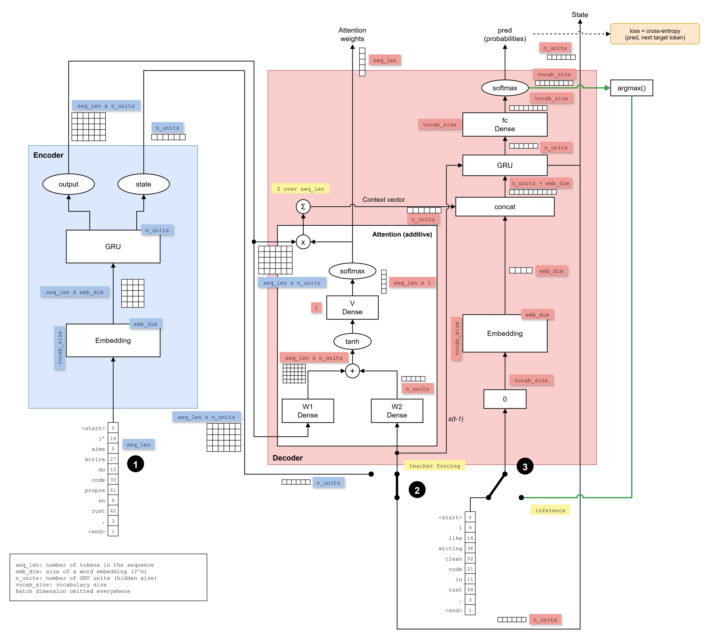
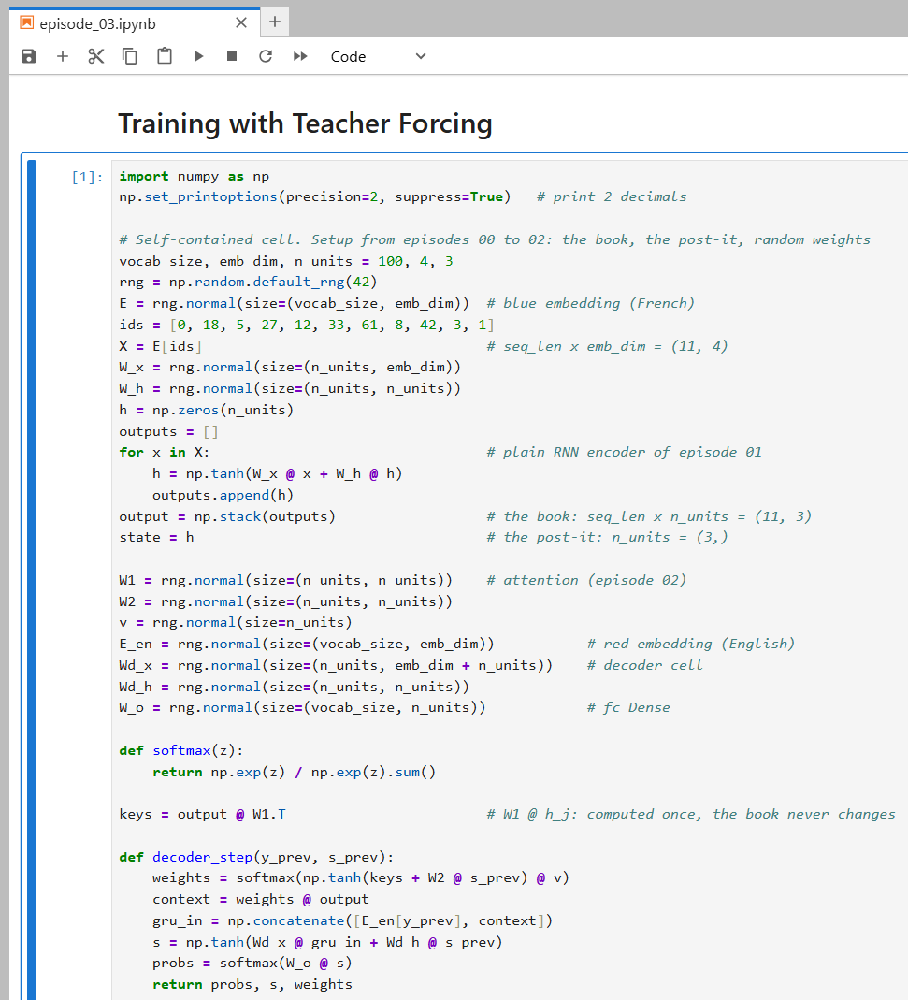
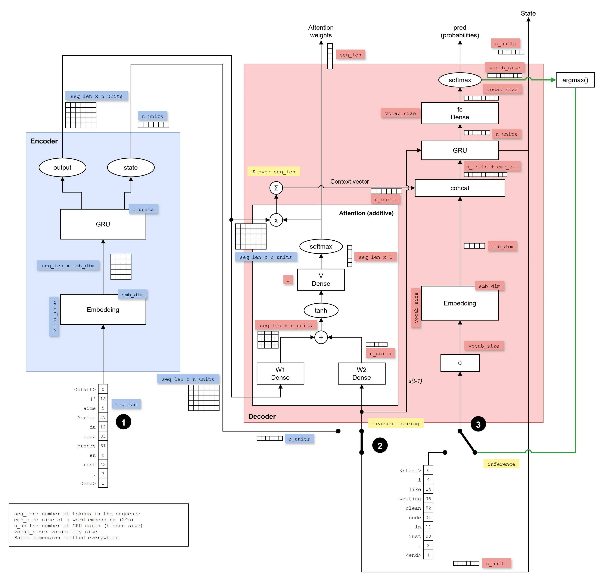

# {{ page.title }}
{: .no_toc }

{{ page.description }}
{: .lead }


<h2 align="center"><span style="color:#F87115"><b> 🚧 This post is under construction 🚧</b></span></h2>


### This is Episode 03, Part 00
{: .no_toc }

{: .note }
> This post is a series in **4 episodes**, some of them in two or three parts. Alice and Bob need two evenings to rebuild the slide, one box at a time.
>
> * [Episode 00](): Day 1. Leaving class with the slide. Why word-by-word translation fails, from words to tokens, from tokens to vectors.
> * Episode 01: Day 1, later that evening.
>   * [Part 00](): Reading in order with a GRU, encoder and decoder.
>   * [Part 01](): The bottleneck and the idea of attention.
> * Episode 02: Day 2. The attention layer step by step.
>   * [Part 00](): The question attention asks, and the scores.
>   * [Part 01](): Softmax and the context vector.
>   * [Part 02](): One iteration of the decoder.
> * Episode 03: Day 2, later that evening.
>   * [Part 00]() **(you are here)**: Training with teacher forcing, and inference.
>   * [Part 01](): A real translation, what we simplified, and a peek at Transformers.


<!-- ###################################################################### -->
<!-- ###################################################################### -->
<!-- ###################################################################### -->
## TL;DR
{: .no_toc }

* **Training** uses **teacher forcing**: at every step, switch 3 gives the decoder the *true* previous English token, whatever it predicted. Switch 2 gives $$s_0$$ at step 1, then the decoder's own memory. The loop runs over the *target* sentence, and the last token to predict is `<end>`.
* The **loss** is the cross-entropy: $$-\log$$ of the probability given to the expected token, summed over the steps. Backpropagation then adjusts every weight of the slide at once: embeddings, both GRUs, `W1`, `W2`, `V`, `fc`. Nobody tells the network where to look: it learns it because looking at the right place lowers the loss.
* **Inference**: no target sentence. Switch 3 flips to the green wire, `argmax()` feeds each prediction back as the next input (greedy decoding) until `<end>` or a maximum length. A mistake is never corrected and can drag the next words with it. Beam search keeps several candidates instead of one.
* Still open: two evenings, every wire understood, and not a single real translation yet. That's Part 01.


<figure style="max-width: 900px; margin: auto; text-align: center;">

<figcaption>Day 2, after the pizza. Training, inference, and a peek at what came next.</figcaption>
</figure>


<!-- ###################################################################### -->
<!-- ###################################################################### -->
<!-- ###################################################################### -->
## Table of Contents
{: .no_toc .text-delta}
- TOC
{:toc}


<!-- ###################################################################### -->
<!-- ###################################################################### -->
<!-- ###################################################################### -->
## Previously

In Episode 02 ([Part 00](), [Part 01]() and [Part 02]()), Alice and Bob opened the attention box. At step $$t$$, the decoder scores every row $$h_j$$ of the book with its memory $$s_{t-1}$$: $$e_{tj} = v^\top \tanh(W_1 h_j + W_2 s_{t-1})$$. Softmax turns the scores into weights $$\alpha_{tj}$$, positive, summing to 1, and the context vector $$c_t = \sum_j \alpha_{tj} h_j$$ is the weighted average of the rows: the new post-it. Then one iteration of the decoder glues the embedding of the previous English token with the context, the GRU updates the memory to $$s_t$$, and `fc Dense` plus a softmax give one probability per English token.

They checked every shape with random weights. The decoder answered `95` instead of `i`, and Alice raised an objection that Bob could not answer: at step 2, which token goes into the decoder, the predicted one or the expected one? That is the job of switch 3. Then they ordered a pizza.

<figure style="max-width: 900px; margin: auto; text-align: center;">

<figcaption>The slide. Only the switches are left, and the reason why any of this works.</figcaption>
</figure>


<!-- ###################################################################### -->
<!-- ###################################################################### -->
<!-- ###################################################################### -->
## Prerequisites

* Episodes [00](), [01.00](), [01.01](), [02.00](), [02.01]() and [02.02](). Episode 02.02 above all: this episode reuses its decoder step as is.
* The idea of a loss minimized by [gradient descent](). We won't compute any gradient by hand.

{: .note-title }
> How to run the code of this episode
>
> Go to [jupyter.org](https://jupyter.org/){:target="_blank"}, click `Try` then `JupyterLab`, open a new notebook and copy'n paste the cells.
>
> * The **first cell of each section** is self-contained. It starts with `import numpy as np` and rebuilds everything from scratch: the encoder, the book, the post-it, the attention and the decoder of Episode 02, with the same random numbers. You can start reading (and running) at any section.
> * The **other cells of a section** continue from the cells above them, in the same section. Run them in order, without restarting the kernel.
> * The setup lines repeat from one section to the next. That's on purpose: no cell depends on a section you may have skipped.

*8 pm. The pizza box is empty, pushed to the edge of the table. Alice puts the slide back in the middle and taps switch 3.*


<!-- ###################################################################### -->
<!-- ###################################################################### -->
<!-- ###################################################################### -->
## Training with Teacher Forcing

**Alice:** My objection. Step 2. The decoder predicted `95`. The right answer was `i`, index 9. What goes into the red embedding now?

**Bob:** Let's read the slide. Switch 3 has two positions. On one side, "teacher forcing", and a column of indices: `0`, `9`, `7`, `58`. On our redrawing, the English sentence: `<start> i like writing clean code in rust . <end>`. On the other side, "inference", and the green wire coming back from `argmax()`.

**Alice:** So, two worlds. One where we *have* the English sentence, one where we don't.

**Bob:** When do we have it?

**Alice:** *(thinks)* During training. To train a translator, you need pairs: a French sentence and its correct English translation. Thousands of them. So during training, we know the answer.

**Bob:** And "teacher forcing" means... the teacher forces the answer?

**Alice:** Let me guess. In training mode, switch 3 is on the side of the English sentence. At step 1 the decoder gets `<start>`. At step 2 it gets `i`, the *true* `i`, whatever it predicted. At step 3, `like`. And so on.

**Bob:** Even if it said `95` at step 1?

**Alice:** Even then. That's the "forcing". The teacher doesn't let it continue from its own mistake.

**Bob:** Okay, let me find an analogy. *(thinks)* A dictation, in primary school. The teacher dictates a sentence, you write word by word. A nice teacher checks every word as you go: you wrote "the cat sat on the hat", she says "no, *mat*", you correct it, and you write the next word from the right sentence. You never write a whole page built on top of your first mistake.

**Alice:** And at each word, she also gives you a mark. "Right" or "wrong", or better, "how far from right". That's the loss, I suppose.

**Bob:** Yes. Let me draw the training position of the switches first.

<figure style="max-width: 900px; margin: auto; text-align: center;">

<figcaption>Training mode, from step 2 on. Switch 2 has flipped to the decoder's own memory, switch 3 stays on the English sentence, and pred goes to the loss.</figcaption>
</figure>

**Alice:** Switch 2 has flipped too.

**Bob:** That's the other half of yesterday's question. At step 1, switch 2 is connected to the encoder: it gives $$s_0$$, the post-it, to `W2` and to the GRU. From step 2 on, it flips: it gives the decoder's *own* memory, $$s_{t-1}$$, the one that comes back down from `State`.

**Alice:** So switch 2 is not about training versus inference. It flips at step 2, in both modes.

**Bob:** Right. Switch 2 is "first step or not". Switch 3 is "training or not".

**Alice:** Okay. And the loop. How many steps?

**Bob:** As many as tokens in the English sentence, after `<start>`. We loop over the *target*, not over the source. And the last token to predict is `<end>`.

**Alice:** Of course. That's how it learns to stop. After `.`, the right answer is `<end>`, and it gets a bad mark if it says anything else.

**Alice:** Now the mark. Easy one. At step 1, `argmax()` says `95`, the right answer is `i`: wrong, 1 point of penalty. If it had said `i`: right, 0. We add the penalties over the sentence, and training means making that number smaller.

**Bob:** Like counting the mistakes in the dictation. *(thinks)* Hmm, wait. With our random weights, it's wrong everywhere: 9 mistakes out of 9. Now I nudge one weight a tiny bit. What happens?

**Alice:** The probabilities move a tiny bit, and... `argmax()` still picks `95`. Still wrong. Still 9.

**Bob:** And another tiny nudge, still 9. And another one... Until one day, the `argmax()` jumps to another token, and the count jumps too.

**Alice:** *(groans)* "Nothing, nothing, nothing, jump". The `argmax` wall, again. We had exactly this discussion about the mix, before the pizza. A count of mistakes can't tell the network which way to go.

**Bob:** So the mark must change smoothly when the weights change smoothly. Not "right or wrong", but "how close to right".

**Alice:** Then forget `argmax()`. The decoder gives a probability to every English token: `pred`, `vocab_size` numbers. At step 1, the expected token is `i`. We only look at one number: the probability given to `i`. That number moves a tiny bit at every nudge.

**Bob:** If it gives 0.99 to `i`, good mark. If it gives 0.001, bad mark. And everything in between.

**Bob:** And the "mark" is a loss: small is good. We take minus the log of that probability.

$$
\mathcal{L}_t = -\log p_t(y_t)
$$

**Alice:** $$y_t$$ is the expected token at step $$t$$, and $$p_t(y_t)$$ is the probability the decoder gave to it. Why the log?

**Bob:** Let me show you rather than explain.

```python
import numpy as np
np.set_printoptions(precision=2, suppress=True)   # print 2 decimals

# Self-contained cell. Setup from episodes 00 to 02: the book, the post-it, random weights
vocab_size, emb_dim, n_units = 100, 4, 3
rng = np.random.default_rng(42)
E = rng.normal(size=(vocab_size, emb_dim))  # blue embedding (French)
ids = [0, 18, 5, 27, 12, 33, 61, 8, 42, 3, 1]
X = E[ids]                                  # seq_len x emb_dim = (11, 4)
W_x = rng.normal(size=(n_units, emb_dim))
W_h = rng.normal(size=(n_units, n_units))
h = np.zeros(n_units)
outputs = []
for x in X:                                 # plain RNN encoder of episode 01
    h = np.tanh(W_x @ x + W_h @ h)
    outputs.append(h)
output = np.stack(outputs)                  # the book: seq_len x n_units = (11, 3)
state = h                                   # the post-it: n_units = (3,)

W1 = rng.normal(size=(n_units, n_units))    # attention (episode 02)
W2 = rng.normal(size=(n_units, n_units))
v = rng.normal(size=n_units)
E_en = rng.normal(size=(vocab_size, emb_dim))           # red embedding (English)
Wd_x = rng.normal(size=(n_units, emb_dim + n_units))    # decoder cell
Wd_h = rng.normal(size=(n_units, n_units))
W_o = rng.normal(size=(vocab_size, n_units))            # fc Dense

def softmax(z):
    return np.exp(z) / np.exp(z).sum()

keys = output @ W1.T                        # W1 @ h_j: computed once, the book never changes

def decoder_step(y_prev, s_prev):
    weights = softmax(np.tanh(keys + W2 @ s_prev) @ v)
    context = weights @ output
    gru_in = np.concatenate([E_en[y_prev], context])
    s = np.tanh(Wd_x @ gru_in + Wd_h @ s_prev)
    probs = softmax(W_o @ s)
    return probs, s, weights

# Training, teacher forcing, one sentence pair
en_tokens = ["<start>", "i", "like", "writing", "clean", "code", "in", "rust", ".", "<end>"]
tgt_ids = [0, 9, 14, 36, 52, 21, 11, 58, 3, 1]

s_prev = state                              # switch 2, step 1: the post-it
total_loss = 0.0
for t in range(1, len(tgt_ids)):            # loop over the TARGET sentence
    y_prev = tgt_ids[t - 1]                 # switch 3: the TRUE previous token
    probs, s, _ = decoder_step(y_prev, s_prev)
    target = tgt_ids[t]                     # the token the decoder should predict
    loss_t = -np.log(probs[target])
    total_loss += loss_t
    print(f"t={t}  in: {en_tokens[t - 1]:>7}  expected: {en_tokens[t]:>7}  p={probs[target]:.3f}  loss={loss_t:.2f}")
    s_prev = s                              # switch 2 flips: the decoder's own memory
print("total loss:", round(total_loss, 2))
```

```text
t=1  in: <start>  expected:       i  p=0.001  loss=7.22
t=2  in:       i  expected:    like  p=0.053  loss=2.94
t=3  in:    like  expected: writing  p=0.003  loss=5.81
t=4  in: writing  expected:   clean  p=0.022  loss=3.82
t=5  in:   clean  expected:    code  p=0.003  loss=5.75
t=6  in:    code  expected:      in  p=0.005  loss=5.26
t=7  in:      in  expected:    rust  p=0.002  loss=6.17
t=8  in:    rust  expected:       .  p=0.011  loss=4.49
t=9  in:       .  expected:   <end>  p=0.009  loss=4.72
total loss: 46.19
```

<figure style="max-width: 900px; margin: auto; text-align: center;">

<figcaption>The training cell in JupyterLab: everything from Episodes 00 to 02 in one cell, and the keys computed once, outside the loop.</figcaption>
</figure>

**Alice:** Wait, I'm reading the "in" column. `<start>`, `i`, `like`, `writing`... it's the English sentence, shifted by one. And the "expected" column is the same sentence, one step ahead. The decoder gets the true sentence as input and must guess the next token, every time.

**Bob:** That's teacher forcing in two columns. And look at `p`: all tiny. 0.001 for `i`. Random weights, 100 tokens, so roughly 1 chance in 100 at best.

**Alice:** And the losses are between 3 and 7. Now show me why the log.

```python
for p in [0.99, 0.5, 0.1, 0.01, 0.001]:
    print(f"p={p:<6} loss={-np.log(p):.2f}")
```

```text
p=0.99   loss=0.01
p=0.5    loss=0.69
p=0.1    loss=2.30
p=0.01   loss=4.61
p=0.001  loss=6.91
```

**Alice:** Almost sure and right: almost zero. Half sure: 0.69. And then each time the probability is divided by 10, the loss goes up by the same 2.30. It never stops growing. A network that gives 0.000001 to the right answer gets a huge penalty.

**Bob:** So it's punished hard for being confidently wrong. That's the **cross-entropy**. The yellow box on our drawing: "loss = cross-entropy (pred, next target token)".

**Alice:** And for the whole sentence, we add the losses of all the steps. 46.19 here.

$$
\mathcal{L} = -\sum_{t=1}^{T'} \log p_t(y_t)
$$

**Alice:** With $$T'$$ the number of English tokens to predict, 9 for us. It's not $$T$$, the French length. Different loop.

**Bob:** By the way, in real code, the softmax at the top and the log of the loss are often merged into one function, for numerical reasons. In PyTorch, `CrossEntropyLoss` takes the logits directly. Same math, more stable.

**Alice:** Now the big question. We have a number, 46.19. How does it become "a network that translates"?

**Bob:** Gradient descent. Same as for any network. We compute how the loss changes when we nudge each weight a tiny bit: that's the gradient. Then we move every weight a tiny bit in the direction that lowers the loss. And again, for the next sentence pair. Thousands of pairs, many times.

**Alice:** Which weights?

**Bob:** All of them. *(runs his finger over the slide)* The blue embedding, the encoder GRU, `W1`, `W2`, `V`, the red embedding, the decoder GRU, `fc Dense`. The loss is computed at the top, and the gradient flows back down through every wire. Through the context vector, through the softmax of the attention, into `W1` and `W2`, and into the encoder itself.

**Alice:** *(slowly)* So nobody ever tells the network "for `clean`, look at `propre`". There's no label for that. It only gets a bad mark when it says something else than `clean`. And if looking at `propre` helps to say `clean`, the gradient will push `W1`, `W2` and `V` in that direction.

**Bob:** That's the "jointly learning to align and translate" of the title of the paper. It learns where to look *because* it's useful for translating. Not because someone drew the arrows.

**Alice:** That's also why the mix had to be soft, before the pizza. The gradient has to flow through the weights. With a hard `argmax`, it would hit a wall.

**Bob:** And one more thing, in my code. `keys = output @ W1.T`, it's outside the loop now. Computed once.

**Alice:** *(checks)* Because the book doesn't change during the sentence. `output` is the same at every step, `W1` too. So `W1` times the book is the same at every step. Only `W2 @ s_prev` changes. Why compute it 9 times?

**Bob:** Free speed. On a sentence of 50 tokens with `n_units = 512`, it's not nothing.

**Alice:** Okay, one doubt. Teacher forcing is comfortable. But isn't it cheating? During training, the decoder always gets perfect inputs. It never learns what to do after a mistake.

**Bob:** *(thinks)* That's... a very good point. I have no answer. Let's do inference, maybe the answer is there.

**Alice:** Feynman check first. Mine. In training mode, we know the English sentence. The loop runs over it. At each step, switch 3 gives the true previous token, whatever the decoder predicted, and switch 2 gives $$s_0$$ at step 1, then the decoder's own memory. The decoder gives a probability to every English token, and the loss is minus the log of the probability of the expected one, added over the steps, `<end>` included. Then gradient descent adjusts every weight of the slide. Nobody teaches it where to look: it learns it because it helps.

**Bob:** Approved.


<!-- ###################################################################### -->
<!-- ###################################################################### -->
<!-- ###################################################################### -->
## Inference: on Its Own

**Bob:** Now the model is trained. A user types a French sentence it has never seen. What do we have?

**Alice:** The French sentence. Only. No English sentence, so no teacher. Switch 3 goes to the other side: "inference". The green wire.

<figure style="max-width: 900px; margin: auto; text-align: center;">

<figcaption>Inference mode. Switch 3 is on the green wire: each prediction becomes the next input. No loss, no teacher.</figcaption>
</figure>

**Bob:** Step 1: `<start>`, as always. The decoder gives probabilities. `argmax()` picks the most likely token. The green wire brings it down to switch 3, and it becomes the input of step 2.

**Alice:** That's exactly your pseudo-code from yesterday, without attention. "token = argmax, feed it back". And it stops when?

**Bob:** When `argmax()` gives `<end>`. Or after a maximum number of steps, in case it never does. Let me write it with our random weights.

```python
import numpy as np
np.set_printoptions(precision=2, suppress=True)   # print 2 decimals

# Self-contained cell. Setup from episodes 00 to 02: the book, the post-it, random weights
vocab_size, emb_dim, n_units = 100, 4, 3
rng = np.random.default_rng(42)
E = rng.normal(size=(vocab_size, emb_dim))  # blue embedding (French)
ids = [0, 18, 5, 27, 12, 33, 61, 8, 42, 3, 1]
X = E[ids]                                  # seq_len x emb_dim = (11, 4)
W_x = rng.normal(size=(n_units, emb_dim))
W_h = rng.normal(size=(n_units, n_units))
h = np.zeros(n_units)
outputs = []
for x in X:                                 # plain RNN encoder of episode 01
    h = np.tanh(W_x @ x + W_h @ h)
    outputs.append(h)
output = np.stack(outputs)                  # the book: seq_len x n_units = (11, 3)
state = h                                   # the post-it: n_units = (3,)

W1 = rng.normal(size=(n_units, n_units))    # attention (episode 02)
W2 = rng.normal(size=(n_units, n_units))
v = rng.normal(size=n_units)
E_en = rng.normal(size=(vocab_size, emb_dim))           # red embedding (English)
Wd_x = rng.normal(size=(n_units, emb_dim + n_units))    # decoder cell
Wd_h = rng.normal(size=(n_units, n_units))
W_o = rng.normal(size=(vocab_size, n_units))            # fc Dense

def softmax(z):
    return np.exp(z) / np.exp(z).sum()

keys = output @ W1.T                        # W1 @ h_j: computed once, the book never changes

def decoder_step(y_prev, s_prev):
    weights = softmax(np.tanh(keys + W2 @ s_prev) @ v)
    context = weights @ output
    gru_in = np.concatenate([E_en[y_prev], context])
    s = np.tanh(Wd_x @ gru_in + Wd_h @ s_prev)
    probs = softmax(W_o @ s)
    return probs, s, weights

# Inference, greedy decoding: no target sentence, the green wire
max_len = 12
s_prev = state                              # switch 2, step 1: the post-it
y_prev = 0                                  # <start>
produced = []
for t in range(1, max_len + 1):
    probs, s, _ = decoder_step(y_prev, s_prev)
    y_hat = int(np.argmax(probs))           # most likely token
    produced.append(y_hat)
    if y_hat == 1:                          # <end>: stop
        break
    y_prev = y_hat                          # switch 3, inference side: feed the prediction back
    s_prev = s                              # switch 2 flips
print(produced)
```

```text
[95, 74, 25, 74, 25, 68, 14, 25, 68, 14, 25, 68]
```

**Alice:** `95` first. The same `95` as before the pizza, same weights, same first step. Then `74`, `25`, `74`, `25`... and then `68, 14, 25`, `68, 14, 25`. It's stuck in a loop!

**Bob:** And it never says `1`, `<end>`. So it stops at `max_len`, 12 tokens. Without `max_len`, it would still be talking.

**Alice:** *(laughs)* There's a `14` in there. `like`. It's the only real word, and it's by chance.

**Bob:** Random weights. But even a trained model can do this kind of thing, repeat itself, on a sentence too different from its training data. That's why `max_len` is always there.

**Alice:** Notice something else. The number of steps has nothing to do with the French sentence. 11 French tokens, and it could have stopped after 3, or after 20. The decoder decides the length by itself, with `<end>`.

**Bob:** Now your doubt from before. "The decoder never learns what to do after a mistake."

**Alice:** Look at the loop. `y_prev = y_hat`. Whatever it predicted goes back in. If it says `love` instead of `like` at step 2, then at step 3 it gets `love` as input. In training, that never happened: after `i`, it always got the true `like`. Now it's in a situation it has never seen.

**Bob:** And then it can make another mistake, which feeds the next step... One mistake can drag the rest of the sentence with it.

**Alice:** So training and inference are not quite the same game. In training, the inputs are always perfect. In inference, they're its own outputs, mistakes included.

**Bob:** *(phone)* Rule 3. It has a name: **exposure bias**. The model is never exposed to its own mistakes during training. And people found fixes. For example, Bengio et al. (2015), [Scheduled Sampling for Sequence Prediction with Recurrent Neural Networks](https://arxiv.org/abs/1506.03099){:target="_blank"}: during training, from time to time, they feed the predicted token instead of the true one. Like a teacher who lets you continue from your mistake once in a while, so that you learn to recover.

**Alice:** So your dictation teacher should sometimes *not* correct you. Funny. Okay, and the other weakness. `argmax()`. At every step, we take the single most likely token, and we never look back.

**Bob:** That's called **greedy decoding**. Greedy, because it takes the best thing right now, without thinking about later.

**Alice:** And that can be a bad deal. Imagine at step 2, `like` gets 0.40 and `love` gets 0.45. Greedy takes `love`. But maybe, after `like`, the rest of the sentence would have been much more probable. `like writing` is very natural, `love writing` a bit less.

**Bob:** Then you keep several candidates instead of one. That's **beam search**. At each step, you keep, say, the 3 best partial translations, not just one. You extend each of them with every possible next token, you compute the probability of each whole sentence so far, and you keep the 3 best again. At the end, you pick the best complete sentence.

**Alice:** More work, but you don't bet everything on the first choice. How much more work?

**Bob:** Roughly 3 times, if you keep 3. People often use something between 4 and 10. [Dive into Deep Learning](https://d2l.ai/chapter_recurrent-modern/beam-search.html){:target="_blank"} has a good explanation, with drawings. For tonight, greedy is enough: it's what the green wire of the slide does.

**Alice:** Feynman check. Yours.

**Bob:** In inference, we only have the French sentence. Switch 3 is on the green wire: each predicted token, the `argmax()` of `pred`, becomes the input of the next step. Switch 2 does as in training: $$s_0$$ at step 1, then the decoder's own memory. We stop on `<end>` or at a maximum length, so the length of the translation is free. There's no loss and no learning anymore: the weights are frozen. A mistake is never corrected and can propagate, and that's the price of not having a teacher. Taking the best token at each step is greedy decoding; beam search keeps several candidates.

**Alice:** Approved. *(pause)* But I'm frustrated.

**Bob:** Why?

**Alice:** Two evenings. We understand every wire. And we've never seen this thing actually translate anything. Only `95` and loops.


<!-- ###################################################################### -->
<!-- ###################################################################### -->
<!-- ###################################################################### -->
## To Be Continued

Two evenings, every wire understood, and the machine has never translated a single sentence. Bob has a confession to make, in [Part 01]().


<!-- ###################################################################### -->
<!-- ###################################################################### -->
<!-- ###################################################################### -->
## Webliography

**Papers**
* Bahdanau, Cho, Bengio (2014), [Neural Machine Translation by Jointly Learning to Align and Translate](https://arxiv.org/abs/1409.0473){:target="_blank"}. The attention of the slide, trained "jointly" with the translation.
* Bengio, Vinyals, Jaitly, Shazeer (2015), [Scheduled Sampling for Sequence Prediction with Recurrent Neural Networks](https://arxiv.org/abs/1506.03099){:target="_blank"}. A fix for exposure bias.

**Explanations and code**
* [Beam Search](https://d2l.ai/chapter_recurrent-modern/beam-search.html){:target="_blank"}, *Dive into Deep Learning*.
* PyTorch tutorial, [NLP From Scratch: Translation with a Sequence to Sequence Network and Attention](https://pytorch.org/tutorials/intermediate/seq2seq_translation_tutorial.html){:target="_blank"}. Teacher forcing and greedy decoding.
* [Understanding Gradient Descent](), on this site.


