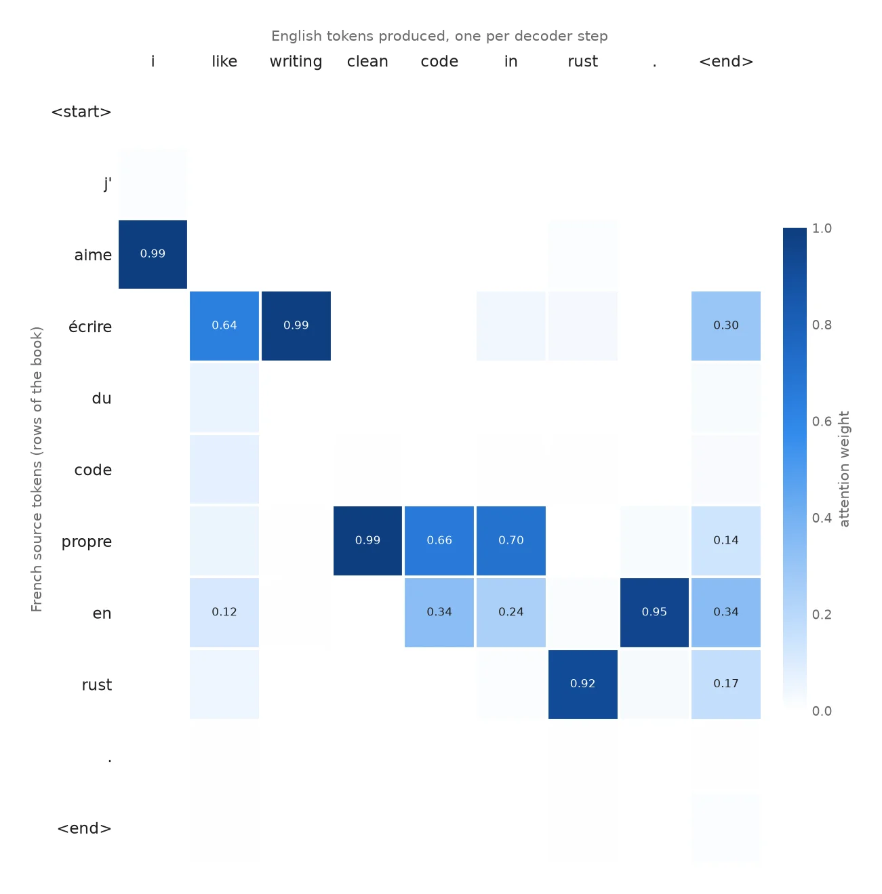
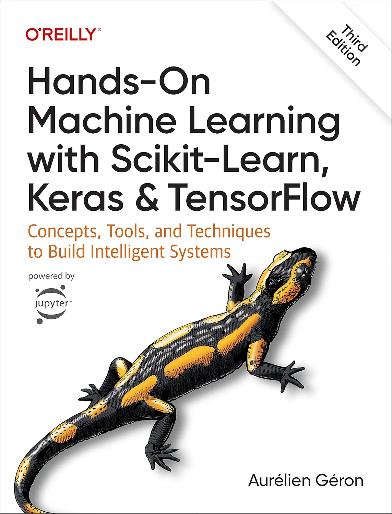

# {{ page.title }}
{: .no_toc }

{{ page.description }}
{: .lead }

<h2 align="center"><b> 🚧 This post is under construction 🚧</b></h2>

### This is Episode 03, Part 01
{: .no_toc }

{: .note }
> This post is a series in **4 episodes**, some of them in two or three parts. Alice and Bob need two evenings to rebuild the slide, one box at a time.
>
> * [Episode 00](): Day 1. Leaving class with the slide. Why word-by-word translation fails, from words to tokens, from tokens to vectors.
> * Episode 01: Day 1, later that evening.
>   * [Part 00](): Reading in order with a GRU, encoder and decoder.
>   * [Part 01](): The bottleneck and the idea of attention.
> * Episode 02: Day 2. The attention layer step by step.
>   * [Part 00](): The question attention asks, and the scores.
>   * [Part 01](): Softmax and the context vector.
>   * [Part 02](): One iteration of the decoder.
> * Episode 03: Day 2, later that evening.
>   * [Part 00](): Training with teacher forcing, and inference.
>   * [Part 01]() **(you are here)**: A real translation, what we simplified, and a peek at Transformers.

<!-- ###################################################################### -->
<!-- ###################################################################### -->
<!-- ###################################################################### -->
## TL;DR
{: .no_toc }

* A tiny trained model translates our sentence without ever having seen it, and its **attention heatmap** shows `clean` looking at `propre`. The weights are sharp where the source really decides the next word, and wander where the memory already knows it.
* The slide simplifies Bahdanau et al. (2014) in three places. And the triplet memory / translated rows / rows becomes **query / keys / values** in the Transformers.
* Last Feynman check: the whole slide, box by box, and the path of the series in four lines.

<figure style="max-width: 900px; margin: auto; text-align: center;">

<figcaption>Day 2, after the pizza. Training, inference, and a peek at what came next.</figcaption>
</figure>

<!-- ###################################################################### -->
<!-- ###################################################################### -->
<!-- ###################################################################### -->
## Table of Contents
{: .no_toc .text-delta}
- TOC
{:toc}

*Same table, same evening. Every wire of the slide is understood, and yet the machine has never translated a single sentence. Alice is frustrated. Bob looks a little too pleased with himself.*

<!-- ###################################################################### -->
<!-- ###################################################################### -->
<!-- ###################################################################### -->
## Where Does `clean` Look?

**Bob:** *(turns his laptop towards her, a little too proud)* I have a confession.

**Alice:** You ate the last cookie.

**Bob:** That too. But no. Last night, when I couldn't sleep, I found the PyTorch tutorial, the one with `query` and `keys`. It trains a real translation model with attention. So I copied it, and I spent the night renaming everything with the names of the slide, and replacing its sentences with ours. I didn't understand half of it. But I told myself: if tonight we understand the slide, tomorrow I'll understand the code.

**Alice:** And today?

**Bob:** Today I understand much more than half. And while you were ordering the pizza, I let it train. A few minutes on my laptop.

**Alice:** Show me.

**Bob:** The slide, in PyTorch. Same boxes, same names: blue embedding, encoder GRU, `W1`, `W2`, `V`, `concat`, decoder GRU, `fc`. A real GRU this time, with `emb_dim = 16` and `n_units = 32`. And a tiny training set: I generated French and English sentences on the model of ours. `tu aimes lire du code sale en python` -> `you like reading dirty code in python`, `nous aimons tester du code en go` -> `we like testing code in go`... 5 subjects, 4 verbs, 5 adjectives or none, 5 languages. 600 pairs.

**Alice:** And our sentence is in there?

**Bob:** No! That's the point. I removed `j' aime écrire du code propre en rust .` from the training set. 599 pairs for training, with teacher forcing. Then inference, greedy, on our sentence. It has never seen it. It has seen `propre`, `écrire`, `rust`, `j'`, but never all together.

**Alice:** And?

**Bob:** `i like writing clean code in rust . <end>`.

**Alice:** *(leans in)* Perfect translation. With the inversion. `clean code`, not `code clean`.

**Bob:** And at each step, I saved the attention weights. The exit at the top of the slide, the window. Remember? "It goes nowhere, it's for us to look". Here's what we see through it.

<figure style="max-width: 800px; margin: auto; text-align: center;">

<figcaption>Attention weights of a tiny trained model on our sentence, which it never saw during training. One column per decoder step; each column sums to 1.</figcaption>
</figure>

**Alice:** One column per English token, one row per French token. Each column is one set of attention weights, so each column adds up to 1. *(follows the dark cells)* `clean`... `propre`. 0.99. It looks at `propre`!

**Bob:** Your eyes, yesterday, when you translated by hand. "I write `clean` while looking at `propre`."

**Alice:** And nobody told it. It learned that from 599 sentences, because it helped to lower the loss. `writing`, `écrire`, 0.99. `rust`, `rust`, 0.92. *(frowns)* But `i` looks at `aime`, not at `j'`.

**Bob:** Hmm. Remember what a row of the book is?

**Alice:** The memory of the encoder *after* reading that token. *(slowly)* So the row of `aime` is the memory after `j' aime`. It knows the `j'`. Looking at `aime` is enough to see the `j'`.

**Bob:** Yes. A row is not a word, it's a word *and everything before it*. And in the same way, `code` looks at `propre`, because the row of `propre` is the memory after `code propre`.

**Alice:** Okay. And `like` is less sharp, 0.64 on `écrire`. `in` looks at `propre`, which makes no sense. And the dot looks at `en`, also weird. `<end>` is spread everywhere.

**Bob:** I wondered about that too. Then I looked at the training sentences. What comes after the adjective?

**Alice:** `code`. Always. And after `code`, `in`. Always. And after the language, `.`, then `<end>`. Always.

**Bob:** So for these tokens, the decoder doesn't need to look anywhere. Its own memory knows that after `clean` comes `code`. The attention can wander, it doesn't change the answer, so the gradient never pushed it anywhere in particular.

**Alice:** And where the French sentence really *decides*... the subject, the verb, the adjective, the language: `i`, `writing`, `clean`, `rust`. These are the four sharp columns. 0.99, 0.99, 0.99, 0.92.

**Bob:** Exactly the four places where my training sentences vary.

**Alice:** *(sits back)* That's beautiful. It looks where it *needs* to look. And when it doesn't need to, it doesn't really care. And a sharp column isn't proof of anything either: the dot is sharp on `en` and it doesn't matter at all.

**Bob:** That's a good warning, actually. These pictures are fun to look at, but they're not an explanation of the model. They show where the weights are, not why the answer is right.

**Alice:** And the paper? Rule 3.

**Bob:** Bahdanau et al. (2014), Figure 3. The same kind of picture, on real English-French sentences, with real vocabularies. And the same thing: mostly a diagonal, because the two languages roughly follow the same order, with little detours where the order changes. Adjectives and nouns, like our `code propre`.

{: .note-title }
> Let's be honest
>
> Two students who discovered attention the day before would not write this script in one night, even with a tutorial. Bob gets a little help from the author here. The script that trained this tiny model and drew the heatmap is [heatmap_toy.py](./assets/heatmap_toy.py). It is about 150 lines of PyTorch, inspired by the PyTorch tutorial of the Webliography, and it follows the names of the slide.
>
> Once you have read the four episodes, you should be able to read it. That's the real test of the series.
>
> It runs on a laptop CPU in a few minutes: `uv run --with torch --with matplotlib --with pillow --with numpy python heatmap_toy.py img22.webp`. With another random seed, the translation stays the same and `i`, `writing`, `clean` and `rust` stay sharp, sometimes one row off (a row also knows the tokens before it). The "wandering" columns change from one seed to the other.

<!-- ###################################################################### -->
<!-- ###################################################################### -->
<!-- ###################################################################### -->
## What the Slide Simplifies

**Alice:** One last thing before the big Feynman check. Rule 3. Is our slide *exactly* Bahdanau et al. (2014)?

**Bob:** *(scrolls the paper)* No. Close, but simplified. I count three differences.

{: .important-title }
> What we simplified, compared to Bahdanau et al. (2014)
>
> * **The encoder reads in one direction only.** In the paper, the encoder is **bidirectional**: one RNN reads left to right, another right to left, and each row $$h_j$$ glues the two memories together. So each row knows what comes before *and* after its token. That's the idea Bob had in [Episode 01, Part 00](), when Alice noticed that the row of `code` has no idea that `propre` is coming.
> * **The decoder starts from the encoder's last memory.** On the slide, $$s_0$$ is `state`. In the paper, $$s_0$$ is computed from the backward RNN, with its own small layer: $$s_0 = \tanh(W_s \overleftarrow{h}_1)$$.
> * **The prediction only uses the decoder memory.** On the slide, $$p_t = \text{softmax}(W_o s_t)$$. In the paper, the last layer also receives the context $$c_t$$ and the previous token $$y_{t-1}$$, through a "maxout" layer.
>
> Also left out everywhere in this series: the **batch** dimension (real code processes many sentences at once, so every shape has a `batch_size` in front), the **biases** of the Dense layers, and, in the NumPy cells, the gates of the GRU (replaced by a plain RNN cell). None of this changes the story.

**Alice:** The bidirectional one explains our heatmap, by the way. With a bidirectional encoder, the row of `code` would know that `propre` follows. The alignment could be cleaner.

**Bob:** Probably. I didn't try. Next time.

<!-- ###################################################################### -->
<!-- ###################################################################### -->
<!-- ###################################################################### -->
## A Door Ajar: Query, Keys, Values

**Bob:** Remember the names I stole from the PyTorch tutorial, earlier tonight? `query` and `keys`?

**Alice:** "They'll come back one day". You were very mysterious.

**Bob:** They come back now. Let me rename three things. The decoder memory, transformed by `W2`, that's the question: the **query**. The rows of the book, transformed by `W1`, they're what we compare the question with: the **keys**. And the rows of the book themselves, the ones we actually mix in the context vector...

**Alice:** ...the content. What we take home once we know where to look.

**Bob:** The **values**. Query, keys, values.

| Our slide | Role | Transformer name |
|---|---|---|
| $$W_2 s_{t-1}$$ | what the decoder is looking for | query |
| $$W_1 h_j$$ | what each row offers, for the comparison | keys |
| $$h_j$$ | what each row contains, for the mix | values |
| scores, softmax, weighted sum | where to look, then read | attention |

**Alice:** It's a library. You come with a question, you compare it with the labels on the shelves, and you take home the books whose labels match. Not the labels. The books.

**Bob:** That's exactly the vocabulary of [Attention Is All You Need](https://arxiv.org/abs/1706.03762){:target="_blank"}, Vaswani et al. (2017). The paper of the Transformers. Three years after Bahdanau.

**Alice:** What did they change?

**Bob:** From what I've read, two big things. First, the comparison. Instead of `+`, `tanh` and `V`, they take a dot product between the query and each key. Cheaper, and it works very well. Remember Luong (2015), the one who replaced the sum by a product? That direction.

$$
\text{Attention}(Q, K, V) = \text{softmax}\left(\frac{Q K^\top}{\sqrt{d_k}}\right) V
$$

**Alice:** *(reads it slowly)* Softmax of scores, times $$V$$. Scores, weights, weighted sum. It's our machine, in one line! Careful, that $$V$$ is the values, not our `V Dense`. And the $$\sqrt{d_k}$$...

**Bob:** A scaling, to keep the scores from getting too far apart. You saw what softmax does when the gaps grow.

**Alice:** Everything goes to one weight. Okay. And the second thing?

**Bob:** The title. "Attention is all you need". They removed the GRUs. No more reading one token at a time. Instead, every token of the sentence looks at every other token of the same sentence, with attention. They call it **self-attention**. And since nothing waits for the previous step anymore, all the tokens can be computed at the same time.

**Alice:** So the book is not written by a GRU anymore. Each row is written by looking at all the other rows. *(thinks)* So the row of `code` would know that `propre` follows. Bidirectional, for free.

**Bob:** And that's what's inside the LLMs everyone uses today.

**Alice:** Okay, stop. I can feel a third evening coming, and I'm not ready.

**Bob:** Me neither. Just the door ajar. If you want to peek in: the [3Blue1Brown video](https://www.youtube.com/watch?v=eMlx5fFNoYc){:target="_blank"} from earlier tonight, and Jay Alammar's [The Illustrated Transformer](https://jalammar.github.io/illustrated-transformer/){:target="_blank"}.

<!-- ###################################################################### -->
<!-- ###################################################################### -->
<!-- ###################################################################### -->
## Feynman Check: The Whole Slide

*9:30 pm. Alice puts the original slide in front of Bob, the one from class, with no redrawing.*

**Alice:** The deal was: at the end, you explain the whole slide. From the beginning. Simple words. I'm the annoying one now.

**Bob:** *(takes a breath)* Okay. We want to translate "J'aime écrire du code propre en Rust." into English.

**Bob:** Bottom left, circle 1. The French sentence is cut into tokens, and each token becomes an index in the French vocabulary: `seq_len` integers. The blue `Embedding` replaces each index by a row of `emb_dim` numbers, learned during training. We get a `seq_len x emb_dim` matrix.

**Alice:** Fine.

**Bob:** The blue `GRU` reads these rows one by one, in order, with a memory of `n_units` numbers. It gives `output`, all its memories, one row per token: the book, `seq_len x n_units`. And `state`, its last memory: the post-it, `n_units`. Each row of the book is a token *and what came before it*.

**Alice:** Objection. Why not only `state`?

**Bob:** Because a fixed-size post-it can't hold a long sentence. That was seq2seq, and its bottleneck. The book grows with the sentence. The book goes up and right, into `W1`. The post-it goes to switch 2.

**Alice:** Rejected. Continue.

**Bob:** The red part writes the English sentence, one token per step. At step $$t$$, the decoder has a memory $$s_{t-1}$$. Switch 2 gives it: at step 1, it's the post-it; after that, it's the decoder's own memory, coming back from the top. That memory goes to two places: `W2`, for the attention, and the red `GRU`, from the side.

**Alice:** Fine. The left half now. Slowly.

**Bob:** The attention answers one question: "given where I am, which rows of the book matter now?". `W1` translates each row of the book, `W2` translates the memory, so that both speak the same language. The `+` adds the translated memory to every translated row: broadcasting, the same question asked to every row. `tanh` tangles them together.

**Alice:** Objection. The `tanh` is just there because networks need non-linearities.

**Bob:** No. Without it, the memory would only add the same number to every score, and softmax ignores what's added to every score. The weights would never depend on the memory, the decoder would look at the same places at every step.

**Alice:** *(smiles)* Rejected. Continue.

**Bob:** `V`, one neuron, turns each row into one number: the scores, `seq_len`. Softmax turns them into the attention weights: positive, sum 1. They go out at the top, just so that we can look at them. And they go into the `x`: each row of the *original* book is multiplied by its weight, and the $$\Sigma$$ adds the rows. That's a weighted average of the rows: the context vector, `n_units`. A new post-it, made for this step.

**Alice:** Objection. After the multiplication, all the rows are zero except one.

**Bob:** Only if one weight is exactly 1. In practice, it's a mix, with big weights where it matters. And it must be a mix, otherwise it couldn't be trained.

**Alice:** Rejected. The right half.

**Bob:** Bottom right, circle 3. Switch 3 gives the previous English token: `<start>` at step 1. The red `Embedding` turns it into `emb_dim` numbers. `concat` glues it with the context: `n_units + emb_dim`. "What I just wrote" and "what matters in the source now". The red `GRU` takes that, and the old memory from the side, and computes the new memory $$s_t$$. `fc Dense` gives one score per English token, softmax turns them into probabilities: `pred`. $$s_t$$ goes up to `State`, and back down to switch 2 for the next step.

**Alice:** And the switches?

**Bob:** Switch 2: first step or not. Switch 3: training or not. In training, we know the English sentence: switch 3 always gives the *true* previous token, that's teacher forcing, and the loss is minus the log of the probability given to the expected token, summed over the steps up to `<end>`. Then gradient descent adjusts every weight, the attention included. Nobody tells it where to look: it learns it because it helps. In inference, there's no English sentence: switch 3 is on the green wire, `argmax()` picks a token and feeds it back, until `<end>`. Mistakes are not corrected anymore.

**Alice:** Last objection. The decoder reads the French sentence from left to right, one row per step.

**Bob:** No. At every step, it looks at *all* the rows again. The book doesn't change, only the memory changes, so the weights change. That's how `code propre` becomes `clean code`: to write `clean`, it looks at `propre`.

**Alice:** *(puts the pen down)* Approved. The whole slide. Every box, every wire, every switch.

**Bob:** *(looks at the slide)* You know what's weird? Yesterday afternoon, this thing was a plumbing diagram. Now I can't *not* see it.

**Alice:** Same. I'd almost be able to explain it to someone else.

**Bob:** We should. Record a video, or something. "The attention slide, explained by the two people who nodded in class".

**Alice:** *(laughs)* We'd never do it. Too many things to do, no time.

**Bob:** Then let's write it down. Before we forget everything.

<!-- ###################################################################### -->
<!-- ###################################################################### -->
<!-- ###################################################################### -->
## Conclusion

Let's step out of the library one last time.

In this last episode, Alice and Bob closed the loop. During training, teacher forcing gives the decoder the true previous token at every step, the cross-entropy loss marks each prediction, and gradient descent adjusts every weight of the slide at once. The network is never told where to look: it learns it, because looking at the right row lowers the loss. During inference, the green wire feeds each prediction back into the decoder until it writes `<end>`, with no teacher to catch the mistakes. And a tiny trained model showed what all this machinery buys: `clean` looks at `propre`, on a sentence the model had never seen.

Looking back at the series, the path was:

* Episode 00: a sentence becomes tokens, indices, then vectors.
* Episode 01: a GRU reads them in order, the encoder-decoder translates from a post-it, and the post-it is the bottleneck.
* Episode 02: the attention builds a new post-it at every step, a weighted average of the rows of the book.
* Episode 03: how it learns, how it is used, and how query, keys and values lead to the Transformers.

Two years ago, I drew this slide and could not explain it anymore. Rebuilding it one box at a time, with simple words and the right to ask "explain it differently" at any moment, worked better than any re-reading. If you remember only one thing, keep Alice's image: a human translator does not work from a post-it. They keep the book open, and at every word they look back at the right place.

And if you need someone to explain it to, you now know two people who would be happy to listen.

<!-- ###################################################################### -->
<!-- ###################################################################### -->
<!-- ###################################################################### -->
## Webliography

**Papers**
* Bahdanau, Cho, Bengio (2014), [Neural Machine Translation by Jointly Learning to Align and Translate](https://arxiv.org/abs/1409.0473){:target="_blank"}. The attention of the slide. Figure 3 for real attention heatmaps, appendix A for the bidirectional encoder and the maxout output.
* Luong, Pham, Manning (2015), [Effective Approaches to Attention-based Neural Machine Translation](https://arxiv.org/abs/1508.04025){:target="_blank"}. Scores with a product instead of a sum.
* Vaswani et al. (2017), [Attention Is All You Need](https://arxiv.org/abs/1706.03762){:target="_blank"}. Query, keys, values, and the Transformers.

**Explanations and code**
* PyTorch tutorial, [NLP From Scratch: Translation with a Sequence to Sequence Network and Attention](https://pytorch.org/tutorials/intermediate/seq2seq_translation_tutorial.html){:target="_blank"}. Teacher forcing, greedy decoding and attention plots, in code.
* Jay Alammar, [Visualizing A Neural Machine Translation Model](https://jalammar.github.io/visualizing-neural-machine-translation-mechanics-of-seq2seq-models-with-attention/){:target="_blank"} and [The Illustrated Transformer](https://jalammar.github.io/illustrated-transformer/){:target="_blank"}.

**Videos**
* 3Blue1Brown, Attention in transformers, step-by-step.

<figure style="max-width: 560px; margin: auto;">

    <iframe
    src="https://www.youtube.com/embed/eMlx5fFNoYc?start=0"
    title="Attention in transformers, step-by-step - 3Blue1Brown"
    style="position: absolute; inset: 0; width: 100%; height: 100%;"
    allowfullscreen>
    </iframe>

<figcaption style="text-align: center;">
    Attention in transformers, step-by-step - 3Blue1Brown
</figcaption>
</figure>

**Books**

* [Hands-On Machine Learning with Scikit-Learn, Keras & TensorFlow: Concepts, Tools, and Techniques to Build Intelligent Systems](https://amzn.eu/d/08QKYbwr){:target="_blank"}. Another version using PyTorch exists (I haven't read it yet).

<figure style="max-width: 450px; margin: auto; text-align: center;">

<figcaption>Hands-On Machine Learning with Scikit-Learn, Keras &amp; TensorFlow, Aurélien Géron (3rd edition).</figcaption>
</figure>

